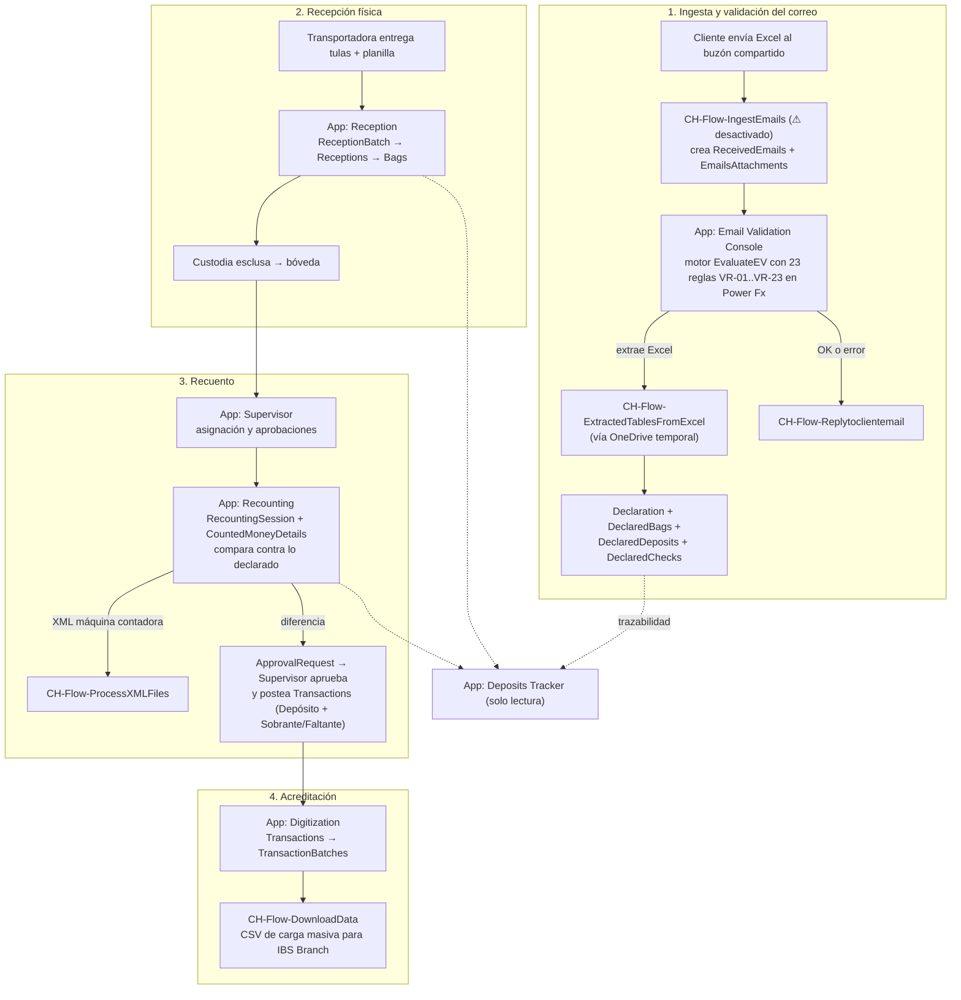

# CashHub — Síntesis del análisis de las 3 soluciones

> Documento de síntesis. El detalle está en:
> [01-core-data-model.md](01-core-data-model.md) · [02-flows.md](02-flows.md) · [03-apps-operativas.md](03-apps-operativas.md) · [04-apps-administrativas.md](04-apps-administrativas.md)

## Qué es CashHub

Digitalización del procesamiento bancario de depósitos en efectivo enviados en bolsas de seguridad (tulas) vía transportadora de valores. Reemplaza la minuta física + digitación manual por: plantilla Excel enviada por correo → validación automática → trazabilidad digital de recepción, bóveda y recuento → carga masiva al core bancario IBS Branch.

Tres soluciones Power Platform (publisher `sanic_`):

| Solución | Contenido |
|---|---|
| **CashHubCore** | 38 tablas Dataverse (`sanic_CHTbl*`), 6 roles de seguridad (`CH-SR-*`), 3 option sets globales, 19 variables de entorno (`sanic_CHEV*`) |
| **CashHubFlow** | 19 flujos Power Automate (`CH-Flow-*`) |
| **CashHubApps** | 8 canvas apps de negocio + 1 model-driven app, 2 bibliotecas de componentes, 1 command library |

## El flujo de punta a punta (según el código real)

Módulo paralelo: **administración de datos maestros del cliente** (RFC = Request For Change): app canvas + model-driven → `ClientDataChangeRequest(Line)` → aprobación por grupos AAD (Contributor/Approver) → webhooks Dataverse disparan `Createclientdata` / `Applyclientdatachanges` / `Activaterow` / `Deactivaterow` → notificaciones Teams con Adaptive Cards (`Notifyreviewers`, `NotifywhenRFCimplementationfinish`).

## Hallazgo arquitectónico central

**La orquestación de validación NO vive en Power Automate: vive en la canvas app Email Validation Console.** En la solución Flow, `ValidationRulesOrchestrator` es un stub (switch vacío), VR02 siempre devuelve Pass, VR04 tiene un bug (ambas ramas Pass) y solo VR01/03/05 validan algo. La app implementa 23 reglas (VR-01..VR-23) en Power Fx. Los flujos VR0x parecen un intento anterior/incompleto de mover la validación al backend.

## Hallazgos críticos (priorizados)

### Seguridad
1. **18 de 38 tablas sin ningún privilegio en ningún rol** (todo el dominio correo/validación, cambios de cliente, `Client`, `TransactionBatches`). 3 de 6 roles (`CH-Role`, `AnalyticsRead`, `OpsAdmin`) no otorgan acceso a ninguna tabla custom.
2. **Las apps no verifican rol**: identidad por `LookUp(Users, PrimaryEmail=User().Email)`; los grupos AAD (`sanic_CHEVAADGroup_*`) solo se usan en el Hub y en Client Administration.
3. **Auto-aprobación en Recounting**: si el cajero recuenta en su mesa asignada, su propia sesión se auto-aprueba — brecha de segregación de funciones.

### Integridad de datos
4. El faltante/sobrante se guarda solo como etiqueta categórica (`Transactions.TransactionType`), **sin monto de la diferencia**.
5. Estado del proceso fragmentado en ≥5 option sets desconectados, sin estado maestro.
6. Relaciones bidireccionales inconsistentes (`Bags↔DeclaredBags` con lookups cruzados en ambos sentidos) y tipos incongruentes entre tablas (AccountNumber int vs decimal).
7. Campo `ChangeStatus` con prefijo de otro publisher (`cr140_`).

### Operación
8. `IngestEmails` (punto de entrada del sistema) está **en Draft/desactivado** en el paquete.
9. Buzón compartido hardcodeado en el trigger (existe `sanic_CHEVSharedMailboxAddress` pero no se usa ahí); el default de la variable apunta a un buzón de dev.
10. Excel temporal en OneDrive nunca se borra; manejo de errores ausente en la mayoría de los flujos.
11. Carga masiva IBS con valores fijos en la app (TRNCODE=8004, identidad de agencia genérica) — existe `sanic_CHEVIbsBranchCodeList` sin explotar.
12. Tras aprobar un RFC de cliente, la materialización depende de los flujos webhook — el vínculo entre soluciones es implícito y frágil.

### Calidad de código
13. Typos en LogicalNames imposibles de renombrar sin recrear campos (`AlternetKey`, `ReasonForForcedFlosure`, `opeationtype`, `fileextention`). Inconsistencia "esclusa/exclusa": el esquema vivo (`Entity.xml` de Bags) y Recounting usan la grafía correcta "esclusa"; Reception, Supervisor, Deposits Tracker y Email Validation Console conservan copias locales cacheadas del esquema con "exclusa" desincronizadas (ver `referencia/typos-conocidos.md` §6 — corrige la dirección reportada originalmente en `03-apps-operativas.md`).
14. Componentes compartidos propios (`sanic_chclsharedcomponents`) incompletos y sin uso: cada app duplica Dialog/Header/Menu.
15. Código de debug (`Notify("Entra")`), bloques comentados y `OnVisible` duplicado sin limpiar.

## Roles vs apps (quién usa qué)

| Rol físico | App | Rol de seguridad esperado |
|---|---|---|
| Oficial de esclusa/bóveda | Reception | CH-SR-Receptionist |
| Cajero de recuento | Recounting | CH-SR-Counter |
| Supervisor de recuento | Supervisor | CH-SR-CountingSupervisor |
| Digitador (transición) | Digitization | — (sin rol mapeado) |
| Analista de correos | Email Validation Console | — (sin rol mapeado) |
| Auditoría/consulta | Deposits Tracker | CH-SR-AnalyticsRead (hoy vacío) |
| Administración de clientes | Client Administration (canvas + model-driven) | grupos AAD Contributor/Approver |
| Todos | Hub | filtro por grupos AAD |
