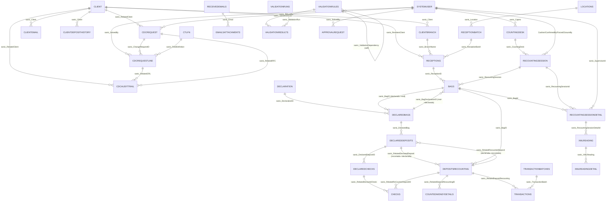

# CashHubCore — Modelo de Datos y Seguridad

> **Nota**: este documento cita los fuentes con la ruta original `src/{core,flow,apps}/`, previa a la reestructuración del repo. La ruta actual es `solutions/unpacked/{core,flow,apps}/`.

Análisis exhaustivo de la solución Dataverse **CashHubCore**, desempaquetada en `src/core/`. Todo dato aquí proviene literalmente de los archivos XML de la solución (`Entities/*/Entity.xml`, `OptionSets/*.xml`, `Roles/*.xml`, `environmentvariabledefinitions/*/environmentvariabledefinition.xml`, `Other/Solution.xml`, `Other/Relationships*`). Donde algo no está documentado en el XML (la mayoría de los campos no tienen `<Description>` de negocio) se indica explícitamente — no se inventa nada.

## Contexto de negocio (proceso físico modelado)

Un **Cliente** (banco corresponsal) envía tulas/bolsas de seguridad con fajos de billetes/cheques + minutas de depósito, vía una **empresa de valores** (transportadora), acompañadas de una **planilla de conducción**, y en paralelo manda un **Excel por correo** declarando el contenido. Un flujo automatizado valida ese correo/Excel. Un **oficial de bóveda** (rol Receptionist) recibe físicamente las bolsas en la esclusa (`ReceptionBatch`/`Receptions`), las traslada a bóveda temporal. Un **supervisor** (rol CountingSupervisor) asigna las bolsas a **cajeros de recuento** (rol Counter) en una mesa de conteo (`RecountingSession`/`CountingDesk`), quienes abren las bolsas y cuentan contra las minutas (`DepositsRecounting`, `CountedMoneyDetails`), generando diferencias (faltante/sobrante) que terminan clasificadas en la transacción final (`Transactions`) que se acredita en el core bancario **IBS Branch**.

---

## 1. Metadata de la solución (`Other/Solution.xml`)

| Campo | Valor |
|---|---|
| UniqueName | `CashHubCore` |
| Nombre visible | CashHub-Core |
| Versión | `1.0.0.5` |
| Managed | `0` (no administrada) |
| Publisher | `Sistemas_Abiertos_Nicaragua` ("Sistemas Abiertos Nicaragua") |
| Descripción del publisher | "Sistemas Abiertos - BacCredomatic NIC" |
| Email de contacto | `hjiron@baccredomatic.ni` |
| CustomizationPrefix | `sanic` |
| CustomizationOptionValuePrefix | `15946` (de ahí que casi todos los option sets locales usen valores `159460000`, `159460001`...) |

**Descripción literal de la solución** (tal cual está en el XML, con sus propios errores de tipeo):
> "Cash Hub Solution: Dataverse tables, columns, relationships, **chouces**, environment variables, **connetion** references, security role"

*(rareza: "chouces" → "choices", "connetion" → "connection"; typos en la descripción oficial de la solución)*

**RootComponents:** las 38 tablas listadas en la tarea, las 6 Security Roles, 3 Option Sets globales, 1 imagen de icono, 8 Web Resources (JS/HTML de soporte al módulo de cambio de datos del cliente), y `sanic_chtblappcatalog` también como App Module component.

**MissingDependencies:** el XML declara explícitamente que `account` (de la solución "System") y `systemuser` (de `msdyn_AppDeploymentMetadata`) son dependencias externas requeridas — confirma que ambas tablas están en la solución solo como referencia, sin personalización propia (ver sección 2.1).

**Web Resources incluidos** (fuera del alcance de esta tarea pero relevantes para el submódulo de cambio de datos del cliente, grupo 6 más abajo): `sanic_ch_webr_changerequestguard`, `sanic_chwebrcrlineduplicateguard.js`, `sanic_chwebrcrlinefilter.js`, `sanic_chwebrcrlineprefilloldvalue.js`, `sanic_chwebrcrlinesaveorchestrator.js`, `sanic_chwebrcrlinetest.js`, `sanic_chwebrcrlinevalidation.js`, `sanic_chwebrproposechange.js` — todo el nombrado indica lógica de formulario para `sanic_CHTblClientDataChangeRequestLine`.

**Archival policies** (`src/core/metadataforarchivals/`): configuradas únicamente para `sanic_chtblreceivedemails`, `sanic_chtblvalidationresults` y `sanic_chtblvalidationruns` — ninguna de las tablas transaccionales de mayor volumen esperado (`Bags`, `Receptions`, `Transactions`, `DepositsRecounting`) tiene política de archivado definida en la solución.

---

## 2. Catálogo de entidades por dominio funcional

38 entidades agrupadas en 6 dominios. Los campos estándar de Dataverse (`createdby/on(/behalfby)`, `modifiedby/on(/behalfby)`, `ownerid`, `owningbusinessunit/team/user`, `statecode/statuscode` cuando son el Active/Inactive genérico, `importsequencenumber`, `overriddencreatedon`, `timezoneruleversionnumber`, `utcconversiontimezonecode`, `versionnumber`, `entityimageid`, `exchangerate`) se omiten del detalle salvo que tengan lógica de negocio agregada.

### 2.1 Maestro / Cliente / Organización física (8 entidades)

| Entidad | Propósito de negocio | Campos clave | Lookups (target resuelto) | Option sets locales |
|---|---|---|---|---|
| **Account** | Entidad estándar de Dataverse **sin ninguna customización** (`unmodified="1"`, `<attributes/>` vacío, 9 líneas de XML). Incluida solo porque la solución la referencia como dependencia. No representa nada del proceso de bóveda. | — | — | — |
| **SystemUser** | Igual que Account: **sin customización** (`unmodified="1"`). Representa a los usuarios internos (cajeros, supervisores, oficial de bóveda, digitadores), pero esos roles NO están modelados con campos propios en SystemUser — viven en Security Roles y en los lookups de otras tablas (`sanic_Cajero`, `sanic_Cashier`, etc.) | — | — | — |
| **sanic_CHTblClient** | Maestro de **Clientes** (banco/entidad corresponsal dueña de las tulas). Tiene 2 claves alternas hacia sistemas externos. | `sanic_name` (req.), `sanic_cifbco`, `sanic_cifcom` (ambos sin descripción, claves alternas `sanic_AlternetKey_CIFBCO`/`CIFCOM` — **typo**: "Alternet" en vez de "Alternate"), `sanic_iseditable` (bit calculado por fórmula, solo lectura), `sanic_recordstatus` (picklist, req., default `159460002`) | — (ninguno declarado en esta tabla) | `sanic_chtblclient_sanic_iseditable`: 1=Yes/0=No |
| **sanic_CHTblClientBranch** | Sucursal/agencia física de un Cliente. | `sanic_name` (req.), `sanic_client` (lookup, req.), `sanic_clientstatus` (calculado por fórmula, default `-1`), `sanic_recordstatus` (editable, default `159460002`) | `sanic_client` → **sanic_CHTblClient** | Usa el global `sanic_chchrecordstatus` para ambos campos de status (ver §3) |
| **sanic_CHTblTransportCompany** | Catálogo de **empresas de valores / transportadoras** (emiten la planilla de conducción). Tabla mínima: solo nombre. | `sanic_name` (req., único campo de negocio) | — | — |
| **sanic_CHTblLocations** | Catálogo de **ubicaciones físicas** (bóvedas/sedes). Tabla mínima: solo nombre, sin picklist de "tipo de ubicación". | `sanic_name` (req., único campo de negocio) | — | — |
| **sanic_CHTblCountingDesk** | **Puesto/mesa de recuento** con máquina contadora, asignado a un cajero. | `sanic_name` (req.), `sanic_cajero` (lookup, req.), `sanic_enable` (bit, default Yes — doble mecanismo de "activo" junto con `statecode`), `sanic_machineserialnumber` (req., **única entidad de todo el grupo 1 con `<Description>` de negocio real**: "Número de serie de maquina BPSC1", en español) | `sanic_cajero` → **SystemUser** (confirmado vía `sanic_chtblcountingdesk_Cajero_systemuser`) | `sanic_chtblcountingdesk_sanic_enable`: 1=Yes/0=No |
| **sanic_CHTblClientEmail** | Direcciones de correo asociadas a un Cliente (para notificaciones). | `emailaddress` (estándar, req. — el dato real del correo), `sanic_name` (autonumerado `CE-{SEQNUM:1}`, **no es el email**), `sanic_client` (lookup, req.), `sanic_alwaysnotify` (bit, req., default No), `sanic_clientstatus`/`sanic_recordstatus` (mismo patrón doble-status que ClientBranch) | `sanic_client` → **sanic_CHTblClient** | `sanic_chtblclientemail_sanic_alwaysnotify`: 1=Yes/0=No |

### 2.2 Declaración del cliente / Bolsas / Cheques / Denominaciones (7 entidades)

Patrón central del dominio: cada concepto tiene una versión **"Declarada"** (lo que el cliente dice en el Excel) y, en algunos casos, una versión **"Real"** (lo verificado físicamente tras el recuento).

| Entidad | Propósito de negocio | Campos clave | Lookups (target resuelto) | Option sets locales |
|---|---|---|---|---|
| **sanic_CHTblDeclaration** | Cabecera de la declaración del cliente (el Excel). Sin campos de negocio propios más allá de una referencia polimórfica manual. | `sanic_name` (autonumerado `Decla-{SEQNUM:4}`), `sanic_sourceentity`/`sanic_sourcerecordid` (texto libre, req. — polimorfismo manual sin integridad referencial) | — | — |
| **sanic_CHTblDeclaredBags** | Bolsa/tula tal como la **declara** el cliente. | `sanic_name` (autonum. `DB-{SEQNUM:7}`), `sanic_bagid` (**lookup** hacia la bolsa real), `sanic_bagnumber` (texto, req.), `sanic_declarationid` (lookup, req.), `sanic_isrelatedtobag` (bit calculado), `sanic_totaldeposits` (rollup), `sanic_totaleur/nio/usd` (decimal) | `sanic_bagid` → **sanic_CHTblBags**; `sanic_declarationid` → **sanic_CHTblDeclaration** | `sanic_chtbldeclaredbags_sanic_isrelatedtobag`: 1=Yes/0=No |
| **sanic_CHTblDeclaredChecks** | Cheque tal como lo **declara** el cliente, dentro de un depósito declarado. | `sanic_checkamount` (req.), `sanic_checkcurrency` (global), `sanic_checknumber` (req., **`IsSecured=1`**), `sanic_checktype` (local, req.), `sanic_declareddepositid` (lookup, req.) | `sanic_declareddepositid` → **sanic_CHTblDeclaredDeposits** | `sanic_chtbldeclaredchecks_sanic_checktype`: 159460000=BAC Local / 159460001=Otros Local |
| **sanic_CHTblDeclaredDeposits** | La **minuta de depósito declarada** (efectivo + cheques por cuenta), dentro de una bolsa declarada. | `sanic_accountnumber` (int, req., `IsSecured=1`), `sanic_currency` (global), `sanic_cashamount`, `sanic_baclocalcheckamount`, `sanic_otherlocalcheckamount`, `sanic_declaredbag` (lookup, req.), `sanic_depositreference` (`IsSecured=1`), `sanic_relatedrecounteddeposit` (lookup), `sanic_total` (calculado), `sanic_transactionno` | `sanic_declaredbag` → **sanic_CHTblDeclaredBags**; `sanic_relatedrecounteddeposit` → **sanic_CHTblDepositsRecounting** | Usa el global `sanic_chchcurrency` |
| **sanic_CHTblBags** | La bolsa **física/real** recibida (contrapartida de DeclaredBags). Modela el ciclo de vida operativo vía `sanic_bagstatus`. | `sanic_name`, `sanic_bagid` (**texto libre**, no lookup — ver rareza), `sanic_bagdeclarationid` (lookup, recom.), `sanic_bagstatus` (local, default `159460000`), `sanic_receptionid` (lookup, req.), `sanic_recountingsession` (lookup), `sanic_totaleur/nio/usd` | `sanic_bagdeclarationid` → **sanic_CHTblDeclaredBags**; `sanic_receptionid` → **sanic_CHTblReceptions**; `sanic_recountingsession` → **sanic_CHTblRecountingSession** | `sanic_chtblbags_sanic_bagstatus`: 159460000=Recibida en esclusa / 159460001=Almacenada en boveda / 159460002=Asignada a cajero / 159460003=Recontada / 159460004=Pendiente rev. supervisor-recuento / 159460005=Pendiente rev. supervisor-esclusa |
| **sanic_CHTblChecks** | El cheque **físico/real** recontado (contrapartida de DeclaredChecks). Modela el ciclo cheque→digitación IBS Branch. | `sanic_name` (autonum. `CK-{SEQNUM:8}`), `sanic_checkamount`, `sanic_checkcurrency` (global), `sanic_checknumber` (req., **sin `IsSecured`** — ver rareza), `sanic_checkstatus` (local), `sanic_checktypes` (local, plural), `sanic_relateddeclaredcheck` (lookup), `sanic_relatedrecounterdepositid` (lookup) | `sanic_relateddeclaredcheck` → **sanic_CHTblDeclaredChecks**; `sanic_relatedrecounterdepositid` → **sanic_CHTblDepositsRecounting** | `sanic_chtblchecks_sanic_checkstatus`: Recontado/Digitado/Rebotado/Enviado a digitacion; `sanic_chtblchecks_sanic_checktypes`: BAC Local/Otros Local (duplica valores de DeclaredChecks en optionset LOCAL distinto) |
| **sanic_CHTblMoneyDenomination** | Catálogo de **denominaciones** (billetes/monedas) por moneda. Tabla catálogo pura. | `sanic_currency` (global, req.), `sanic_enabled` (bit, default Yes), `sanic_type` (local, req.), `sanic_value` (decimal, max 10000) | — (única entidad del grupo sin lookups) | `sanic_chtblmoneydenomination_sanic_enabled`: 1=Yes/0=No; `sanic_chtblmoneydenomination_sanic_type`: 159460000=Billete / 159460001=Moneda |

### 2.3 Recepción física / Bóveda / Recuento (8 entidades)

| Entidad | Propósito de negocio | Campos clave | Lookups (target resuelto) | Option sets locales |
|---|---|---|---|---|
| **sanic_CHTblReceptionBatch** | El **lote/viaje de la transportadora** (esclusa→bóveda). Único lugar donde se modela ese paso del proceso. | `sanic_name` (autonum. `RB-{SEQNUM:5}`), `sanic_transportadora` (texto, req.), `sanic_location` (lookup), `sanic_receptionstatus` (local, default En progreso) | `sanic_location` → **sanic_CHTblLocations** | `sanic_chtblreceptionbatch_sanic_receptionstatus`: 159460000=En progreso / 159460001=Recibido / 159460002=Anulado / 159460003=En boveda |
| **sanic_CHTblReceptions** | Planilla individual (una fila = una planilla/minuta) con montos **declarados** en NIO/USD, cash/cheque. No tiene estado propio ni fecha/hora del evento físico. | `sanic_receiptid` (req.), `sanic_branchname` (lookup), `sanic_receptionbatch` (lookup), `sanic_remitentclient` (lookup, req.), `sanic_remitentname` (texto libre, redundante), `sanic_niocash/niocheck/usdcash/usdcheck` (decimal, recom.) | `sanic_branchname` → **sanic_CHTblClientBranch**; `sanic_receptionbatch` → **sanic_CHTblReceptionBatch**; `sanic_remitentclient` → **sanic_CHTblClient** | — |
| **sanic_CHTblRecountingSession** | **Sesión de conteo**: asignación cajero + mesa de conteo. Sin lookup hacia `ReceptionBatch`/`Reception`, sin fechas de inicio/fin propias. | `sanic_cashier` (lookup, req.), `sanic_countingdesk` (lookup, req.), `sanic_confirmed`/`sanic_confirmedby`, `sanic_sessionforciblyclosed`/`sanic_forcedclosureby`, `sanic_reasonforforcedflosure` (**typo grabado**: "Flosure") | `sanic_cashier`/`sanic_confirmedby`/`sanic_forcedclosureby` → **SystemUser**; `sanic_countingdesk` → **sanic_CHTblCountingDesk** | `sanic_chtblrecountingsession_sanic_confirmed`: Yes/No; `sanic_chtblrecountingsession_sanic_sessionforciblyclosed`: Yes/No |
| **sanic_CHTblRecountingSessionDetail** | Detalle: **qué bolsa** se cuenta dentro de una sesión, con supervisor y estado propio. | `sanic_bagid` (lookup, req.), `sanic_recountingsessionid` (lookup, req.), `sanic_supervisorid` (lookup), `sanic_recountingsessiondetailstatus` (**global**, default `159460000`) | `sanic_bagid` → **sanic_CHTblBags**; `sanic_recountingsessionid` → **sanic_CHTblRecountingSession**; `sanic_supervisorid` → **SystemUser** | Usa el global `sanic_chrecountingdetailsstatus` (ver §3) |
| **sanic_CHTblDepositsRecounting** | Resultado del **conteo real** de una bolsa/depósito (cash + 2 tipos de cheque). No tiene campo de diferencia/faltante-sobrante propio. | `sanic_bagid` (lookup, req.), `sanic_relateddeclareddeposit` (lookup), `sanic_accountnumber` (**int**, `IsSecured=1`), `sanic_cashamount`, `sanic_baclocalcheckamount`, `sanic_otherlocacheckamount` (**typo**: falta "l"), `sanic_currency` (global), `sanic_transactionnumber`, `sanic_total` (calculado) | `sanic_bagid` → **sanic_CHTblBags**; `sanic_relateddeclareddeposit` → **sanic_CHTblDeclaredDeposits** | — |
| **sanic_CHTblCountedMoneyDetails** | Detalle de conteo **por denominación** (desglose billete a billete) dentro de un DepositsRecounting. | `sanic_relateddepositrecountingid` (lookup, req.), `sanic_denomination` (decimal, req.), `sanic_denominationtype` (**texto libre**, no picklist), `sanic_quantity` (int, req.), `sanic_totalamount` (calculado) | `sanic_relateddepositrecountingid` → **sanic_CHTblDepositsRecounting** | — |
| **sanic_CHTblTransactions** | La **transacción final** generada del conteo, clasificada Depósito/Faltante/Sobrante/Sin declaración — el paso de acreditación en IBS Branch. | `sanic_transactionreference` (max 31, interoperabilidad con core), `sanic_accountnumber` (**decimal**, `IsSecured=1`), `sanic_cashamount`, `sanic_baclocalcheckamount`, `sanic_otherlocalcheckamount` (bien escrito acá), `sanic_currency` (global), `sanic_transactionbatch` (lookup), `sanic_relateddepositrecounting` (lookup), `sanic_transactionprocessingtype` (local), `sanic_transactionstatus` (local, **solo 1 valor**), `sanic_transactiontype` (local, **campo clave de la "hoja de diferencia"**), `sanic_total` (calculado) | `sanic_transactionbatch` → **sanic_TransactionBatches**; `sanic_relateddepositrecounting` → **sanic_CHTblDepositsRecounting** | `..._transactionprocessingtype`: Manual/Batch; `..._transactionstatus`: Aplicada (único valor); `..._transactiontype`: Deposito/Faltante/Sobrante/Sin declaracion |
| **sanic_TransactionBatches** | Lote de transacciones enviado al core, con ciclo de estado completo. | `sanic_batchstatus` (local, default Generado, **`RequiredLevel=none`** pese a ser crítico), `sanic_comentarios` (texto libre, **en español** — único campo así en el grupo) | — | `sanic_transactionbatches_sanic_batchstatus`: Generado→Ingresado→Aprobado→Aplicado |

### 2.4 Correo entrante / Lectura XML / Validación (8 entidades)

| Entidad | Propósito de negocio | Campos clave | Lookups (target resuelto) | Option sets locales |
|---|---|---|---|---|
| **sanic_CHTblReceivedEmails** | El **correo crudo** recibido del cliente (metadatos de Outlook/Exchange), con estado de revisión/respuesta y un veredicto de validación global. | `sanic_attachment` (file, `IsSecured=1`), `sanic_emailreplystatus`, `sanic_emailreviewmethod`, `sanic_emailreviewstatus`, `sanic_errorcode`/`sanic_errortext`, `sanic_receivedemailinternetmessageid`/`outlookuniqueid` (req.), `sanic_receptiondatetime`, `sanic_repliedby` (`IsSecured=1`), `sanic_replydatetime`, `sanic_replyemailinternetmessageid`/`outlookuniqueid`, `sanic_sourceemailaddress` (req., `IsSecured=1`), `sanic_subject` (`IsSecured=1`), `sanic_validationstatus` | — (sin lookups custom en esta entidad) | 4 optionsets locales: EmailReplyStatus (Pendiente/Respondido/Omitido), EmailReviewMethod (Manual/Auto), EmailReviewStatus (6 valores: Pendiente/Aceptado/Omitido/Revision manual/Error/Denegado), ValidationStatus (Pendiente/Valido/Invalido) |
| **sanic_CHTblEmailsAttachments** | El **adjunto/Excel** extraído del correo, normalizado, más su representación en JSON parseado. | `sanic_emailattachmentid` (req.), `sanic_filename` (req.), `sanic_fileextention` (**typo**: "Extention"), `sanic_tamanoenbytes` (int, **en español**), `sanic_filecontent` (file), `sanic_jsondata` (**file**, no texto; solo lectura tras creación), `sanic_email` (lookup, req.) | `sanic_email` → **sanic_CHTblReceivedEmails** | — |
| **sanic_CHTblXMLReading** | Cabecera de una **lectura/parseo** del XML/Excel de la declaración, vinculada a la sesión de recuento físico. | `sanic_filename` (req.), `sanic_isactive` (bit, default Yes), `sanic_recountingsessiondetailid` (lookup, req.) | `sanic_recountingsessiondetailid` → **sanic_CHTblRecountingSessionDetail** (puente digital↔físico) | `sanic_chtblxmlreading_sanic_isactive`: Yes/No |
| **sanic_CHTblXMLReadingDetail** | Línea por línea del parseo (moneda/denominación/cantidad/subtotal). | `sanic_currency` (**texto libre**, no lookup/optionset), `sanic_denomination` (decimal), `sanic_quantity` (int), `sanic_subtotal` (calculado por fórmula), `sanic_xmlreading` (lookup, req.) | `sanic_xmlreading` → **sanic_CHTblXMLReading** | — |
| **sanic_CHTblValidationResults** | Resultado de aplicar **una** regla de validación dentro de una corrida. Unidad atómica de auditoría del motor de reglas. | `sanic_durationms` (int, telemetría), `sanic_sourcetype` (local, único valor "Shared Mailbox"), `sanic_validationresult` (local: Pass/Fail), `sanic_validationrule` (lookup, req.), `sanic_validationrun` (lookup, req.) | `sanic_validationrule` → **sanic_ValidationRules**; `sanic_validationrun` → **sanic_CHTblValidationRuns** | `..._sourcetype`: Shared Mailbox; `..._validationresult`: Pass/Fail |
| **sanic_CHTblValidationRuns** | La **corrida completa** de validación contra un registro origen, con ventana de tiempo y veredicto global (con colores UI: Pass verde, Fail rojo). | `sanic_runstart` (req.), `sanic_runend`, `sanic_runresult` (local, con `Color`), `sanic_sourceentity`/`sanic_sourcerecordid` (texto, req. — polimorfismo manual), `sanic_sourcetype` (local, req.) | — (vínculo polimórfico por texto, sin lookup real) | `..._runresult`: Pass(#08a623)/Fail(#db0000); `..._sourcetype`: Shared Mailbox |
| **sanic_ValidationRules** | **Motor de reglas de validación configurable** — confirmado: tipo de dato, operador, valor de referencia, orden, mensaje de error, activo/inactivo, posible dependencia entre reglas. | `sanic_validationname` (req.), `sanic_isactive` (req., default Yes), `sanic_validationorder` (int), `sanic_validationdatatype` (local, req.), `sanic_validationoperation` (local), `sanic_validationvalue` (req.), `sanic_validationfailmessage` (req.), `sanic_notes`, `sanic_sourcetype` (local, req.), `sanic_validationdependency` (lookup, auto-referencia) | `sanic_validationdependency` → **sanic_ValidationRules** (self-reference) | `..._validationdatatype`: numeric/text/datetime/boolean; `..._validationoperation`: equal/less than/less than or equal/greater than/greater than or equal/contains/empty/begins with/ends with; `..._sourcetype`: Shared Mailbox; `..._isactive`: Yes/No |
| **sanic_CHTblClientDepositHistory** | Histórico acumulado de depósitos por cliente (para detección de anomalías). Sorprendentemente escueta: sin monto, fecha ni moneda. | `sanic_client` (lookup, req.), `sanic_chchrecordstatus` (**global**) | `sanic_client` → **sanic_CHTblClient** | Usa el global `sanic_chchrecordstatus` |

### 2.5 Administración: catálogo de apps, aprobaciones y cambios de datos del cliente (7 entidades)

| Entidad | Propósito de negocio | Campos clave | Lookups (target resuelto) | Option sets locales |
|---|---|---|---|---|
| **sanic_CHTblAppCatalog** | Catálogo data-driven de **apps del Hub**, filtradas por grupo AAD (descripción literal del XML: "Central source for which app exist... Works with AAD groups checks to show only the apps a user should see."). | `sanic_aadgroupid`, `sanic_appkey` (req., clave única `sanic_AppKey_Unique`), `sanic_appurl`, `sanic_description`, `sanic_displayname` (req.), `sanic_enabled` (bit, req.), `sanic_icon` (imagen), `sanic_order` (int, req.), `sanic_tags` | — | `..._enabled`: Yes/No |
| **sanic_CHTblApprovalRequest** | Solicitud de aprobación **genérica** (no ligada a un módulo específico — `TargetTable`/`TargetRecordID` son texto libre). | `sanic_approvalstatus` (local, labels en **español**), `sanic_requestdetails`, `sanic_requestresources`, `sanic_requesttype` (req.), `sanic_resolutiondatetime`, `sanic_solvedby` (lookup), `sanic_statusreason`, `sanic_targetrecordid`/`sanic_targettable` (texto libre) | `sanic_solvedby` → **SystemUser** | `..._approvalstatus`: 159460000=Aprobado / 159460001=Rechazado |
| **sanic_CHTblClientDataChangePermission** | Define **quién** (grupo AAD/Teams) puede participar en el flujo de cambio de datos del cliente, y con qué rol (Contributor/Approver). | `sanic_aadgroupid` (req.), `sanic_teamsgroupid`, `sanic_type` (local, req., default Contributor) | — | `..._type`: Contributor/Approver |
| **sanic_CHTblClientDataChangeRequest** | Cabecera de la **solicitud de cambio de dato del cliente**, con ciclo de vida completo. `IsQuickCreateEnabled=1` (única del grupo). | **`cr140_changestatus`** (picklist, **prefijo de otro publisher** — ver rareza), `sanic_applynotes`, `sanic_applyon`, `sanic_reason` (req.), `sanic_reasonfordecision`, `sanic_relatedclient` (lookup), `sanic_solvedby` (lookup), `sanic_solvedon`, `sanic_targetrecordid`/`sanic_targettable`/`sanic_targettabledisplayname`/`sanic_targettablepluralname` (texto libre), `sanic_type` (local) | `sanic_relatedclient` → **sanic_CHTblClient**; `sanic_solvedby` → **SystemUser** | `cr140_..._changestatus`: Draft/Submited(sic)/Approved/Rejected/Applied/Failed (rango `796490xxx`) + Canceled (`159460001`, rango distinto); `..._type`: Update/Deactivate/Create/Activate |
| **sanic_CHTblClientDataChangeRequestLine** | Línea de detalle: campo específico a cambiar, valor viejo/nuevo, sub-estado propio de aprobación. | `sanic_changerequestid` (lookup, req.), `sanic_changestatus` (local, default Draft), `sanic_fielddefinition` (lookup, req.), `sanic_newvalue` (req.), `sanic_oldvalue`, `sanic_reasonfordecision`, `sanic_solvedby` (lookup), `sanic_solvedon` | `sanic_changerequestid` → **sanic_CHTblClientDataChangeRequest**; `sanic_fielddefinition` → **sanic_CHTblClientTableLogicalFieldName**; `sanic_solvedby` → **SystemUser** | `..._changestatus`: Draft/Submitted/Approved/**Denied**/Applied/Failed/Canceled (vocabulario distinto a la cabecera, que usa "Rejected") |
| **sanic_CHTblClientDataChangesAuditTrail** | Rastro de auditoría de cambios **ya aplicados** (create/update/activate/deactivate), con resultado success/fail. | `sanic_message`, `sanic_opeationtype` (**typo**: falta "r" de "Operation", local), `sanic_relatedclient` (lookup), `sanic_relatedcrl` (lookup), `sanic_relatedrfc` (lookup, req.), `sanic_result` (bit, default Fail) | `sanic_relatedclient` → **sanic_CHTblClient**; `sanic_relatedcrl` → **sanic_CHTblClientDataChangeRequestLine**; `sanic_relatedrfc` → **sanic_CHTblClientDataChangeRequest** | `..._opeationtype`: Create/Update/Deactivate/Activate; `..._result`: 1=Success/0=Fail |
| **sanic_CHTblClientTableLogicalFieldName** | **Diccionario de metadata**: mapea nombre lógico de campo + tabla + tipo de dato + si está permitido, para el flujo genérico/data-driven de cambio de datos. | `sanic_datatype` (local, req.: Text/Number/Date/Money/Lookup/OptionSet/TwoOptions), `sanic_isallowed` (bit, req., default Yes), `sanic_logicalname`, `sanic_lookuptargettable` (**texto libre**, no lookup real), `sanic_optionsetmap` (texto/JSON libre), `sanic_table` (texto libre), `sanic_tabledisplayname` (req.), `sanic_tablepluralname` | — (por diseño: describe metadata de otras tablas mediante texto, no relaciones nativas) | `..._datatype`: Text/Number/Date/Money/Lookup/OptionSet/TwoOptions; `..._isallowed`: Yes/No |

---

## 3. Option Sets globales (`src/core/OptionSets/`)

| Schema Name | Display Name | Valores |
|---|---|---|
| `sanic_chchcurrency` | CH-Ch-Currency | `159460000`=NIO · `159460001`=USD · `159460002`=EUR |
| `sanic_chchrecordstatus` | CH-Ch-RecordStatus | `159460000`=Active · `159460001`=Inactive · `159460002`=PendingApproval · `159460003`=PendingDeactivation |
| `sanic_chrecountingdetailsstatus` | ch-recountingDetailsStatus | `159460000`=En progreso · `159460001`=Cerrado · `159460002`=Cerrado con diferencias |

`sanic_chchcurrency` se usa en: DeclaredChecks, DeclaredDeposits, Checks, MoneyDenomination, DepositsRecounting, Transactions.
`sanic_chchrecordstatus` se usa en: Client, ClientBranch, ClientEmail, ClientDepositHistory — siempre bajo el nombre de campo `sanic_recordstatus` (y en 2 de 4 casos, también `sanic_clientstatus` calculado).
`sanic_chrecountingdetailsstatus` se usa solo en RecountingSessionDetail.

---

## 4. Variables de entorno (`src/core/environmentvariabledefinitions/`)

19 variables, todas `iscustomizable=1`, `isrequired=0`, `secretstore=0` (ninguna se guarda en Azure Key Vault). Tipo `100000000` = String, `100000001` = Number (valores estándar del option set de tipo de Environment Variable de Dataverse; no están definidos en estos archivos individuales sino que son parte del esquema base de la plataforma).

| Variable | Tipo | Valor por defecto | Propósito |
|---|---|---|---|
| `sanic_CHEVAADGroup_Admin` | String | — | Grupo AAD para el rol de administración |
| `sanic_CHEVAADGroup_ClientAdmin` | String | — | Grupo AAD para administración de datos del cliente |
| `sanic_CHEVAADGroup_Counting` | String | — | Grupo AAD para cajeros de recuento |
| `sanic_CHEVAADGroup_EmailValidation` | String | — | Grupo AAD para el módulo de validación de correo |
| `sanic_CHEVAADGroup_Reception` | String | — | Grupo AAD para oficiales de bóveda/recepción |
| `sanic_CHEVAADGroup_Supervisor` | String | — | Grupo AAD para supervisores de conteo |
| `sanic_CHEVAppUrl_ClientAdmin` | String | — | URL de la app modelo-controlada de administración de clientes |
| `sanic_CHEVAppUrl_Counting` | String | — | URL de la app de conteo |
| `sanic_CHEVAppUrl_EmailValidation` | String | — | URL de la app de validación de correo |
| `sanic_CHEVAppUrl_Reception` | String | — | URL de la app de recepción |
| `sanic_CHEVAppUrl_Supervisor` | String | — | URL de la app de supervisión |
| `sanic_CHEVCsvExportLibraryUrl` | String | — | URL de una librería para exportar CSV |
| `sanic_CHEVEmailSubjectToAccept` | String | — | Asunto de correo que el flujo acepta/reconoce |
| `sanic_CHEVFileSizeMaxMB` | Number | `5` | Tamaño máximo de archivo adjunto permitido (MB) |
| `sanic_CHEVIbsBranchCodeList` | String | — | Lista de códigos de sucursal del core bancario IBS Branch |
| `sanic_CHEVProcessingLibraryUrl` | String | — | URL de una librería de procesamiento (probablemente Azure Function/Function App) |
| `sanic_CHEVSharedMailboxAddress` | String | `no-reply-powerplatform-dev@baccredomatic.ni` | Dirección del buzón compartido donde llegan los correos de clientes (nota: dirección de **ambiente dev**, no productiva) |
| `sanic_CHEVSharedMailboxArchiveFolderID` | String | `AAMkADgz...` (ID de carpeta Outlook) | Carpeta de archivo del buzón compartido tras procesar el correo |
| `sanic_CHEVTimezone` | String | `America/Managua` | Zona horaria de referencia del sistema |

**Rareza:** el `sanic_CHEVSharedMailboxAddress` tiene como valor por defecto una dirección con el literal `-dev-` en el dominio (`no-reply-powerplatform-dev@baccredomatic.ni`) — si esta solución se importó a producción sin sobreescribir esta variable de entorno (común en ALM de Dataverse via connection/environment variable overrides por ambiente), el flujo de producción seguiría escuchando el buzón de desarrollo.

---

## 5. Roles de seguridad (`src/core/Roles/`)

6 Security Roles, todos `IsAutoAssigned=0`. Todos los privilegios sobre tablas custom que sí existen están a **nivel Global** (organización completa) — no hay ninguna restricción a nivel User/BU en las tablas de negocio.

### 5.1 Hallazgo crítico: 3 de 6 roles no dan acceso a NINGUNA tabla de negocio

- **`CH-Role`**: solo privilegios genéricos de plataforma (Workflow, SharePoint, Team, User, etc.) + `prvReadsanic_CHTblAppCatalog` (Global). Ningún otro privilegio sobre ninguna tabla `sanic_*`.
- **`CH-SR-AnalyticsRead`**: privilegios idénticos a los genéricos de `CH-Role`, mismo listado, pero **ni siquiera incluye** `prvReadsanic_CHTblAppCatalog`. **Cero privilegios sobre cualquier tabla custom.** Un rol llamado "lectura de analítica" que no puede leer ninguna tabla de negocio es, tal como está exportado, no funcional para su propósito — o el reporting se resuelve fuera de Dataverse, o el rol quedó sin terminar de configurar.
- **`CH-SR-OpsAdmin`**: exactamente el mismo problema — privilegios idénticos a `CH-SR-AnalyticsRead` (genéricos, cero sobre tablas custom). Un rol de "administración de operaciones" sin ningún privilegio sobre las tablas operativas es una bandera de seguridad/configuración a revisar antes de asignarlo a usuarios reales.

### 5.2 Roles operativos con privilegios reales

- **`CH-SR-Counter`** (cajero de recuento): CRUD completo sobre el núcleo del proceso de conteo (`Bags`, `Checks`, `CountedMoneyDetails`, `DepositsRecounting`, `RecountingSession`, `Transactions`, `ApprovalRequest`), y solo lectura/append sobre catálogos y cabeceras que no crea (`Declaration`, `DeclaredBags`, `DeclaredChecks`, `DeclaredDeposits`, `CountingDesk`, `Locations`, `MoneyDenomination`, `ReceptionBatch`, `Receptions`, `TransportCompany`).
- **`CH-SR-CountingSupervisor`**: lectura amplia (mismas 17 tablas que Counter), pero Create limitado a `Bags`/`Checks`/`Transactions`, Write sobre `ApprovalRequest`/`Bags`/`Checks`/`ReceptionBatch`/`Receptions`/`RecountingSession`/`Transactions`, y puede **Assign** sobre `ApprovalRequest`. **Rareza:** el proceso de negocio dice que "un supervisor asigna planillas a cajeros", pero el rol Supervisor **no tiene privilegio de Create sobre `RecountingSession`** (solo Delete) — es el rol **Counter** el que sí puede crearla. La creación técnica de la sesión de conteo queda en manos del cajero, no del supervisor, lo cual contradice la descripción narrativa del proceso.
- **`CH-SR-Receptionist`** (oficial de bóveda): CRUD sobre `Bags`/`ReceptionBatch`/`Receptions`/`ApprovalRequest`/`TransportCompany`, append/read sobre `DeclaredBags`/`Locations`. No tiene ningún privilegio sobre las tablas de conteo (`RecountingSession`, `DepositsRecounting`, `Checks`, `CountedMoneyDetails`) — coherente con que su función termina al dejar la bolsa en bóveda.

### 5.3 Matriz Rol × Entidad (solo entidades con algún privilegio; C=Create R=Read W=Write D=Delete A=Append T=AppendTo S=Assign; todo nivel Global)

| Entidad | CH-Role | AnalyticsRead | Counter | CountingSupervisor | OpsAdmin | Receptionist |
|---|---|---|---|---|---|---|
| AppCatalog | R | — | R | R | — | R |
| ApprovalRequest | — | — | C,R,W | A,T,S,R,W | — | C,R,W |
| Bags | — | — | A,T,R,W | C,R,W | — | A,T,C,D,R,W |
| Checks | — | — | A,T,C,D,R,W | C,R,W | — | — |
| CountedMoneyDetails | — | — | A,T,C,D,R,W | — | — | — |
| CountingDesk | — | — | A,T,R | R | — | — |
| Declaration | — | — | A,T,R | R | — | — |
| DeclaredBags | — | — | A,T,R | R | — | A,T,R |
| DeclaredChecks | — | — | A,T,R | R | — | — |
| DeclaredDeposits | — | — | A,T,R | R | — | — |
| DepositsRecounting | — | — | A,T,C,D,R,W | R | — | — |
| Locations | — | — | A,T,R | R | — | A,T,R |
| MoneyDenomination | — | — | A,T,R | R | — | — |
| ReceptionBatch | — | — | A,T,R | R,W | — | A,T,C,R,W |
| Receptions | — | — | A,T,R | R,W | — | A,T,C,D,R,W |
| RecountingSession | — | — | A,T,C,D,R,W | D,R,W | — | — |
| Transactions | — | — | A,T,C,R,W | C,R,W | — | — |
| TransportCompany | — | — | R | R | — | A,T,R,W |

### 5.4 Entidades SIN ningún privilegio en ningún rol (18 de 38)

**Ninguno de los 6 Security Roles otorga ningún privilegio** sobre: `sanic_CHTblClient`, `sanic_CHTblClientBranch`, `sanic_CHTblClientEmail`, `sanic_CHTblClientDepositHistory`, `sanic_CHTblReceivedEmails`, `sanic_CHTblEmailsAttachments`, `sanic_CHTblXMLReading`, `sanic_CHTblXMLReadingDetail`, `sanic_CHTblValidationResults`, `sanic_CHTblValidationRuns`, `sanic_ValidationRules`, `sanic_TransactionBatches`, `sanic_CHTblClientDataChangePermission`, `sanic_CHTblClientDataChangeRequest`, `sanic_CHTblClientDataChangeRequestLine`, `sanic_CHTblClientDataChangesAuditTrail`, `sanic_CHTblClientTableLogicalFieldName`, y las estándar `Account`/`SystemUser`. Esto cubre por completo los dominios 2.4 (correo/validación) y 2.5 (administración/cambios de cliente), más el maestro de Clientes y `TransactionBatches`. En Dataverse esto normalmente significa que ese acceso se resuelve por otra vía no incluida en esta solución (rol System Administrator implícito, un Application User/Service Principal de un flujo con permisos elevados, o Security Roles definidas en otra solución) — pero **dentro de los archivos de esta solución, ningún usuario humano con estos 6 roles puede crear, leer, ni editar un Cliente, un correo recibido, una regla de validación o una solicitud de cambio de datos**.

---

## 6. Diagrama del modelo de datos (relaciones custom, Mermaid ER)

*(Alias usados: CLIENT=sanic_CHTblClient, CLIENTBRANCH=sanic_CHTblClientBranch, CLIENTEMAIL=sanic_CHTblClientEmail, CLIENTDEPOSITHISTORY=sanic_CHTblClientDepositHistory, LOCATIONS=sanic_CHTblLocations, COUNTINGDESK=sanic_CHTblCountingDesk, DECLARATION=sanic_CHTblDeclaration, DECLAREDBAGS=sanic_CHTblDeclaredBags, DECLAREDCHECKS=sanic_CHTblDeclaredChecks, DECLAREDDEPOSITS=sanic_CHTblDeclaredDeposits, BAGS=sanic_CHTblBags, CHECKS=sanic_CHTblChecks, RECEPTIONBATCH=sanic_CHTblReceptionBatch, RECEPTIONS=sanic_CHTblReceptions, RECOUNTINGSESSION=sanic_CHTblRecountingSession, RECOUNTINGSESSIONDETAIL=sanic_CHTblRecountingSessionDetail, DEPOSITSRECOUNTING=sanic_CHTblDepositsRecounting, COUNTEDMONEYDETAILS=sanic_CHTblCountedMoneyDetails, TRANSACTIONS=sanic_CHTblTransactions, TRANSACTIONBATCHES=sanic_TransactionBatches, RECEIVEDEMAILS=sanic_CHTblReceivedEmails, EMAILSATTACHMENTS=sanic_CHTblEmailsAttachments, XMLREADING=sanic_CHTblXMLReading, XMLREADINGDETAIL=sanic_CHTblXMLReadingDetail, VALIDATIONRESULTS=sanic_CHTblValidationResults, VALIDATIONRUNS=sanic_CHTblValidationRuns, VALIDATIONRULES=sanic_ValidationRules, APPROVALREQUEST=sanic_CHTblApprovalRequest, CDCREQUEST=sanic_CHTblClientDataChangeRequest, CDCREQUESTLINE=sanic_CHTblClientDataChangeRequestLine, CDCAUDITTRAIL=sanic_CHTblClientDataChangesAuditTrail, CTLFN=sanic_CHTblClientTableLogicalFieldName, SYSTEMUSER=SystemUser.)*

**Tablas catálogo sin ninguna relación custom (no aparecen en el diagrama):** `sanic_CHTblTransportCompany`, `sanic_CHTblMoneyDenomination`, `sanic_CHTblAppCatalog`, `sanic_CHTblClientDataChangePermission`, y la estándar `Account`.

**Hallazgo notable del modelo:** hay **dos pares de tablas con relación bidireccional** (dos lookups cruzados entre las mismas dos tablas, uno en cada sentido): `Bags` ↔ `DeclaredBags` (`DeclaredBags.sanic_BagID → Bags` y `Bags.sanic_BagDeclarationID → DeclaredBags`) y `DeclaredDeposits` ↔ `DepositsRecounting` (`DepositsRecounting.sanic_RelatedDeclaredDeposit → DeclaredDeposits` y `DeclaredDeposits.sanic_RelatedRecountedDeposit → DepositsRecounting`). El par equivalente de Cheques (`Checks`/`DeclaredChecks`) **no** es bidireccional — solo `Checks.sanic_RelatedDeclaredCheck → DeclaredChecks`, sin el lookup inverso. Inconsistencia de patrón entre los 3 pares "declarado/real" del modelo.

---

## 7. Resumen ejecutivo de hallazgos y rarezas transversales

1. **Seguridad: 3 de 6 roles (CH-Role, AnalyticsRead, OpsAdmin) no dan acceso a ninguna tabla de negocio**, y **18 de 38 entidades** (todo correo/validación, todo el módulo de cambio de datos de cliente, el maestro de Clientes y TransactionBatches) **no tienen NINGÚN privilegio en NINGÚN rol** de la solución — el acceso a esas tablas debe resolverse fuera de este paquete (System Administrator, Service Principal, u otra solución).
2. **El "faltante/sobrante" no se persiste como monto** en ningún campo numérico de diferencia — solo existe como etiqueta categórica (`sanic_TransactionType`) en la última entidad del flujo (`Transactions`). El cálculo de la diferencia vive fuera de Dataverse.
3. **El estado del proceso está fragmentado en al menos 5 optionsets desconectados** entre sí (`ReceptionBatch.ReceptionStatus`, `RecountingSessionDetail` con el global `sanic_chrecountingdetailsstatus`, `Bags.BagStatus`, `Transactions.TransactionType/Status`, `TransactionBatches.BatchStatus`) — no existe un estado maestro de "expediente de depósito" de punta a punta.
4. **Relaciones bidireccionales inconsistentes**: `Bags`↔`DeclaredBags` y `DeclaredDeposits`↔`DepositsRecounting` tienen lookups cruzados en ambos sentidos; `Checks`↔`DeclaredChecks` solo en un sentido.
5. **Prefijo de publisher ajeno**: el campo más crítico del flujo de cambio de datos (`ChangeStatus` en `ClientDataChangeRequest`) usa el prefijo `cr140_` en vez de `sanic_`, y su optionset mezcla rangos `796490xxx` con un valor suelto `159460001` — evidencia de un campo importado de otra solución/publisher.
6. **Ausencia casi total de `<Description>` de negocio** en los ~38 archivos: salvo un puñado de excepciones (AppCatalog, ValidationRules, `sanic_machineserialnumber`), el modelo no está autodocumentado.
7. **Typos consolidados en LogicalNames** (no corregibles sin recrear el campo): `sanic_AlternetKey_CIFBCO/CIFCOM` (Client), `sanic_ReasonForForcedFlosure` (RecountingSession), `sanic_OtherLocaCheckAmount` (DepositsRecounting), `sanic_opeationtype` (ClientDataChangesAuditTrail), `sanic_fileextention` (EmailsAttachments).
8. **Inconsistencias de tipo de dato para el mismo concepto** entre tablas relacionadas: `AccountNumber` es `int` en `DepositsRecounting` pero `decimal` en `Transactions`; `sanic_bagid` es `lookup` en `DeclaredBags` pero `nvarchar` en `Bags`.
9. **Idioma mixto** en labels/campos: mayoría en inglés, pero `TransactionBatches.sanic_Comentarios`, `ApprovalRequest.sanic_approvalstatus` (Aprobado/Rechazado) y `sanic_machineserialnumber` están en español.
10. **`Account` y `SystemUser` no tienen ninguna personalización** — son stubs (`unmodified="1"`) incluidos solo por dependencia.
11. **Variable de entorno con valor default de ambiente dev** (`sanic_CHEVSharedMailboxAddress`) — riesgo si no se sobreescribe al desplegar a producción.
12. **Políticas de archivado configuradas solo para 3 tablas** (correos recibidos, resultados y corridas de validación) — ninguna de las tablas transaccionales de mayor volumen (Bags, Receptions, Transactions) tiene retención definida en esta solución.
