# CashHubFlow — Análisis de Power Automate

> **Nota**: este documento cita los fuentes con la ruta original `src/{core,flow,apps}/`, previa a la reestructuración del repo. La ruta actual es `solutions/unpacked/{core,flow,apps}/`.

Fuente: `/home/gmaker/projects/CashHub/src/flow/Workflows/*.json` (+ `.json.data.xml` de metadata).
Todo el contenido de este documento sale de leer esos archivos con `python3`/`json` — nada inventado. Se citan expresiones y valores literales cuando son relevantes.

Son **19 flujos** (17 `.json` reales + `Ch-Flow-VR02` con mayúscula distinta en el nombre de archivo, y `ValidationRulesOrchestrator`). Todos son **Cloud Flows** (`Category=5` en el `.json.data.xml`).

---

## 0. Hallazgo crítico antes de entrar en el detalle

**`CH-Flow-IngestEmails` está en `StateCode=0 / StatusCode=1` (Draft/Off).** Es el ÚNICO flujo de los 19 que no está activado (todos los demás tienen `StateCode=1 / StatusCode=2`, Activado). Es decir: el flujo que dispara TODA la cadena (recepción de correo del cliente) está apagado en este export. Si esto refleja el estado real del ambiente, el sistema completo no está procesando correos.

---

## 1. Inventario de flujos (una línea cada uno)

| # | Flujo | Trigger | Propósito en una línea |
|---|-------|---------|-------------------------|
| 1 | **IngestEmails** | Automatizado — correo entrante en buzón compartido (polling 1 min) | Detecta duplicados por `internetMessageId`/id de Outlook y crea el registro de correo + adjuntos en Dataverse. **Desactivado (Draft).** |
| 2 | **ExtractedTablesFromExcel** | Instantáneo (`PowerAppV2`, llamable como child flow) | Descarga el adjunto Excel de Dataverse, lo sube a OneDrive `/tmp`, lee todas las tablas del libro con el conector Excel Online Business, arma un JSON consolidado y lo vuelve a guardar en Dataverse. |
| 3 | **GetJSONdatafromattachment** | Instantáneo (`PowerAppV2`) | Descarga el campo archivo `sanic_jsondata` de un adjunto y lo devuelve como string (decodificado de base64) a quien lo llamó. |
| 4 | **ValidationRulesOrchestrator** | Instantáneo (`PowerAppV2`) | Switch por nombre de regla (`VR01`…) pensado para despachar a los flujos VR0x. **Las ramas están vacías — es un stub sin implementar.** |
| 5 | **VR01** | Instantáneo (`Button`, llamable como child flow) | Valida que la cantidad de archivos adjuntos recibida coincida con un valor esperado (`number == int(text)`). |
| 6 | **VR02** | Instantáneo (`Button`) | Debería validar el dominio/formato del `EmailAddress` del remitente. **No implementa ninguna lógica: siempre responde `Pass`.** |
| 7 | **VR03** | Instantáneo (`Button`) | Valida que el `EmailSubject` empiece con el valor esperado (`startsWith`, case-insensitive). |
| 8 | **VR04** | Instantáneo (`Button`) | Debería validar la extensión del adjunto contra un valor esperado. **Bug: ambas ramas del `If` responden `Pass`, la validación nunca puede fallar.** |
| 9 | **VR05** | Instantáneo (`Button`) | Valida que el tamaño del adjunto sea menor o igual a un máximo (`lessOrEquals`). |
| 10 | **Replytoclientemail** | Instantáneo (`PowerAppV2`) | Responde (Reply V3) un correo del buzón compartido con el cuerpo indicado por quien lo invoca. |
| 11 | **ProcessXMLFiles** | Instantáneo (`PowerAppV2`) | Procesa los XML de una máquina contadora de efectivo (por `SessionID`/`MachineSerial`) leídos desde OneDrive, crea/actualiza `sanic_chtblxmlreadings` y `sanic_chtblxmlreadingdetails`, y mueve el archivo procesado. |
| 12 | **DownloadData** | Instantáneo (`PowerAppV2`) | Genera un CSV a partir de datos recibidos, lo sube a OneDrive y devuelve un link para compartir. |
| 13 | **Activaterow** | Automatizado — webhook Dataverse (RFC `Approved` + tipo `Activate`) | Aplica un RFC de tipo Activar: pone `sanic_recordstatus = Active` en Client/ClientBranch/ClientEmail según la tabla objetivo, y audita. |
| 14 | **Deactivaterow** | Automatizado — webhook Dataverse (RFC `Approved` + tipo `Deactivate`) | Igual que el anterior pero pone `sanic_recordstatus = Inactive`. |
| 15 | **Applyclientdatachanges** | Automatizado — webhook Dataverse (RFC `Approved` + tipo `Update`) | Aplica cada línea de cambio (`CRL`) de un RFC de tipo Update sobre la tabla/columna objetivo, con conversión de tipo por Switch. |
| 16 | **Createclientdata** | Automatizado — webhook Dataverse (RFC `Approved` + tipo `Create`) | Crea un registro nuevo en la tabla objetivo con los valores de las líneas del RFC, y lo audita. |
| 17 | **Notifyreviewers** | Automatizado — webhook Dataverse (RFC `Submitted`) | Arma una Adaptive Card y la publica en Teams para los aprobadores del cambio; si no existe el chat grupal lo crea (child flow). |
| 18 | **NotifywhenRFCimplementationfinish** | Automatizado — webhook Dataverse (RFC `Failed`/`Applied`/`Rejected`) | Notifica por Teams (mensaje directo) al creador y al aprobador del resultado final del RFC. |
| 19 | **CreateaTeamschatgroupbasedonOffice365Group** | Instantáneo (`Button`, child flow) | Dado un grupo AAD, lista sus miembros y crea un chat grupal de Teams; devuelve el `chatid`. |

Todos los triggers de tipo `OpenApiConnectionWebhook` usan `SubscribeWebhookTrigger` sobre `sanic_chtblclientdatachangerequest` (tabla de RFC de cambios de datos de cliente) — son disparadores nativos de Dataverse (creación/actualización de fila con filtro OData), no polling.

---

## 2. Cadena de orquestación: ingesta de correo → validación → respuesta

### 2.1 Lo que SÍ está conectado en el JSON

Solo se encontró **una** llamada explícita a otro flujo (`type: "Workflow"`, acción "Run a Child Flow") en todo el paquete:

- `Notifyreviewers` → llama a `CreateaTeamschatgroupbasedonOffice365Group` (`workflowReferenceName: "f386eeb1-f2aa-f011-bbd2-000d3a52eba2"`), pasándole el `sanic_aadgroupid` y un nombre de chat armado con el nombre de la tabla objetivo, cuando el grupo de aprobadores todavía no tiene chat creado.

Ningún otro flujo invoca a otro por "Run a Child Flow", HTTP, ni Workflow. En particular:

- **`IngestEmails` no llama a `ExtractedTablesFromExcel`.** Solo crea las filas en `sanic_chtblreceivedemailses` y `sanic_chtblemailsattachmentses` (subiendo el binario del adjunto vía `UpdateEntityFileImageFieldContent`). Ahí termina.
- **`ValidationRulesOrchestrator` no llama a VR01…VR05.** Su único `Switch` tiene un `case "VR01"` con `"actions": {}` y un `default` con `"actions": {}` — literalmente vacío en el JSON exportado.
- `ExtractedTablesFromExcel`, `GetJSONdatafromattachment`, `Replytoclientemail`, `ProcessXMLFiles`, `DownloadData`, `ValidationRulesOrchestrator` y **VR01, VR03, VR04, VR05** tienen trigger `kind: "PowerAppV2"` o `"Button"` — son **child flows / flujos instantáneos pensados para ser invocados desde afuera** (una app canvas o el "Run a Child Flow" de otro flujo), pero dentro de este paquete de flujos nadie los invoca.

### 2.2 Conclusión de arquitectura

La orquestación real "correo → extracción → validación → respuesta al cliente" **no vive en Power Automate como cadena de flujos encadenados**. Los flujos de negocio del pipeline de ingesta (`ExtractedTablesFromExcel`, `GetJSONdatafromattachment`, `ValidationRulesOrchestrator`+VR0x, `Replytoclientemail`) están diseñados como **servicios invocables (child flows) desde una Power App / Canvas App** (coherente con que el repo se llame `CanvasApps`) o desde un plugin/Custom API de Dataverse. Cada uno recibe parámetros de texto simples (`AttachmentGUID`, `ValidationRule`, `DataToEvaluate`, `EmailSubject`, etc.) por el trigger `manual` y responde con `Response` — es la firma típica de un flujo pensado para `Set(resultado, PowerAutomate.Flujo.Run(...))` en Power Fx, no para "runAfter" entre flujos.

El único tramo que SÍ es una cadena de flujos autónoma (sin intervención de una app) es el subsistema de **RFC de cambios de datos de cliente** (sección 3).

### 2.3 Diagrama (lo documentado vs. lo inferido)

```mermaid
flowchart TD
    subgraph Ingesta["Pipeline de correo (según lo hallado en el JSON)"]
        MAIL["Correo del cliente\n(buzón compartido)"] -->|trigger cada 1 min\nDESACTIVADO| IE["IngestEmails"]
        IE -->|CreateRecord| REC["sanic_chtblreceivedemailses"]
        IE -->|CreateRecord + upload binario| ATT["sanic_chtblemailsattachmentses"]

        APP["Power App / Canvas App\n(orquestador real, fuera del alcance\nde este paquete de flujos)"] -.->|"Run/Flow(AttachmentGUID)"| ETE["ExtractedTablesFromExcel"]
        APP -.->|"Run/Flow(AttachmentGUID)"| GJD["GetJSONdatafromattachment"]
        APP -.->|"Run/Flow(ValidationRule, Data)"| VRO["ValidationRulesOrchestrator\n(stub vacío)"]
        APP -.->|"Run/Flow directo"| VR01["VR01 cant. adjuntos"]
        APP -.->|"Run/Flow directo"| VR02["VR02 email\n(siempre Pass)"]
        APP -.->|"Run/Flow directo"| VR03["VR03 asunto"]
        APP -.->|"Run/Flow directo"| VR04["VR04 extensión\n(siempre Pass, bug)"]
        APP -.->|"Run/Flow directo"| VR05["VR05 tamaño"]
        APP -.->|"Run/Flow(Body, MessageId, Mailbox)"| RCE["Replytoclientemail"]

        ETE -->|lee| ATT
        ETE -->|Excel Online: GetTables/GetItems| XLSX["Excel .xlsx temporal\nen OneDrive /tmp\n(nunca se borra)"]
        ETE -->|UpdateEntityFileImageFieldContent\nsanic_jsondata| ATT
        GJD -->|lee sanic_jsondata| ATT
        RCE -->|ReplyToV3| MAIL
    end

    subgraph RFC["Subsistema RFC: cambios de datos de cliente (cadena real de flujos)"]
        SUBMIT["RFC en status Submitted"] -->|webhook| NR["Notifyreviewers"]
        NR -->|"Run a Child Flow\n(si no existe chat)"| TEAMS_GRP["CreateaTeamschatgroup..."]
        NR -->|Adaptive Card| TEAMS["Microsoft Teams"]
        TEAMS -->|aprobador aprueba| APPROVED["RFC Approved + tipo"]
        APPROVED -->|tipo=Create, webhook| CCD["Createclientdata"]
        APPROVED -->|tipo=Update, webhook| ACDC["Applyclientdatachanges"]
        APPROVED -->|tipo=Activate, webhook| ACT["Activaterow"]
        APPROVED -->|tipo=Deactivate, webhook| DEACT["Deactivaterow"]
        CCD --> DONE["RFC Applied/Failed/Rejected"]
        ACDC --> DONE
        ACT --> DONE
        DEACT --> DONE
        DONE -->|webhook| NF["NotifywhenRFCimplementationfinish"]
        NF -->|mensaje directo| TEAMS
    end
```

Líneas punteadas = invocación inferida por el tipo de trigger (`PowerAppV2`/`Button`, sin conector propio) porque ningún `.json` de este paquete contiene la llamada; líneas sólidas = `runAfter`/webhook/`Run a Child Flow` verificado en el JSON.

---

## 3. Detalle por flujo

### 3.1 IngestEmails
- **Trigger**: `OpenApiConnection` — `SharedMailboxOnNewEmailV2` (Office 365 Outlook), polling cada 1 minuto sobre `no-reply-powerplatform-dev@baccredomatic.ni`, carpeta `Inbox`, `hasAttachments: false` (¡ojo, ver hallazgos!), `includeAttachments: false`.
- **Conectores**: `shared_office365` (conn ref `sanic_CEADCONNOutlook365`), `shared_commondataserviceforapps` (conn ref `sanic_CHCRDataverse`).
- **Lógica**:
  1. `ListRecords` sobre `sanic_chtblreceivedemailses` filtrando por `sanic_replyemailoutlookuniqueid eq '{id del correo}'` → control de duplicados.
  2. Si ya existe → `Terminate (Succeeded)` con nota "Duplicate ID found".
  3. Si no existe → `CreateRecord` en `sanic_chtblreceivedemailses` guardando `internetMessageId`, `id` de Outlook, remitente.
  4. `Foreach` sobre los adjuntos del correo: `CreateRecord` en `sanic_chtblemailsattachmentses` + `UpdateEntityFileImageFieldContent` para subir el binario.
- **A quién llama**: a nadie (no hay acciones `Workflow`/HTTP).
- **Quién lo llama**: nadie, es el trigger raíz del sistema.
- **Manejo de errores**: prácticamente ninguno — no hay `Scope`/`configureRunAfter` para capturar fallas de `CreateRecord` o de subida de adjuntos; si falla, el run queda en `Failed` sin notificación ni reintento explícito más allá del reintento nativo del conector.
- **Rareza**: el trigger tiene `hasAttachments: false`, o sea procesa CUALQUIER correo entrante (con o sin adjunto), no solo los que traen la plantilla Excel esperada. No hay validación de remitente/whitelist de clientes en este flujo.

### 3.2 ExtractedTablesFromExcel
- **Trigger**: `Request` / `kind: PowerAppV2`, input `AttachmentGUID` (text).
- **Conectores**: Dataverse (`sanic_CHCRDataverse`), OneDrive for Business (`sanic_CHCROneDrive`, `runtimeSource: invoker`), Excel Online Business (`sanic_CEADCONNExcelOnlineBusiness`, `runtimeSource: invoker`).
- **Lógica**:
  1. `GetEntityFileImageFieldContent` descarga `sanic_filecontent` (tamaño `full`) de `sanic_chtblemailsattachmentses` por `recordId = AttachmentGUID`.
  2. `CreateFile` en OneDrive, carpeta `/tmp`, nombre `Exce_{guid}_{yyyyMMddhhmmss}.xlsx` (zona horaria `Central America Standard Time`).
  3. `GetFileMetadata` → `Delay` 5s (para que Excel Online termine de indexar el archivo recién subido) → `Compose` con el `drive` derivado del `FileLocator`.
  4. `GetTables` sobre el archivo → `Foreach` tabla: `GetItems` (filas) → `Filter_array` con una expresión XPath/JSON que limpia filas (compara vía `xpath(xml(json(...)))`, típico truco para descartar filas vacías o atributos no deseados) → `AppendToArrayVariable varDatos` con `{ nombreTabla: filasFiltradas }`.
  5. `UpdateEntityFileImageFieldContent` sube el JSON consolidado (`varDatos`, con `_x002e_` reemplazado por `.`) como archivo `Data.json` en el campo `sanic_jsondata` del mismo adjunto.
  6. `Response` devuelve `datos` (el mismo JSON como string) a quien lo llamó.
- **Manejo de errores**: ninguno explícito (`runAfter` solo por `Succeeded`); si `GetTables`/`GetItems` fallan, el flujo corta ahí sin rama de error ni notificación.
- **Rareza**: el `.xlsx` temporal creado en OneDrive `/tmp` **nunca se borra ni se mueve** — no hay acción `DeleteFile` en el árbol. Con uso real, esto acumula archivos indefinidamente.

### 3.3 GetJSONdatafromattachment
- **Trigger**: `Request` / `PowerAppV2`, input `AttachmentGUID`.
- **Conector**: Dataverse.
- **Lógica**: `GetEntityFileImageFieldContent` sobre `sanic_jsondata` de `sanic_chtblemailsattachmentses` → `Response` con `jsonstring = base64ToString(coalesce(...,''))`.
- **Manejo de errores**: el `Response` corre con `runAfter: Succeeded, TimedOut, Skipped, Failed` — es decir, siempre responde (con string vacío si la descarga falló), evitando que el llamador se quede sin respuesta. Es el único flujo del pipeline de ingesta con ese cuidado.

### 3.4 ValidationRulesOrchestrator
- **Trigger**: `Request` / `PowerAppV2`, inputs `ValidationRule` (text) y `DataToEvaluate` (text).
- **Conectores**: ninguno (sin `connectionReferences`).
- **Lógica**: un único `Switch` sobre `@triggerBody()['text']` con `case "VR01": {actions: {}}` y `default: {actions: {}}`.
- **Hallazgo**: **flujo huérfano/stub**. No llama a VR01-VR05, no tiene acción `Response`, no hace nada. Si se lo invoca, termina sin devolver resultado. No está integrado con nada.

### 3.5–3.9 VR01 a VR05 (reglas de validación)

Los cinco comparten forma: `Request`/`kind: Button` con inputs primitivos, un `If` con dos `Response` (Pass/Fail) y un tercer `Response` fuera del `If` con `runAfter: [Failed, Skipped, TimedOut]` de la condición → responde `"Error"` si la propia evaluación de la condición explota (p. ej. `int()` sobre texto no numérico). Ninguno usa conectores ni Dataverse — son puramente lógicos.

| Flujo | Inputs | Regla concreta | Resultado |
|---|---|---|---|
| **VR01** | `number` (Cant Archivos Adjuntos), `text` (ValidationValue) | `equals(triggerBody()['number'], int(triggerBody()['text']))` | Pass/Fail/Error correctos |
| **VR02** | `text` (EmailAddress) | **No hay `If`, no hay lógica.** Un único `Response` con `validationresult: "Pass"` incondicional. | Siempre Pass — validación no implementada |
| **VR03** | `text` (EmailSubject), `text_1` (ValidationValue) | `equals(startsWith(toLower(text), toLower(text_1)), true)` | Pass/Fail/Error correctos |
| **VR04** | `text` (ValidationValue), `text_1` (AttachmentExtension) | `equals(toLower(text_1), toLower(text))` | **Bug**: la rama `then` y la rama `else` responden ambas `"Pass"` — la comparación se calcula pero el resultado nunca puede ser "Fail" |
| **VR05** | `text` (ValidationValue), `number` (AttachmentSize) | `lessOrEquals(triggerBody()['number'], int(triggerBody()['text']))` | Pass/Fail/Error correctos |

### 3.10 Replytoclientemail
- **Trigger**: `Request`/`PowerAppV2`, inputs `CuerpoDelCorreo`, `IDMensaje`, `BuzonDeCorreo`.
- **Conector**: `shared_office365` (`runtimeSource: invoker`, o sea usa la conexión del usuario que ejecuta el flujo, no una de aplicación).
- **Lógica**: `ReplyToV3` (Office 365 Outlook) → `Response` con `status`.
- **Manejo de errores**: ninguno — si `ReplyToV3` falla, no hay rama de captura; el `Response` no tiene `runAfter` sobre `Failed`.

### 3.11 ProcessXMLFiles
- **Trigger**: `Request`/`PowerAppV2`, inputs `Input_SessionID`, `Input_MachineSerial`.
- **Conectores**: OneDrive for Business (`new_sharedonedriveforbusiness_a6c30`), Dataverse (`sanic_sharedcommondataserviceforapps_025cb`).
- **Lógica**: lista archivos en una carpeta de OneDrive, filtra por nombre/serie de máquina, `ListRecords` sobre `sanic_chtblxmlreadings` filtrando por `_sanic_recountingsessiondetailid_value`, actualiza esos registros; luego por cada archivo XML nuevo: lee el contenido, crea fila en `sanic_chtblxmlreadings` + filas detalle en `sanic_chtblxmlreadingdetails`, y mueve el archivo procesado a otra carpeta. Responde `status` + `recountingsessionid`.
- **Nota de dominio**: este flujo NO es parte del pipeline de correo/Excel — es la integración con las **máquinas contadoras de efectivo** que exportan XML de recuento, correspondiente a la etapa de "recuento por cajeros" descrita en el contexto de negocio.
- **Manejo de errores**: ninguno explícito.

### 3.12 DownloadData
- **Trigger**: `Request`/`PowerAppV2`, inputs `Input`, `NombreDelArchivo`.
- **Conector**: OneDrive for Business (`sanic_AEDDConnOneDrive`).
- **Lógica**: arma una tabla CSV con `Create_CSV_table`/`Select`, `CreateFile` en OneDrive, `CreateShareLinkV2`, responde `archivosalida`. Utilitario genérico de exportación, no específico del dominio de depósitos (podría usarse para exportar la carga masiva a IBS Branch, pero no hay evidencia textual de esa referencia en el JSON).

### 3.13 Activaterow / 3.14 Deactivaterow
- **Trigger**: webhook Dataverse sobre `sanic_chtblclientdatachangerequest`, filtro `cr140_changestatus eq 796490002 and sanic_type eq {159460003|159460001}` (Approved + Activate / Approved + Deactivate).
- **Conector**: Dataverse (`sanic_CHCRDataverse`).
- **Lógica**: `Switch` por `sanic_targettable` del RFC — casos `sanic_chtblclient`, `sanic_chtblclientbranch`, `sanic_chtblclientemail`, `default: Terminate`. En cada caso hace `UpdateOnlyRecord` seteando `sanic_recordstatus` (159460000=Active en Activaterow, 159460001=Inactive en Deactivaterow, confirmado contra `OptionSets/sanic_chchrecordstatus.xml`). Luego crea fila de auditoría (`sanic_chtblclientdatachangesaudittrails`) para el caso Failed o Success, y actualiza el RFC a `APPLIED` o `FAILED`.
- **Rareza (cosmética)**: en `Activaterow`, la acción que pone el registro en **Active** se llama literalmente `Actualizar_cliente_a_INACTIVE` (copiada de `Deactivaterow` y no renombrada). El valor que setea es correcto (`159460000` = Active), pero el nombre de la acción es engañoso para cualquiera que audite el flujo desde el diseñador.
- **Manejo de errores**: el patrón "auditoría FAILED / auditoría SUCCESS" sugiere ramas `runAfter` para capturar fallos del `UpdateOnlyRecord` del switch, pero solo hay una tabla objetivo activa por ejecución — el `default: Terminate` no deja rastro de auditoría si la tabla objetivo no matchea ninguno de los tres casos conocidos.

### 3.15 Createclientdata
- **Trigger**: webhook Dataverse, `cr140_changestatus eq 796490002 and sanic_type eq 159460002` (Approved + Create).
- **Lógica**: `ListRecords` de `sanic_chtblclientdatachangerequestlines` (líneas del RFC) → `Foreach` línea: actualiza el status de la línea (`APPLIED`/`FAILED`), y dentro de un `Scope` "Convertir_dato_y_actualizar_campo" hace un `Switch` por `sanic_datatype` de la línea (Text=159460000, Number=159460001, Date=159460002, Money=159460003, LookUp=159460004, OptionSet=159460005, TwoOptions=159460006) para convertir el valor y **acumularlo en un array de propiedades** (no actualiza fila por fila como Applyclientdatachanges, sino que arma el objeto completo). Luego, fuera del loop, `CreateRecord` en la tabla dinámica `@{triggerOutputs()?['body/sanic_targettablepluralname']}` con todas las propiedades acumuladas — es decir, primero recolecta todos los campos del nuevo registro y recién ahí lo crea una sola vez.
- **Hallazgo**: el caso `OptionSet (159460005)` del switch **tiene acciones vacías** en ambos flujos (Createclientdata y Applyclientdatachanges) — si una línea de RFC cambia un campo de tipo Option Set, no se agrega ninguna propiedad / no se actualiza ese campo. Es un gap funcional silencioso (no genera error, simplemente omite el campo).
- Auditoría por línea (`Create_audit_trail_for_SUCCESS/FAIL`, con variante `_1` según `Es_un_nuevo_cliente`), y al final actualiza el RFC a `APPLIED`/`FAILED` según `varAnyError`.

### 3.16 Applyclientdatachanges
- **Trigger**: webhook Dataverse, `cr140_changestatus eq 796490002 and sanic_type eq 159460000` (Approved + Update).
- **Lógica**: misma estructura que Createclientdata (lista CRL, switch por tipo de dato), pero acá cada `case` del switch hace su propio `UpdateOnlyRecord` sobre la tabla objetivo (`Update_a_row`, `_2`, `_3`, `_4`, `_4_1`, `_4_1_1`) — actualiza campo por campo en vez de acumular. Mismo hueco: `OptionSet` sin acciones.
- Actualiza `CRL` a `APPLIED`/`FAILED` por línea, y el RFC completo a `APPLIED`/`FAILED` al final.

### 3.17 Notifyreviewers
- **Trigger**: webhook Dataverse, `cr140_changestatus eq 796490001` (Submitted).
- **Conectores**: Dataverse (dos conexiones distintas: `sanic_CHCRDataverse` y `sanic_AEDDConnDataverse`), Teams (`new_sharedteams_084e4`).
- **Lógica**: lista las líneas del RFC, arma arrays de (campo, valor viejo, valor nuevo), obtiene más datos del RFC (`GetItem`), busca la URL de la app de administración de clientes vía `ListRecords` sobre `environmentvariablevalues` filtrando `schemaname eq 'sanic_CHEVAppUrl_ClientAdmin'`, arma una Adaptive Card, y lista los permisos de aprobación (`sanic_chtblclientdatachangepermissions`) filtrando por la tabla objetivo y `sanic_type eq 159460001`. Por cada permiso: si (`Condition`, probablemente "no tiene chat creado todavía") **llama al child flow `CreateaTeamschatgroupbasedonOffice365Group`** pasándole el `sanic_aadgroupid` y actualiza el registro de permiso con el chat creado, y publica la Adaptive Card en ese chat; si ya existe, publica directo.
- **Manejo de errores**: ninguno explícito más allá del propio `If`.

### 3.18 NotifywhenRFCimplementationfinish
- **Trigger**: webhook Dataverse, `cr140_changestatus eq 796490004 or 796490005 or 796490003` (Failed/Applied/Rejected — el orden en el filtro no es correlativo con los nombres, ver hallazgos).
- **Lógica**: obtiene la URL de la app de admin de clientes (mismo patrón de `environmentvariablevalues` que Notifyreviewers), arma HTML, `PostMessageToConversation` (Teams) al creador del RFC, obtiene más detalle del RFC (`GetItem`), y otro `PostMessageToConversation` al aprobador.

### 3.19 CreateaTeamschatgroupbasedonOffice365Group
- **Trigger**: `Request`/`kind: Button`, inputs `AADGroup`, `GroupName` — diseñado explícitamente como child flow (lo confirma que `Notifyreviewers` lo invoca).
- **Conectores**: Office 365 Groups, Teams, Office 365 Users.
- **Lógica**: `ListGroupMembers` del grupo AAD, `MyProfile_V2` (para excluir al usuario actual de la lista, vía `Filter_array`/`Select`), `CreateChat` en Teams con los miembros restantes, responde `chatid`.

---

## 4. Variables de entorno (`sanic_CHEV*`)

Solo se encontró **una** variable de entorno referenciada en los 19 flujos:

- **`sanic_CHEVAppUrl_ClientAdmin`** — usada en `Notifyreviewers` y `NotifywhenRFCimplementationfinish` para armar el link a la app de administración de clientes que se incluye en la Adaptive Card / mensaje de Teams.

**Detalle técnico**: en ambos flujos se obtiene con un `ListRecords` crudo sobre la tabla `environmentvariablevalues` filtrando `schemaname eq 'sanic_CHEVAppUrl_ClientAdmin'`, en vez de usar la acción nativa "Get an environment variable value" del conector de Dataverse. Funciona, pero es un patrón menos mantenible (no aparece en el picker de variables del diseñador, y si la env var no tiene *value* seteado en el ambiente el filtro no devuelve nada sin dar un error claro).

No se encontraron otras variables `sanic_CHEV*` en los flujos de ingesta de correo, validaciones, ni en el resto del subsistema RFC — si existen más variables de entorno en la solución (para el buzón, para umbrales de VR0x, etc.), no están siendo consumidas por ningún flujo de este paquete; los valores como el mailbox address (`no-reply-powerplatform-dev@baccredomatic.ni`) están **hardcodeados** directamente en el trigger de `IngestEmails` en lugar de vía variable de entorno.

---

## 5. Hallazgos y rarezas (resumen)

1. **`IngestEmails` desactivado** (`StateCode=0`) — el punto de entrada de todo el sistema no está corriendo en este export.
2. **`ValidationRulesOrchestrator` es un stub vacío** — no llama a ningún VR0x, no responde nada. No cumple su nombre.
3. **`VR02` no valida nada** — responde `Pass` siempre, sin `If` ni lógica de comparación de dominio de correo.
4. **`VR04` tiene un bug real** — ambas ramas del `If` devuelven `Pass`, por lo que la validación de extensión de adjunto no puede fallar nunca aunque la lógica de comparación esté bien escrita.
5. **Ningún flujo del pipeline de ingesta llama a otro flujo del pipeline de ingesta.** La única llamada `Run a Child Flow` real de todo el paquete es `Notifyreviewers → CreateaTeamschatgroupbasedonOffice365Group`. La cadena "email → extracción → validación → respuesta" depende de una Power App (o Custom API) externa a este paquete de flujos que no está en `src/flow/`.
6. **`ExtractedTablesFromExcel` no limpia el archivo temporal** que crea en OneDrive `/tmp` — no hay `DeleteFile`; se acumulan `.xlsx` por cada correo procesado.
7. **Campos de tipo OptionSet no se aplican** en `Createclientdata` ni en `Applyclientdatachanges` — el caso del switch existe pero está vacío; un RFC que cambie un campo Option Set queda con esa columna sin actualizar, sin generar error visible.
8. **Nombre de acción engañoso** en `Activaterow`: la acción que pone el registro en estado *Active* se llama `Actualizar_cliente_a_INACTIVE` (copy-paste de `Deactivaterow` sin renombrar). El valor seteado es correcto, el nombre no.
9. **Hardcodeo del buzón de correo** en el trigger de `IngestEmails` (`no-reply-powerplatform-dev@baccredomatic.ni`) en vez de variable de entorno — dificulta promover la solución entre ambientes (dev/test/prod) sin editar el flujo.
10. **`IngestEmails` no filtra por adjuntos** (`hasAttachments: false`) ni valida remitente contra un padrón de clientes — cualquier correo al buzón genera un registro, delegando toda la validación de "es un cliente válido con la plantilla correcta" a etapas posteriores (VR0x) que, como se vio, están incompletas.
11. **Manejo de errores débil en general**: salvo el patrón "Response con runAfter en Failed/Skipped/TimedOut" de VR01/VR03/VR04/VR05 y `GetJSONdatafromattachment`, la mayoría de los flujos (IngestEmails, ExtractedTablesFromExcel, Replytoclientemail, ProcessXMLFiles, DownloadData) no tiene ramas de captura de error ni notificación ante fallo de conector.
12. **Doble conexión a Dataverse en `Notifyreviewers`** (`sanic_CHCRDataverse` y `sanic_AEDDConnDataverse`) — dos connection references distintas apuntando al mismo conector dentro del mismo flujo, posible resto de una fusión de flujos o de copiar acciones de otro flujo sin reconciliar la conexión.

---

## Anexo — mapeo de `sanic_type` / `cr140_changestatus` usado por los triggers RFC

Inferido de los filtros OData de los 5 webhooks sobre `sanic_chtblclientdatachangerequest` (no hay un optionset `sanic_type`/`cr140_changestatus` entre los 3 archivos de `OptionSets/` provistos, así que los nombres de los valores se infieren del nombre del flujo que los consume):

| Valor `sanic_type` | Tipo de RFC (flujo que lo consume) |
|---|---|
| 159460000 | Update → `Applyclientdatachanges` |
| 159460001 | Deactivate → `Deactivaterow` |
| 159460002 | Create → `Createclientdata` |
| 159460003 | Activate → `Activaterow` |

| Valor `cr140_changestatus` | Status (flujo que lo consume) |
|---|---|
| 796490001 | Submitted → `Notifyreviewers` |
| 796490002 | Approved → `Activaterow`/`Deactivaterow`/`Createclientdata`/`Applyclientdatachanges` |
| 796490003, 796490004, 796490005 | Rejected/Failed/Applied (orden exacto no confirmable solo con el JSON) → `NotifywhenRFCimplementationfinish` |
