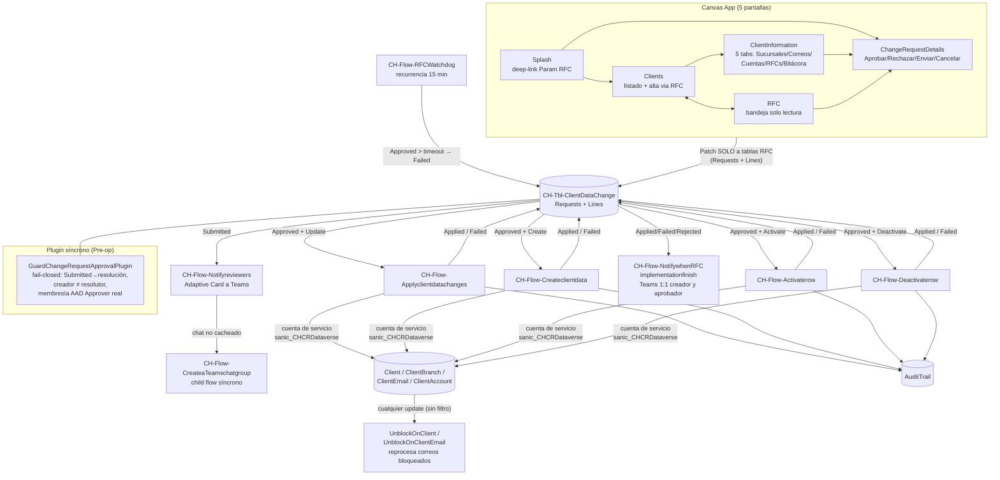

# CH-App-ClientAdministration v2 — Análisis y plan de reconstrucción

> Fecha de análisis: 2026-08-24. Fuentes: código desempaquetado de la canvas app
> (`solutions/unpacked/apps/CanvasApps/src/sanic_chappclientadministration_fd97f/`), los 10
> cloud flows del ciclo RFC (`solutions/unpacked/flow/Workflows/`), entidades y roles de Core,
> plugins C# (`src/backend/CashHub.Plugins/`), y docs previas (`docs/analysis/05-client-
> administration-deep-dive.md`, `docs/procesos/01-administracion-datos-clientes.md`).
> Tres agentes de análisis independientes (app / flujos / modelo-seguridad) + síntesis.

---

## 1. Cómo funciona la aplicación HOY (modelo confirmado)

### 1.1 Principio rector

Ningún usuario humano tiene privilegio de escritura sobre las tablas maestras de clientes
(`Client`, `ClientBranch`, `ClientEmail`, `ClientAccount`). Toda mutación viaja como **RFC**
(`CH-Tbl-ClientDataChangeRequests` + `Lines`), y la materialización sobre el maestro la hace
la **cuenta de servicio** de la conexión Dataverse de 4 cloud flows disparados por webhook.
La app canvas nunca invoca un flujo directamente (**cero `.Run(` en todo el fuente**): escribe
el RFC y los flujos reaccionan al cambio de estado.

### 1.2 Ciclo de vida del RFC

Estados de cabecera (`sanic_changestatus`): `159460000 Draft → 159460001 Submitted →
159460002 Approved → 159460004 Applied | 159460005 Failed`; desde Submitted también
`159460003 Rejected`; desde Draft, `159460006 Canceled`.

Tipos (`sanic_type`): `Update (0)`, `Deactivate (1)`, `Create (2)`, `Activate (3)` — cada tipo
tiene su flujo materializador propio, filtrado por webhook sobre `Approved + type`.

### 1.3 Grafo del sistema

### 1.4 Piezas de metadata que hacen genérico el motor

- **`ClientTableLogicalFieldNames`**: catálogo de campos editables — `sanic_table` +
  `sanic_logicalname` + `sanic_datatype` (Text/Number/Date/Money/LookUp/OptionSet/TwoOptions)
  + `sanic_optionsetmap` (JSON etiqueta→código) + `sanic_lookuptargettable`. Cada RFC Line
  apunta acá vía lookup `sanic_fielddefinition`; `oldvalue`/`newvalue` son texto sin tipar.
- **`ClientDataChangePermissions`**: matriz tabla-objetivo × rol (Contributor/Approver) ×
  grupo AAD (`sanic_aadgroupid`, texto libre) + `sanic_teamsgroupid` (chat cacheado).
- La app resuelve pertenencia en `App.OnStart` con **una llamada a
  `Office365Groups.ListGroupMembers` por fila de permisos** (secuencial, bloqueante).
- El guard server-side re-resuelve la membresía contra AAD group teams de Dataverse
  (`teammembership`) — fail-closed.

### 1.5 Seguridad vigente (post-remediaciones tanda 1/2)

- Roles `CH-SR-ClientAdminContributor` (Read global dominio; Create/Write **Basic** solo sobre
  RFC/Lines) y `CH-SR-ClientAdminApprover` (Write **Global** sobre RFC/Lines). Ninguno tiene
  Write sobre las tablas maestras → la premisa se cumple a nivel plataforma.
- `GuardChangeRequestApprovalPlugin` (Pre-op sync en Create/Update de la cabecera RFC):
  bloquea nacer en estado resuelto, exige Submitted→resolución, creador ≠ resolutor, y
  membresía AAD real del resolutor. Motor puro `ChangeRequestApprovalGuard` en
  `CashHub.Validation.Security` con tests.
- La model-driven app y sus 5 web resources fueron eliminados (decisión 2026-08-04).

---

## 2. Hallazgos consolidados (bugs y deuda)

### 2.1 SEGURIDAD

| # | Sev. | Hallazgo | Evidencia |
|---|---|---|---|
| S1 | ALTA | Los 4 forms ligados a tablas maestras (`formClient`, `formSucursales`, `formCuentas`, `formCorreos`) quedan armados y "listos para submitear"; la premisa se sostiene solo porque nadie llama `SubmitForm`. Riesgo estructural + confusión de mantenimiento. | `Clients.fx.yaml:13587`, `ClientInformation.fx.yaml` (3 forms) |
| S2 | ALTA | `ClientAccount` no tiene NINGÚN privilegio (ni Read) en los roles ClientAdmin — la tab Cuentas depende de privilegios fuera del paquete. | `CH-SR-ClientAdmin*.xml` (0 × `prv*ClientAccount`) |
| S3 | MEDIA | Gates de la UI son solo `Visible`/`ItemVisible`, nunca `DisplayMode`; New/Delete de líneas no valida creador (Enviar/Cancelar sí). El guard server-side cubre la cabecera, pero **no hay guard sobre `ClientDataChangeRequestLines`** (crear/borrar líneas de un RFC ajeno en Draft vía Web API es posible para un Approver con Write global). | `ChangeRequestDetails.fx.yaml:1237-1256` |
| S4 | MEDIA | Auditoría (`AuditTrail`) escrita solo por los flujos: si el flujo muere antes, el intento no deja rastro. No hay garantía server-side. | flujos Apply/Create/Activate/Deactivate |
| S5 | BAJA | Número de cuenta bancaria sin masking en la grilla de Cuentas. | `ClientInformation.fx.yaml` columns Cta |
| S6 | BAJA | `ClientEmail` sin alternate key (cliente, dirección) — duplicados posibles. | `Entity.xml` sin `EntityKeys` |

### 2.2 ROBUSTEZ / LÓGICA

| # | Sev. | Hallazgo |
|---|---|---|
| L1 | CRÍTICA | **`Applyclientdatachanges` no es transaccional**: un `UpdateOnlyRecord` POR CAMPO; si falla la línea 3 de 5, el maestro queda a medio actualizar, sin rollback. |
| L2 | CRÍTICA | **El botón "Editar" de Sucursales/Cuentas/Correos está funcionalmente roto**: crea RFC tipo Update SIN ninguna línea de cambio (el bloque de `Patch` a Lines solo corre para `Type=Create`). El aprobador recibe un RFC vacío, y el flujo Apply lo marca Failed por "sin líneas". |
| L3 | CRÍTICA | 4 flujos centrales (Apply, Activate, Deactivate, Notifyreviewers) figuran **en Draft (inactivos)** en el export. Confirmar contra ambiente. Basta "guardar sin publicar" para romper un tipo entero de operación — fragilidad operativa intrínseca del diseño. |
| L4 | ALTA | `Terminate(Succeeded)` en guard "sin líneas": el run reporta éxito cuando el negocio falló — monitoreo ciego. |
| L5 | ALTA | Sin idempotencia/lock contra doble aprobación concurrente (dos disparos del webhook compiten por las mismas Lines). En la app tampoco hay revalidación del estado antes del Patch de cabecera. |
| L6 | ALTA | Switch de conversión de tipos **duplicado 1:1** entre Apply y Create; Activate/Deactivate con lista de 4 tablas hardcodeada y `default: Terminate(Succeeded)` silencioso. |
| L7 | MEDIA | Overlay de spinner queda trabado (pantalla bloqueada) tras error en Enviar y Aprobar/Rechazar (Cancelar sí lo resetea). |
| L8 | MEDIA | Si el Patch de cabecera falla tras actualizar las líneas, quedan estados inconsistentes (líneas resueltas, cabecera Submitted) sin compensación. |
| L9 | MEDIA | `varChangeStatus`/`varTargetTable`/`varTablePluralName` se calculan y nunca se leen (DataCards hardcodeados); `varTablePluralName` tiene valor erróneo (singular) en la rama "new" — bug latente. |
| L10 | MEDIA | Borrado de línea de RFC sin confirmación ni `IfError`. |
| L11 | BAJA | Aprobación todo-o-nada: el modelo soporta estado por línea pero la UI no. |
| L12 | MEDIA | `UnblockOnClient(Email)` se dispara en CUALQUIER update de las tablas maestras (sin `filterexpression`) — corre en cada aplicación de RFC aunque no cambie el CIF. |

### 2.3 PERFORMANCE

| # | Sev. | Hallazgo |
|---|---|---|
| P1 | ALTA | Listado de Clients: `AddColumns` con `LookUp` a colección local rompe delegación → con >500-2000 clientes, orden incorrecto y filas invisibles sin aviso. Mismo patrón en la bandeja RFC. |
| P2 | ALTA | `App.OnStart`: N llamadas secuenciales a `Office365Groups.ListGroupMembers` (una por fila de permisos) bloqueando el arranque. |
| P3 | MEDIA | `colPendingRFCs` trae TODAS las RFC pendientes del entorno en cada OnVisible, y nunca se refresca tras crear un RFC (badge desactualizado). |
| P4 | MEDIA | RFCWatchdog: polling cada 15 min — costo permanente que solo existe porque la materialización no es confiable. |
| P5 | ALTA (deuda) | **~80% del fuente de Clients y RFC es bloat**: la tabla de iconos del `ExpandMenu` de PowerCAT (~11.275 líneas) serializada completa en cada instancia. |

### 2.4 UX/UI

| # | Hallazgo |
|---|---|
| U1 | Overlays modales (diálogos, paneles) con `Width/Height = 1366×768` hardcodeado — no responsive; el esqueleto sí usa auto-layout pero los modales asumen la resolución de diseño. |
| U2 | Labels copy-pasteados mal: "Número de cuenta" muestra "Nombre de sucursal"; "Moneda" muestra "Notificar siempre". |
| U3 | Menú contextual con "Save"/"Delete" sin handler; ramas muertas del template PowerCAT (`TBL_Meetings`, `"flow"`). |
| U4 | Errores genéricos ("Hubo problemas al guardar...") descartando el motivo real; typo "Campos incompeltos"; mensaje en inglés suelto. |
| U5 | Validación de email destructiva (`Reset(Self)` borra todo lo tipeado). |
| U6 | Sin granularidad ni indicadores consistentes: estado de RFC como texto plano en varias vistas (v1 agregó badges parciales), ícono `Download` rotado como "primera página". |
| U7 | Data sources de muestra sin uso (`ComboBoxSample`, `DropDownSample`, `CustomGallerySample`, `Bulk Delete Failures`). |

---

## 3. Plan de reconstrucción v2

### 3.1 Backend: reemplazo de los 4 flujos materializadores por Custom APIs

Decisión propuesta (patrón ya probado en Digitization: dominio puro testeado +
plugin backing + registro idempotente + `executeprivilegename`):

| Pieza actual | Reemplazo v2 | Por qué |
|---|---|---|
| `Applyclientdatachanges` + `Createclientdata` + `Activaterow` + `Deactivaterow` | **Custom API única `sanic_CHResolveChangeRequest`** (plugin C#, síncrono): valida con `ChangeRequestApprovalGuard`, materializa según `sanic_type`, escribe AuditTrail y estado final **en la misma transacción**. Un solo `Update` con todos los atributos → atomicidad real (mata L1); generalización por metadata (mata L6); error de negocio = excepción visible (mata L4); sin ventana Approved-sin-aplicar (mata L3/L5/P4). | El SDK aplica todos los atributos de una `Entity` en una operación; pipeline síncrono = transacción de Dataverse. |
| `RFCWatchdog` | **Se elimina** (sin ventana asíncrona ya no hay huérfanos). | — |
| `Notifyreviewers`, `NotifywhenRFCimplementationfinish`, `CreateaTeamschatgroup` | **Se quedan en Power Automate**, adelgazados: solo notificación (Teams/Graph no pertenece a un plugin síncrono). Se les agrega try/catch. | I/O externo con SLA variable; sin precedente C#→Graph en el repo. |
| `UnblockOnClient(Email)` | Fuera de alcance de este rebuild (subsistema correos); anotar `filterexpression` como mejora. | — |
| — (nuevo) | **Guard de Lines** (Pre-op sync en Create/Update/Delete de `ClientDataChangeRequestLines`): RFC padre en Draft, creador o Approver, sin duplicados por (RFC, FieldDefinition). Cierra S3. | — |

La app v2 llama `Environment.sanic_CHResolveChangeRequest(...)` (o el guard actual dispara la
materialización al aprobar — a definir en diseño técnico). El privilegio de ejecución
(`executeprivilegename`) acota quién invoca; la escritura al maestro corre como sistema
(`CreateOrganizationService(null)`), igual que hoy la cuenta de servicio, pero sin conexiones,
sin webhooks y sin Draft-accidental.

### 3.2 Frontend: app v2

- **Sin dependencias externas**: adiós Power CAT component library y PCF Fluent (CommandBar,
  DetailsList, SearchBox, TabList). Controles clásicos nativos + componentes propios en la
  librería `CH-CL-SharedComponents` (patrón de los otros rebuilds v2). Mata P5 y el lock-in.
- **Responsive horizontal**: contenedores manuales (`groupContainer` LayoutMode.Manual) con
  posiciones/tamaños por fórmula relativa (`Parent.Width - X*2`, proporciones), sin anchos
  1366 hardcodeados. Layout pensado para cualquier pantalla horizontal.
- **Solo lectura sobre maestros, sin forms conectados**: los forms de captura se reconstruyen
  con controles sueltos + validación explícita → imposibilidad estructural de `SubmitForm` a
  tablas maestras (mata S1).
- **Galerías nativas con delegación limpia**: filtros delegables server-side; badges de estado
  por fila con botones/labels nativos (sin canvas components dentro de galerías).
- Pantallas v2 (5): Splash (deep-link), Clients, ClientInformation (tabs), RFC (bandeja),
  ChangeRequestDetails (decisión). Correcciones funcionales clave: Edit con captura real del
  nuevo valor (mata L2), refresh de pendientes tras crear RFC, manejo de error con motivo
  real y spinner que siempre se libera, labels correctos, confirmación en borrados.
- **Permisos**: reemplazar el fan-out a Graph del OnStart por resolución cacheada (colección
  única con membership del usuario, o lectura de una tabla puente mantenida por el backend) —
  a definir en diseño técnico (mata P2).

### 3.3 Secuencia de trabajo

1. Mockup HTML completo (aprobación del usuario) → `docs/clientadmin-rebuild/mockup-clientadmin.html`
2. Guías MD por pantalla (skill powerapps-screen-guides; pipeline diseñador→revisor vs
   mockup→antagonista) → `01-app.md`, `02-pantalla-clients.md`, …
3. Backend: Custom API + guard de Lines (Strict TDD sobre dominio puro) + scripts de registro
4. Scaffolding manual del usuario en Studio → pegado de propiedades por agentes → pack →
   import a Power Platform
5. Seeder de estrés (clientes/sucursales/correos/cuentas/RFCs masivos) + medición
6. Docs, changelog, commit y push
