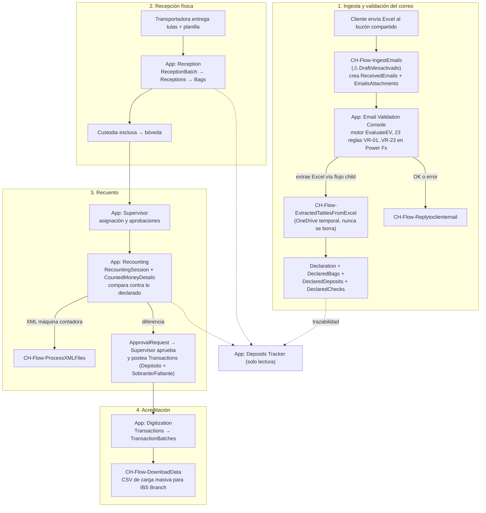
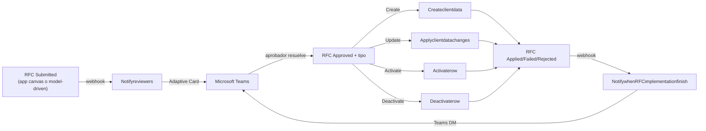

# Arquitectura — CashHub

> Fuente: [`docs/analysis/00-sintesis.md`](../analysis/00-sintesis.md), [`01-core-data-model.md`](../analysis/01-core-data-model.md), [`02-flows.md`](../analysis/02-flows.md), [`03-apps-operativas.md`](../analysis/03-apps-operativas.md), [`04-apps-administrativas.md`](../analysis/04-apps-administrativas.md), y lectura directa de `solutions/unpacked/{core,flow,apps}/`.

## 1. Las 3 soluciones y su segmentación

CashHub está partido en 3 soluciones Dataverse independientes, publisher `sanic_` (`Sistemas_Abiertos_Nicaragua`), desempaquetadas en [`solutions/unpacked/`](../../solutions/unpacked/):

| Solución | Carpeta | Versión | Responsabilidad | Contenido |
|---|---|---|---|---|
| **CashHubCore** | `solutions/unpacked/core/` | 1.0.0.5 | Datos + seguridad | 38 tablas (`sanic_CHTbl*`), 6 roles de seguridad (`CH-SR-*`/`CH-Role`), 3 option sets globales, 19 variables de entorno (`sanic_CHEV*`), 8 web resources JS del módulo de cambio de datos de cliente |
| **CashHubFlow** | `solutions/unpacked/flow/` | 1.0.0.6 | Automatización | 19 flujos Power Automate (`CH-Flow-*`) |
| **CashHubApps** | `solutions/unpacked/apps/` | 1.0.0.12 | UI | 8 canvas apps de negocio + 1 model-driven app (`sanic_ChAppClientAdministration`) + 2 bibliotecas de componentes + 1 command library |

Esta segmentación es la práctica recomendada de ALM en Dataverse (datos separados de lógica separados de UI, para poder versionar e importar cada capa de forma independiente), y en general se respeta: Flow y Apps declaran a Core como dependencia implícita (consumen sus tablas), no al revés.

**Lo que la segmentación NO garantiza automáticamente**: que la lógica de negocio esté efectivamente en la capa "correcta". Ver el hallazgo central en la sección 3.

## 2. El flujo de punta a punta



Cada etapa está descrita en detalle en la síntesis del análisis; acá el foco es **dónde vive el código de cada etapa**, que es lo que importa para desarrollo.

## 3. Hallazgo arquitectónico central: dónde vive REALMENTE la validación

**La orquestación de validación de correos NO vive en Power Automate. Vive en la canvas app Email Validation Console (`sanic_chappemailvalidationconsole_f3b93`).**

Evidencia, leyendo `solutions/unpacked/flow/Workflows/`:

- `CH-Flow-ValidationRulesOrchestrator` (`ValidationRulesOrchestrator`) tiene un único `Switch` con `case "VR01": {actions: {}}` y `default: {actions: {}}` — **literalmente vacío**. No llama a ningún flujo VR0x, no responde nada.
- De los 5 flujos `VR01`-`VR05`: solo VR01, VR03, VR05 implementan lógica real de comparación. **VR02** (debería validar dominio/formato del email remitente) responde `Pass` incondicional, sin ningún `If`. **VR04** (debería validar extensión de adjunto) tiene un bug real: ambas ramas del `If` responden `Pass` — la validación nunca puede fallar aunque la comparación esté bien escrita.
- Ningún flujo del "pipeline de ingesta" (`IngestEmails`, `ExtractedTablesFromExcel`, `GetJSONdatafromattachment`, `ValidationRulesOrchestrator`, VR0x, `Replytoclientemail`) llama a otro mediante `Run a Child Flow` dentro del paquete de Flow. Todos exponen trigger `PowerAppV2`/`Button` — están diseñados como **servicios invocables desde afuera**, no como cadena de flujos.

En cambio, en `solutions/unpacked/apps/CanvasApps/src/sanic_chappemailvalidationconsole_f3b93/`:

- `App.Formulas` define la UDF `EvaluateEV(_op, _iv, _bv)`, un motor de comparación genérico (soporta `=`, `<`, `<=`, `>`, `>=`, `contains`, `begins with`, `ends with`, `empty`).
- La app carga las reglas activas desde Dataverse (`ClearCollect(colValidationRules, Filter('CH-Tbl-ValidationRules', IsActive=true))`) — **23 reglas VR-01 a VR-23**, config-driven (tabla `sanic_ValidationRules`), no hardcodeadas.
- La pantalla "Cola de procesamiento" ejecuta las 23 reglas en Power Fx respetando dependencias, persiste cada resultado en `sanic_CHTblValidationResults`/`sanic_CHTblValidationRuns`, y si todo pasa dispara la creación en cascada de `Declaration → DeclaredBags → DeclaredDeposits → DeclaredChecks` con rollback manual (`Remove`) si algún `Patch` de la cadena falla.

**Conclusión práctica para desarrollo**: los flujos `VR0x` y `ValidationRulesOrchestrator` en `solutions/unpacked/flow/` parecen un intento anterior o incompleto de mover la validación al backend, que quedó abandonado. Si vas a **modificar una regla de validación**, el lugar correcto es la tabla `sanic_ValidationRules` (datos) y, si la regla requiere un operador nuevo, la UDF `EvaluateEV` en `App.Formulas` de Email Validation Console — **no** los flujos VR0x, que no están conectados a nada real. Si el objetivo de arquitectura es sacar la validación de la canvas app hacia el backend, hace falta completar `ValidationRulesOrchestrator` y los VR0x (incluyendo el bug de VR04) y reemplazar las llamadas Power Fx por esa cadena — hoy no es así.

## 4. Integración con el core bancario IBS Branch

La acreditación final no tiene integración directa (API/webhook) con IBS Branch; es un **archivo de carga masiva** generado y descargado manualmente:

1. App **Digitization** (`sanic_chappdigitization_278aa`) agrupa transacciones de efectivo puro sin cheques en un `TransactionBatches` ("hacer el corte", `UpdateIf` masivo sobre `CH-Tbl-Transactions`).
2. Al presionar "Descargar lote", arma la colección `colTx` con el layout fijo de columnas IBS (`TRNCODE`, `CUENTA`, `MONTOTOTAL`, `MONEDA`, etc.) y llama:
   ```
   'CH-Flow-DownloadData'.Run(JSON(colTx, JSONFormat.IncludeBinaryData), varLoteSelected.Name).archivosalida
   ```
3. `CH-Flow-DownloadData` (`solutions/unpacked/flow/Workflows/CH-Flow-DownloadData-*.json`) arma la tabla CSV, la sube a OneDrive for Business, genera un link de descarga y lo devuelve.
4. El archivo se sube a IBS Branch **manualmente**, fuera de CashHub. No hay confirmación automática de vuelta — el estado del lote (`Generado → Ingresado → Aplicado`) avanza por clic manual del digitador tras confirmar visualmente que el core lo aplicó.

Columnas del layout con valores **fijos/hardcodeados** en la app (no vienen de variable de entorno ni de configuración): `TRNCODE=8004`, `DISPONIBILIDADINMEDIATA="0"`, `MANIFIESTO=1`, `TIPOID="0000000000001"`, `NACIONALIDAD="0000000000558"`, `NUMEROID1="4411001991"`, `NUMEROID2="003A"`. Existe la variable de entorno `sanic_CHEVIbsBranchCodeList` en Core pero no se encontró ninguna referencia a ella ni en la app ni en el flujo — está sin explotar. Ver [05-hallazgos-y-backlog.md](05-hallazgos-y-backlog.md) para el impacto de este hardcodeo.

Las transacciones con cheques (BAC u otro banco) **no** van por carga masiva: se marcan en la pestaña "Tx Manuales" y se digitan una por una directo en IBS Branch.

## 5. Módulo de RFCs de datos de cliente (Request For Change)

Subsistema paralelo al flujo de depósitos, para gobernar cambios sobre `sanic_CHTblClient`/`ClientBranch`/`ClientEmail` sin permitir edición directa. Es la **única cadena de Power Automate que sí es una secuencia real de flujos encadenados** (webhooks Dataverse sobre `sanic_chtblclientdatachangerequest`, sección 2.2 de [02-flows.md](../analysis/02-flows.md)):



Puntos clave para desarrollo:

- **Dos superficies de UI sobre el mismo modelo**: la canvas app `sanic_chappclientadministration_fd97f` (Contributor arma la solicitud, Approver la resuelve) y la model-driven app `sanic_ChAppClientAdministration` (con el web resource `sanic_chwebrproposechange.js`, que abre un Quick Create de `sanic_chtblclientdatachangerequest`). Ambas terminan escribiendo en las mismas tablas `sanic_CHTblClientDataChangeRequest(Line)`.
- **Ni la canvas app ni el web resource aplican el cambio real**: ambas dejan la solicitud en `Approved`/`Submitted`. Quien materializa el cambio sobre `Client`/`ClientBranch`/`ClientEmail` (y mueve el estado a `Applied`/`Failed`) son los 4 flujos webhook (`Createclientdata`, `Applyclientdatachanges`, `Activaterow`, `Deactivaterow`). El vínculo entre la capa Apps y la capa Flow para este submódulo es **implícito**: depende de que el filtro OData del webhook (`cr140_changestatus eq 796490002 and sanic_type eq ...`) siga alineado con los valores que la app escribe — no hay contrato explícito documentado entre ambos.
- **Campo `OptionSet` no se aplica**: en `Createclientdata` y `Applyclientdatachanges`, el `case` del switch para tipo de dato `OptionSet (159460005)` tiene acciones vacías — un RFC que cambie un campo Option Set queda sin ese campo actualizado, sin error visible.
- **Prefijo de publisher ajeno**: el campo de estado más crítico del módulo, `cr140_changestatus` en `sanic_CHTblClientDataChangeRequest`, usa el prefijo `cr140_` en vez de `sanic_` — evidencia de un campo importado de otra solución/publisher, y su optionset mezcla rangos `796490xxx` con un valor suelto `159460001` (Canceled).

## 6. Dependencias externas

Ningún componente de CashHub es autocontenido en Dataverse; depende de:

| Dependencia | Uso | Dónde se referencia |
|---|---|---|
| **Buzón compartido de Outlook** (`shared_office365`) | Trigger de `CH-Flow-IngestEmails` (polling 1 min); respuesta al cliente vía `CH-Flow-Replytoclientemail`; lectura directa por Microsoft Graph desde Email Validation Console | Hardcodeado en el trigger de `IngestEmails` (`no-reply-powerplatform-dev@baccredomatic.ni`); existe `sanic_CHEVSharedMailboxAddress` pero no se usa ahí |
| **OneDrive for Business** | Excel temporal (`ExtractedTablesFromExcel`), XML de máquinas contadoras (`ProcessXMLFiles`), CSV de carga masiva (`DownloadData`) | Connection references `sanic_CHCROneDrive`, `sanic_AEDDConnOneDrive`, `new_sharedonedriveforbusiness_a6c30` (`solutions/unpacked/flow/Other/Customizations.xml`) |
| **Excel Online Business** | Lectura de tablas del Excel del cliente | Connection reference `sanic_CEADCONNExcelOnlineBusiness` |
| **Microsoft Teams** | Adaptive Cards de aprobación de RFC, notificación de resultado, chat grupal de aprobadores | Flujos `Notifyreviewers`, `NotifywhenRFCimplementationfinish`, `CreateaTeamschatgroupbasedonOffice365Group` |
| **Grupos AAD (Azure AD / Entra ID)** | Filtrado de apps visibles en el Hub (`sanic_CHTblAppCatalog.AAD Group Id` vía `Office365Groups.ListGroupMembers`); permisos Contributor/Approver en `sanic_CHTblClientDataChangePermission` | Solo consumidos por **Hub** y **Client Administration**; las 3 apps operativas (Reception, Recounting, Supervisor) y las otras 2 administrativas (Digitization, Deposits Tracker) **no** verifican grupo AAD en su código Power Fx — ver [03-apps-canvas.md](03-apps-canvas.md) §1 y [05-hallazgos-y-backlog.md](05-hallazgos-y-backlog.md) |
| **IBS Branch (core bancario)** | Destino final de la carga masiva (CSV) y de la digitación manual de transacciones con cheques | Sin integración API — proceso manual descrito en §4 |

## 7. Ver también

- [02-estructura-y-build.md](02-estructura-y-build.md) — cómo desempaquetar/reempaquetar cada solución.
- [03-apps-canvas.md](03-apps-canvas.md) — patrones técnicos comunes entre las 8 canvas apps.
- [04-deploy-y-alm.md](04-deploy-y-alm.md) — orden de despliegue y configuración por ambiente.
- [05-hallazgos-y-backlog.md](05-hallazgos-y-backlog.md) — backlog priorizado de todo lo señalado como hallazgo en este documento.
