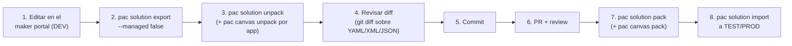

# Estructura del repo y build — CashHub

> Fuente: layout real verificado en `solutions/unpacked/`, [`README.md`](../../README.md), [`.gitignore`](../../.gitignore), y `Other/Solution.xml` de cada solución.

## 1. Layout del repositorio

```
CashHub/
├── CashHubCore.zip          # paquete exportado (gitignored, ver §5)
├── CashHubFlow.zip          # paquete exportado (gitignored, ver §5)
├── CashHubApps.zip          # paquete exportado (gitignored, ver §5)
├── README.md
├── CHANGELOG.md
├── .gitignore
├── docs/
│   ├── analysis/            # análisis técnico as-is (existe)
│   ├── desarrollo/          # este directorio (existe)
│   ├── referencia/          # contratos vivos — NO existe todavía
│   └── guias/               # manuales por rol — NO existe todavía
└── solutions/
    └── unpacked/
        ├── core/            # CashHubCore desempaquetada
        │   ├── Entities/                        # 38 carpetas, una por tabla (Entity.xml, forms, views)
        │   ├── OptionSets/                       # 3 option sets globales (.xml)
        │   ├── Roles/                            # 6 security roles (.xml)
        │   ├── environmentvariabledefinitions/   # 19 carpetas, una por variable
        │   ├── metadataforarchivals/             # políticas de archivado (solo 3 tablas)
        │   ├── WebResources/                     # 8 JS del módulo de cambio de datos de cliente
        │   └── Other/
        │       ├── Solution.xml                  # metadata + RootComponents
        │       ├── Customizations.xml
        │       └── Relationships.xml / Relationships/
        ├── flow/            # CashHubFlow desempaquetada
        │   ├── Workflows/                        # 19 flujos: <Nombre>-<GUID>.json + .json.data.xml
        │   ├── OptionSets/
        │   └── Other/
        │       ├── Solution.xml
        │       └── Customizations.xml            # incluye <connectionreferences>
        └── apps/            # CashHubApps desempaquetada
            ├── CanvasApps/
            │   ├── <app>_DocumentUri.msapp        # binario original de cada canvas app (11 apps/librerías)
            │   ├── <app>.meta.xml
            │   └── src/<app>/                     # fuente YAML desempaquetada de cada .msapp
            │       ├── Src/*.fx.yaml               # pantallas y App.fx.yaml (código Power Fx)
            │       ├── pkgs/Components/            # componentes locales de la app
            │       ├── pkgs/TableDefinitions/       # snapshot de esquema de tablas usadas
            │       ├── DataSources/*.json           # datasources declarados
            │       ├── Connections/Connections.json
            │       └── CanvasManifest.json
            ├── AppModules/sanic_ChAppClientAdministration/AppModule.xml       # app model-driven
            ├── AppModuleSiteMaps/sanic_ChAppClientAdministration/AppModuleSiteMap.xml
            ├── WebResources/sanic_chwebrproposechange.js                     # script de la app model-driven
            └── Other/
                ├── Solution.xml
                └── Customizations.xml
```

**Nota de terminología**: `docs/analysis/` fue escrito referenciando los archivos como `src/core/`, `src/flow/`, `src/apps/`. La ruta real y actual en el repo es `solutions/unpacked/{core,flow,apps}/` (confirmado contra el filesystem). Al citar rutas en documentación nueva, usar siempre `solutions/unpacked/...`.

## 2. Versiones actuales de cada solución

Confirmado en `<Version>` de cada `Other/Solution.xml`:

| Solución | Versión | Managed |
|---|---|---|
| CashHubCore | `1.0.0.5` | No (0) |
| CashHubFlow | `1.0.0.6` | No (0) |
| CashHubApps | `1.0.0.12` | No (0) |

Las 3 se exportan como **no administradas** (`Managed=0`) — coherente con que este repo es la fuente de desarrollo, no el paquete de distribución a producción (que normalmente se importa managed).

## 3. Herramienta: Power Platform CLI (`pac`)

Todo el ciclo se apoya en [`pac`](https://aka.ms/PowerPlatformCLI). Verificar instalación:

```bash
pac --version
```

Antes de exportar/importar contra un ambiente real hace falta autenticar el perfil:

```bash
pac auth create --url https://<tu-ambiente>.crm.dynamics.com
```

## 4. Comandos: desempaquetar (`unpack`)

Para traer cambios hechos en el ambiente DEV al repo (después de editar en el maker portal):

```bash
# 1. Exportar la solución sin administrar desde DEV
pac solution export --name CashHubCore --path CashHubCore.zip --managed false

# 2. Desempaquetar el .zip a fuente versionable
pac solution unpack --zipfile CashHubCore.zip --folder solutions/unpacked/core --packagetype Unmanaged

# Repetir para Flow y Apps
pac solution export --name CashHubFlow --path CashHubFlow.zip --managed false
pac solution unpack --zipfile CashHubFlow.zip --folder solutions/unpacked/flow --packagetype Unmanaged

pac solution export --name CashHubApps --path CashHubApps.zip --managed false
pac solution unpack --zipfile CashHubApps.zip --folder solutions/unpacked/apps --packagetype Unmanaged
```

`pac solution unpack` deja el `.msapp` de cada canvas app **intacto como binario** dentro de `CanvasApps/`; no genera el YAML por sí solo. Para tener el código Power Fx legible/diffable hace falta un segundo paso por app:

```bash
# Desempaquetar una canvas app puntual a su fuente YAML
pac canvas unpack \
  --msapp solutions/unpacked/apps/CanvasApps/sanic_chappreception_9ff29_DocumentUri.msapp \
  --sources solutions/unpacked/apps/CanvasApps/src/sanic_chappreception_9ff29
```

Repetir por cada una de las 11 entradas de `CanvasApps/` que sea canvas app o librería de componentes (8 apps de negocio + `sanic_chclsharedcomponents_85fca` + `cat_powercatcomponentlibrary_0be3a` + `sanic_chappclientadministrationdefaultcommand13815`).

## 5. Comandos: reempaquetar (`pack`)

Para generar el `.zip` importable a partir del código versionado (dirección inversa, útil antes de importar a un ambiente):

```bash
# Reempaquetar una canvas app editada desde su fuente YAML de vuelta a .msapp
pac canvas pack \
  --sources solutions/unpacked/apps/CanvasApps/src/sanic_chappreception_9ff29 \
  --msapp solutions/unpacked/apps/CanvasApps/sanic_chappreception_9ff29_DocumentUri.msapp

# Reempaquetar cada solución completa
pac solution pack --zipfile CashHubCore.zip --folder solutions/unpacked/core --packagetype Unmanaged
pac solution pack --zipfile CashHubFlow.zip --folder solutions/unpacked/flow --packagetype Unmanaged
pac solution pack --zipfile CashHubApps.zip --folder solutions/unpacked/apps --packagetype Unmanaged
```

Los `.zip` resultantes se importan al ambiente destino:

```bash
pac solution import --path CashHubCore.zip --publish-changes
```

## 6. Los `.zip` no se versionan

Confirmado en [`.gitignore`](../../.gitignore): `*.zip` está excluido del control de versiones (junto con `.env*`, `*.pem`, `*.pfx`, temporales). Los tres `.zip` presentes hoy en la raíz del repo (`CashHubCore.zip`, `CashHubFlow.zip`, `CashHubApps.zip`) son artefactos de trabajo locales, no versionados. Según el README, la distribución de paquetes se hace vía **GitHub Releases**, no commiteando el binario.

## 7. Ciclo de trabajo propuesto



Puntos a tener en cuenta en este ciclo, dado el estado real del código:

- **Nunca editar el `.msapp` binario a mano ni commitearlo modificado sin volver a correr `pac canvas unpack`** — el YAML en `Src/*.fx.yaml` es lo revisable; el `.msapp` es el artefacto derivado.
- El diff de un `.fx.yaml` de pantalla grande (hasta ~14.000 líneas en `screen Clients` de Client Administration) es ruidoso — Power Apps Studio reordena/reformatea controles al guardar aunque el cambio funcional sea mínimo. Revisar el diff funcional, no exigir mínimo de líneas cambiadas.
- Antes de reempaquetar y desplegar, alinear con [04-deploy-y-alm.md](04-deploy-y-alm.md): el orden de importación entre las 3 soluciones no es arbitrario (Core → Flow → Apps, por dependencia de tablas/conectores).
- El publisher (`sanic_`) y el prefijo de valores de option set (`15946`) están fijados en `Other/Solution.xml` de cada solución — no cambian entre ambientes; lo que cambia son variables de entorno y connection references (§ en [04-deploy-y-alm.md](04-deploy-y-alm.md)).

## 8. Ver también

- [01-arquitectura.md](01-arquitectura.md) — qué hace cada solución.
- [03-apps-canvas.md](03-apps-canvas.md) — qué mirar dentro del YAML de cada canvas app.
- [04-deploy-y-alm.md](04-deploy-y-alm.md) — despliegue entre ambientes con estos mismos comandos `pac`.
