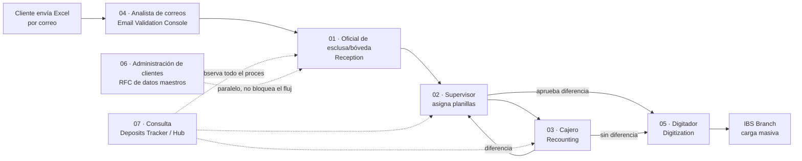

# Manuales por rol — CashHub

CashHub digitaliza el procesamiento de depósitos en efectivo que los clientes del
banco envían en bolsas de seguridad (tulas) a través de una transportadora de
valores. El proceso completo tiene cuatro grandes momentos, y cada uno lo opera
un rol físico distinto, con su propia aplicación:

1. **El cliente declara** el contenido de sus tulas en una plantilla Excel y la
   envía por correo al buzón compartido del banco.
2. **El banco recibe** físicamente las tulas y las planillas de conducción en la
   esclusa, y las traslada a bóveda temporal.
3. **Un supervisor asigna** las planillas a cajeros, quienes recuentan el
   contenido contra lo declarado; si hay diferencia, el supervisor la revisa y
   aprueba.
4. **El banco acredita** las transacciones resultantes en el core bancario
   **IBS Branch** mediante carga masiva.

Cada manual de esta carpeta cubre una aplicación y el rol físico que la usa, en
el orden en que participan del proceso real. Están escritos para personal de
operaciones, sin conocimientos técnicos de Power Platform.

| # | Manual | Rol físico | Aplicación | Qué hace en el proceso |
|---|--------|-----------|------------|-------------------------|
| 01 | [Manual del recepcionista](01-manual-recepcionista.md) | Oficial de esclusa/bóveda | **Reception** | Registra el lote de recepción, las planillas de conducción y las tulas que trae la transportadora; mueve la custodia de esclusa a bóveda. |
| 02 | [Manual del supervisor](02-manual-supervisor.md) | Supervisor de recuento | **Supervisor** | Aprueba o rechaza las excepciones que generan Reception y Recounting (altas/bajas de tulas, sesiones, diferencias de recuento); es quien contabiliza el faltante/sobrante. Gestiona ubicación de tulas, resumen de operaciones y envío de cheques a digitación. |
| 03 | [Manual del cajero de recuento](03-manual-cajero-recuento.md) | Cajero de recuento | **Recounting** | Abre su sesión de mesa, escanea cada tula, cuenta efectivo por denominación y cheques contra lo declarado, importa la lectura de la máquina contadora, y cierra la tula. |
| 04 | [Manual de validación de correos](04-manual-validacion-correos.md) | Analista de correos | **Email Validation Console** | Revisa los correos con la plantilla Excel del cliente, corre las validaciones automáticas y extrae los datos declarados hacia el sistema, o responde el rechazo al cliente. |
| 05 | [Manual de digitación](05-manual-digitacion.md) | Digitador | **Digitization** | Agrupa las transacciones en lotes ("hace el corte"), gestiona las transacciones con cheques que van manuales, y descarga el archivo de carga masiva para IBS Branch. |
| 06 | [Manual de administración de clientes](06-manual-administracion-clientes.md) | Administrador de datos maestros | **Client Administration v2** (canvas) | Da de alta o modifica datos de clientes/sucursales/correos/cuentas mediante una solicitud de cambio (RFC) que otro usuario aprueba o rechaza — la decisión se resuelve en el momento (Custom API síncrona), sin espera. |
| 07 | [Manual de trazabilidad](07-manual-trazabilidad.md) | Cualquier rol de consulta/auditoría | **Deposits Tracker** + **Hub** | Consulta de solo lectura del estado de lotes, planillas, tulas y depósitos; el Hub es la puerta de entrada a todas las apps. |
| [08-plan-de-pruebas-validacion.md](08-plan-de-pruebas-validacion.md) | Batería de pruebas del motor de validación y las notificaciones al cliente: 14 archivos de prueba verificados contra el motor, casos de sobre, contingencia y registro de resultados. |
| [09-plan-de-pruebas-integral.md](09-plan-de-pruebas-integral.md) | Plan de pruebas integral de 0 a 100 para certificar la salida a producción: pre-vuelo del entorno, batería por módulo (clientes, correo, recepción, recuento, supervisión, digitación, tracker, hub), el "hilo de oro" end-to-end y el checklist Go/No-Go. |

## Cómo usar estos manuales

- Cada manual sigue el mismo orden: **propósito del rol**, **prerequisitos**,
  **paso a paso por pantalla** (en el orden real de trabajo) y una sección final
  de **Limitaciones conocidas**.
- La sección de Limitaciones conocidas no es un formalismo: describe
  comportamientos reales del sistema, verificados contra el código fuente, que
  pueden sorprender en el uso diario (por ejemplo, aprobaciones que no requieren
  intervención de un tercero, o pantallas que existen pero no hacen nada
  todavía). Léanla con la misma atención que el paso a paso.
- Si necesitás el detalle técnico de las 23 reglas de validación de correos, el
  modelo de datos completo o los flujos de Power Automate, consultá
  [`../referencia/`](../referencia/00-indice.md). Si querés el análisis narrativo
  completo con hallazgos priorizados, está en [`../analysis/`](../analysis/00-sintesis.md).

## Mapa rápido del flujo end-to-end

