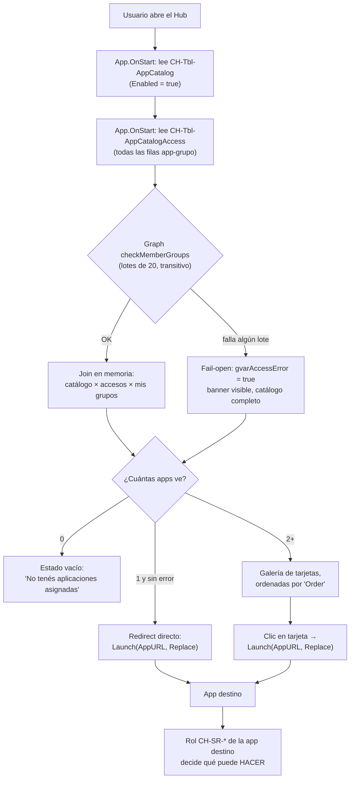

# 00 — Acceso y plataforma

## 1. Qué es este proceso

Es el proceso 0: lo primero que toca cualquier usuario de CashHub, antes de
tocar un solo dato de negocio. Un usuario entra a **CH-App-Hub**
(`sanic_chapphub_2038c`, pantalla única `scrHub`), el hub lee el catálogo de
apps y resuelve — contra Azure AD, no contra Dataverse — a cuáles de esas apps
pertenece el usuario, y lanza la elegida en la misma pestaña
(`Launch(AppURL, {}, LaunchTarget.Replace)`). Si el usuario solo tiene acceso a
una app, ni siquiera ve el hub: aterriza directo.

El catálogo (`CH-Tbl-AppCatalog` / `sanic_chtblappcatalog`) es la única fuente
de verdad de qué apps existen, su URL y su orden. El gating por grupo es
**relacional**: una tabla hija, `CH-Tbl-AppCatalogAccess` /
`sanic_chtblappcatalogaccess`, declara qué grupos de Azure AD ven cada app —
una fila por (app, grupo). Una app sin ninguna fila de acceso es **pública**:
la ve cualquiera con acceso al hub.

Es importante remarcar desde el título de este documento lo que este proceso
**no** es: no es la frontera de seguridad de CashHub. El filtro del hub decide
**qué ve** el usuario (experiencia), no **qué puede hacer**. La autorización
real la imponen los roles de seguridad `CH-SR-*` de Dataverse en cada app
destino — si alguien llega a la URL de Recuento sin `CH-SR-Counter`, la app
abre pero no puede leer ni escribir nada. Ver el detalle de esta distinción en
§3 y §10.

**Handoffs**: este proceso no recibe nada de ningún otro — es el punto de
entrada. Entrega a **todos** los demás procesos (1 a 8) un usuario ya
autenticado por Entra ID que aterriza en la app correcta; la autorización de
grano fino dentro de cada proceso (qué tabla puede leer, qué acción puede
ejecutar) la resuelve el rol `CH-SR-*` asignado en esa app, documentado en
cada proceso vecino y en la referencia
[roles-y-seguridad.md](../referencia/roles-y-seguridad.md) (con el caveat de
§3 sobre su vigencia).

## 2. Estados y transiciones

Este proceso **no tiene una máquina de estados de negocio** con valores
`159460xxx` — ni `CH-Tbl-AppCatalog` ni `CH-Tbl-AppCatalogAccess` declaran un
option set local de estado. Lo que gobierna la visibilidad de una app son dos
mecanismos independientes, verificados contra `Entity.xml` de ambas tablas:

| Mecanismo | Tabla | Columna | Tipo | Quién lo cambia | Qué defiende |
|---|---|---|---|---|---|
| Flag de catálogo | `CH-Tbl-AppCatalog` | `Enabled` (`sanic_enabled`) | Sí/No (booleano local, valores Yes/No) | Manual, por Web API/Excel (ningún rol CH tiene write) | `App.OnStart` bloque 2 filtra `Filter('CH-Tbl-AppCatalogs', Enabled)` — una app con `Enabled = No` desaparece del catálogo aunque tenga filas de acceso |
| Ciclo de vida estándar de Dataverse | Ambas tablas | `statecode`/`statuscode` | `state`/`status` genéricos de plataforma (0=Active/1=Inactive; 1=Active/2=Inactive) | Administración, vía Desactivar registro | Ninguna query de este proceso pide explícitamente registros inactivos, así que una fila desactivada (app o acceso) queda fuera de toda lectura del hub por comportamiento estándar de la plataforma, no por una fórmula de la app — **verificar en vivo** si algún flujo administrativo reactiva registros de este dominio |

No hay guard de transición de estado porque no hay transición: `Enabled` es un
booleano plano, no un flujo aprobar/rechazar. Los guards que sí existen
(`GuardAppCatalogPlugin`, `GuardAppCatalogAccessPlugin`) validan **contenido**
de columna, no una máquina de estados — ver §8.

## 3. Roles y acceso

### 3.1 La distinción que manda todo el proceso

> ✅ **Qué verifica la app (Hub)**: a qué grupos de Azure AD pertenece el
> usuario (`checkMemberGroups` de Graph), cruzado contra las filas de
> `CH-Tbl-AppCatalogAccess`. Decide **qué tarjetas dibuja**.
>
> ✅ **Qué impone el servidor**: el rol de seguridad `CH-SR-*` de Dataverse
> que tenga asignado el usuario en la app destino. Decide **qué puede leer o
> escribir** una vez adentro. Ningún control del hub escribe en Dataverse —
> es una pantalla 100% de lectura.

Si el hub muestra de más (caso fail-open, ver §10), **no es una escalada de
privilegios** — la app destino igual bloquea por rol. Si el hub muestra de
menos, es un problema de experiencia (falta una fila en
`CH-Tbl-AppCatalogAccess`), no de seguridad.

### 3.2 Los 10 roles `CH-SR-*` (verificado contra `solutions/unpacked/core/Roles/*.xml`)

Todos los roles listados abajo tienen, hoy, exactamente los mismos dos
privilegios sobre el catálogo: `prvReadsanic_CHTblAppCatalog` y
`prvReadsanic_CHTblAppCatalogAccess`, ambos con **profundidad Global** (grep
`name="prv...sanic_"` sobre cada XML — cero excepciones). Es decir: **todo
usuario con cualquier rol `CH-SR-*` puede leer el catálogo completo**; lo que
cambia entre roles es el acceso a las tablas de negocio de *otros* procesos
(documentado en cada proceso vecino), no el acceso al catálogo del hub.

| Rol de seguridad | Rol físico esperado | App asociada |
|---|---|---|
| `CH-Role` | Rol base/plantilla — todo usuario CashHub | — (solo catálogo) |
| `CH-SR-Receptionist` | Oficial de esclusa/bóveda | Reception |
| `CH-SR-Counter` | Cajero de recuento | Recounting |
| `CH-SR-CountingSupervisor` | Supervisor de recuento | Supervisor |
| `CH-SR-Digitizer` | Digitador (transición a IBS Branch) | Digitization |
| `CH-SR-DepositsTracker` | Auditoría/consulta (visor, cero escritura) | Deposits Tracker |
| `CH-SR-AnalyticsRead` | Auditoría/consulta (histórico) | — |
| `CH-SR-ClientAdminContributor` | Gestor de RFC de datos de cliente | Client Administration |
| `CH-SR-ClientAdminApprover` | Aprobador de RFC de datos de cliente | Client Administration |
| `CH-SR-OpsAdmin` | Administración de operaciones | — (sin app mapeada) |

Ningún rol de la lista tiene privilegio de **write** sobre `CH-Tbl-AppCatalog`
ni `CH-Tbl-AppCatalogAccess` — la escritura del catálogo queda reservada a
`System Administrator`/`System Customizer` (ver §6.2 del guard). Y para esos
roles de plataforma también rige el guard: no hay atajo de escritura sin
pasar por `GuardAppCatalogPlugin`.

> ⚠️ **Divergencia con `docs/referencia/roles-y-seguridad.md`**: ese documento
> lista solo 6 roles y afirma que `CH-SR-AnalyticsRead` y `CH-SR-OpsAdmin`
> tienen **cero** privilegios sobre cualquier tabla custom. Dejá de confiar en
> esa afirmación para este proceso: **verificado en esta sesión** contra el
> XML vivo (`sanic_CHTblAppCatalog` publicado en el repo) que hoy existen 10
> roles (`CH-SR-ClientAdminApprover/Contributor`, `CH-SR-DepositsTracker` y
> `CH-SR-Digitizer` no aparecen en esa referencia), y que `CH-SR-AnalyticsRead`
> y `CH-SR-OpsAdmin` tienen exactamente el mismo privilegio de catálogo que
> `CH-Role` (diff de privilegios entre ambos XML: vacío). El documento de
> referencia quedó desactualizado en este punto — el código manda (regla 1 del
> contrato de esta carpeta).

### 3.3 Grupos de Azure AD

El acceso por grupo no vive en variables de entorno ni en Security Roles: vive
en filas de `CH-Tbl-AppCatalogAccess`, cada una con el GUID crudo del grupo en
`'AAD Group Id'` (`sanic_aadgroupid`). No hay Dataverse Team ni sincronización
de membresía — el hub llama a Graph `checkMemberGroups` **en el contexto del
usuario logueado** en cada arranque, así que la membresía transitiva (grupos
anidados incluidos) se resuelve en tiempo real, sin caché ni backfill.

Las variables de entorno `sanic_CHEVAADGroup_*` (`_Admin`, `_ClientAdmin`,
`_Counting`, `_EmailValidation`, `_Reception`, `_Supervisor`, documentadas en
[variables-de-entorno.md](../referencia/variables-de-entorno.md)) **no
alimentan este mecanismo**: ninguna fórmula de `CH-App-Hub` las referencia por
nombre. Son una convención de configuración de otros dominios (o un
remanente); el patrón vivo de este proceso es el GUID guardado directo en la
fila de `CH-Tbl-AppCatalogAccess`.

### 3.4 Matriz rápida por app del catálogo

| App | Rol de seguridad esperado dentro | Filtrado por grupo hoy (fila en `AppCatalogAccess`) |
|---|---|---|
| Reception | `CH-SR-Receptionist` | verificar en vivo (dato de negocio, no de código) |
| Supervisor | `CH-SR-CountingSupervisor` | ídem |
| Recounting | `CH-SR-Counter` | ídem |
| Digitization | `CH-SR-Digitizer` | ídem |
| Ingesta de correos | — (sin rol mapeado en los 10 roles) | ídem |
| Deposits Tracker | `CH-SR-DepositsTracker` | verificar en vivo (dato de negocio, no de código) |
| Client Administration | `CH-SR-ClientAdminContributor` / `Approver` | 4 grupos (Contributor/Approver de Banca y Bóveda) |

Cuáles GUIDs de grupo están cargados hoy en cada fila es un dato del entorno
vivo, no del repo — **verificar en vivo** contra `CH-Tbl-AppCatalogAccess`.

## 4. Aplicaciones

Una sola app pertenece a este proceso: **CH-App-Hub** (`sanic_chapphub_2038c`,
Apps 1.30.0.7). Es una app de **una sola pantalla**, `scrHub`, documentada
control por control en
[docs/hub-rebuild/01-pantalla-hub.md](../hub-rebuild/01-pantalla-hub.md).

| Pantalla | Sirve a | No hace |
|---|---|---|
| `scrHub` | Todo el flujo de §1: lee catálogo + accesos, resuelve membresía, lanza la app elegida (o redirige directo si hay una sola) | No navega a otra pantalla (no hay otra). No escribe nada en Dataverse. No hace ninguna llamada de red fuera de las de `OnStart` |

Las **7 apps que el catálogo lanza hoy** (`data/seed/30-appcatalogs.json`,
orden por `'Order'`) son las de los procesos 1 a 7 de este mismo directorio:
Reception, Supervisor, Recounting, Digitization, Email Validation Console,
Deposits Tracker y Client Administration. Cada una tiene su propio proceso
documentado por separado — este documento no repite su UI.

## 5. Flujos Power Automate

**No aplica.** Verificado con `rg` sobre `solutions/unpacked/flow/`: ningún
flujo referencia `sanic_chtblappcatalog` ni `sanic_chtblappcatalogaccess`. El
hub resuelve todo síncronamente en `App.OnStart` (lectura Dataverse + una
llamada directa a Graph vía el conector `Office365Groups`), sin pasar por
Power Automate en ningún punto de este proceso.

## 6. Tablas

### 6.1 `CH-Tbl-AppCatalog` (`sanic_chtblappcatalog`)

Catálogo de apps del hub. `UserOwned`. Alternate key `AppKey_Unique`
(`sanic_appkey_unique`) sobre `sanic_appkey` — un `'App Key'` no se puede
repetir.

| Display name | Logical name | Tipo | Uso |
|---|---|---|---|
| `'Display Name'` | `sanic_displayname` | Texto (primary) | Título de la tarjeta |
| `Description` | `sanic_description` | Texto | Bajada de la tarjeta |
| `AppURL` | `sanic_appurl` | Texto | Destino de `Launch()`. Validado server-side (§8) |
| `Enabled` | `sanic_enabled` | Sí/No | Filtro de catálogo en `OnStart` (§2) |
| `'Order'` | `sanic_order` | Entero, requerido | Orden de las tarjetas |
| `Icon` | `sanic_icon` | Imagen | Glifo de la tarjeta (miniatura servida por Dataverse, tope 144×144) |
| `'App Key'` | `sanic_appkey` | Texto, requerido, único | Identificador corto de la app (`reception`, `digitization`, …); respaldo visual de dos letras cuando `Icon` está vacío |
| `Name`, `Tags` | `sanic_name`, `sanic_tags` | Texto | No se leen en pantalla |
| ~~`'AAD Group Id'`~~ | ~~`sanic_aadgroupid`~~ | Texto | 🚫 **Deprecada y bloqueada por `GuardAppCatalogPlugin`** — cualquier escritura no vacía rebota. El gating vive en la tabla hija (§6.2) |

### 6.2 `CH-Tbl-AppCatalogAccess` (`sanic_chtblappcatalogaccess`)

Acceso relacional por grupo AAD. `UserOwned`. Una fila = una app + un grupo.
Relación 1:N desde `CH-Tbl-AppCatalog` (`sanic_CHTblAppCatalog_CHTblAppCatalogAccess`),
con `Delete: Cascade` (borrar la app borra sus filas de acceso), `Archive:
RemoveLink` y el resto (`Assign`/`Reparent`/`Share`/`Unshare`/`RollupView`) en
`NoCascade` (verificado contra `Relationships/sanic_CHTblAppCatalog.xml`).

| Display name | Logical name | Tipo | Uso |
|---|---|---|---|
| `'AAD Group Id'` | `sanic_aadgroupid` | Texto, requerido | El GUID de grupo **vivo** — un único GUID por fila, sin `;`. Normalizado a formato canónico (trim + minúsculas) por el guard |
| `'App Catalog'` | `sanic_appcatalog` | Lookup, requerido | App a la que aplica la fila |
| `Name` | `sanic_name` | Texto | No se usa en pantalla; el provisioning la llena como `"<appkey> - <guid>"` |

> ⚠️ **Las dos tablas comparten el display name `'AAD Group Id'`.** La regla
> operativa: se lee y se escribe **solo** desde `CH-Tbl-AppCatalogAccess`. Si
> una fórmula o un script combina `'CH-Tbl-AppCatalogs'` con `'AAD Group Id'`
> en la misma expresión, es un bug — ver checklist §6.4 del rebuild guide.

Ninguna columna de estas dos tablas está **mantenida por plugin** en el
sentido de espejo/materializada — los guards de §8 **validan y normalizan** lo
que el usuario escribe (columna `sanic_aadgroupid` de la tabla de accesos se
normaliza a formato canónico), no calculan un valor derivado de otra tabla.

## 7. Custom APIs

**No aplica.** Verificado con `rg` sobre `src/backend/CashHub.Plugins/*.cs`:
ningún Custom API tiene como target `sanic_chtblappcatalog` ni
`sanic_chtblappcatalogaccess`. Toda la lógica de este dominio es lectura
directa por el conector estándar de Dataverse (canvas app) más los dos guards
síncronos de §8 — no hay una operación de negocio compleja que justifique un
Custom API acá.

## 8. Steps de plugins

Registrados por `scripts/register-appcatalog-guard.sh` (idempotente, verificado
contra el script real):

| Plugin | Mensaje | Etapa | Filtro | Regla de negocio que defiende |
|---|---|---|---|---|
| `GuardAppCatalogPlugin` | `Create` de `sanic_chtblappcatalog` | **Pre-validation** (10), síncrono | Ninguno — corre siempre que se crea una fila | `AppURL` (si viene con valor) debe ser https absoluta, host exactamente `apps.powerapps.com`, puerto estándar. Blanco es válido (fila en preparación) |
| `GuardAppCatalogPlugin` | `Update` de `sanic_chtblappcatalog` | **Pre-validation** (10), síncrono | `sanic_appurl`, `sanic_aadgroupid` | Misma validación de `AppURL` cuando cambia; y bloquea **cualquier** escritura no vacía al `sanic_aadgroupid` deprecado, señalando la tabla nueva en el mensaje de error |
| `GuardAppCatalogAccessPlugin` | `Create` de `sanic_chtblappcatalogaccess` | **Pre-operation** (20), síncrono | Ninguno | Exige exactamente un GUID válido en `'AAD Group Id'` (sin `;`), normaliza a formato canónico, exige `'App Catalog'` resuelto, y bloquea duplicados (misma app + mismo grupo, lectura como sistema) |
| `GuardAppCatalogAccessPlugin` | `Update` de `sanic_chtblappcatalogaccess` | **Pre-operation** (20), síncrono | `sanic_aadgroupid`, `sanic_appcatalog` | Misma validación que el Create, releyendo el valor actual de la fila cuando el campo tocado no viene en el request (para recalcular duplicados contra el estado resultante) |

**Por qué Pre-validation en el catálogo y Pre-operation en los accesos**: el
guard del catálogo (`GuardAppCatalogPlugin`) solo lee el `Target` — no necesita
abrir la transacción, así que corre en la etapa más temprana posible (aborta
antes de cualquier lock). El guard de accesos (`GuardAppCatalogAccessPlugin`)
**normaliza el `Target`** (reescribe el GUID a formato canónico) y **consulta
Dataverse** para chequear duplicados — necesita Pre-operation (20), la primera
etapa donde el pipeline permite tocar el `Target` que se va a persistir y hacer
lecturas consistentes con la transacción en curso.

La lógica de decisión de ambos vive en el dominio puro
`CashHub.Validation.Security.AppCatalogGuard` (16 casos de test, verificado
contra `AppCatalogGuardTests.cs` — el changelog que introdujo el guard cita
17/132, desactualizado frente al código vivo) — los plugins son cáscara: leen
el `Target`, delegan y propagan el bloqueo con `InvalidPluginExecutionException`.

## 9. Acciones

### Acción: Usuario abre el hub y lanza una app

| Campo | Contenido |
|---|---|
| **Quién** | Cualquier usuario con un rol `CH-SR-*` asignado |
| **Cuándo** | Al navegar a la URL de CH-App-Hub |
| **Por qué / para qué** | Es la puerta de entrada única a todo el ecosistema CashHub; habilita el resto de los procesos 1-8 |
| **Cómo** | `scrHub` (arranque) → `App.OnStart` resuelve catálogo + accesos + membresía → galería `galHubApps` → clic en tarjeta |
| **Qué valida el servidor** | Nada en este paso: el hub es 100% lectura. La app destino valida el rol `CH-SR-*` recién cuando el usuario intenta leer o escribir algo adentro |
| **Qué pasa si falla / deshacer** | No hay "fallo" de esta acción en sí — si Graph cae, degrada a fail-open (§10) con banner. No hay deshacer: es navegación, no una escritura |

### Acción: Usuario con acceso a una sola app

| Campo | Contenido |
|---|---|
| **Quién** | Usuario cuyo cruce catálogo × accesos × grupos da exactamente 1 app |
| **Cuándo** | Al terminar `App.OnStart`, si `CountRows(colAppData) = 1 && !gvarAccessError` |
| **Por qué / para qué** | Evitar que un usuario mono-app tenga que elegir entre una sola opción |
| **Cómo** | Automático — no hay gesto del usuario, es la última línea de `OnStart`: `Launch(First(colAppData).AppURL, {}, LaunchTarget.Replace)` |
| **Qué valida el servidor** | Nada nuevo — la validación de rol ocurre igual dentro de la app destino |
| **Qué pasa si falla / deshacer** | Si Graph falló en algún lote, esta rama **no** dispara (la condición exige `!gvarAccessError`) — el usuario ve el hub normal con el banner de aviso en vez de un redirect a ciegas |

### Acción: Administrador habilita/deshabilita una app del catálogo

| Campo | Contenido |
|---|---|
| **Quién** | System Administrator / System Customizer (ningún rol `CH-SR-*` tiene write) |
| **Cuándo** | Cuando una app entra o sale de producción |
| **Por qué / para qué** | Sacar una app de circulación sin borrar el registro ni tocar la canvas app del hub |
| **Cómo** | Web API / Excel / vista de administración de la tabla → `Enabled = No` sobre la fila de `CH-Tbl-AppCatalog` |
| **Qué valida el servidor** | Si el mismo request también toca `sanic_appurl` o `sanic_aadgroupid`, `GuardAppCatalogPlugin` corre igual sobre esos campos — `Enabled` en sí no tiene guard propio |
| **Qué pasa si falla / deshacer** | Sin guard sobre este campo específico no hay rechazo posible por este motivo; deshacer es volver a poner `Enabled = Yes` |

### Acción: Administrador declara una app pública o restringida por grupo

| Campo | Contenido |
|---|---|
| **Quién** | System Administrator / System Customizer |
| **Cuándo** | Alta de una app nueva en el catálogo, o cambio de política de acceso de una existente |
| **Por qué / para qué** | Una app sin ninguna fila en `CH-Tbl-AppCatalogAccess` es pública (la ve todo el que entra al hub); agregar filas la restringe a esos grupos |
| **Cómo** | Crear (o borrar) filas en `CH-Tbl-AppCatalogAccess`: `'App Catalog'` → la app, `'AAD Group Id'` → el GUID del grupo de Entra |
| **Qué valida el servidor** | `GuardAppCatalogAccessPlugin`: un solo GUID válido por fila, `'App Catalog'` obligatorio, sin duplicados (app, grupo) |
| **Qué pasa si falla / deshacer** | GUID inválido, con `;`, vacío en Create, o duplicado → 400 con mensaje explícito (ver §11 HU-05). Deshacer: borrar la fila (no hay soft-delete específico de este dominio) |

### Acción: Escritura directa al campo deprecado del catálogo

| Campo | Contenido |
|---|---|
| **Quién** | Cualquiera con permiso de escritura al catálogo (System Administrator/Customizer) intentando usar el patrón viejo |
| **Cuándo** | `Create` o `Update` de `sanic_chtblappcatalog` con `sanic_aadgroupid` no vacío |
| **Por qué / para qué** | N/A — esta es la acción que el guard existe para **impedir** |
| **Cómo** | Web API/Excel escribiendo directamente el campo (no hay ningún control de la canvas app que lo exponga) |
| **Qué valida el servidor** | `GuardAppCatalogPlugin.EvaluateDeprecatedCatalogGroups`: cualquier valor no vacío se bloquea, señalando `CH-Tbl-AppCatalogAccess` en el mensaje |
| **Qué pasa si falla / deshacer** | Rebota con 400 antes de persistir nada (Pre-validation) — no hay estado que deshacer porque nunca se escribió |

### Acción: Usuario sin ningún grupo con acceso

| Campo | Contenido |
|---|---|
| **Quién** | Usuario con rol `CH-SR-*` pero sin membresía en ningún grupo declarado en `CH-Tbl-AppCatalogAccess` para ninguna app no-pública |
| **Cuándo** | Al terminar el join en memoria, `CountRows(colAppData) = 0` |
| **Por qué / para qué** | Comunicar la situación real sin un error críptico de permisos |
| **Cómo** | `scrHub` muestra la card de estado vacío (`shpHubVacio`) en vez de la galería |
| **Qué valida el servidor** | Nada — es un resultado de la lectura, no un rechazo. Si el usuario tampoco tiene rol `CH-SR-*`, igual ve este mismo estado vacío (los 10 roles otorgan `prvRead` sobre el catálogo, así que sin rol el usuario ya no puede ni leer las tablas — ver §3.2) |
| **Qué pasa si falla / deshacer** | No aplica — es el camino esperado, no una falla. Corrección: agregar una fila de acceso para el grupo del usuario, o asignarle un rol/grupo existente |

## 10. Supuestos y limitaciones

- **El filtro del hub es UX, no seguridad.** Repetido a propósito en §1, §3 y
  acá porque es la limitación de diseño más importante del proceso: mostrar de
  más no es una fuga de datos (la app destino bloquea por rol); mostrar de
  menos es una fila faltante en `CH-Tbl-AppCatalogAccess`, no un bug de
  seguridad.
- **Fail-open deliberado.** Si `checkMemberGroups` falla en cualquier lote, el
  hub muestra el catálogo completo con un banner de aviso, en vez de dejar a
  toda la operación sin acceso por una intermitencia de red. La contraparte:
  mientras el banner esté visible, el redirect automático de app-única **no**
  dispara (`&& !gvarAccessError`), justamente para no decidir a ciegas por el
  usuario.
- **Tope de 500 filas no delegable en `CH-Tbl-AppCatalogAccess`.** El
  `ForAll` que materializa la tabla de accesos en `OnStart` no delega — trae
  hasta el límite de filas configurado en la app (default 500, subible a
  2000). Con la cantidad de filas de hoy no es un problema; si el catálogo
  creciera mucho, la solución documentada es mover el filtro a una vista o un
  Custom API, no subir el número indefinidamente.
- **Las variables `sanic_CHEVAADGroup_*` no gobiernan este proceso.** El
  patrón vivo es el GUID crudo guardado en la fila de
  `CH-Tbl-AppCatalogAccess`; esas variables de entorno son una convención de
  configuración de otros dominios (o remanente sin lectura programática
  verificada) — no las cites como el mecanismo de control de acceso del hub.
- **`gvarEntorno` en la píldora "Producción" es un literal**, no una lectura
  del entorno real — en cualquier ambiente que no sea el que lo tenga escrito
  a mano, la píldora miente. Divergencia declarada en el rebuild guide.
- **Sin auditoría de quién agrega/quita un grupo de acceso** dentro de este
  proceso más allá del audit log estándar de Dataverse sobre
  `CH-Tbl-AppCatalogAccess` — no hay un `ApprovalRequest` ni flujo de
  aprobación para tocar el gating de acceso (a diferencia de, por ejemplo, el
  proceso de datos de cliente).
- **La referencia de roles (`roles-y-seguridad.md`) está desactualizada en el
  conteo de roles y en el estado de `AnalyticsRead`/`OpsAdmin`** — corregido
  en §3.2 de este documento contra el XML vivo. No asumas que ese documento
  refleja los 10 roles actuales sin cruzar contra `solutions/unpacked/core/Roles/`.
- **Qué GUIDs de grupo están cargados hoy en `CH-Tbl-AppCatalogAccess` para
  cada app es un dato del entorno, no del repo.** Este documento no lo
  inventa — se marca "verificar en vivo" en §3.4.

## 11. Pruebas

No se duplican casos acá — ver
[09-plan-de-pruebas-integral.md](../guias/09-plan-de-pruebas-integral.md),
bloque **H Hub**: `HU-01` a `HU-06`.

| ID | Cubre |
|---|---|
| `HU-01` 🔴 | Acceso por grupos — cada usuario ve solo las apps de sus grupos |
| `HU-02` | Redirect directo cuando el usuario tiene acceso a una sola app |
| `HU-03` | Fail-open ante falla de Graph |
| `HU-04` | Estado vacío para usuario sin ningún grupo |
| `HU-05` 🔴 | Guard del catálogo — URL maliciosa, GUID inválido/duplicado rebotan con 400 |
| `HU-06` | Orden de tarjetas por `'Order'` y branding (glifos por dato) |
