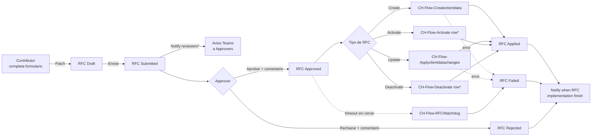

# Administración de datos de clientes

> Alcance: altas, modificaciones, activaciones y bajas de Clientes,
> Sucursales, Correos autorizados y Cuentas, todas vía RFC (Request For
> Change) con aprobación cuatro-ojos y flujos aplicadores.

## 1. Qué es este proceso

Nadie escribe directo sobre el dato maestro de un cliente. Cualquier alta o
cambio — nombre, CIF, una sucursal nueva, un correo autorizado, una cuenta,
o pasar un registro a Inactive — nace como una **solicitud de cambio (RFC)**
en estado Draft/Submitted. Un segundo usuario, con permiso de aprobador para
esa tabla puntual, la revisa y decide Approved o Rejected. Recién ahí un
flujo de Power Automate separado — según el tipo de RFC — hace la escritura
real sobre Cliente, Sucursal, Correo o Cuenta y cierra el ciclo en Applied o
Failed. Aprobar **nunca** aplica el cambio: aprobar solo habilita a que el
aplicador lo tome.

La separación de funciones (quien pide ≠ quien aprueba, y quien aprueba debe
pertenecer al grupo Approver de esa tabla) no es solo un botón oculto en la
app: la impone un plugin server-side (§2, §8), así que sigue firme aunque
alguien le pegue al registro por Web API o Excel.

Handoffs:

- **Entrega a** [02-recepcion-ingesta-emails](02-recepcion-ingesta-emails.md):
  el motor de validación de correos resuelve remitente y CIF contra el
  Cliente/Correo/Cuenta que este proceso mantiene (VR-24/25/26 en
  `docs/soluciones/04-backend.md`). Un cliente en `recordstatus = Inactive`
  o un correo no autorizado hace que el correo entrante rebote.
- **Entrega a** [07-tracking-depositos](07-tracking-depositos.md): el
  tracker resuelve el cliente del depósito contra el mismo maestro.
- **Recibe de** [00-acceso-y-plataforma](00-acceso-y-plataforma.md): la
  pertenencia a los grupos AAD Contributor/Approver por tabla, resuelta ahí.

*Estado ON/OFF de Notify reviewers, Activate row y Deactivate row: **verificar
en vivo** (ver §5).

## 2. Estados y transiciones

### 2.1 RFC — cabecera (`CH-Tbl-ClientDataChangeRequest` /
`sanic_chtblclientdatachangerequest`), campo `sanic_changestatus`

> El campo vivió antes como `cr140_changestatus`, de un publisher ajeno a la
> solución (`cr140`, no `sanic`). Se migró a `sanic_changestatus` con los
> mismos valores que ya usaba la línea — ver
> `scripts/migrate-cr140-changestatus.sh` y
> `docs/desarrollo/06-runbook-migracion-cr140.md`. El nombre viejo puede
> seguir apareciendo en documentación histórica; el código vivo (Entity.xml,
> el guard, los 6 flujos) ya usa `sanic_changestatus`.

| Valor | Etiqueta | Quién transiciona | Guard |
|---|---|---|---|
| 159460000 | Draft | Contributor (crea/edita el borrador) | Ninguno — libre mientras sea el propio Draft |
| 159460001 | Submitted | Contributor (Enviar) | App bloquea si hay otro RFC no resuelto sobre el mismo campo + mismo registro destino |
| 159460002 | Approved | Approver | `GuardChangeRequestApprovalPlugin`: previo debe ser Submitted, resolutor ≠ creador, resolutor pertenece al grupo Approver de la tabla objetivo (fail-closed) |
| 159460003 | Rejected | Approver | Mismo guard que Approved |
| 159460004 | Applied | Flujo aplicador (sistema) | — transición de sistema, el guard la deja pasar sin fricción |
| 159460005 | Failed | Flujo aplicador o `CH-Flow-RFCWatchdog` | — ídem |
| 159460006 | Canceled | Contributor (desde Draft) | — ídem |

El guard además bloquea **crear** un RFC que nazca ya en Approved, Rejected,
Applied o Failed (cierra el bypass de un `Create` directo por Web API con el
estado final ya puesto).

### 2.2 RFC — línea (`CH-Tbl-ClientDataChangeRequestLine` /
`sanic_chtblclientdatachangerequestline`), campo `sanic_changestatus`

Mismos siete valores 159460000-006, con una etiqueta distinta en 159460003:
**Denied** (no "Rejected" — la cabecera y la línea usan la misma escala
numérica pero la línea llama distinto a ese valor puntual). La decisión de
Aprobar/Rechazar se aplica a **todas las líneas de la solicitud a la vez**:
no existe un camino de UI para aprobar una línea y rechazar otra dentro del
mismo RFC, aunque el modelo de datos sí guarda un estado por línea.

Bug histórico ya corregido (ver CHANGELOG): la acción `Actualizar status CRL
a FAILED` de los flujos aplicadores escribía 159460004 (Applied) en vez de
159460005 (Failed) — una línea que fallaba quedaba marcada como aplicada.
Corregido a 159460005 y desplegado en DEV; el caso CA-15 lo verifica en vivo.

### 2.3 Tipo de RFC (`sanic_type`, en la cabecera)

| Valor | Etiqueta | Dispara |
|---|---|---|
| 159460000 | Update | `CH-Flow-Applyclientdatachanges` |
| 159460001 | Deactivate | `CH-Flow-Deactivate row` |
| 159460002 | Create | `CH-Flow-Createclientdata` |
| 159460003 | Activate | `CH-Flow-Activate row` |

### 2.4 `recordstatus` de Cliente / Sucursal / Correo / Cuenta
(`sanic_recordstatus`, option set global `sanic_chchrecordstatus`)

| Valor | Etiqueta |
|---|---|
| 159460000 | Active |
| 159460001 | Inactive |
| 159460002 | PendingApproval |
| 159460003 | PendingDeactivation |

**Hecho verificado esta sesión** (contradice cualquier doc que diga que el
cliente nace directo en Active): el `AppDefaultValue` de `sanic_recordstatus`
en `CH-Tbl-Client/Entity.xml` es **159460002 (PendingApproval)**. Un cliente
recién creado en pantalla nace pendiente; recién cuando el RFC de tipo
**Create** queda Approved y `CH-Flow-Createclientdata` lo materializa, el
registro se crea/activa con `sanic_recordstatus = Active` directamente en el
JSON de creación (el flujo agrega ese campo al construir el registro, no lo
deja en el default). Los valores PendingDeactivation no tienen, hasta donde
cubre este documento, un flujo que los escriba de forma automática — su uso
real es **verificar en vivo**.

Statecode/statuscode estándar de Dataverse (Active/Inactive, valores 0/1) es
un campo aparte de `sanic_recordstatus` en las 4 tablas; ambos existen en
paralelo, `sanic_recordstatus` es el que gobierna la lógica de negocio de
este proceso.

## 3. Roles y acceso

Roles de seguridad Dataverse (`solutions/unpacked/core/Roles/`):

| Rol | Sobre las 10 tablas del dominio |
|---|---|
| `CH-SR-ClientAdminContributor` | Read Global de Client/ClientBranch/ClientEmail/ClientDataChangePermission/ClientDataChangeRequest(Line)/AuditTrail/DepositHistory/TableLogicalFieldName. Create/Write **Basic** (solo lo propio) de ChangeRequest y ChangeRequestLine. |
| `CH-SR-ClientAdminApprover` | Mismo Read Global que Contributor. Write **Global** de ChangeRequest y ChangeRequestLine (necesita poder mover cualquier RFC, no solo el propio). |

Ninguno de los dos roles tiene privilegio de escritura sobre Client,
ClientBranch ni ClientEmail — **solo lectura Global sobre esos 3 maestros**
(`prvReadsanic_CHTblClient`, `prvReadsanic_CHTblClientBranch`,
`prvReadsanic_CHTblClientEmail`, verificado en los XML de ambos roles).
**Sobre `CH-Tbl-ClientAccount` (Cuenta) ninguno de los dos roles declara
privilegio alguno** — ni Create, ni Read, ni Write: un `rg` sobre
`ClientAdminContributor.xml` y `ClientAdminApprover.xml` no devuelve ningún
`prv*sanic_CHTblClientAccount`. La única escritura real sobre Client/
ClientBranch/ClientEmail/ClientAccount la hace la cuenta de servicio bajo la
que corren los flujos aplicadores. Esto es intencional para los 3 maestros
con lectura: ni el Contributor ni el Approver pueden saltarse el ciclo RFC
editando el maestro directo, aunque tuvieran acceso a Excel/Web API — el rol
de seguridad se lo impide antes de que el guard tenga que intervenir. Sobre
Cuenta, en cambio, la ausencia total de privilegio es una laguna sin
documentar en el diseño original (§10) — no hay evidencia en el repo de que
sea deliberada.

Distinción app vs. servidor:

- **La app verifica** (cosmético): oculta los botones Aprobar/Rechazar si el
  usuario no tiene, en `colClientDataPermissions` (armada en `App.OnStart`
  vía `checkMemberGroups`, fail-**cerrado** — si Graph falla no se otorga
  ningún permiso), una fila Approver para la tabla objetivo; oculta
  Enviar/Cancelar si el usuario no es el creador.
- **El servidor impone** (real): `GuardChangeRequestApprovalPlugin` (§2.1,
  §8) — estado previo Submitted, resolutor ≠ creador, y desde la Fase 2
  también la membresía real del grupo Approver, resuelta contra
  `CH-Tbl-ClientDataChangePermission` (tabla → grupo AAD) y el **Azure AD
  group team** correspondiente (`teammembership`), fail-closed: sin grupo
  configurado o sin membresía confirmada, se bloquea. Los AAD group teams
  que el guard necesita se provisionan con
  `scripts/provision-approver-teams.sh` (uno por grupo AAD distinto usado
  como Approver en `CH-Tbl-ClientDataChangePermission`; la membresía se
  materializa sola cuando cada aprobador entra al entorno).

Matriz quién-puede-qué (tabla `CH-Tbl-ClientDataChangePermission` /
`sanic_chtblclientdatachangepermission`, campo `sanic_type`): **159460000
Contributor**, **159460001 Approver**. Una fila = (tabla objetivo en
`sanic_name`, tipo, grupo AAD en `sanic_aadgroupid` — texto libre, sin
relación con ninguna Environment Variable ni catálogo, editable solo por
quien tenga escritura sobre esta tabla — es decir, hoy nadie vía rol
`ClientAdmin*`, ver arriba). Sembrado hoy con 8 filas reales de Banca de
Empresas y Bóveda (CHANGELOG).

Sobre `sanic_CHEVAADGroup_ClientAdmin` (Environment Variable declarada en
Core): sin referencia textual confirmada en flujos ni apps — el patrón real
de grupos AAD para este proceso vive en filas de
`CH-Tbl-ClientDataChangePermission`, no en esta variable (ver
[referencia/variables-de-entorno.md](../referencia/variables-de-entorno.md)).

## 4. Aplicaciones

Única vía oficial: la **canvas app** `CH-App-ClientAdministration`
(`sanic_chappclientadministration_fd97f`). La **app model-driven** que existía
en paralelo (AppModule + sitemap + 9 web resources de formulario, todos con
sus validaciones desconectadas del evento que las dispara) fue **eliminada
por decisión de negocio** (CHANGELOG) — si ves referencias a ella en manuales
viejos, están obsoletas. Esta app **no** pasó por el rediseño v2 que sí
tuvieron Reception/Recounting/Supervisor/Digitization/Hub/Tracker — sigue
siendo la app v1 descrita en
[docs/guias/06-manual-administracion-clientes.md](../guias/06-manual-administracion-clientes.md).

| Pantalla | Sirve a |
|---|---|
| Splash | Entrada; si trae `Param("RFC")` (deep-link de Teams), navega directo a ChangeRequestDetails. |
| Clients | Alta y listado de Cliente — genera RFC tipo Create con 3 líneas (Nombre/CIFBCO/CIFCOM) en un solo Patch. |
| ClientInformation | Ficha de un cliente: sub-grillas de Sucursales, Correos y **Cuentas** (número + moneda). Cada alta/edición ahí es un RFC propio — **dar de alta un cliente con 1 sucursal y 1 correo genera 3 RFC independientes**, cada uno aprobable por separado (limitación conocida, §10). |
| RFC | Dashboard de solicitudes (toggle pendientes/todas) con badges de color por estado; sin lógica de creación/aprobación propia. |
| ChangeRequestDetails | Pantalla de resolución: cabecera, líneas (valor viejo/nuevo), botones Aprobar/Rechazar/Enviar/Cancelar; comentario obligatorio al resolver. |

Indicador "RFC en curso" por fila en Clients/ClientInformation (colección
precargada, sin N+1) — mitiga el sub-bloqueo de crear dos RFC sobre el mismo
campo sin saberlo.

## 5. Flujos Power Automate

> **CAVEAT del CONTRATO**: el export de `solutions/unpacked/flow/` es un
> snapshot puntual (hoy en `Version 1.12.0.0`) y no necesariamente refleja
> reactivaciones hechas directo en el ambiente vivo — el caso confirmado es
> `Apply client data changes` (ver abajo). Donde el estado no se pudo
> confirmar de forma consistente entre export y CHANGELOG, se marca
> **verificar en vivo**.

| Flujo | Trigger (webhook sobre `sanic_chtblclientdatachangerequest`) | Estado | Owner de la conexión |
|---|---|---|---|
| `CH-Flow-Notify reviewers` | Update, `sanic_changestatus = Submitted` | **verificar en vivo** | `new_sharedteams_084e4` |
| `CH-Flow-Apply client data changes` | Update, `Approved + Update` | **ON** (reparado y reactivado — CHANGELOG; el export local todavía lo muestra Draft/OFF, no confiar en el export para este flujo puntual) | `sanic_CHCRDataverse` |
| `CH-Flow-Create client data` | Update, `Approved + Create` | ON (confirmado en export) | `sanic_CHCRDataverse` |
| `CH-Flow-Activate row` | Update, `Approved + Activate` | **verificar en vivo** | `sanic_CHCRDataverse` |
| `CH-Flow-Deactivate row` | Update, `Approved + Deactivate` | **verificar en vivo** | `sanic_CHCRDataverse` |
| `CH-Flow-Notify when RFC implementation finish` | Update, `Rejected \| Applied \| Failed` | ON (confirmado en export) | `new_sharedteams_084e4` |
| `CH-Flow-RFCWatchdog` | Recurrence 15 min | ON (confirmado en export) | `sanic_CHCRDataverse` |

Qué toca cada uno:

- **Notify reviewers**: dispara sobre `Update` del RFC (webhook `message: 4`,
  igual código que usan `Apply client data changes`/`Create client data`;
  coherente con el propio ciclo de vida del RFC — nace en Draft, `sanic_changestatus
  = Submitted` solo se alcanza con el Enviar, que es un Update, nunca un Create).
  Arma una Adaptive Card con el diff (campo, valor actual, nuevo) y la postea
  al chat Teams del grupo Approver de la tabla destino (crea el group chat vía
  el flujo hijo `Create a Teams chat group…` si todavía no existe uno para ese
  grupo).
- **Apply client data changes**: por cada línea, `Switch` por `sanic_datatype`
  del catálogo de campos (§6) y `Update` sobre el registro destino. Try/Catch
  global: cualquier fallo — incluido el primer paso — cierra el RFC en Failed
  con auditoría (antes de la tanda 2 de mejoras, un fallo temprano dejaba el
  RFC en Approved para siempre).
- **Create client data**: arma el JSON completo desde las líneas, agrega
  `sanic_recordstatus = Active` y crea el registro. Enlaza `sanic_targetrecordid`
  y `sanic_RelatedClient` en el RFC y en cada fila de auditoría de creación de
  cliente (fix de backfill de `Update_a_row_1`/`Update_a_row` — antes eran
  PATCH sin campos, no-ops, y el RFC quedaba sin saber qué registro había
  creado).
- **Activate row / Deactivate row**: `Switch` por tabla destino (Client,
  ClientBranch, ClientEmail, ClientAccount) y `Update` de
  `sanic_recordstatus` a Active/Inactive.
- **RFCWatchdog**: lee la Environment Variable `sanic_CHEVRfcApplyTimeoutMinutes`
  (default 30 si no está seteada), busca RFC en Approved con `modifiedon` más
  viejo que el timeout y los marca Failed con nota + auditoría. Es la red de
  contención para el punto único de falla de los aplicadores — hoy es el que
  efectivamente "cierra" cualquier RFC de Update/Activate/Deactivate cuyo
  aplicador esté apagado (§10).

Gap de OptionSet, ya corregido — pero **solo en uno de los dos aplicadores**:
el caso `OptionSet (159460005)` del switch de tipo de dato en
`Apply client data changes` hacía `AppendToArrayVariable` sobre `varItem`,
una variable que ese flujo nunca inicializaba (patrón copiado de
`Create client data`, donde sí se inicializa) — la definición no validaba
(`InvalidVariableOperation`), el flujo quedaba en Draft y un cambio aprobado
sobre un campo de lista de opciones nunca se escribía. Se corrigió
reemplazando esa rama por un `Update_a_row_optionset` explícito (confirmado
en el JSON exportado de `Apply client data changes`). `Create client data`
**nunca tuvo el bug**: su rama `OptionSet` ya construía la propiedad y la
agregaba a `varItem` correctamente desde antes (el JSON exportado sigue
usando ese patrón `AppendToArrayVariable`, no `Update_a_row_optionset` — no
hacía falta reemplazarlo). El caso **CA-14** pide confirmar en vivo que la
escritura del campo OptionSet efectivamente ocurre en un RFC de tipo Update.

## 6. Tablas

Las 10 tablas del dominio, todas `UserOwned` (el modelo de seguridad estándar
de privilegios por rol aplica de lleno — no son de acceso libre):

| Tabla | Display name / logical name | Rol |
|---|---|---|
| Cliente | `CH-Tbl-Client` / `sanic_chtblclient` | Maestro. Campos propios: `sanic_name`, `sanic_cifbco`, `sanic_cifcom`, `sanic_iseditable`, `sanic_recordstatus`. |
| Sucursal | `CH-Tbl-ClientBranch` / `sanic_chtblclientbranch` | `sanic_client` (lookup), `sanic_name`, `sanic_clientstatus`, `sanic_recordstatus`, `sanic_clientnamemirror`. |
| Correo autorizado | `CH-Tbl-ClientEmail` / `sanic_chtblclientemail` | `sanic_client`, `sanic_name`, `sanic_alwaysnotify`, `sanic_clientstatus`, `sanic_recordstatus`. |
| Cuenta | `CH-Tbl-ClientAccount` / `sanic_chtblclientaccount` | `sanic_client`, `sanic_name` (número, alternate key única a nivel banco), `sanic_currency` (option set global), `sanic_recordstatus`, `sanic_chchrecordstatus`. |
| RFC — cabecera | `CH-Tbl-ClientDataChangeRequest` / `sanic_chtblclientdatachangerequest` | `sanic_changestatus`, `sanic_type`, `sanic_targettable`, `sanic_targetrecordid`, `sanic_targettabledisplayname`, `sanic_targettablepluralname`, `sanic_relatedclient`, `sanic_reason`, `sanic_reasonfordecision`, `sanic_solvedby`, `sanic_solvedon`, `sanic_applynotes`, `sanic_applyon`. |
| RFC — línea | `CH-Tbl-ClientDataChangeRequestLine` / `sanic_chtblclientdatachangerequestline` | `sanic_changerequestid` (lookup a la cabecera), `sanic_fielddefinition` (lookup al catálogo), `sanic_oldvalue`, `sanic_newvalue`, `sanic_changestatus`, `sanic_reasonfordecision`. |
| Permiso | `CH-Tbl-ClientDataChangePermission` / `sanic_chtblclientdatachangepermission` | `sanic_name` (tabla objetivo, pese al nombre del campo), `sanic_type` (Contributor/Approver), `sanic_aadgroupid` (texto libre), `sanic_teamsgroupid` (chat cacheado). |
| Bitácora de aplicación | `CH-Tbl-ClientDataChangesAuditTrail` / `sanic_chtblclientdatachangesaudittrail` | `sanic_message`, `sanic_opeationtype` (**typo de esquema real**: falta la "r" de "operation" — no es error de este doc), `sanic_relatedclient`, `sanic_relatedcrl`, `sanic_relatedrfc`, `sanic_result`. |
| Catálogo de campos editables | `CH-Tbl-ClientTableLogicalFieldName` / `sanic_chtblclienttablelogicalfieldname` | `sanic_table`, `sanic_tabledisplayname`, `sanic_tablepluralname`, `sanic_logicalname`, `sanic_datatype` (Text/Number/Date/Money/Lookup/OptionSet/…, ver §5), `sanic_isallowed`, `sanic_lookuptargettable`, `sanic_optionsetmap`. |
| Historial de depósito | `CH-Tbl-ClientDepositHistory` / `sanic_chtblclientdeposithistory` | Fuera del ciclo RFC — la llena el proceso de tracking, no este. |

Columna **mantenida por plugin — no editar a mano**:

- `sanic_clientnamemirror` (texto 850) en `CH-Tbl-ClientBranch`: espejo de
  `sanic_client.sanic_name`, estampado por `ClientBranchNameMirrorPlugin`
  (§8) para que el combo de sucursales de Reception v2 filtre por nombre de
  cliente con `StartsWith` **delegado**, sin navegar la relación (con
  decenas de miles de sucursales, `Filter` sobre la relación no delega y el
  combo miente por debajo del tope de filas). **Limitación conocida**: no
  hay cascada por rename del cliente — si el cliente cambia `sanic_name`,
  las sucursales ya existentes quedan con el nombre viejo hasta que se
  corra `scripts/backfill-clientbranch-mirror.py` (idempotente, solo
  PATCHea lo que difiere). Es deliberado: un rename de cliente es raro y
  controlado (pasa por RFC), y una cascada síncrona sobre miles de
  sucursales convertiría "corregir una letra" en una operación pesada.

Referencia completa del modelo de datos y de los choices globales:
[referencia/modelo-de-datos.md](../referencia/modelo-de-datos.md),
[referencia/catalogo-de-choices.md](../referencia/catalogo-de-choices.md).

## 7. Custom APIs

No aplica: este proceso no tiene ninguna Custom API propia. La única Custom
API del repo (`sanic_CHValidateReceivedEmail`) pertenece al proceso de
[02-recepcion-ingesta-emails](02-recepcion-ingesta-emails.md) y solo
**consume** los datos que este proceso mantiene (resuelve cliente/correo
contra el maestro); no escribe sobre ninguna de las 10 tablas del dominio de
Client Administration.

## 8. Steps de plugins

Ambos steps viven en `CashHub.Plugins` (mismo assembly firmado que el motor
de validación de correos) y corren **síncronos en Pre-operation (stage 20)**
— tienen que poder abortar la transacción antes de que el pipeline la
persista.

| Plugin | Mensaje / etapa / filtro | Qué regla de negocio defiende |
|---|---|---|
| `GuardChangeRequestApprovalPlugin` | `Update` de `sanic_chtblclientdatachangerequest`, Pre-operation (20), filtrado en `sanic_changestatus`, con pre-image (`sanic_changestatus, createdby, sanic_targettable`) | Separación de funciones: bloquea que el creador de un RFC apruebe/rechace su propia solicitud, exige estado previo Submitted, y (Fase 2) exige que el resolutor pertenezca al grupo AAD Approver de la tabla objetivo destino — resuelto contra `CH-Tbl-ClientDataChangePermission` + membresía del Azure AD group team. Fail-closed en toda la cadena: sin grupo configurado, sin membresía resuelta, o sin creador identificable, se bloquea. |
| `GuardChangeRequestApprovalPlugin` | `Create` de `sanic_chtblclientdatachangerequest`, Pre-operation (20), sin filtro de atributo | Impide que un RFC nazca ya resuelto (Approved/Rejected/Applied/Failed) — cierra el bypass de crear directo en un estado final por Web API. |
| `ClientBranchNameMirrorPlugin` | `Create` de `sanic_chtblclientbranch`, Pre-operation (20), sin filtro | Estampa `sanic_clientnamemirror` con una sola lectura del cliente (como sistema — es una derivación, no un permiso de negocio) y cero escrituras adicionales (escribe en el propio Target). |
| `ClientBranchNameMirrorPlugin` | `Update` de `sanic_chtblclientbranch`, Pre-operation (20), filtrado en `sanic_client` | Re-estampa el espejo solo cuando la sucursal se re-cuelga de otro cliente; un Update que no toca `sanic_client` no dispara el step. |

Las transiciones de sistema (`Approved→Applied/Failed` que hacen los flujos
aplicadores, `→Canceled`, `Draft→Submitted`) pasan por el guard sin fricción
— solo intercepta la **decisión humana** (`→Approved`/`→Rejected`) y el
`Create` en un estado resuelto.

Registro (idempotente, vía Web API): `scripts/register-clientadmin-guard.sh`
y `scripts/register-clientbranch-mirror.sh`. Ambos re-suben el mismo
`pluginassembly` (un solo DLL con todos los tipos adentro) y crean/actualizan
el `plugintype` y los `sdkmessageprocessingstep` correspondientes.

## 9. Acciones

### Crear un RFC de alta de Cliente

| Campo | Contenido |
|---|---|
| **Quién** | Contributor de la tabla Cliente |
| **Cuándo** | En cualquier momento; no depende de otro RFC |
| **Por qué / para qué** | Da de alta un cliente nuevo en el maestro; habilita después dar de alta sus sucursales, correos y cuentas |
| **Cómo** | Clients → botón Nuevo → completar Nombre/CIFBCO/CIFCOM → Guardar |
| **Qué valida el servidor** | El `Create` del RFC pasa por `GuardChangeRequestApprovalPlugin` (solo bloquea si viniera con un estado ya resuelto; un alta normal nace Draft/Submitted y pasa libre). El rol `CH-SR-ClientAdminContributor` limita el Create/Write de RFC a nivel Basic (solo lo propio). |
| **Qué pasa si falla / deshacer** | Si falla el guard: rebote con el mensaje de `ApprovalGuardResult.Reason`. Deshacer: sí — mientras el RFC siga en Draft, Cancelar lo mueve a Canceled sin haber tocado el maestro. |

### Enviar un RFC (Draft → Submitted)

| Campo | Contenido |
|---|---|
| **Quién** | El Contributor que creó el RFC |
| **Cuándo** | RFC propio en Draft |
| **Por qué / para qué** | Dispara la revisión: notifica a los aprobadores (si `Notify reviewers` está ON) y habilita los botones Aprobar/Rechazar para el Approver |
| **Cómo** | ChangeRequestDetails → botón Enviar |
| **Qué valida el servidor** | La app bloquea el envío si hay otro RFC en curso sobre el mismo campo + mismo registro destino (conflict-check corregido para excluir el propio RFC y clientes no relacionados). El guard no interviene en esta transición (Draft→Submitted pasa libre). |
| **Qué pasa si falla / deshacer** | Mensaje de conflicto en pantalla, el RFC queda en Draft. Deshacer: Cancelar sigue disponible desde Draft. |

### Aprobar un RFC

| Campo | Contenido |
|---|---|
| **Quién** | Approver de la tabla objetivo del RFC, distinto del creador |
| **Cuándo** | RFC en Submitted |
| **Por qué / para qué** | Habilita que el flujo aplicador correspondiente materialice el cambio sobre el maestro |
| **Cómo** | RFC → abrir en ChangeRequestDetails → botón Aprobar → comentario obligatorio |
| **Qué valida el servidor** | `GuardChangeRequestApprovalPlugin`, Update Pre-operation: previo = Submitted, `initiatingUserId ≠ createdby`, y membresía confirmada en el grupo Approver de `sanic_targettable` (query a `CH-Tbl-ClientDataChangePermission` + `teammembership` del Azure AD group team). Cualquiera de las tres condiciones que falle bloquea con `InvalidPluginExecutionException`. |
| **Qué pasa si falla / deshacer** | El usuario ve el error del guard tal cual (mensajes en español, nunca genéricos — p. ej. "El creador de un RFC no puede aprobar su propia solicitud"). No hay deshacer: aprobar es una transición de estado, no hay botón de "desaprobar"; si fue un error, hay que esperar a que el aplicador falle o pedir un RFC nuevo. |

### Rechazar un RFC

| Campo | Contenido |
|---|---|
| **Quién** | Approver de la tabla objetivo, distinto del creador |
| **Cuándo** | RFC en Submitted |
| **Por qué / para qué** | Cierra la solicitud sin aplicar ningún cambio; deja constancia del motivo |
| **Cómo** | ChangeRequestDetails → botón Rechazar → comentario obligatorio |
| **Qué valida el servidor** | Mismo guard que Aprobar (estado previo, identidad, membresía) |
| **Qué pasa si falla / deshacer** | Igual que Aprobar. No hay deshacer — Rejected es terminal; se necesita un RFC nuevo para reintentar el cambio. |

### El aplicador materializa el cambio (automático, sin acción humana)

| Campo | Contenido |
|---|---|
| **Quién** | Flujo Power Automate (`Create client data` / `Apply client data changes` / `Activate row` / `Deactivate row`, según `sanic_type`), corre como la cuenta de servicio de la conexión |
| **Cuándo** | Webhook `Update` del RFC con `sanic_changestatus = Approved` |
| **Por qué / para qué** | Es el único punto que escribe de verdad sobre Cliente/Sucursal/Correo/Cuenta |
| **Cómo** | Automático — no hay gesto humano |
| **Qué valida el servidor** | El propio flujo (conversión por `sanic_datatype`, Try/Catch que fuerza Failed ante cualquier error incluido el primer paso) más `ClientBranchNameMirrorPlugin` si la escritura toca una sucursal |
| **Qué pasa si falla / deshacer** | RFC → Failed con `sanic_applynotes` explicando el motivo y una fila en `CH-Tbl-ClientDataChangesAuditTrail`; notifica por Teams al creador y al aprobador (`Notify when RFC implementation finish`). Sin deshacer automático: un RFC Failed no reintenta solo — hay que evaluar y, si corresponde, crear un RFC nuevo. |

### El watchdog cierra un RFC atascado (automático)

| Campo | Contenido |
|---|---|
| **Quién** | `CH-Flow-RFCWatchdog`, recurrencia cada 15 minutos |
| **Cuándo** | RFC en Approved con `modifiedon` más viejo que `sanic_CHEVRfcApplyTimeoutMinutes` (default 30 min si la variable no está seteada) |
| **Por qué / para qué** | Evita que un RFC quede "aprobado" para siempre si su aplicador falló antes de poder marcar el resultado (punto único de falla del primer paso de los aplicadores) |
| **Cómo** | Automático |
| **Qué valida el servidor** | El propio flujo — lee la Environment Variable, filtra por timeout, marca Failed con nota y auditoría |
| **Qué pasa si falla / deshacer** | Si el watchdog mismo falla, el RFC sigue trabado en Approved sin nadie enterado — no tiene su propia red de contención. Sin deshacer: la única salida es un RFC nuevo. |

## 10. Supuestos y limitaciones

- **Un alta completa de cliente son 3 (o 4, con cuenta) RFC independientes**,
  no una unidad. Cliente, Sucursal, Correo y Cuenta se piden por separado,
  cada uno con su propio ciclo Draft→…→Applied, potencialmente aprobados por
  personas distintas en momentos distintos. No existe un "RFC compuesto" que
  agrupe el alta completa como una sola aprobación.
- **La app model-driven fue retirada por decisión de negocio.** La canvas
  app es la única vía soportada; cualquier manual o captura que muestre
  "Governance"/"Reviews" en la navegación estándar de Dataverse describe un
  estado que ya no existe.
- **Los cambios sobre campos de tipo OptionSet tuvieron una ventana en la que
  se ignoraban silenciosamente en `Apply client data changes`** (rama vacía
  del switch de tipo de dato — `Create client data` nunca tuvo este bug, ver
  §5). Se corrigió con un `Update_a_row_optionset` explícito en ese flujo —
  el caso **CA-14** exige confirmarlo en vivo antes de asumirlo cerrado en el
  ambiente que estés mirando.
- **Ni `CH-SR-ClientAdminContributor` ni `CH-SR-ClientAdminApprover` declaran
  ningún privilegio (Create/Read/Write) sobre `CH-Tbl-ClientAccount`** —
  verificado con `rg` sobre los dos XML de rol: ningún `prv*sanic_CHTblClientAccount`
  aparece en ninguno de los dos. Como la sub-grilla de Cuentas de
  ClientInformation (§4) lee de esa tabla, un Contributor/Approver sin ningún
  otro privilegio adicional (rol de plataforma, sharing, etc. — fuera del
  alcance de este documento) debería ver esa sub-grilla vacía por el modelo de
  seguridad estándar de Dataverse. No hay evidencia en el repo de que sea
  deliberado ni de que exista otra vía de acceso — **verificar en vivo**.
- **Estado ON/OFF de `Notify reviewers`, `Activate row` y `Deactivate row`:
  verificar en vivo.** El export local de la solución de flujos no es
  necesariamente el estado real del ambiente (caso confirmado: `Apply client
  data changes` aparece OFF en el export pero el CHANGELOG registra su
  reparación y reactivación verificada en vivo). Mientras `Activate row` /
  `Deactivate row` estén OFF, un RFC de tipo Activate/Deactivate aprobado no
  se aplica nunca — a los ~30 minutos el watchdog lo marca Failed.
- **`sanic_applyon` es de solo lectura desde CHANGELOG reciente**: antes
  parecía un picker editable que sugería poder "programar" cuándo se aplica
  un cambio; en realidad los flujos aplican de inmediato y pisan el campo con
  la fecha real de aplicación. Si ves esta pantalla en un ambiente viejo con
  el campo editable, es una versión sin ese fix.
- **No hay validación de correo duplicado por cliente a nivel de esquema**:
  `CH-Tbl-ClientEmail` no tiene alternate key sobre (cliente, dirección); dos
  RFC pueden dar de alta el mismo correo dos veces para el mismo cliente sin
  que el sistema lo impida.
- **El espejo `sanic_clientnamemirror` no cascadea por rename del cliente**
  (ver §6) — es una limitación deliberada, cubierta por un script de backfill
  manual, no un bug pendiente.

## 11. Pruebas

Casos cubiertos en
[docs/guias/09-plan-de-pruebas-integral.md](../guias/09-plan-de-pruebas-integral.md):
**CA-01** a **CA-15** (sección "A Client Admin"). Cubren, entre otros: alta
de cliente desde cero y su aprobación (CA-01/02), alta de sucursal con
verificación del espejo (CA-03), alta de correo y de cuenta (CA-04/05),
update de campo simple (CA-06), desactivar/reactivar cliente y su efecto en
la ingesta de correos (CA-07/08), auto-aprobación bloqueada por Web API
directa (CA-09), notificaciones Teams (CA-10), RFC en conflicto (CA-11), el
watchdog (CA-12), rechazo (CA-13), OptionSet en RFC de Update (CA-14, marcado
⚠️ — confirmar el fix en vivo) y línea fallida honesta (CA-15).
