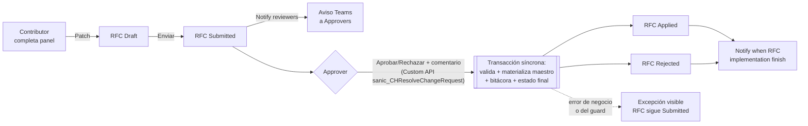

# Administración de datos de clientes

> Alcance: altas, modificaciones, activaciones y bajas de Clientes,
> Sucursales, Correos autorizados y Cuentas, todas vía RFC (Request For
> Change) con aprobación cuatro-ojos y materialización **síncrona** por
> Custom API.

## 1. Qué es este proceso

Nadie escribe directo sobre el dato maestro de un cliente. Cualquier alta o
cambio — nombre, CIF, una sucursal nueva, un correo autorizado, una cuenta,
o pasar un registro a Inactive — nace como una **solicitud de cambio (RFC)**
en estado Draft/Submitted. Un segundo usuario, con permiso de aprobador para
esa tabla puntual, la revisa y decide.

**Desde el rediseño v2 (desplegado 2026-08-25), la decisión ES la
materialización.** Aprobar o Rechazar ya no es un cambio de estado que
espera a un flujo aparte: invoca la Custom API `sanic_CHResolveChangeRequest`
(§7), que en la misma transacción del pipeline valida separación de
funciones, escribe el maestro (Cliente/Sucursal/Correo/Cuenta) si corresponde,
registra la bitácora y deja la cabecera en su estado final — **Applied** o
**Rejected** — todo antes de devolver la respuesta a la app. El estado
intermedio `Approved` que existía en la v1 (una solicitud "aprobada" a la
espera de que un flujo la tomara, potencialmente para siempre si ese flujo
estaba caído) **ya no se escribe en este camino**: el ciclo salta de
`Submitted` directo a `Applied`/`Rejected`. El valor de opción `Approved`
sigue existiendo en el esquema (dato histórico de RFC resueltos antes de la
migración) pero ningún camino vivo lo produce.

La separación de funciones (quien pide ≠ quien aprueba, y quien aprueba debe
pertenecer al grupo Approver de esa tabla) no es solo un botón oculto en la
app: la impone un plugin server-side sobre la cabecera (§2, §8) y, desde v2,
también uno sobre las **líneas** del RFC (§8) — así que sigue firme aunque
alguien le pegue al registro por Web API o Excel.

Handoffs:

- **Entrega a** [02-recepcion-ingesta-emails](02-recepcion-ingesta-emails.md):
  el motor de validación de correos resuelve remitente y CIF contra el
  Cliente/Correo/Cuenta que este proceso mantiene (VR-24/25/26 en
  `docs/soluciones/04-backend.md`). Un cliente en `recordstatus = Inactive`
  o un correo no autorizado hace que el correo entrante rebote.
- **Entrega a** [07-tracking-depositos](07-tracking-depositos.md): el
  tracker resuelve el cliente del depósito contra el mismo maestro.
- **Recibe de** [00-acceso-y-plataforma](00-acceso-y-plataforma.md): la
  pertenencia a los grupos AAD Contributor/Approver por tabla, resuelta ahí.

Los 4 flujos materializadores (`Apply client data changes`, `Create client
data`, `Activate row`, `Deactivate row`) y el `RFCWatchdog` que cerraba los
RFC huérfanos quedaron **retirados** el 2026-08-25 — ver §5.

## 2. Estados y transiciones

### 2.1 RFC — cabecera (`CH-Tbl-ClientDataChangeRequest` /
`sanic_chtblclientdatachangerequest`), campo `sanic_changestatus`

> El campo vivió antes como `cr140_changestatus`, de un publisher ajeno a la
> solución (`cr140`, no `sanic`). Se migró a `sanic_changestatus` con los
> mismos valores que ya usaba la línea — ver
> `scripts/migrate-cr140-changestatus.sh` y
> `docs/desarrollo/06-runbook-migracion-cr140.md`. El nombre viejo puede
> seguir apareciendo en documentación histórica; el código vivo (Entity.xml,
> el guard, los 6 flujos) ya usa `sanic_changestatus`.

| Valor | Etiqueta | Quién transiciona | Guard |
|---|---|---|---|
| 159460000 | Draft | Contributor (crea/edita el borrador) | Ninguno — libre mientras sea el propio Draft |
| 159460001 | Submitted | Contributor (Enviar) | App bloquea si hay otro RFC no resuelto sobre el mismo campo + mismo registro destino (aviso, no bloqueo duro — el guard de servidor no impone esta regla) |
| 159460002 | Approved | **Sin uso en ningún camino vivo** desde 2026-08-25 | Valor histórico: RFC resueltos antes de la migración a Custom API pueden tenerlo grabado; ningún flujo ni la Custom API lo vuelven a escribir (ver §1) |
| 159460003 | Rejected | Approver, vía Custom API `sanic_CHResolveChangeRequest` (§7) | `ChangeRequestResolution.Evaluate` (dominio puro) delega la separación de funciones en la misma lógica de `ChangeRequestApprovalGuard`: previo debe ser Submitted, resolutor ≠ creador, resolutor pertenece al grupo Approver de la tabla objetivo (fail-closed) |
| 159460004 | Applied | Approver, vía la misma Custom API — **directo desde Submitted, sin pasar por Approved** | Mismo guard que Rejected; además, en Update/Create exige al menos una línea de cambio (`ChangeRequestResolution.RequiresLines`) — un RFC vacío es rechazado como error de negocio, no un éxito disfrazado |
| 159460005 | Failed | Sin uso en ningún camino vivo desde 2026-08-25 | La Custom API es transaccional: si algo falla, la excepción sale visible y el RFC **permanece en Submitted** (nunca queda "a medio aplicar" ni se graba en Failed) — el valor sigue existiendo en el esquema por compatibilidad histórica |
| 159460006 | Canceled | Contributor (desde Draft) | — transición de sistema/creador, sin fricción del guard |

El guard de cabecera (`GuardChangeRequestApprovalPlugin`) además bloquea
**crear** un RFC que nazca ya en Approved, Rejected, Applied o Failed (cierra
el bypass de un `Create` directo por Web API con el estado final ya puesto).
La Custom API resuelve la cabecera con la identidad real del resolutor (no
como sistema) precisamente para que este guard la re-valide de igual manera
que si fuera un Patch humano — ver §7/§8.

### 2.2 RFC — línea (`CH-Tbl-ClientDataChangeRequestLine` /
`sanic_chtblclientdatachangerequestline`), campo `sanic_changestatus`

Mismos siete valores 159460000-006, con una etiqueta distinta en 159460003:
**Denied** (no "Rejected" — la cabecera y la línea usan la misma escala
numérica pero la línea llama distinto a ese valor puntual). La decisión de
Aprobar/Rechazar se aplica a **todas las líneas de la solicitud a la vez**:
no existe un camino de UI para aprobar una línea y rechazar otra dentro del
mismo RFC, aunque el modelo de datos sí guarda un estado por línea.

Bug histórico ya corregido (ver CHANGELOG) y hoy **doblemente obsoleto**: la
acción `Actualizar status CRL a FAILED` de los flujos aplicadores (retirados,
§5) escribía 159460004 (Applied) en vez de 159460005 (Failed) — una línea que
fallaba quedaba marcada como aplicada. El caso CA-15 lo verificó en vivo antes
de la migración. Desde v2, la línea nunca puede quedar en un estado
intermedio incoherente: `ResolveChangeRequestPlugin` la mueve a Applied/Denied
en la misma transacción atómica en la que resuelve la cabecera — o la
transacción entera revierte y la línea sigue en Submitted junto con la
cabecera.

`GuardChangeRequestLinePlugin` (nuevo, §8) impone además, sobre esta tabla,
que mientras el RFC padre esté en Draft no puede haber dos líneas apuntando
al mismo `sanic_fielddefinition` (cierra un duplicado silencioso que antes
nadie evitaba).

### 2.3 Tipo de RFC (`sanic_type`, en la cabecera)

| Valor | Etiqueta | Materializa (vía `sanic_CHResolveChangeRequest`) |
|---|---|---|
| 159460000 | Update | `Update` sobre el registro destino, un único `Entity` con todos los campos convertidos (atomicidad real: ya no hay un `Update` por campo) |
| 159460001 | Deactivate | `sanic_recordstatus = Inactive` sobre el registro destino |
| 159460002 | Create | `Create` del registro nuevo con todos los campos de las líneas + `sanic_recordstatus = Active` |
| 159460003 | Activate | `sanic_recordstatus = Active` sobre el registro destino |

La tabla destino se resuelve dinámicamente desde `sanic_targettable` de la
cabecera — a diferencia de los viejos `Activate row`/`Deactivate row`, que
tenían un `Switch` de 4 tablas hardcodeado.

### 2.4 `recordstatus` de Cliente / Sucursal / Correo / Cuenta
(`sanic_recordstatus`, option set global `sanic_chchrecordstatus`)

| Valor | Etiqueta |
|---|---|
| 159460000 | Active |
| 159460001 | Inactive |
| 159460002 | PendingApproval |
| 159460003 | PendingDeactivation |

El `AppDefaultValue` de `sanic_recordstatus` en `CH-Tbl-Client/Entity.xml` es
**159460002 (PendingApproval)** — pero eso solo importa para un registro
creado por fuera del ciclo RFC (o mientras el RFC de Alta sigue en Draft): un
cliente **no existe en el maestro** hasta que su RFC de tipo Create se
resuelve, y `ResolveChangeRequestPlugin` lo crea con `sanic_recordstatus =
Active` puesto explícitamente en el mismo `Create` (no lo deja en el default,
igual que hacía el viejo `Createclientdata`). Los valores PendingDeactivation
no tienen, hasta donde cubre este documento, un camino que los escriba de
forma automática — su uso real es **verificar en vivo**.

Statecode/statuscode estándar de Dataverse (Active/Inactive, valores 0/1) es
un campo aparte de `sanic_recordstatus` en las 4 tablas; ambos existen en
paralelo, `sanic_recordstatus` es el que gobierna la lógica de negocio de
este proceso.

## 3. Roles y acceso

Roles de seguridad Dataverse (`solutions/unpacked/core/Roles/`):

| Rol | Sobre las 10 tablas del dominio |
|---|---|
| `CH-SR-ClientAdminContributor` | Read Global de Client/ClientBranch/ClientEmail/ClientDataChangePermission/ClientDataChangeRequest(Line)/AuditTrail/DepositHistory/TableLogicalFieldName. Create/Write **Basic** (solo lo propio) de ChangeRequest y ChangeRequestLine. |
| `CH-SR-ClientAdminApprover` | Mismo Read Global que Contributor. Write **Global** de ChangeRequest y ChangeRequestLine (necesita poder mover cualquier RFC, no solo el propio). |

Ninguno de los dos roles tiene privilegio de escritura sobre Client,
ClientBranch ni ClientEmail — **solo lectura Global sobre esos 3 maestros**
(`prvReadsanic_CHTblClient`, `prvReadsanic_CHTblClientBranch`,
`prvReadsanic_CHTblClientEmail`, verificado en los XML de ambos roles).
**Sobre `CH-Tbl-ClientAccount` (Cuenta) ninguno de los dos roles declara
privilegio alguno** — ni Create, ni Read, ni Write: un `rg` sobre
`ClientAdminContributor.xml` y `ClientAdminApprover.xml` no devuelve ningún
`prv*sanic_CHTblClientAccount`. La única escritura real sobre Client/
ClientBranch/ClientEmail/ClientAccount la hace la cuenta de servicio bajo la
que corren los flujos aplicadores. Esto es intencional para los 3 maestros
con lectura: ni el Contributor ni el Approver pueden saltarse el ciclo RFC
editando el maestro directo, aunque tuvieran acceso a Excel/Web API — el rol
de seguridad se lo impide antes de que el guard tenga que intervenir. Sobre
Cuenta, en cambio, la ausencia total de privilegio es una laguna sin
documentar en el diseño original (§10) — no hay evidencia en el repo de que
sea deliberada.

Distinción app vs. servidor:

- **La app verifica** (cosmético): oculta los botones Aprobar/Rechazar si el
  usuario no tiene, en `colClientDataPermissions` (armada en `App.OnStart`
  vía `checkMemberGroups`, fail-**cerrado** — si Graph falla no se otorga
  ningún permiso), una fila Approver para la tabla objetivo; oculta
  Enviar/Cancelar si el usuario no es el creador.
- **El servidor impone** (real): `GuardChangeRequestApprovalPlugin` sobre la
  cabecera (§2.1, §8) — estado previo Submitted, resolutor ≠ creador, y desde
  la Fase 2 también la membresía real del grupo Approver, resuelta contra
  `CH-Tbl-ClientDataChangePermission` (tabla → grupo AAD) y el **Azure AD
  group team** correspondiente (`teammembership`), fail-closed: sin grupo
  configurado o sin membresía confirmada, se bloquea. Los AAD group teams
  que el guard necesita se provisionan con
  `scripts/provision-approver-teams.sh` (uno por grupo AAD distinto usado
  como Approver en `CH-Tbl-ClientDataChangePermission`; la membresía se
  materializa sola cuando cada aprobador entra al entorno). Desde v2,
  `GuardChangeRequestLinePlugin` (§8) impone la misma separación de
  funciones sobre las **líneas**, cerrando el hueco que existía antes.
  El Custom API `sanic_CHResolveChangeRequest` (§7) que dispara la
  resolución **reutiliza la misma resolución de membresía**
  (`ChangeRequestApproverResolver`, compartida entre el guard de cabecera,
  el de líneas y el plugin de la API) — es una sola fuente de verdad para
  "¿este usuario es Approver de esta tabla?", no tres implementaciones que
  puedan divergir.

Matriz quién-puede-qué (tabla `CH-Tbl-ClientDataChangePermission` /
`sanic_chtblclientdatachangepermission`, campo `sanic_type`): **159460000
Contributor**, **159460001 Approver**. Una fila = (tabla objetivo en
`sanic_name`, tipo, grupo AAD en `sanic_aadgroupid` — texto libre, sin
relación con ninguna Environment Variable ni catálogo, editable solo por
quien tenga escritura sobre esta tabla — es decir, hoy nadie vía rol
`ClientAdmin*`, ver arriba). Sembrado hoy con 8 filas reales de Banca de
Empresas y Bóveda (CHANGELOG).

Sobre `sanic_CHEVAADGroup_ClientAdmin` (Environment Variable declarada en
Core): sin referencia textual confirmada en flujos ni apps — el patrón real
de grupos AAD para este proceso vive en filas de
`CH-Tbl-ClientDataChangePermission`, no en esta variable (ver
[referencia/variables-de-entorno.md](../referencia/variables-de-entorno.md)).

## 4. Aplicaciones

Única vía oficial: la **canvas app v2** `CH-App-ClientAdministration v2`
(CashHubApps **1.33.0.0**, publicada en DEV el 2026-08-25). Esta app **sí**
pasó por el rediseño v2 que ya tuvieron Reception/Recounting/Supervisor/
Digitization/Hub/Tracker — descrita en
[docs/guias/06-manual-administracion-clientes.md](../guias/06-manual-administracion-clientes.md)
y en el detalle de reconstrucción de
[docs/clientadmin-rebuild/](../clientadmin-rebuild/00-analisis-y-plan.md).
La **app model-driven** que existía en paralelo en versiones anteriores
(AppModule + sitemap + 9 web resources de formulario, todos con sus
validaciones desconectadas del evento que las dispara) fue **eliminada por
decisión de negocio** (CHANGELOG) — si ves referencias a ella en manuales
viejos, están obsoletas.

100% controles clásicos nativos, sin Power CAT ni PCF, layout responsive
horizontal por contenedores manuales — mismo paradigma que el resto de la
familia v2 (ver `docs/clientadmin-rebuild/01-app.md` §0).

| Pantalla | Sirve a |
|---|---|
| `scrSplash` | Entrada; si trae `Param("RFC")` (deep-link de Teams), navega directo a `scrSolicitud`. |
| `scrClientes` | Listado de Cliente con badge "RFC en curso" por fila — alta de Cliente genera RFC tipo Create con 3 líneas (Nombre/CIFBCO/CIFCOM). |
| `scrCliente` | Ficha de un cliente: datos maestros de solo lectura + 5 pestañas (Sucursales/Correos/Cuentas/Solicitudes/Bitácora). Cada alta/edición sobre un hijo es un RFC propio — **dar de alta un cliente con 1 sucursal y 1 correo sigue generando RFC independientes**, cada uno aprobable por separado (limitación conocida, §10). |
| `scrSolicitudes` | Bandeja de RFC con tres segmentos: **Para mi decisión** (default del Approver), **Mías**, **Todas** — con búsqueda delegable y filtro por tabla objetivo. |
| `scrSolicitud` | Pantalla única de detalle y decisión: cabecera, grilla de cambios (valor actual → propuesto), historial, y Aprobar/Rechazar/Enviar/Cancelar/Agregar-Quitar-cambio según estado y rol. Aprobar/Rechazar invoca `sanic_CHResolveChangeRequest` (§7) y el resultado — Aplicada o Rechazada — vuelve **síncrono**, sin refrescar. |

El header de la app es un componente compartido (`cmpAppHeader`,
`CH-CL-SharedComponents`) con selector de dos pestañas (Clientes/Solicitudes)
fijo — no hay menú de navegación aparte. Indicador "RFC en curso" por fila
(colección precargada en `OnVisible`, sin N+1) en Clientes y en la ficha —
mitiga el sub-bloqueo de crear dos RFC sobre el mismo campo sin saberlo.

## 5. Flujos Power Automate

> **Migración 2026-08-25**: los 4 flujos materializadores y el watchdog
> quedaron **retirados** — reemplazados por la Custom API
> `sanic_CHResolveChangeRequest` (§7). Los de notificación siguen vigentes
> sin cambios de trigger. Ver `docs/clientadmin-rebuild/00-analisis-y-plan.md`
> §3.1 para el detalle de la decisión y `08-integracion-y-deploy.md` para el
> runbook del deploy.

| Flujo | Trigger (webhook sobre `sanic_chtblclientdatachangerequest`) | Estado | Owner de la conexión |
|---|---|---|---|
| `CH-Flow-Notify reviewers` | Update, `sanic_changestatus = Submitted` | **ON — vigente**, sin cambios | `new_sharedteams_084e4` |
| `CH-Flow-Apply client data changes` | Update, `Approved + Update` | **RETIRADO (2026-08-25)** — desactivado, reemplazado por `sanic_CHResolveChangeRequest` | `sanic_CHCRDataverse` |
| `CH-Flow-Create client data` | Update, `Approved + Create` | **RETIRADO (2026-08-25)** — ídem | `sanic_CHCRDataverse` |
| `CH-Flow-Activate row` | Update, `Approved + Activate` | **RETIRADO (2026-08-25)** — ídem | `sanic_CHCRDataverse` |
| `CH-Flow-Deactivate row` | Update, `Approved + Deactivate` | **RETIRADO (2026-08-25)** — ídem | `sanic_CHCRDataverse` |
| `CH-Flow-Notify when RFC implementation finish` | Update, `Rejected \| Applied \| Failed` | **ON — vigente**: la Custom API escribe esos mismos tres estados finales, así que este flujo sigue disparando igual que antes | `new_sharedteams_084e4` |
| `CH-Flow-RFCWatchdog` | Recurrence 15 min | **RETIRADO (2026-08-25)** — sin sentido: ya no existe una ventana `Approved` en la que un RFC pueda quedar huérfano (§1) | `sanic_CHCRDataverse` |

Los 4 flujos retirados y el watchdog **quedan desactivados pero todavía
existen en la solución** — no fueron eliminados; una limpieza futura puede
sacarlos de `CashHubCore`/`CashHubFlow` sin afectar nada vivo (pendiente
conocido, ver `docs/clientadmin-rebuild/08-integracion-y-deploy.md`).

Qué toca cada uno de los que siguen vivos:

- **Notify reviewers**: dispara sobre `Update` del RFC (webhook `message: 4`;
  coherente con el propio ciclo de vida del RFC — nace en Draft,
  `sanic_changestatus = Submitted` solo se alcanza con el Enviar, que es un
  Update, nunca un Create). Arma una Adaptive Card con el diff (campo, valor
  actual, nuevo) y la postea al chat Teams del grupo Approver de la tabla
  destino (crea el group chat vía el flujo hijo `Create a Teams chat
  group…` si todavía no existe uno para ese grupo). No requirió ningún
  cambio con la migración: sigue escuchando exactamente la misma transición
  (`Submitted`) que la app v2 sigue produciendo igual que la v1.
- **Notify when RFC implementation finish**: dispara sobre `Rejected`,
  `Applied` o `Failed`. Antes de la migración esos tres estados los escribían
  los 4 flujos aplicadores (éxito) o el watchdog (`Failed` por timeout);
  ahora los escribe `sanic_CHResolveChangeRequest` en la misma transacción
  que resuelve el RFC — el flujo de notificación no tuvo que tocarse porque
  sigue viendo la misma transición de estado, solo que ahora ocurre en el
  acto en vez de con demora.

Qué tocaban los retirados (referencia histórica, ya no ejecuta nada):

- **Apply client data changes**: por cada línea, `Switch` por `sanic_datatype`
  del catálogo de campos (§6) y `Update` **por campo** sobre el registro
  destino (sin atomicidad — un fallo a mitad de camino dejaba el maestro a
  medio actualizar). Reemplazado por `ApplyUpdate` en el plugin, que arma
  UN solo `Entity` con todos los campos convertidos y hace UN `Update`.
- **Create client data**: arma el JSON completo desde las líneas, agrega
  `sanic_recordstatus = Active` y crea el registro. Reemplazado por
  `ApplyCreate`, mismo resultado, sin flujo intermedio.
- **Activate row / Deactivate row**: `Switch` por tabla destino (Client,
  ClientBranch, ClientEmail, ClientAccount) hardcodeado y `Update` de
  `sanic_recordstatus`. Reemplazado por `ApplyRecordStatusChange`, que
  resuelve la tabla dinámicamente desde `sanic_targettable` — sin el switch
  de 4 tablas fijo.
- **RFCWatchdog**: leía la Environment Variable
  `sanic_CHEVRfcApplyTimeoutMinutes` (default 30 si no estaba seteada),
  buscaba RFC en Approved con `modifiedon` más viejo que el timeout y los
  marcaba Failed con nota + auditoría. Era la red de contención para el
  punto único de falla de los aplicadores — con la resolución síncrona esa
  ventana de riesgo ya no existe, así que la red de contención tampoco hace
  falta.

Gap de OptionSet, ya corregido en su momento sobre los flujos viejos — pero
**solo en uno de los dos aplicadores**: el caso `OptionSet (159460005)` del
switch de tipo de dato en `Apply client data changes` hacía
`AppendToArrayVariable` sobre `varItem`, una variable que ese flujo nunca
inicializaba (patrón copiado de `Create client data`, donde sí se
inicializa) — la definición no validaba (`InvalidVariableOperation`), el
flujo quedaba en Draft y un cambio aprobado sobre un campo de lista de
opciones nunca se escribía. Se corrigió reemplazando esa rama por un
`Update_a_row_optionset` explícito (confirmado
en el JSON exportado de `Apply client data changes`). `Create client data`
**nunca tuvo el bug**: su rama `OptionSet` ya construía la propiedad y la
agregaba a `varItem` correctamente desde antes (el JSON exportado sigue
usando ese patrón `AppendToArrayVariable`, no `Update_a_row_optionset` — no
hacía falta reemplazarlo). El caso **CA-14** pide confirmar en vivo que la
escritura del campo OptionSet efectivamente ocurre en un RFC de tipo Update.

## 6. Tablas

Las 10 tablas del dominio, todas `UserOwned` (el modelo de seguridad estándar
de privilegios por rol aplica de lleno — no son de acceso libre):

| Tabla | Display name / logical name | Rol |
|---|---|---|
| Cliente | `CH-Tbl-Client` / `sanic_chtblclient` | Maestro. Campos propios: `sanic_name`, `sanic_cifbco`, `sanic_cifcom`, `sanic_iseditable`, `sanic_recordstatus`. |
| Sucursal | `CH-Tbl-ClientBranch` / `sanic_chtblclientbranch` | `sanic_client` (lookup), `sanic_name`, `sanic_clientstatus`, `sanic_recordstatus`, `sanic_clientnamemirror`. |
| Correo autorizado | `CH-Tbl-ClientEmail` / `sanic_chtblclientemail` | `sanic_client`, `sanic_name`, `sanic_alwaysnotify`, `sanic_clientstatus`, `sanic_recordstatus`. |
| Cuenta | `CH-Tbl-ClientAccount` / `sanic_chtblclientaccount` | `sanic_client`, `sanic_name` (número, alternate key única a nivel banco), `sanic_currency` (option set global), `sanic_recordstatus`, `sanic_chchrecordstatus`. |
| RFC — cabecera | `CH-Tbl-ClientDataChangeRequest` / `sanic_chtblclientdatachangerequest` | `sanic_changestatus`, `sanic_type`, `sanic_targettable`, `sanic_targetrecordid`, `sanic_targettabledisplayname`, `sanic_targettablepluralname`, `sanic_relatedclient`, `sanic_reason`, `sanic_reasonfordecision`, `sanic_solvedby`, `sanic_solvedon`, `sanic_applynotes`, `sanic_applyon`. |
| RFC — línea | `CH-Tbl-ClientDataChangeRequestLine` / `sanic_chtblclientdatachangerequestline` | `sanic_changerequestid` (lookup a la cabecera), `sanic_fielddefinition` (lookup al catálogo), `sanic_oldvalue`, `sanic_newvalue`, `sanic_changestatus`, `sanic_reasonfordecision`. |
| Permiso | `CH-Tbl-ClientDataChangePermission` / `sanic_chtblclientdatachangepermission` | `sanic_name` (tabla objetivo, pese al nombre del campo), `sanic_type` (Contributor/Approver), `sanic_aadgroupid` (texto libre), `sanic_teamsgroupid` (chat cacheado). |
| Bitácora de aplicación | `CH-Tbl-ClientDataChangesAuditTrail` / `sanic_chtblclientdatachangesaudittrail` | `sanic_message`, `sanic_opeationtype` (**typo de esquema real**: falta la "r" de "operation" — no es error de este doc), `sanic_relatedclient`, `sanic_relatedcrl`, `sanic_relatedrfc`, `sanic_result`. |
| Catálogo de campos editables | `CH-Tbl-ClientTableLogicalFieldName` / `sanic_chtblclienttablelogicalfieldname` | `sanic_table`, `sanic_tabledisplayname`, `sanic_tablepluralname`, `sanic_logicalname`, `sanic_datatype` (Text/Number/Date/Money/Lookup/OptionSet/…, ver §5), `sanic_isallowed`, `sanic_lookuptargettable`, `sanic_optionsetmap`. |
| Historial de depósito | `CH-Tbl-ClientDepositHistory` / `sanic_chtblclientdeposithistory` | Fuera del ciclo RFC — la llena el proceso de tracking, no este. |

Columna **mantenida por plugin — no editar a mano**:

- `sanic_clientnamemirror` (texto 850) en `CH-Tbl-ClientBranch`: espejo de
  `sanic_client.sanic_name`, estampado por `ClientBranchNameMirrorPlugin`
  (§8) para que el combo de sucursales de Reception v2 filtre por nombre de
  cliente con `StartsWith` **delegado**, sin navegar la relación (con
  decenas de miles de sucursales, `Filter` sobre la relación no delega y el
  combo miente por debajo del tope de filas). **Limitación conocida**: no
  hay cascada por rename del cliente — si el cliente cambia `sanic_name`,
  las sucursales ya existentes quedan con el nombre viejo hasta que se
  corra `scripts/backfill-clientbranch-mirror.py` (idempotente, solo
  PATCHea lo que difiere). Es deliberado: un rename de cliente es raro y
  controlado (pasa por RFC), y una cascada síncrona sobre miles de
  sucursales convertiría "corregir una letra" en una operación pesada.

Referencia completa del modelo de datos y de los choices globales:
[referencia/modelo-de-datos.md](../referencia/modelo-de-datos.md),
[referencia/catalogo-de-choices.md](../referencia/catalogo-de-choices.md).

## 7. Custom APIs

### `sanic_CHResolveChangeRequest`

Global, `POST`, síncrona. Backing: `ResolveChangeRequestPlugin`
(`CashHub.Plugins`). Desplegada 2026-08-25, reemplaza los 4 flujos
materializadores (§5).

| Parámetro | Dirección | Tipo | Obligatorio | Contenido |
|---|---|---|---|---|
| `ChangeRequestId` | Entrada | Guid | Sí | El RFC (`sanic_chtblclientdatachangerequest`) a resolver |
| `Decision` | Entrada | String | Sí | `"Approve"` o `"Reject"` |
| `Comment` | Entrada | String | No | Va a `sanic_applynotes` de la cabecera |
| `Outcome` | Salida | String | — | `"Applied"` o `"Rejected"`. Un fallo real **nunca** viaja acá disfrazado de salida: sale como `InvalidPluginExecutionException` con el motivo. |
| `Message` | Salida | String | — | Texto de confirmación (`"RFC {id} resuelto: {outcome} por {resolutor}."`) |

`executeprivilegename`: **`prvWritesanic_CHTblClientDataChangeRequest`**
(Global) — el mismo privilegio que ya tiene `CH-SR-ClientAdminApprover` (y
ningún otro rol ClientAdmin) sobre la cabecera del RFC. Sin este privilegio,
cualquier usuario del entorno podría invocar la Custom API por Web API
directo (mismo patrón de cierre que V-1 del corte de transacciones de
Digitization).

Qué hace, en orden, dentro de la misma transacción del pipeline:

1. Lee la cabecera **como sistema** (`CreateOrganizationService(null)`) —
   chequeo de solo lectura, independiente de los privilegios del resolutor.
2. Resuelve la membresía Approver del resolutor
   (`ChangeRequestApproverResolver`, misma resolución que usan los dos
   guards de §8).
3. Evalúa la decisión con `ChangeRequestResolution.Evaluate` (dominio puro,
   `CashHub.Validation.Security`): separación de funciones + estados finales
   a escribir. Si no es legítima, lanza la excepción con el motivo real —
   nunca sigue de largo.
4. Trae las líneas del RFC como sistema. En `Approve` de tipo Update/Create
   exige al menos una línea — un RFC vacío es rechazado explícitamente
   (`"no tiene lineas de cambio; no hay nada que aplicar"`), no un éxito
   silencioso.
5. Si es `Approve`: materializa sobre el maestro **como sistema**, con la
   tabla resuelta dinámicamente desde `sanic_targettable` (§2.3) — un único
   `Update`/`Create` con todos los campos ya convertidos por
   `FieldValueConverter` (7 conversiones de tipo de dato: Text, Number,
   Date, Money, Lookup, OptionSet, TwoOptions/Boolean — mismo catálogo que
   describía el viejo `Switch` de los flujos, ahora en dominio puro
   testeado).
6. Marca cada línea Applied/Denied **con la identidad real del resolutor**
   (`CreateOrganizationService(resolverId)`, no como sistema — si corriera
   como sistema, `GuardChangeRequestLinePlugin`/`GuardChangeRequestApprovalPlugin`
   resolverían membresía contra el usuario SYSTEM y bloquearían la
   escritura).
7. Escribe la bitácora (`CH-Tbl-ClientDataChangesAuditTrail`, §6) — una fila
   por línea, o una fila de cabecera si el tipo es Activate/Deactivate (sin
   líneas). Esta fila **solo** se escribe si se llegó hasta acá sin
   excepción: nunca queda un rastro "Fail" a medio camino.
8. Mueve la cabecera a su estado final (`Applied`/`Rejected`, identidad del
   resolutor) — ver §2.1.

La identidad **doble** (sistema para leer/materializar el maestro,
resolutor real para escribir cabecera/líneas del RFC) es el mismo patrón que
ya usan `CreateTransactionCutPlugin`/`DeclarationMaterializer` en otros
procesos del repo.

La otra Custom API del repo, `sanic_CHValidateReceivedEmail`, pertenece al
proceso de [02-recepcion-ingesta-emails](02-recepcion-ingesta-emails.md) y
solo **consume** los datos que este proceso mantiene (resuelve cliente/correo
contra el maestro); no escribe sobre ninguna de las 10 tablas del dominio de
Client Administration.

## 8. Steps de plugins

Todos viven en `CashHub.Plugins` (mismo assembly firmado que el motor de
validación de correos) y corren **síncronos en Pre-operation (stage 20)** —
tienen que poder abortar la transacción antes de que el pipeline la
persista.

| Plugin | Mensaje / etapa / filtro | Qué regla de negocio defiende |
|---|---|---|
| `GuardChangeRequestApprovalPlugin` | `Update` de `sanic_chtblclientdatachangerequest`, Pre-operation (20), filtrado en `sanic_changestatus`, con pre-image (`sanic_changestatus, createdby, sanic_targettable`) | Separación de funciones sobre la **cabecera**: bloquea que el creador de un RFC apruebe/rechace su propia solicitud, exige estado previo Submitted, y exige que el resolutor pertenezca al grupo AAD Approver de la tabla objetivo destino — resuelto contra `CH-Tbl-ClientDataChangePermission` + membresía del Azure AD group team. Fail-closed en toda la cadena: sin grupo configurado, sin membresía resuelta, o sin creador identificable, se bloquea. Es la misma lógica que reutiliza `ChangeRequestResolution.Evaluate` dentro de la Custom API (§7) — un solo motor de decisión, no dos que puedan divergir. |
| `GuardChangeRequestApprovalPlugin` | `Create` de `sanic_chtblclientdatachangerequest`, Pre-operation (20), sin filtro de atributo | Impide que un RFC nazca ya resuelto (Approved/Rejected/Applied/Failed) — cierra el bypass de crear directo en un estado final por Web API. |
| `GuardChangeRequestLinePlugin` *(nuevo, 2026-08-25)* | `Create`/`Update`/`Delete` de `sanic_chtblclientdatachangerequestline`, Pre-operation (20), con pre-image (`sanic_changerequestid, sanic_fielddefinition`) en Update/Delete | Cierra el hallazgo S3 del análisis (no había guard sobre las líneas): el RFC padre debe estar en Draft, sin líneas duplicadas por (RFC, `sanic_fielddefinition`), y solo el creador del RFC o un Approver de la tabla objetivo puede tocar sus líneas. **Exento por profundidad** (`depth > 1`) cuando la escritura viene de `sanic_CHResolveChangeRequest` marcando el desenlace de sus propias líneas — esa transición ocurre con la cabecera ya en Submitted, algo que el guard bloquearía si la tratara como una escritura humana. |
| `ClientBranchNameMirrorPlugin` | `Create` de `sanic_chtblclientbranch`, Pre-operation (20), sin filtro | Estampa `sanic_clientnamemirror` con una sola lectura del cliente (como sistema — es una derivación, no un permiso de negocio) y cero escrituras adicionales (escribe en el propio Target). |
| `ClientBranchNameMirrorPlugin` | `Update` de `sanic_chtblclientbranch`, Pre-operation (20), filtrado en `sanic_client` | Re-estampa el espejo solo cuando la sucursal se re-cuelga de otro cliente; un Update que no toca `sanic_client` no dispara el step. |

Las transiciones de sistema (`→Applied/Rejected` que ahora escribe
`sanic_CHResolveChangeRequest`, `→Canceled`, `Draft→Submitted`) pasan por el
guard de cabecera sin fricción — solo intercepta la **decisión humana**
(`→Approved`/`→Rejected`, camino que ya no produce ningún flujo vivo pero
que el guard sigue defendiendo por si alguien intentara un Patch directo) y
el `Create` en un estado resuelto. Sobre las líneas, el equivalente es la
exención por profundidad descrita arriba.

Registro (idempotente, vía Web API): `scripts/register-clientadmin-guard.sh`,
`scripts/register-changerequestline-guard.sh` y
`scripts/register-clientbranch-mirror.sh`. Los tres re-suben el mismo
`pluginassembly` (un solo DLL con todos los tipos adentro) y crean/actualizan
el `plugintype` y los `sdkmessageprocessingstep` correspondientes.
`scripts/plugin-steps.sh` lista y activa/desactiva cualquier step del
assembly por GUID (útil para confirmar en vivo qué está ON/OFF sin abrir el
portal).

## 9. Acciones

### Crear un RFC de alta de Cliente

| Campo | Contenido |
|---|---|
| **Quién** | Contributor de la tabla Cliente |
| **Cuándo** | En cualquier momento; no depende de otro RFC |
| **Por qué / para qué** | Da de alta un cliente nuevo en el maestro; habilita después dar de alta sus sucursales, correos y cuentas |
| **Cómo** | Clients → botón Nuevo → completar Nombre/CIFBCO/CIFCOM → Guardar |
| **Qué valida el servidor** | El `Create` del RFC pasa por `GuardChangeRequestApprovalPlugin` (solo bloquea si viniera con un estado ya resuelto; un alta normal nace Draft/Submitted y pasa libre). El rol `CH-SR-ClientAdminContributor` limita el Create/Write de RFC a nivel Basic (solo lo propio). |
| **Qué pasa si falla / deshacer** | Si falla el guard: rebote con el mensaje de `ApprovalGuardResult.Reason`. Deshacer: sí — mientras el RFC siga en Draft, Cancelar lo mueve a Canceled sin haber tocado el maestro. |

### Enviar un RFC (Draft → Submitted)

| Campo | Contenido |
|---|---|
| **Quién** | El Contributor que creó el RFC |
| **Cuándo** | RFC propio en Draft |
| **Por qué / para qué** | Dispara la revisión: notifica a los aprobadores (si `Notify reviewers` está ON) y habilita los botones Aprobar/Rechazar para el Approver |
| **Cómo** | ChangeRequestDetails → botón Enviar |
| **Qué valida el servidor** | La app bloquea el envío si hay otro RFC en curso sobre el mismo campo + mismo registro destino (conflict-check corregido para excluir el propio RFC y clientes no relacionados). El guard no interviene en esta transición (Draft→Submitted pasa libre). |
| **Qué pasa si falla / deshacer** | Mensaje de conflicto en pantalla, el RFC queda en Draft. Deshacer: Cancelar sigue disponible desde Draft. |

### Aprobar un RFC (resolución síncrona)

| Campo | Contenido |
|---|---|
| **Quién** | Approver de la tabla objetivo del RFC, distinto del creador |
| **Cuándo** | RFC en Submitted |
| **Por qué / para qué** | Materializa el cambio sobre el maestro **en el mismo gesto** — no hay un segundo paso automático que lo tome después |
| **Cómo** | Solicitudes → abrir en `scrSolicitud` → botón "Aprobar…" → comentario obligatorio |
| **Qué valida el servidor** | La Custom API `sanic_CHResolveChangeRequest` (§7): `ChangeRequestResolution.Evaluate` exige previo = Submitted, `initiatingUserId ≠ createdby`, membresía confirmada en el grupo Approver de `sanic_targettable`, y — si el tipo es Update/Create — al menos una línea de cambio. Cualquiera de esas condiciones que falle bloquea con `InvalidPluginExecutionException` **antes** de tocar el maestro. |
| **Qué pasa si falla / deshacer** | El usuario ve el error tal cual lo devuelve el servidor (mensajes en español, nunca genéricos — p. ej. "El creador de un RFC no puede aprobar su propia solicitud" o "no tiene lineas de cambio; no hay nada que aplicar"), y el RFC **permanece en Submitted** (la transacción entera revierte). No hay deshacer sobre un Applied exitoso: es una transición de estado, no hay botón de "desaprobar"; si fue un error, hay que evaluar y, si corresponde, crear un RFC nuevo. |

### Rechazar un RFC (resolución síncrona)

| Campo | Contenido |
|---|---|
| **Quién** | Approver de la tabla objetivo, distinto del creador |
| **Cuándo** | RFC en Submitted |
| **Por qué / para qué** | Cierra la solicitud sin aplicar ningún cambio; deja constancia del motivo |
| **Cómo** | `scrSolicitud` → botón "Rechazar…" → comentario obligatorio |
| **Qué valida el servidor** | Misma Custom API y mismo motor de decisión que Aprobar (estado previo, identidad, membresía) — la diferencia es que no toca el maestro, solo marca líneas Denied y cabecera Rejected |
| **Qué pasa si falla / deshacer** | Igual que Aprobar: motivo real en pantalla, RFC sigue en Submitted si falla. No hay deshacer una vez Rejected — es terminal; se necesita un RFC nuevo para reintentar el cambio. |

## 10. Supuestos y limitaciones

- **Un alta completa de cliente son 3 (o 4, con cuenta) RFC independientes**,
  no una unidad. Cliente, Sucursal, Correo y Cuenta se piden por separado,
  cada uno con su propio ciclo Draft→…→Applied, potencialmente aprobados por
  personas distintas en momentos distintos. No existe un "RFC compuesto" que
  agrupe el alta completa como una sola aprobación.
- **La app model-driven fue retirada por decisión de negocio.** La canvas
  app es la única vía soportada; cualquier manual o captura que muestre
  "Governance"/"Reviews" en la navegación estándar de Dataverse describe un
  estado que ya no existe.
- **El bug histórico de OptionSet (§5) es hoy estructuralmente imposible de
  repetir.** En la v1, `Apply client data changes` tenía una rama vacía para
  OptionSet que silenciaba el cambio; el fix parche vivía solo en ese flujo.
  Desde la migración a Custom API, las 7 conversiones de tipo de dato
  (Text/Number/Date/Money/Lookup/OptionSet/TwoOptions) viven en
  `FieldValueConverter` (`CashHub.Validation.Security`), un único punto con
  tests, usado tanto para Create como para Update — no hay dos
  implementaciones que puedan divergir. El caso **CA-14** de la guía de
  pruebas queda como referencia histórica del bug ya cerrado, no como algo
  a re-confirmar en cada release.
- **Ni `CH-SR-ClientAdminContributor` ni `CH-SR-ClientAdminApprover` declaran
  ningún privilegio (Create/Read/Write) sobre `CH-Tbl-ClientAccount`** —
  verificado con `rg` sobre los dos XML de rol: ningún `prv*sanic_CHTblClientAccount`
  aparece en ninguno de los dos. Como la sub-grilla de Cuentas de
  ClientInformation (§4) lee de esa tabla, un Contributor/Approver sin ningún
  otro privilegio adicional (rol de plataforma, sharing, etc. — fuera del
  alcance de este documento) debería ver esa sub-grilla vacía por el modelo de
  seguridad estándar de Dataverse. No hay evidencia en el repo de que sea
  deliberado ni de que exista otra vía de acceso — **verificar en vivo**.
- **Los 4 flujos materializadores y el watchdog quedaron desactivados, no
  eliminados** (§5). Siguen presentes en `CashHubCore`/`CashHubFlow` y
  reactivarlos por error volvería a disparar `Update`s duplicados sobre el
  maestro en paralelo con la Custom API — no hay ninguna protección
  adicional contra ese escenario más allá de mantenerlos apagados. Una
  limpieza futura puede eliminarlos de la solución (pendiente conocido,
  `docs/clientadmin-rebuild/08-integracion-y-deploy.md`).
- **`sanic_applyon` es de solo lectura desde CHANGELOG reciente**: antes
  parecía un picker editable que sugería poder "programar" cuándo se aplica
  un cambio; en realidad los flujos aplican de inmediato y pisan el campo con
  la fecha real de aplicación. Si ves esta pantalla en un ambiente viejo con
  el campo editable, es una versión sin ese fix.
- **No hay validación de correo duplicado por cliente a nivel de esquema**:
  `CH-Tbl-ClientEmail` no tiene alternate key sobre (cliente, dirección); dos
  RFC pueden dar de alta el mismo correo dos veces para el mismo cliente sin
  que el sistema lo impida.
- **El espejo `sanic_clientnamemirror` no cascadea por rename del cliente**
  (ver §6) — es una limitación deliberada, cubierta por un script de backfill
  manual, no un bug pendiente.

## 11. Pruebas

Casos cubiertos en
[docs/guias/09-plan-de-pruebas-integral.md](../guias/09-plan-de-pruebas-integral.md):
**CA-01** a **CA-15** (sección "A Client Admin"). Cubren, entre otros: alta
de cliente desde cero y su aprobación (CA-01/02), alta de sucursal con
verificación del espejo (CA-03), alta de correo y de cuenta (CA-04/05),
update de campo simple (CA-06), desactivar/reactivar cliente y su efecto en
la ingesta de correos (CA-07/08), auto-aprobación bloqueada por Web API
directa (CA-09), notificaciones Teams (CA-10), RFC en conflicto (CA-11),
rechazo (CA-13), OptionSet en RFC de Update ya resuelto arquitectónicamente
(CA-14, §10) y línea fallida honesta (CA-15). **CA-12 (el watchdog) queda sin
objeto** desde el retiro de §5 — no hay ventana `Approved` que vigilar.

Cobertura de backend adicional por la migración, fuera de la numeración CA
(suite de dominio puro, no de la guía integral): 56 tests nuevos sobre
`ChangeRequestResolution`, `ChangeRequestLineGuard` y `FieldValueConverter`
(`src/backend/CashHub.Validation.Tests/`), batería total 680/680 en verde.
