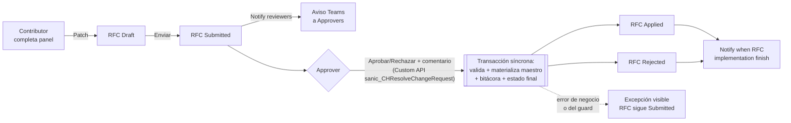

# Administración de datos de clientes

> Alcance: altas, modificaciones, activaciones y bajas de Clientes,
> Sucursales, Correos autorizados y Cuentas, todas vía RFC (Request For
> Change) con aprobación y materialización **síncrona** por
> Custom API.

## 1. Qué es este proceso

Nadie escribe directo sobre el dato maestro de un cliente. Cualquier alta o
cambio — nombre, CIF, una sucursal nueva, un correo autorizado, una cuenta,
o pasar un registro a Inactive — nace como una **solicitud de cambio (RFC)**
en estado Draft. Un segundo usuario, con permiso de aprobador para
esa tabla puntual, la revisa y decide.

La separación de funciones (quien pide ≠ quien aprueba, y quien aprueba debe
pertenecer al grupo Approver de esa tabla) no es solo un botón oculto en la
app: la impone un plugin server-side sobre la cabecera (§2, §8) y,
también uno sobre las **líneas** del RFC (§8) — así que sigue firme aunque
alguien le pegue al registro por Web API o Excel.

Handoffs:

- **Entrega a** [02-recepcion-ingesta-emails](02-recepcion-ingesta-emails.md):
  el motor de validación de correos resuelve remitente y CIF contra el
  Cliente/Correo/Cuenta que este proceso mantiene (VR-24/25/26). Un cliente en `recordstatus = Inactive`
  o un correo no autorizado hace que el correo entrante rebote.
- **Entrega a** [07-tracking-depositos](07-tracking-depositos.md): el
  tracker resuelve el cliente del depósito contra el mismo maestro.

## 2. Estados y transiciones

### 2.1 RFC — cabecera (`CH-Tbl-ClientDataChangeRequest` /
`sanic_chtblclientdatachangerequest`), campo `sanic_changestatus`

| Valor | Etiqueta | Quién transiciona | Guard |
|---|---|---|---|
| 159460000 | Draft | Contributor (crea/edita el borrador) | Ninguno — libre mientras sea el propio Draft |
| 159460001 | Submitted | Contributor (Enviar) | App bloquea si hay otro RFC no resuelto sobre el mismo campo + mismo registro destino (aviso, no bloqueo duro — el guard de servidor no impone esta regla) |
| 159460002 | Approved | **Sin uso en ningún camino vivo** desde 2026-08-25 | Valor histórico: RFC resueltos antes de la migración a Custom API pueden tenerlo grabado; ningún flujo ni la Custom API lo vuelven a escribir (ver §1) |
| 159460003 | Rejected | Approver, vía Custom API `sanic_CHResolveChangeRequest` (§7) | `ChangeRequestResolution.Evaluate` (dominio puro) delega la separación de funciones en la misma lógica de `ChangeRequestApprovalGuard`: previo debe ser Submitted, resolutor ≠ creador, resolutor pertenece al grupo Approver de la tabla objetivo (fail-closed) |
| 159460004 | Applied | Approver, vía la misma Custom API — **directo desde Submitted, sin pasar por Approved** | Mismo guard que Rejected; además, en Update/Create exige al menos una línea de cambio (`ChangeRequestResolution.RequiresLines`) — un RFC vacío es rechazado como error de negocio, no un éxito disfrazado |
| 159460005 | Failed | Sin uso en ningún camino vivo desde 2026-08-25 | La Custom API es transaccional: si algo falla, la excepción sale visible y el RFC **permanece en Submitted** (nunca queda "a medio aplicar" ni se graba en Failed) — el valor sigue existiendo en el esquema por compatibilidad histórica |
| 159460006 | Canceled | Contributor (desde Draft) | — transición de sistema/creador, sin fricción del guard |

El guard de cabecera (`GuardChangeRequestApprovalPlugin`) además bloquea
**crear** un RFC que nazca ya en Approved, Rejected, Applied o Failed (cierra
el bypass de un `Create` directo por Web API con el estado final ya puesto).
La Custom API resuelve la cabecera con la identidad real del resolutor (no
como sistema) precisamente para que este guard la re-valide de igual manera
que si fuera un Patch humano — ver §7/§8.

### 2.2 RFC — línea (`CH-Tbl-ClientDataChangeRequestLine` /
`sanic_chtblclientdatachangerequestline`), campo `sanic_changestatus`

Mismos siete valores 159460000-006. La decisión de
Aprobar/Rechazar se aplica a **todas las líneas de la solicitud a la vez**:
no existe un camino de UI para aprobar una línea y rechazar otra dentro del
mismo RFC, aunque el modelo de datos sí guarda un estado por línea.

`GuardChangeRequestLinePlugin` (nuevo, §8) impone además, sobre esta tabla,
que mientras el RFC padre esté en Draft no puede haber dos líneas apuntando
al mismo `sanic_fielddefinition`.

### 2.3 Tipo de RFC (`sanic_type`, en la cabecera)

| Valor | Etiqueta | Materializa (vía `sanic_CHResolveChangeRequest`) |
|---|---|---|
| 159460000 | Update | `Update` sobre el registro destino |
| 159460001 | Deactivate | `sanic_recordstatus = Inactive` sobre el registro destino |
| 159460002 | Create | `Create` del registro nuevo con todos los campos de las líneas + `sanic_recordstatus = Active` |
| 159460003 | Activate | `sanic_recordstatus = Active` sobre el registro destino |

La tabla destino se resuelve dinámicamente desde `sanic_targettable` de la
cabecera.

### 2.4 `recordstatus` de Cliente / Sucursal / Correo / Cuenta
(`sanic_recordstatus`, option set global `sanic_chchrecordstatus`)

| Valor | Etiqueta |
|---|---|
| 159460000 | Active |
| 159460001 | Inactive |
| 159460002 | PendingApproval |
| 159460003 | PendingDeactivation |

Statecode/statuscode estándar de Dataverse (Active/Inactive, valores 0/1) es
un campo aparte de `sanic_recordstatus` en las 4 tablas; ambos existen en
paralelo, `sanic_recordstatus` es el que gobierna la lógica de negocio de
este proceso.

## 3. Roles y acceso

Roles de seguridad Dataverse (`solutions/unpacked/core/Roles/`):

| Rol | Sobre las 10 tablas del dominio |
|---|---|
| `CH-SR-ClientAdminContributor` | Read Global de Client/ClientBranch/ClientEmail/ClientDataChangePermission/ClientDataChangeRequest(Line)/AuditTrail/DepositHistory/TableLogicalFieldName. Create/Write **Basic** (solo lo propio) de ChangeRequest y ChangeRequestLine. |
| `CH-SR-ClientAdminApprover` | Mismo Read Global que Contributor. Write **Global** de ChangeRequest y ChangeRequestLine (necesita poder mover cualquier RFC, no solo el propio). |

Ninguno de los dos roles tiene privilegio de escritura sobre Client,
ClientBranch, ClientEmail ni ClientAccount — **solo lectura Global sobre los
4 maestros** (`prvReadsanic_CHTblClient`, `prvReadsanic_CHTblClientBranch`,
`prvReadsanic_CHTblClientEmail`, `prvReadsanic_CHTblClientAccount`). La única escritura real sobre
Client/ClientBranch/ClientEmail/ClientAccount la sigue haciendo la Custom
API `sanic_CHResolveChangeRequest` como sistema (§7) — el rol de seguridad
impide que ni el Contributor ni el Approver puedan saltarse el ciclo RFC
editando el maestro directo, aunque tuvieran acceso a Excel/Web API, antes
de que el guard tenga que intervenir.

Distinción app vs. servidor:

- **La app verifica** (cosmético): oculta los botones Aprobar/Rechazar si el
  usuario no tiene, en `colClientDataPermissions` (armada en `App.OnStart`
  vía `checkMemberGroups`, fail-**cerrado** — si Graph falla no se otorga
  ningún permiso), una fila Approver para la tabla objetivo; oculta
  Enviar/Cancelar si el usuario no es el creador.
- **El servidor impone** (real): `GuardChangeRequestApprovalPlugin` sobre la
  cabecera (§2.1, §8) — estado previo Submitted, resolutor ≠ creador, y desde
  la Fase 2 también la membresía real del grupo Approver, resuelta contra
  `CH-Tbl-ClientDataChangePermission` (tabla → grupo AAD) y el **Azure AD
  group team** correspondiente (`teammembership`), fail-closed: sin grupo
  configurado o sin membresía confirmada, se bloquea. 

Matriz quién-puede-qué (tabla `CH-Tbl-ClientDataChangePermission` /
`sanic_chtblclientdatachangepermission`, campo `sanic_type`): **159460000
Contributor**, **159460001 Approver**. Una fila = (tabla objetivo en
`sanic_name`, tipo, grupo AAD en `sanic_aadgroupid` — texto libre, sin
relación con ninguna Environment Variable ni catálogo, editable solo por
quien tenga escritura sobre esta tabla — es decir, hoy nadie vía rol
`ClientAdmin*`, ver arriba).

## 4. Aplicaciones

Única vía oficial: la **canvas app** `CH-App-ClientAdministration`.
100% controles clásicos nativos, sin Power CAT ni PCF, layout responsive
horizontal por contenedores manuales.

| Pantalla | Sirve a |
|---|---|
| `scrSplash` | Entrada; si trae `Param("RFC")` (deep-link de Teams), navega directo a `scrSolicitud`. |
| `scrClientes` | Listado de Cliente con badge "RFC en curso" por fila — alta de Cliente genera RFC tipo Create con 3 líneas (Nombre/CIFBCO/CIFCOM). |
| `scrCliente` | Ficha de un cliente: datos maestros de solo lectura + 5 pestañas (Sucursales/Correos/Cuentas/Solicitudes/Bitácora). Cada alta/edición sobre un hijo es un RFC propio — **dar de alta un cliente con 1 sucursal y 1 correo sigue generando RFC independientes**, cada uno aprobable por separado (limitación conocida, §10). |
| `scrSolicitudes` | Bandeja de RFC con tres segmentos: **Para mi decisión** (default del Approver), **Mías**, **Todas** — con búsqueda delegable y filtro por tabla objetivo. |
| `scrSolicitud` | Pantalla única de detalle y decisión: cabecera, grilla de cambios (valor actual → propuesto), historial, y Aprobar/Rechazar/Enviar/Cancelar/Agregar-Quitar-cambio según estado y rol. Aprobar/Rechazar invoca `sanic_CHResolveChangeRequest` (§7) y el resultado — Aplicada o Rechazada — vuelve **síncrono**, sin refrescar. |

## 5. Flujos Power Automate

| Flujo | Trigger (webhook sobre `sanic_chtblclientdatachangerequest`) | Estado según export (`StateCode`) | Estado esperado por diseño | 
|---|---|---|---|
| `CH-Flow-Notify reviewers` | Update, `sanic_changestatus = Submitted` | **Draft/OFF** (`StateCode=0`) — no coincide con el diseño | ON | 
| `CH-Flow-Notify when RFC implementation finish` | Update, `Rejected \| Applied \| Failed` | Activated/ON (`StateCode=1`) — coincide | ON | 

**Por qué esto importa, no es solo un dato de tabla:**

Qué toca cada uno **por diseño** (la lógica del trigger no cambió; lo que
está en duda es si está prendido — ver tabla arriba):

- **Notify reviewers**: dispara sobre `Update` del RFC (webhook `message: 4`;
  coherente con el propio ciclo de vida del RFC — nace en Draft,
  `sanic_changestatus = Submitted` solo se alcanza con el Enviar, que es un
  Update, nunca un Create). Arma una Adaptive Card con el diff (campo, valor
  actual, nuevo) y la postea al chat Teams del grupo Approver de la tabla
  destino (crea el group chat vía el flujo hijo `Create a Teams chat
  group…` si todavía no existe uno para ese grupo). 

- **Notify when RFC implementation finish**: dispara sobre `Rejected`,
  `Applied` o `Failed`. Antes de la migración esos tres estados los escribían
  los 4 flujos aplicadores (éxito) o el watchdog (`Failed` por timeout);
  ahora los escribe `sanic_CHResolveChangeRequest` en la misma transacción
  que resuelve el RFC — el flujo de notificación no tuvo que tocarse porque
  sigue viendo la misma transición de estado, solo que ahora ocurre en el
  acto en vez de con demora.

## 6. Tablas

Las 10 tablas del dominio, todas `UserOwned` (el modelo de seguridad estándar
de privilegios por rol aplica de lleno — no son de acceso libre):

| Tabla | Display name / logical name | Rol |
|---|---|---|
| Cliente | `CH-Tbl-Client` / `sanic_chtblclient` | Maestro. Campos propios: `sanic_name`, `sanic_cifbco`, `sanic_cifcom`, `sanic_iseditable`, `sanic_recordstatus`. |
| Sucursal | `CH-Tbl-ClientBranch` / `sanic_chtblclientbranch` | `sanic_client` (lookup), `sanic_name`, `sanic_clientstatus`, `sanic_recordstatus`, `sanic_clientnamemirror`. |
| Correo autorizado | `CH-Tbl-ClientEmail` / `sanic_chtblclientemail` | `sanic_client`, `sanic_name`, `sanic_alwaysnotify`, `sanic_clientstatus`, `sanic_recordstatus`. |
| Cuenta | `CH-Tbl-ClientAccount` / `sanic_chtblclientaccount` | `sanic_client`, `sanic_name` (número, alternate key única a nivel banco), `sanic_currency` (option set global), `sanic_recordstatus`, `sanic_chchrecordstatus`. |
| RFC — cabecera | `CH-Tbl-ClientDataChangeRequest` / `sanic_chtblclientdatachangerequest` | `sanic_changestatus`, `sanic_type`, `sanic_targettable`, `sanic_targetrecordid`, `sanic_targettabledisplayname`, `sanic_targettablepluralname`, `sanic_relatedclient`, `sanic_reason`, `sanic_reasonfordecision`, `sanic_solvedby`, `sanic_solvedon`, `sanic_applynotes`, `sanic_applyon`. |
| RFC — línea | `CH-Tbl-ClientDataChangeRequestLine` / `sanic_chtblclientdatachangerequestline` | `sanic_changerequestid` (lookup a la cabecera), `sanic_fielddefinition` (lookup al catálogo), `sanic_oldvalue`, `sanic_newvalue`, `sanic_changestatus`, `sanic_reasonfordecision`, `sanic_solvedby` (lookup), `sanic_solvedon` (datetime) — estos dos últimos, análogos a los de la cabecera, los estampa `sanic_CHResolveChangeRequest` en el paso 6 (§7). |
| Permiso | `CH-Tbl-ClientDataChangePermission` / `sanic_chtblclientdatachangepermission` | `sanic_name` (tabla objetivo, pese al nombre del campo), `sanic_type` (Contributor/Approver), `sanic_aadgroupid` (texto libre), `sanic_teamsgroupid` (chat cacheado). |
| Bitácora de aplicación | `CH-Tbl-ClientDataChangesAuditTrail` / `sanic_chtblclientdatachangesaudittrail` | `sanic_message`, `sanic_opeationtype` (**typo de esquema real**: falta la "r" de "operation" — no es error de este doc), `sanic_relatedclient`, `sanic_relatedcrl`, `sanic_relatedrfc`, `sanic_result`. |
| Catálogo de campos editables | `CH-Tbl-ClientTableLogicalFieldName` / `sanic_chtblclienttablelogicalfieldname` | `sanic_table`, `sanic_tabledisplayname`, `sanic_tablepluralname`, `sanic_logicalname`, `sanic_datatype` (Text/Number/Date/Money/Lookup/OptionSet/…, ver §5), `sanic_isallowed`, `sanic_lookuptargettable`, `sanic_optionsetmap`. |
| Historial de depósito | `CH-Tbl-ClientDepositHistory` / `sanic_chtblclientdeposithistory` | Fuera del ciclo RFC — la llena el proceso de tracking, no este. |

Columna **mantenida por plugin — no editar a mano**:

- `sanic_clientnamemirror` (texto 850) en `CH-Tbl-ClientBranch`: espejo de
  `sanic_client.sanic_name`, estampado por `ClientBranchNameMirrorPlugin`
  (§8) para que el combo de sucursales de Reception filtre por nombre de
  cliente con `StartsWith` **delegado**, sin navegar la relación (con
  decenas de miles de sucursales, `Filter` sobre la relación no delega y el
  combo miente por debajo del tope de filas). **Limitación conocida**: no
  hay cascada por rename del cliente — si el cliente cambia `sanic_name`,
  las sucursales ya existentes quedan con el nombre viejo.

## 7. Custom APIs

### `sanic_CHResolveChangeRequest`

Global, `POST`, síncrona. Backing: `ResolveChangeRequestPlugin`
(`CashHub.Plugins`).

| Parámetro | Dirección | Tipo | Obligatorio | Contenido |
|---|---|---|---|---|
| `ChangeRequestId` | Entrada | Guid | Sí | El RFC (`sanic_chtblclientdatachangerequest`) a resolver |
| `Decision` | Entrada | String | Sí | `"Approve"` o `"Reject"` |
| `Comment` | Entrada | String | No | Va a `sanic_applynotes` de la cabecera |
| `Outcome` | Salida | String | — | `"Applied"` o `"Rejected"`. Un fallo real **nunca** viaja acá disfrazado de salida: sale como `InvalidPluginExecutionException` con el motivo. |
| `Message` | Salida | String | — | Texto de confirmación (`"RFC {id} resuelto: {outcome} por {resolutor}."`) |

`executeprivilegename`: **`prvWritesanic_CHTblClientDataChangeRequest`**
(Global) — el mismo privilegio que ya tiene `CH-SR-ClientAdminApprover` (y
ningún otro rol ClientAdmin) sobre la cabecera del RFC. Sin este privilegio,
cualquier usuario del entorno podría invocar la Custom API por Web API
directo.

Qué hace, en orden, dentro de la misma transacción del pipeline:

1. Lee la cabecera **como sistema** (`CreateOrganizationService(null)`) —
   chequeo de solo lectura, independiente de los privilegios del resolutor.
2. Resuelve la membresía Approver del resolutor
   (`ChangeRequestApproverResolver`, misma resolución que usan los dos
   guards de §8).
3. Evalúa la decisión con `ChangeRequestResolution.Evaluate` (dominio puro,
   `CashHub.Validation.Security`): separación de funciones + estados finales
   a escribir. Si no es legítima, lanza la excepción con el motivo real —
   nunca sigue de largo.
4. Trae las líneas del RFC como sistema. En `Approve` de tipo Update/Create
   exige al menos una línea — un RFC vacío es rechazado explícitamente
   (`"no tiene lineas de cambio; no hay nada que aplicar"`), no un éxito
   silencioso.
5. Si es `Approve`: materializa sobre el maestro **como sistema**, con la
   tabla resuelta dinámicamente desde `sanic_targettable` (§2.3) — un único
   `Update`/`Create` con todos los campos ya convertidos por
   `FieldValueConverter` (7 conversiones de tipo de dato: Text, Number,
   Date, Money, Lookup, OptionSet, TwoOptions/Boolean — mismo catálogo que
   describía el viejo `Switch` de los flujos, ahora en dominio puro
   testeado).
6. Marca cada línea Applied/Denied **con la identidad real del resolutor**
   (`CreateOrganizationService(resolverId)`, no como sistema — si corriera
   como sistema, `GuardChangeRequestLinePlugin`/`GuardChangeRequestApprovalPlugin`
   resolverían membresía contra el usuario SYSTEM y bloquearían la
   escritura).
7. Escribe la bitácora (`CH-Tbl-ClientDataChangesAuditTrail`, §6) — una fila
   por línea, o una fila de cabecera si el tipo es Activate/Deactivate (sin
   líneas). Esta fila **solo** se escribe si se llegó hasta acá sin
   excepción: nunca queda un rastro "Fail" a medio camino.
8. Mueve la cabecera a su estado final (`Applied`/`Rejected`, identidad del
   resolutor) — ver §2.1.

La identidad **doble** (sistema para leer/materializar el maestro,
resolutor real para escribir cabecera/líneas del RFC) es el mismo patrón que
ya usan `CreateTransactionCutPlugin`/`DeclarationMaterializer` en otros
procesos.

## 8. Steps de plugins

Todos viven en `CashHub.Plugins` (mismo assembly firmado que el motor de
validación de correos) y corren **síncronos en Pre-operation (stage 20)** —
tienen que poder abortar la transacción antes de que el pipeline la
persista.

| Plugin | Mensaje / etapa / filtro | Qué regla de negocio defiende |
|---|---|---|
| `GuardChangeRequestApprovalPlugin` | `Update` de `sanic_chtblclientdatachangerequest`, Pre-operation (20), filtrado en `sanic_changestatus`, con pre-image (`sanic_changestatus, createdby, sanic_targettable`) | Separación de funciones sobre la **cabecera**: bloquea que el creador de un RFC apruebe/rechace su propia solicitud, exige estado previo Submitted, y exige que el resolutor pertenezca al grupo AAD Approver de la tabla objetivo destino — resuelto contra `CH-Tbl-ClientDataChangePermission` + membresía del Azure AD group team. Fail-closed en toda la cadena: sin grupo configurado, sin membresía resuelta, o sin creador identificable, se bloquea. Es la misma lógica que reutiliza `ChangeRequestResolution.Evaluate` dentro de la Custom API (§7) — un solo motor de decisión, no dos que puedan divergir. |
| `GuardChangeRequestApprovalPlugin` | `Create` de `sanic_chtblclientdatachangerequest`, Pre-operation (20), sin filtro de atributo | Impide que un RFC nazca ya resuelto (Approved/Rejected/Applied/Failed) — cierra el bypass de crear directo en un estado final por Web API. |
| `GuardChangeRequestLinePlugin` *(nuevo, 2026-08-25)* | `Create`/`Update`/`Delete` de `sanic_chtblclientdatachangerequestline`, Pre-operation (20), con pre-image (`sanic_changerequestid, sanic_fielddefinition`) en Update/Delete | Cierra el hallazgo S3 del análisis (no había guard sobre las líneas): el RFC padre debe estar en Draft, sin líneas duplicadas por (RFC, `sanic_fielddefinition`), y solo el creador del RFC o un Approver de la tabla objetivo puede tocar sus líneas. **Exento por profundidad** (`depth > 1`) cuando la escritura viene de `sanic_CHResolveChangeRequest` marcando el desenlace de sus propias líneas — esa transición ocurre con la cabecera ya en Submitted, algo que el guard bloquearía si la tratara como una escritura humana. |
| `ClientBranchNameMirrorPlugin` | `Create` de `sanic_chtblclientbranch`, Pre-operation (20), sin filtro | Estampa `sanic_clientnamemirror` con una sola lectura del cliente (como sistema — es una derivación, no un permiso de negocio) y cero escrituras adicionales (escribe en el propio Target). |
| `ClientBranchNameMirrorPlugin` | `Update` de `sanic_chtblclientbranch`, Pre-operation (20), filtrado en `sanic_client` | Re-estampa el espejo solo cuando la sucursal se re-cuelga de otro cliente; un Update que no toca `sanic_client` no dispara el step. |

Las transiciones de sistema (`→Applied/Rejected` que ahora escribe
`sanic_CHResolveChangeRequest`, `→Canceled`, `Draft→Submitted`) pasan por el
guard de cabecera sin fricción — solo intercepta la **decisión humana**
(`→Approved`/`→Rejected`, camino que ya no produce ningún flujo vivo pero
que el guard sigue defendiendo por si alguien intentara un Patch directo) y
el `Create` en un estado resuelto. Sobre las líneas, el equivalente es la
exención por profundidad descrita arriba.

## 9. Acciones

### Crear un RFC de alta de Cliente

| Campo | Contenido |
|---|---|
| **Quién** | Contributor de la tabla Cliente |
| **Cuándo** | En cualquier momento; no depende de otro RFC |
| **Por qué / para qué** | Da de alta un cliente nuevo en el maestro; habilita después dar de alta sus sucursales, correos y cuentas |
| **Cómo** | Clients → botón Nuevo → completar Nombre/CIFBCO/CIFCOM → Guardar |
| **Qué valida el servidor** | El `Create` del RFC pasa por `GuardChangeRequestApprovalPlugin` (solo bloquea si viniera con un estado ya resuelto; un alta normal nace Draft/Submitted y pasa libre). El rol `CH-SR-ClientAdminContributor` limita el Create/Write de RFC a nivel Basic (solo lo propio). |
| **Qué pasa si falla / deshacer** | Si falla el guard: rebote con el mensaje de `ApprovalGuardResult.Reason`. Deshacer: sí — mientras el RFC siga en Draft, Cancelar lo mueve a Canceled sin haber tocado el maestro. |

### Enviar un RFC (Draft → Submitted)

| Campo | Contenido |
|---|---|
| **Quién** | El Contributor que creó el RFC |
| **Cuándo** | RFC propio en Draft |
| **Por qué / para qué** | Dispara la revisión: notifica a los aprobadores (si `Notify reviewers` está ON) y habilita los botones Aprobar/Rechazar para el Approver |
| **Cómo** | ChangeRequestDetails → botón Enviar |
| **Qué valida el servidor** | La app bloquea el envío si hay otro RFC en curso sobre el mismo campo + mismo registro destino (conflict-check corregido para excluir el propio RFC y clientes no relacionados). El guard no interviene en esta transición (Draft→Submitted pasa libre). |
| **Qué pasa si falla / deshacer** | Mensaje de conflicto en pantalla, el RFC queda en Draft. Deshacer: Cancelar sigue disponible desde Draft. |

### Aprobar un RFC (resolución síncrona)

| Campo | Contenido |
|---|---|
| **Quién** | Approver de la tabla objetivo del RFC, distinto del creador |
| **Cuándo** | RFC en Submitted |
| **Por qué / para qué** | Materializa el cambio sobre el maestro **en el mismo gesto** — no hay un segundo paso automático que lo tome después |
| **Cómo** | Solicitudes → abrir en `scrSolicitud` → botón "Aprobar…" → comentario obligatorio |
| **Qué valida el servidor** | La Custom API `sanic_CHResolveChangeRequest` (§7): `ChangeRequestResolution.Evaluate` exige previo = Submitted, `initiatingUserId ≠ createdby`, membresía confirmada en el grupo Approver de `sanic_targettable`, y — si el tipo es Update/Create — al menos una línea de cambio. Cualquiera de esas condiciones que falle bloquea con `InvalidPluginExecutionException` **antes** de tocar el maestro. |
| **Qué pasa si falla / deshacer** | El usuario ve el error tal cual lo devuelve el servidor (mensajes en español, nunca genéricos — p. ej. "El creador de un RFC no puede aprobar su propia solicitud" o "no tiene lineas de cambio; no hay nada que aplicar"), y el RFC **permanece en Submitted** (la transacción entera revierte). No hay deshacer sobre un Applied exitoso: es una transición de estado, no hay botón de "desaprobar"; si fue un error, hay que evaluar y, si corresponde, crear un RFC nuevo. |

### Rechazar un RFC (resolución síncrona)

| Campo | Contenido |
|---|---|
| **Quién** | Approver de la tabla objetivo, distinto del creador |
| **Cuándo** | RFC en Submitted |
| **Por qué / para qué** | Cierra la solicitud sin aplicar ningún cambio; deja constancia del motivo |
| **Cómo** | `scrSolicitud` → botón "Rechazar…" → comentario obligatorio |
| **Qué valida el servidor** | Misma Custom API y mismo motor de decisión que Aprobar (estado previo, identidad, membresía) — la diferencia es que no toca el maestro, solo marca líneas Denied y cabecera Rejected |
| **Qué pasa si falla / deshacer** | Igual que Aprobar: motivo real en pantalla, RFC sigue en Submitted si falla. No hay deshacer una vez Rejected — es terminal; se necesita un RFC nuevo para reintentar el cambio. |

## 10. Supuestos y limitaciones

- **Un alta completa de cliente son 3 (o 4, con cuenta) RFC independientes**,
  no una unidad. Cliente, Sucursal, Correo y Cuenta se piden por separado,
  cada uno con su propio ciclo Draft→…→Applied, potencialmente aprobados por
  personas distintas en momentos distintos. No existe un "RFC compuesto" que
  agrupe el alta completa como una sola aprobación.
- **El espejo `sanic_clientnamemirror` no cascadea por rename del cliente**
  (ver §6) — es una limitación deliberada.

## 11. Pruebas

Apps: **Client Administration**. Actores: un usuario
**Contributor** y un usuario **Approver** (distintos — el guard lo exige). Estos usuarios deben cambiarse de "grupo" para poder probar la seccion de Banca de Empresas y Tesoreria.

| # | Caso | Pasos | Esperado |
|---|---|---|---|
| CA-01 🔴 | Alta de cliente desde 0 | Contributor: Clients → Nuevo → completar datos → guardar | NO se crea el cliente: se crea un RFC en **Submitted** con una línea por campo. El cliente (si se pre-crea) nace con `recordstatus = PendingApproval` |
| CA-02 🔴 | Aprobación del alta | Approver (OTRO usuario): RFC → ChangeRequestDetails → Aprobar + comentario | Comentario obligatorio; RFC pasa a Approved; RFC → **Applied**, `targetrecordid` y `RelatedClient` poblados en RFC y bitácora |
| CA-03 🔴 | Alta de sucursal | Contributor: ClientInformation del cliente nuevo → agregar sucursal → RFC → aprobar | Sucursal creada Active; espejo `sanic_clientnamemirror` estampado (verificar por Web API) |
| CA-04 🔴 | Alta de correo autorizado | Ídem con un correo (el que va a usar el Módulo B) | `CH-Tbl-ClientEmail` Active. **Este correo es prerrequisito del hilo de oro** |
| CA-05 🔴 | Alta de cuenta | Ídem con cuenta + moneda | Cuenta Active; etiquetas correctas ("Numero de cuenta", "Moneda") |
| CA-06 | Update de un campo | Contributor: editar teléfono del cliente → RFC → aprobar | `Apply client data changes` escribe el campo, línea Applied, RFC Applied |
| CA-07 🔴 | Desactivar cliente | Acción Desactivar → RFC tipo Deactivate → aprobar | `recordstatus = Inactive`. Un correo del cliente desactivado debe REBOTAR en el Módulo B (VR-03/25) |
| CA-08 🔴 | Reactivar cliente | Acción Activar → RFC tipo Activate → aprobar | `recordstatus = Active` de vuelta; el correo vuelve a pasar |
| CA-09 🔴 | Auto-aprobación bloqueada | El MISMO Contributor intenta aprobar su RFC (probalo también por Web API con `changestatus = Approved`) | Rebota con 400 del `GuardChangeRequestApprovalPlugin`: creador ≠ resolutor y membresía del grupo Approver se exigen server-side |
| CA-10 | Notificaciones Teams | Enviar un RFC / esperar su cierre | Card a los aprobadores al Submitted (si Notify reviewers está ON) y card de resultado al creador y aprobador al Applied/Failed/Rejected |
| CA-11 | RFC en conflicto | Con un RFC pendiente sobre un campo, intentar otro RFC sobre el MISMO campo del mismo registro | La app bloquea el envío |
| CA-12 | Rechazo | Approver rechaza con comentario | RFC Rejected, nada se aplica, notificación de cierre llega |
| CA-13 ⚠️ | Option set en RFC de Update | RFC que cambie un campo de lista de opciones → aprobar | Verificar EXPLÍCITAMENTE que el campo quedó escrito |

