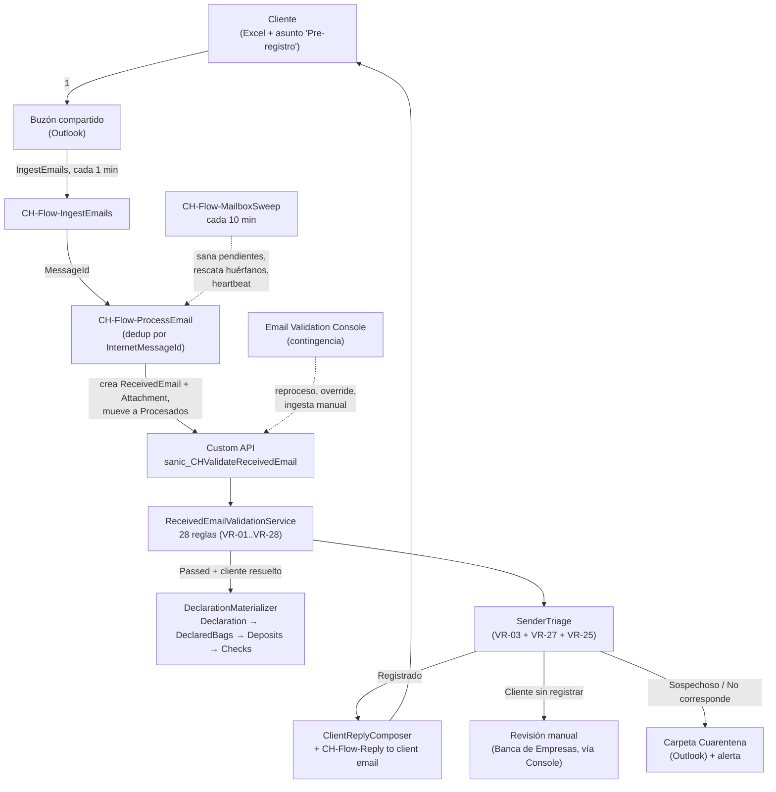

# Recepción e ingesta de emails

> Fuente de verdad: `src/backend/CashHub.Plugins/` (`ReceivedEmailValidationService.cs`,
> `DeclarationMaterializer.cs`, `ValidateReceivedEmailPlugin.cs`, `Schema.cs`) y
> `src/backend/CashHub.Validation/` (motor, 28 reglas, `SenderTriage`), más
> `solutions/unpacked/flow/` (1.6.5.0) y `solutions/unpacked/core/` (1.14.0.0)
> para option sets y logical names. Ante conflicto con `docs/guias/04-manual-validacion-correos.md`
> manda este documento: ese manual describe la **era pre-plugin** (23 reglas en
> Power Fx, dentro de la Console); hoy el motor corre 28 reglas en un plugin C#
> y la Console es la vía de **contingencia**, no el camino normal.

## 1. Qué es este proceso

El cliente declara el contenido de sus tulas llenando la plantilla oficial
`CH-TPL-Depositos` (Excel) y la envía por correo, con asunto que empieza con
"Pre-registro", al buzón compartido del banco. Un flujo detecta el correo cada
minuto y lo entrega a un pipeline que: registra el correo y su adjunto,
invoca al motor de validación (28 reglas paramétricas corriendo dentro de un
plugin C# síncrono), y según el resultado **materializa la declaración digital**
(bolsas → depósitos → cheques) o la rechaza con el detalle exacto de qué
falló. Un segundo componente — el **triage de remitente** — decide, de forma
independiente de si el archivo pasó o no, si corresponde responderle a quien
escribió: solo una dirección verificada recibe respuesta; todo lo demás se
cuarentena o se escala a Banca de Empresas sin contestar, por seguridad (no
confirmarle a un tercero que un CIF es cliente del banco). Un barrido cada 10
minutos actúa de red de seguridad: re-valida pendientes, rescata correos que
quedaron huérfanos en el buzón, y deja un latido de salud que la Email
Validation Console usa como semáforo. Esa Console es la **bandeja de
contingencia**: en un día sano queda vacía, porque todo el camino normal es
automático.

**Handoffs**:
- **Recibe**: nada de otro proceso — es la puerta de entrada primaria del
  contenido declarado del cliente. Consume el maestro de remitentes
  autorizados (`CH-Tbl-ClientEmail`) que administra
  [01-administracion-datos-clientes](01-administracion-datos-clientes.md).
- **Entrega**: las `CH-Tbl-DeclaredBags`/`DeclaredDeposits`/`DeclaredChecks`
  materializadas son el contra-valor contra el que
  [03-recepcion-tulas-esclusa](03-recepcion-tulas-esclusa.md) y
  [05-recuento-tulas](05-recuento-tulas.md) concilian la bolsa física. Cuando
  la Console "Registra correo" de un remitente sin registrar, crea un RFC de
  alta que resuelve [01-administracion-datos-clientes](01-administracion-datos-clientes.md).

## 2. Estados y transiciones

Todo vive en `CH-Tbl-Received Emails` (`sanic_chtblreceivedemails`), una fila
por correo. Cinco atributos independientes, todos escritos por
`ReceivedEmailValidationService.UpdateEmail` (nunca por la app, salvo el
override manual de la Console):

### `sanic_validationstatus` — veredicto del archivo

| Valor | Etiqueta | Quién transiciona | Guard |
|---|---|---|---|
| `159460000` | Pendiente | Valor inicial (`AppDefaultValue`) | — |
| `159460001` | Válido | Motor: `result.Passed = true` | Ninguna reescritura fuera del plugin (no hay Guard de Update registrado sobre la tabla) |
| `159460002` | Inválido | Motor: `result.Passed = false` con hallazgos de negocio | ídem |

### `sanic_emailreviewstatus` — estado operativo del correo

| Valor | Etiqueta | Quién transiciona | Guard |
|---|---|---|---|
| `159460000` | Pendiente | Alta (ingesta) | — |
| `159460001` | Aceptado | Motor, si `Passed` | Requiere `Passed` Y `ResolvedClientId` Y `Workbook` no nulo para que exista `Declaration` (§10) |
| `159460002` | Omitido | Motor, si el triage es Sospechoso/No corresponde y no hay respuesta | — |
| `159460003` | Revisión manual | Motor, si el triage es Cliente sin registrar | Le toca a Banca de Empresas vía Console |
| `159460004` | Error | Motor, si `HasSystemIssues` sin hallazgos de negocio (falla de sistema, no del cliente) | `ErrorText` lleva la nota técnica cruda |
| `159460005` | Denegado | Motor, si `Passed = false` con hallazgos de negocio | `ErrorText` lleva los mensajes que el cliente ya vio en el correo de rechazo |

### `sanic_emailreplystatus` — si salió respuesta al cliente

| Valor | Etiqueta | Quién transiciona |
|---|---|---|
| `159460000` | Pendiente | El motor arma `reply` (asunto+cuerpo) y lo deja para el flujo de envío |
| `159460001` | Respondido | `CH-Flow-Reply to client email`, tras `ReplyToV3` exitoso |
| `159460002` | Omitido | El motor, cuando el triage decide `MayReplyToSender = false` (Cliente sin registrar / Sospechoso / No corresponde) |

Si el envío falla, el flujo **no** cambia el estado a Respondido: concatena en
`sanic_errortext` el aviso `"[SISTEMA] No se pudo enviar la respuesta…"` y el
correo queda con `ReplyStatus = Pendiente` — la Console ofrece reenviar
(guía 08, caso D-CO-05).

### `sanic_senderclassification` — triage del remitente

| Valor | Etiqueta | Regla que lo produce |
|---|---|---|
| `159460000` | Remitente registrado | VR-03 = Pass |
| `159460001` | Cliente sin registrar | VR-03 ≠ Pass, VR-27 = Pass, VR-25 = Pass |
| `159460002` | Sospechoso | VR-03 ≠ Pass, VR-27 = Pass, VR-25 ≠ Pass |
| `159460003` | No corresponde | VR-03 ≠ Pass, VR-27 ≠ Pass |

El guard real es de negocio, no de plataforma: `SenderTriage.Classify`
(`CashHub.Validation/Engine/SenderTriage.cs`) es puro dominio, corre siempre
sobre el mismo `RunResult`, y **una regla Omitida por dependencia nunca cuenta
como aprobada** — sin evidencia no se otorga confianza. `sanic_triagenotes`
siempre cita los VR concretos (regla de la casa: nunca un motivo genérico).

### `sanic_emailreviewmethod`

`159460000` Manual (lo estampa la Console en el override auditado) /
`159460001` Auto (lo estampa siempre el motor). Es la única columna que
distingue una decisión humana de una automática.

## 3. Roles y acceso

**Hallazgo verificado** (contra `solutions/unpacked/core/Roles/*.xml` — hoy
son **9** archivos `CH-SR-*.xml`; `docs/referencia/roles-y-seguridad.md` dice
"6" y quedó desactualizado, manda el código): **ninguno de los 9 Security
Roles de CashHub otorga privilegio alguno sobre las 7 tablas de este dominio**
(`ReceivedEmails`, `EmailsAttachments`, `ValidationRules`, `ValidationRuns`,
`ValidationResults`, y transitivamente `Declaration`/`DeclaredBags` para
quien no sea Counter/Receptionist). El rol físico "Analista de correos" de la
Email Validation Console **no tiene rol de seguridad Dataverse mapeado**. Todo
acceso real a estas tablas hoy sale de fuera de los 9 roles: System
Administrator implícito, o la cuenta de sistema con la que corre el plugin
(`serviceFactory.CreateOrganizationService(null)` — el motor **siempre** corre
como sistema, nunca como el llamante).

**Qué verifica la app vs. qué impone el servidor**:
- La Console **no verifica pertenencia a grupo ni rol de seguridad en Power
  Fx** — resuelve identidad con `LookUp(Users, PrimaryEmail = User().Email)` y
  listo; solo oculta botones que no corresponden al caso. El control de acceso
  real, tal como está exportado, depende de a quién se comparte la app.
- El servidor **sí** impone dos cosas server-side: (1) `sanic_sourceemailaddress`
  tiene `IsSecured=1` (columna segura — requiere un Field Security Profile con
  lectura habilitada; qué perfil lo otorga hoy: verificar en vivo); (2) el
  motor de validación corre como sistema, así que ningún privilegio de tabla
  del usuario condiciona si el correo se valida o no.
- No hay ningún `Guard*Plugin` registrado sobre `Create`/`Update` de
  `sanic_chtblreceivedemails` (a diferencia de otros dominios como
  `GuardChangeRequestApprovalPlugin` o `GuardTransactionPlugin`): la única
  defensa de negocio sobre esta tabla es el propio motor.

| Rol físico | App | Rol de seguridad Dataverse | Acceso real a este dominio |
|---|---|---|---|
| Cliente (externo) | — (envía correo) | — | Ninguno directo; su remitente debe estar en `CH-Tbl-ClientEmail` |
| Analista de correos | Email Validation Console | — (sin rol mapeado) | Resuelto fuera del paquete de roles (verificar en vivo) |
| Banca de Empresas | Email Validation Console (vista "Esperando a Banca") | — (sin rol mapeado) | ídem |
| Sistema (plugin) | — | Corre como sistema | CRUD completo, sin restricción |

## 4. Aplicaciones

| App | Pantalla | Sirve para |
|---|---|---|
| **CH-App-EmailValidationConsole** (`sanic_chappemailvalidationconsole`) | `ColaDeProcesamiento` | Bandeja de contingencia: banda de salud (semáforo contra el heartbeat `ingesta-correos`), 4 contadores, vistas por caso ("Esperando a Banca", "Sospechosos", "Errores", "Sin responder"), panel de detalle con "Qué pasó" / "Qué hacer" (`CH-Tbl-Playbook`) / reglas fallidas, y las acciones del §9. |
| **CH-App-EmailValidationConsole** | `CorreosElectronicos` | Vía manual de contingencia: lee el buzón directo por Microsoft Graph (`Office365Outlook.HttpRequest`, no invoca ningún flujo) y permite "Incluir + Validar" cuando el pipeline automático no llegó al correo. |
| **CH-App-DepositsTracker** (`sanic_chappdepositstracker`) | `scrCorreo` (guía [`06-pantalla-correo`](../tracker-rebuild/06-pantalla-correo.md)) | Trazabilidad de solo lectura: la raíz donde aterriza cualquier búsqueda por número de gestión (`Email-N`), con las 4 pestañas Validaciones / Declaración / Cheques declarados / Respuesta al cliente. |

**Nota de versión**: la pantalla de plantillas de correo (edición de
`CH-Tbl-EmailTemplate` desde la Console) **no existe en la app** — su fuente
quedó estacionada sin integrar en
`docs/pendiente/screen-PlantillasCorreo.fx.yaml.guardado`. Hoy la plantilla
solo se edita por Web API/Excel directo sobre la tabla.

## 5. Flujos Power Automate

Fuente: `solutions/unpacked/flow/` 1.6.5.0. Owner real de cada conexión:
verificar en vivo (el export de solución no lo registra; ver memoria de
sesión sobre reactivación de flujos como owner). **Ningún** `.json`/`.json.data.xml`
de `solutions/unpacked/flow/Workflows/` trae `statecode`/`state` — el export
no registra ON/OFF de ninguno de los 4 flujos de este proceso; la columna de
abajo es, en todos los casos, lo mejor que da el repo, nunca un hecho
confirmado (regla del contrato).

| Flujo | Trigger | Qué toca | Estado (export 1.6.5.0) | Conexión |
|---|---|---|---|---|
| `CH-Flow-IngestEmails` | `SharedMailboxOnNewEmailV2` cada 1 min, buzón `sanic_CHEVSharedMailboxAddress` — **hardcodeado literal en el trigger**, no leído de la env var (§10) | Invoca `ProcessEmail` con el `MessageId`. Sin manejo de error propio a propósito: si el hijo falla, el correo queda en Inbox y lo recoge el barrido | verificar en vivo — CHANGELOG registra que este flujo **importa en borrador** (conexión de Outlook por activar en make.powerautomate.com) | `sanic_conn_wfe_office365outlook` (Office 365 Outlook) |
| `CH-Flow-ProcessEmail` | `Request` (hijo, param `MessageId`) | Dedup por `sanic_receivedemailinternetmessageid`; si es nuevo: crea `ReceivedEmail` + `EmailsAttachments` (sube `sanic_filecontent`), mueve a `Procesados`, **refresca `sanic_receivedemailoutlookuniqueid`** (Exchange cambia el id al mover — este refresh es el fix del bug que dejaba respuestas en Pendiente para siempre), invoca la Custom API (retry ×4), y si el triage sale Sospechoso/No corresponde mueve el mensaje a `Cuarentena` | verificar en vivo (el export no trae `statecode`) | Office 365 Outlook |
| `CH-Flow-MailboxSweep` | Recurrence 10 min | 5 etapas: sana pendientes (top 20 sin corrida o con corrida más vieja que `modifiedon`), vigila que `IngestEmails` esté activo, rescata del Inbox lo que lleve >5 min sin registro (invocando `ProcessEmail`), **reintenta respuestas encoladas** (top 20 con `ReplyStatus = Pendiente`, cuerpo ya armado y `sanic_replyattempts < 3`, quietas >5 min: incrementa `sanic_replyattempts` y lo deja en el log de notas — no vuelve a invocar `ReplyToV3` directo), y siempre actualiza/crea el heartbeat `sanic_name = 'ingesta-correos'` en `CH-Tbl-SystemHeartbeat` con `sanic_details = "sanados=… faltantes=… notas=…"` y `sanic_lastrunon` | verificar en vivo — CHANGELOG registra que este flujo **importa en borrador** (conexión de Outlook por activar en make.powerautomate.com) | Office 365 Outlook + Dataverse |
| `CH-Flow-Reply to client email` | Webhook `Update` sobre `ReceivedEmails`, filtrado por `sanic_replybodyhtml,sanic_emailreplystatus` (**no incluye `sanic_replysubject`** — un cambio solo de asunto no dispara el flujo, limitación conocida) | `ReplyToV3` sobre el hilo original desde el buzón compartido; marca Respondido + fecha + `repliedby = "CashHub (automatico)"`; si falla, concatena el aviso de sistema en `sanic_errortext` | verificar en vivo (el export no trae `statecode`) | Office 365 Outlook (`runtimeSource: invoker`) |

## 6. Tablas

Modelo completo en [`../referencia/modelo-de-datos.md`](../referencia/modelo-de-datos.md)
(sección 4) — acá solo lo propio del proceso, con los nombres verificados
contra `Schema.cs` y `DeclarationMaterializer.cs` (fuente de verdad; el
modelo de referencia tiene notas desactualizadas, ver §10).

| Tabla | Logical name | Columnas propias del proceso |
|---|---|---|
| **CH-Tbl-Received Emails** | `sanic_chtblreceivedemails` | `sanic_sourceemailaddress` (`IsSecured=1`), `sanic_subject`, `sanic_client` (lookup, "el contenido ATRIBUYE" aunque el correo se rechace), `sanic_declaredcif`, `sanic_name` (autonumber `Email-N`), + los 5 option sets del §2 |
| **CH-Tbl-EmailsAttachments** | `sanic_chtblemailsattachments` | `sanic_email` (lookup, req.), `sanic_filename`, `sanic_tamanoenbytes`, `sanic_filecontent` (file, `IsSecured=0`) |
| **CH-Tbl-ValidationRules** | `sanic_validationrules` | Catálogo paramétrico: `sanic_validationname` (clave VR-xx), `sanic_validationorder`, `sanic_isactive`, `sanic_validationvalue`, `sanic_validationfailmessage`, `sanic_validationdependency` (self-lookup) |
| **CH-Tbl-ValidationRuns** | `sanic_chtblvalidationruns` | `sanic_name` = `"Validacion de {Email-N}"`, `sanic_runstart`/`sanic_runend`, `sanic_runresult` (Pass/Fail), `sanic_receivedemail` — lookup real al correo (**Mantenido por plugin**; existe porque `sanic_sourcerecordid` es texto libre polimórfico y no delega — ver §10 sobre el bug de casing que tuvo este campo) |
| **CH-Tbl-ValidationResults** | `sanic_chtblvalidationresults` | Una fila por hallazgo (o por regla si Pass/Omitida): `sanic_validationrule`/`sanic_validationrun` (lookups), `sanic_validationresult` (Pass/Fail/Omitida), `sanic_durationms`, `sanic_sheet`/`sanic_cellref`/`sanic_rownumber` (español), `sanic_detail` — **Mantenido por plugin, no editar a mano.** |
| **CH-Tbl-ClientEmail** | `sanic_chtblclientemail` | `sanic_name` = dirección de correo, `sanic_client` (lookup). Único remitente que dispara VR-03=Pass |
| **CH-Tbl-Declarations** | `sanic_chtbldeclaration` | `sanic_name` = `"Declaracion {fecha} {Email-N}"`, `sanic_client`, `sanic_receivedemail` (lookup real al correo) — **Mantenido por plugin.** Solo existe si `Passed` |
| **CH-Tbl-DeclaredBags** | `sanic_chtbldeclaredbags` | `sanic_bagnumber`, `sanic_declarationid` (lookup), `sanic_totalnio/usd/eur`, **`sanic_totaldeposits`: entero simple escrito por `DeclarationMaterializer` con el conteo real de depósitos por bolsa — NO es rollup** (lo era hasta el fix reciente, §10) — **Mantenido por plugin, no editar a mano** |
| **CH-Tbl-DeclaredDeposits** | `sanic_chtbldeclareddeposits` | `sanic_transactionno`, `sanic_accountnumber` (int 32 bits, deuda de esquema §10), `sanic_currency`, `sanic_cashamount`/`sanic_baclocalcheckamount`/`sanic_otherlocalcheckamount`, `sanic_declaredbag` (lookup), `sanic_declaration` (denormalizado a la raíz) — **Mantenido por plugin.** |
| **CH-Tbl-DeclaredChecks** | `sanic_chtbldeclaredchecks` | `sanic_checknumber`, `sanic_checkamount`, `sanic_checkcurrency`, `sanic_checktype` (BAC si el texto de tipo contiene "BAC", si no Otros), `sanic_declareddepositid` (lookup) — **Mantenido por plugin.** |
| **CH-Tbl-EmailTemplate** | `sanic_chtblemailtemplate` | Claves `reply-accepted`/`reply-rejected`, `IsActive` (`sanic_isactive`). Si falta, está inactiva o falla: cae al HTML embebido de respaldo — nunca se deja de responder por un problema de plantilla |
| **CH-Tbl-Playbook** | `sanic_chtblplaybook` | `sanic_titulo`, `sanic_pasos`, `sanic_orden`, `sanic_nota`, `sanic_isactive` — el "Qué hacer" que la Console arma por clave de caso |
| **CH-Tbl-SystemHeartbeat** | `sanic_chtblsystemheartbeat` | `sanic_name` (clave `'ingesta-correos'`), `sanic_lastrunon`, `sanic_details` — **Mantenido por el flujo de barrido, no la app** |

## 7. Custom APIs

### `sanic_CHValidateReceivedEmail`

| Campo | Detalle |
|---|---|
| Tipo | Global, síncrona (`allowedcustomprocessingsteptype: 0`, `bindingtype: 0`) |
| Entrada | `ReceivedEmailId` (Guid, requerido) |
| Salida | `RunId` (Guid), `Result` (`"Pass"`/`"Fail"`), `FailedFindings` (entero) |
| Plugin | `CashHub.Plugins.ValidateReceivedEmailPlugin` — asociado directo vía `PluginTypeId@odata.bind` sobre el `customapi` (no es un `sdkmessageprocessingstep` clásico sobre una tabla) |
| `executeprivilegename` | No se registra ningún `customapiprivilege` en `register-validation-plugin.sh` — la API queda sin privilegio dedicado atado. Alcance real de quién puede invocarla: **verificar en vivo** |
| Quién la invoca | `CH-Flow-ProcessEmail` (tras subir adjuntos, orden garantizado, retry ×4), `CH-Flow-MailboxSweep` (pendientes sin corrida o con corrida vieja), Custom API directa desde la Console ("Marcar para reproceso", indirecto — lo levanta el barrido en ≤10 min) o invocación manual con Web API para pruebas (guía 08, caso D1) |

Corre como sistema (`serviceFactory.CreateOrganizationService(null)`) y tiene
guarda anti-bucle: si `context.Depth > 2` se omite sin error.

## 8. Steps de plugins

**No hay steps clásicos de plugin (Pre-validation/Pre-operation/Post-operation)
sobre `sanic_chtblreceivedemails` hoy.** El único paso asíncrono en `Create`
que existió (`"CashHub.ValidateReceivedEmail: Create de correo recibido"`) fue
**retirado deliberadamente** (fase D del rediseño): `register-validation-plugin.sh`
lo borra si lo encuentra, porque la ingesta ahora invoca el Custom API de
forma explícita después de subir los adjuntos (orden garantizado — evita la
condición de carrera de validar antes de que el archivo termine de subir).

El único "step" real del dominio es la asociación directa entre el
`plugintype` `ValidateReceivedEmailPlugin` y el `customapi`
`sanic_CHValidateReceivedEmail` descrita en §7. Ninguna otra tabla de este
proceso (`EmailsAttachments`, `ValidationRuns`, `ValidationResults`,
`Declaration`, `DeclaredBags/Deposits/Checks`) tiene un `Guard*Plugin`
registrado que defienda su escritura — a diferencia de dominios como
Digitación o RFC de clientes, este pipeline confía en que solo el plugin
(corriendo como sistema) escribe estas tablas.

**Deuda documentada**: el doc-comment de `ValidateReceivedEmailPlugin.cs`
todavía describe la arquitectura vieja de "dos puertas" (Custom API + paso
asíncrono en Create) — el código real ya solo tiene una puerta. No corregido
al momento de este documento.

## 9. Acciones

### Enviar la declaración

| Campo | Detalle |
|---|---|
| **Quién** | Cliente (externo al sistema) |
| **Cuándo** | Cuando tiene tulas para declarar; puede reenviar tras una corrección |
| **Por qué / para qué** | Dispara todo el pipeline; habilita que su declaración se concilie luego contra la tula física |
| **Cómo** | Correo al buzón compartido, asunto empezando con "Pre-registro", **un** adjunto `.xlsx` con la plantilla `CH-TPL-Depositos` |
| **Qué valida el servidor** | Nada todavía — recién entra al motor cuando `ProcessEmail` lo registra |
| **Qué pasa si falla / deshacer** | No aplica: es la entrada del proceso. Si el archivo está mal, el motor lo rechaza con detalle (ver siguiente acción) |

### Ingesta y validación automática

| Campo | Detalle |
|---|---|
| **Quién** | Sistema (`CH-Flow-IngestEmails` → `CH-Flow-ProcessEmail` → Custom API → plugin) |
| **Cuándo** | Cada 1 minuto hay correo nuevo en el buzón compartido |
| **Por qué / para qué** | Registrar el correo, correr las 28 reglas y, si corresponde, materializar la declaración y responder — sin intervención humana |
| **Cómo** | No aplica (automático) |
| **Qué valida el servidor** | Las 28 reglas VR-01..VR-28 (`ValidationEngine.Run`, sin cortocircuito global — el cliente recibe la lista completa de hallazgos en un solo correo); dedup por `sanic_receivedemailinternetmessageid` |
| **Qué pasa si falla / deshacer** | Si el motor tira excepción no controlada, el correo queda `Error` con `ErrorText` explícito y el system job queda Failed (visible para operaciones); no hay deshacer — se reprocesa con la Custom API |

### Registrar correo (alta de remitente)

| Campo | Detalle |
|---|---|
| **Quién** | Analista de correos / Banca de Empresas |
| **Cuándo** | Correo en triage "Cliente sin registrar" (plantilla oficial + CIF válido, remitente no autorizado) |
| **Por qué / para qué** | Habilitar que ese remitente reciba respuesta en futuros envíos |
| **Cómo** | Console → `ColaDeProcesamiento` → correo → "Registrar correo" |
| **Qué valida el servidor** | Crea un RFC (`ClientDataChangeRequest`) de alta de correo autorizado — solo disponible para quien pertenece al grupo aprobador y con cliente ya atribuido. La aprobación real del RFC la defiende `GuardChangeRequestApprovalPlugin` de [01-administracion-datos-clientes](01-administracion-datos-clientes.md), no este proceso |
| **Qué pasa si falla / deshacer** | El correo original no se reprocesa solo: hay que "Marcar para reproceso" después de que el RFC se apruebe |

### Marcar para reproceso

| Campo | Detalle |
|---|---|
| **Quién** | Analista de correos |
| **Cuándo** | Cualquier correo que necesite re-evaluarse (dato corregido, RFC de remitente ya aprobado) |
| **Por qué / para qué** | Forzar una nueva corrida del motor sin esperar los 10 minutos del barrido |
| **Cómo** | Console → correo → "Marcar para reproceso" |
| **Qué valida el servidor** | Es indirecto: el `MailboxSweep` lo levanta en su próxima corrida (≤10 min) y vuelve a invocar la Custom API — las mismas 28 reglas, sin atajos |
| **Qué pasa si falla / deshacer** | Sin deshacer; **si el correo ya estaba Aceptado, esto crea una SEGUNDA `Declaration`** (§10 — el materializador no dedupea) |

### Reenviar respuesta

| Campo | Detalle |
|---|---|
| **Quién** | Analista de correos |
| **Cuándo** | `EmailReplyStatus = Pendiente` con `sanic_errortext` mostrando `"[SISTEMA] No se pudo enviar…"` (el flujo de respuesta falló) |
| **Por qué / para qué** | El cliente no quede sin la respuesta que ya se compuso |
| **Cómo** | Console → correo → "Reenviar respuesta" |
| **Qué valida el servidor** | El disparo real sigue siendo el webhook de `CH-Flow-Reply to client email` sobre `sanic_replybodyhtml`/`sanic_emailreplystatus` — la acción de la Console solo re-arma las condiciones para que el webhook dispare |
| **Qué pasa si falla / deshacer** | Puede fallar de nuevo por el mismo motivo de conectividad/Outlook; sin deshacer |

### Resuelto por fuera

| Campo | Detalle |
|---|---|
| **Quién** | Analista de correos |
| **Cuándo** | El caso se resolvió por un canal fuera del sistema (llamada, correo manual) |
| **Por qué / para qué** | Sacar el correo de la bandeja accionable sin fingir que el motor lo aprobó |
| **Cómo** | Console → correo → "Resuelto por fuera" + nota |
| **Qué valida el servidor** | Cierra con `EmailReplyStatus = Omitido` — no hay guard server-side, es un cierre administrativo |
| **Qué pasa si falla / deshacer** | Sin deshacer registrado |

### Denegar/Aceptar manualmente (override auditado)

| Campo | Detalle |
|---|---|
| **Quién** | Analista de correos |
| **Cuándo** | Cuando el criterio humano difiere del veredicto automático del motor |
| **Por qué / para qué** | Cerrar casos límite que las 28 reglas no capturan bien, dejando trazabilidad de que fue una decisión humana |
| **Cómo** | Console → correo → "Denegar/Aceptar manualmente", motivo de **mínimo 10 caracteres** obligatorio |
| **Qué valida el servidor** | `EmailReviewMethod = Manual` (`159460000`) queda estampado junto con `OverrideBy`/`On`/`Reason` — la app exige el mínimo de caracteres, pero **no hay guard server-side confirmado** que impida un override sin motivo por Web API directo (verificar en vivo) |
| **Qué pasa si falla / deshacer** | Sin deshacer: es un override de estado, no una transacción reversible |

### Incluir + Validar (vía manual del buzón)

| Campo | Detalle |
|---|---|
| **Quién** | Analista de correos |
| **Cuándo** | El pipeline automático no generó el `ReceivedEmail` (p. ej. `IngestEmails` caído, correo huérfano que el barrido no llegó a rescatar todavía) |
| **Por qué / para qué** | Dar de alta el correo a mano para que entre al mismo motor de 28 reglas |
| **Cómo** | Console → `CorreosElectronicos` → seleccionar correo del buzón (leído por Graph) → "Incluir + Validar" |
| **Qué valida el servidor** | Las mismas 28 reglas — esta vía no las evita, solo reemplaza el disparo automático |
| **Qué pasa si falla / deshacer** | Si el correo ya fue ingerido por el flujo mientras tanto, puede duplicar el registro (esta vía no comparte el dedup por `InternetMessageId` de `ProcessEmail` — verificar en vivo si la Console valida duplicados antes de crear) |

## 10. Supuestos y limitaciones

1. **Re-validar un correo ya Aceptado crea una SEGUNDA `Declaration`.** El
   `DeclarationMaterializer` no dedupea: cada corrida en verde con
   `ResolvedClientId` materializa bolsas/depósitos/cheques nuevos. "Marcar
   para reproceso" sobre un correo ya Aceptado duplica la declaración. Ya
   pasó en vivo (Email-1265) y se limpió a mano.
2. **`CH-Flow-IngestEmails` tiene el buzón hardcodeado en el trigger**, no
   leído de `sanic_CHEVSharedMailboxAddress`: el JSON exportado apunta
   literalmente a `no-reply-powerplatform-dev@baccredomatic.ni`. Promover a
   producción sin editar el flujo a mano deja la ingesta escuchando el buzón
   de dev.
3. **El folder de archivado de la Console está hardcodeado** en `OnStart`
   (`varIDFolderArchivado`); la lectura de la env var
   `sanic_CHEVSharedMailboxArchiveFolderID` quedó comentada. La pantalla de
   correos sí la resuelve por env var en su `OnVisible` — inconsistencia entre
   las dos pantallas de la misma app.
4. **La Console no verifica rol ni grupo dentro de Power Fx** (§3): el control
   de acceso depende de a quién se comparte la app en Power Platform.
5. **VR-25 tiene la celda `Depositos!J2` hardcodeada** en vez de tomarla de
   parámetro (VR-24 sí lo hace) — deuda documentada en el backend.
6. **`sanic_accountnumber` es entero de 32 bits.** Una cuenta que no parsee a
   `int` hace que el materializador tire un error explícito nombrando la
   invariante rota; requiere migrar el campo a texto para levantar el límite.
7. **`sanic_totaldeposits` de `CH-Tbl-DeclaredBags` fue rollup hasta hace
   poco** — el `FormulaDefinition` era nulo y nunca calculaba (siempre 0). Se
   reemplazó por la columna entera simple que hoy escribe el materializador
   (backfill de 4.323 bolsas hecho). El `Entity.xml` versionado en
   `solutions/unpacked/core/Entities/sanic_CHTblDeclaredBags/` **ya refleja el
   fix** (`Type=int`, `SourceType=0`, sin `FormulaDefinition`, descripción
   "Mantenido por el materializador del plugin. No editar a mano.") — la
   re-exportación pendiente que mencionaban entregas anteriores de este doc
   **ya se hizo**.
8. **El doc-comment del plugin describe "dos puertas"** (Custom API + paso
   asíncrono en Create) que ya no existen — el paso fue retirado (§8), el
   comentario no se actualizó.
9. **El filtro del webhook de `CH-Flow-Reply to client email` no incluye
   `sanic_replysubject`**: cambiar solo el asunto de la respuesta no dispara
   el envío. Limitación conocida, no un bug nuevo.
10. **El manual `docs/guias/04-manual-validacion-correos.md` describe la era
    pre-plugin** (23 reglas corridas manualmente en Power Fx dentro de la
    Console, con dos reglas rotas que siempre daban Pass). Ya no es el camino
    real: el motor vigente corre 28 reglas en el plugin C#, automático. Ese
    manual queda como referencia histórica, no operativa.
11. **`executeprivilegename` de la Custom API no está confirmado** (§7): el
    script de registro no crea ningún `customapiprivilege`. Alcance real de
    invocación: verificar en vivo.

## 11. Pruebas

No se duplican casos acá — ver la
[guía 09, Plan de pruebas integral](../guias/09-plan-de-pruebas-integral.md),
§2 (Módulo B · Pipeline de correo):

- **Guía 08 completa** (bloques A–D, obligatoria): A1–A3 aceptados,
  B1–B12 rechazos de contenido, C1–C7 rechazos de sobre, D1–D6 contingencia.
  Ver [`08-plan-de-pruebas-validacion.md`](../guias/08-plan-de-pruebas-validacion.md).
- **CO-01..CO-07**: triage de remitentes (Registrado / Cliente sin registrar /
  Sospechoso / No corresponde / respuesta fallida / auto-sanado / asunto no
  dispara).
- **CO-08..CO-10**: salud de la Console (bandeja vacía en día sano, casos
  CO-02/03/04 visibles con su triage, heartbeat `ingesta-correos` actualizándose).
