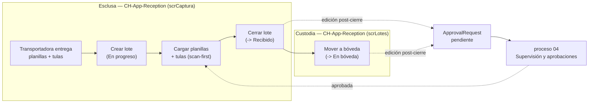
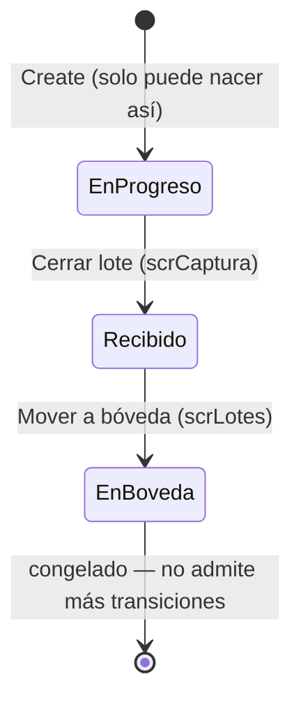
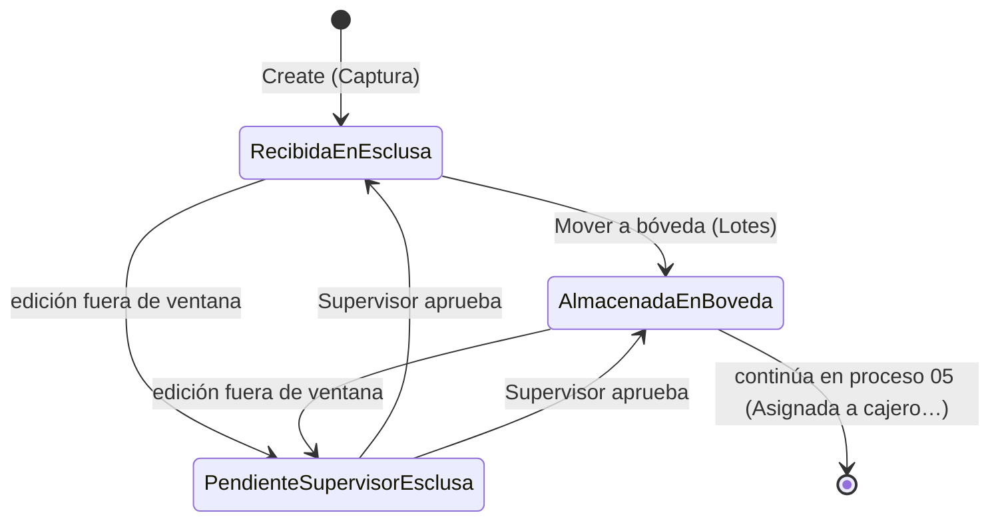

# 03 — Recepción de tulas en esclusa

## 1. Qué es este proceso

Es el punto de entrada físico del efectivo al banco. La transportadora de
valores llega a la esclusa con una o más **planillas de conducción** (el papel
que declara el cliente/sucursal remitente y los montos NIO/USD en efectivo y
cheque) y, por cada planilla, un lote de **tulas** (bolsas de seguridad
selladas, cada una con su propio código). El oficial de esclusa/bóveda no abre
 las tulas — solo dejar constancia digital de qué entró: agrupa todo
en un **lote de recepción**, carga cada planilla con su remitente y sus
montos declarados, y escanea el código de cada tula asociada. Al cerrar el
lote, éste queda `Recibido`; cuando el oficial mueve la custodia física de la
esclusa a la bóveda temporal, repite la operación en el sistema y el lote pasa
a `En bóveda`.

Este proceso **no compara** lo recibido contra lo que el cliente declaró por
correo — esa conciliación ocurre en el recuento de caja (proceso 05), que
además es quien decide cuándo una tula pasa de `Almacenada en bóveda` a
`Asignada a cajero`. Tampoco calcula
faltantes ni sobrantes: es un registro de entrada, no de conciliación.

Toda edición de tula o planilla **antes** de cerrar el lote (`En progreso`) es
directa. Una vez que el lote quedó `Recibido` o `En bóveda`, cualquier alta,
baja, remapeo o edición de tula (o corrección del número de una planilla) deja
de aplicarse directo: genera una `ApprovalRequest` y la tula queda
`Pendiente de revisión por supervisor - esclusa` hasta que el proceso 04
(Supervisión y aprobaciones) la resuelva.

**Handoffs**:
- **Recibe de** [01 — Administración de datos de clientes](01-administracion-datos-clientes.md):
  el catálogo de sucursales (`CH-Tbl-ClientBranch` / `sanic_chtblclientbranch`)
  que alimenta el combo de remitente de cada planilla, incluido el espejo
  `sanic_clientnamemirror` que lo hace buscable por nombre de cliente.
- **Entrega a** [04 — Supervisión y aprobaciones](04-supervision-aprobaciones.md):
  toda `ApprovalRequest` que este proceso crea al editar un lote ya cerrado.
- **Entrega a** [05 — Recuento de tulas](05-recuento-tulas.md): las tulas
  `Almacenada en bóveda`, que el proceso 05 (vía aprobación del supervisor)
  transiciona a `Asignada a cajero`.

## 2. Estados y transiciones

### 2.1 Lote — `CH-Tbl-ReceptionBatch` (`sanic_chtblreceptionbatch`), columna `ReceptionStatus` (`sanic_receptionstatus`)

| Valor | Label |
|---|---|
| `159460000` | En progreso |
| `159460001` | Recibido |
| `159460002` | Anulado |
| `159460003` | En bóveda |

`Anulado` está declarado en el option set pero **ninguna app lo asigna**.

Quién transiciona / qué guard defiende (`ReceptionGuard.EvaluateBatchCreate` /
`EvaluateBatchUpdate` / `EvaluateBatchDelete`):
- **Nace** `En progreso` — cualquier otro valor de nacimiento se rechaza.
- **`En progreso → Recibido`**: `btnDlgOkCerrarCap` (scrCaptura) al cerrar el
  lote. Legal también `Recibido → En progreso` (reabrir).
- **`Recibido → En bóveda`**: `btnMoverBovedaLot.OnSelect` (scrLotes).
  Cualquier otra transición se bloquea.
- **`En bóveda`**: queda congelado — ni siquiera puede reabrirse. La única
  escritura que pasa es la que **solo** toca las 6 columnas de totales
  declarados materializados (`touchesOnlyTotals`, ver §6).
- **Delete**: solo un lote `En progreso` puede eliminarse (`EvaluateBatchDelete`)
  — y ni así: el rol `CH-SR-Receptionist` no tiene privilegio **D** sobre
  `ReceptionBatch` (ver §3), así que el borrado de lote está bloqueado en dos
  capas independientes.

### 2.2 Planilla — `CH-Tbl-Receptions` (`sanic_chtblreceptions`)

La planilla no tiene estado propio: hereda el del lote. La columna
`BatchStatusMirror` (`sanic_batchstatus`, entero) es un **espejo** — ver §6 —
que existe solo para que las apps filtren por estado de lote con delegación.

Reglas de `EvaluateReceptionCreate` / `EvaluateReceptionUpdate` /
`EvaluateReceptionDelete`: crear, editar (incluido reparentar a otro lote) o
eliminar una planilla exige que **el lote (origen y, si reparenta, destino)**
esté abierto (`En progreso` o `Recibido`). Contra un lote `En bóveda` o
`Anulado`, todo se rechaza — salvo la escritura que solo toca el espejo
`BatchStatusMirror` (`touchesOnlyMirror`), que la propaga
`ReceptionBatchStatusMirrorPlugin` incluso con el lote congelado.

### 2.3 Tula — `CH-Tbl-Bags` (`sanic_chtblbags`), columna `BagStatus` (`sanic_bagstatus`)

| Valor | Label |
|---|---|
| `159460000` | Recibida en esclusa |
| `159460001` | Almacenada en bóveda |
| `159460002` | Asignada a cajero |
| `159460003` | Recontada |
| `159460004` | Pendiente de revisión por supervisor - recuento |
| `159460005` | Pendiente de revisión por supervisor - esclusa |

> **Nota de grafía**: el label vigente en el `Entity.xml` es *"Recibida en
> esclusa"* (con "s"). [`typos-conocidos.md`](../referencia/typos-conocidos.md)
> §6 documentó (análisis previo al rebuild v2) que 4 apps tenían cacheada la
> variante *"exclusa"* (con "x"), entre ellas Reception. **Verificado contra
> el código vivo de `CH-App-Reception` v2** (`Src/scrCaptura.fx.yaml`,
> `Src/scrLotes.fx.yaml` y `pkgs/TableDefinitions/CH-Tbl-Bags.json`): cero
> ocurrencias de "exclusa" — el rebuild v2 resincronizó el esquema y usa
> *"esclusa"* (con "s") de forma consistente, coincidiendo con el `Entity.xml`.
> El hallazgo de `typos-conocidos.md` para Reception queda superado por el
> rebuild. Chequeo rápido sobre el resto: Supervisor (`Screen BagLocation.fx.yaml`)
> tampoco tiene "exclusa" hoy (4/4 ocurrencias "esclusa"); Deposits Tracker y
> Email Validation Console no referencian el choice en su `Src/` actual. La
> referencia queda desactualizada para las 4 apps — corresponde actualizar
> `typos-conocidos.md` §6, fuera del alcance de este documento.

Reglas (`EvaluateBagCreate` / `EvaluateBagStatusTransition` /
`EvaluateBagIdentityEdit` / `EvaluateBagDelete`):
- **Nace** `Recibida en esclusa` (captura normal), `Pendiente de revisión -
  esclusa` (circuito de aprobación: alta rechazada por lote cerrado) o
  `Almacenada en bóveda` (materialización de un "Agregar tula" ya aprobado por
  el supervisor). Nacer directamente `Asignada a cajero` o cualquier estado
  del ciclo de recuento se **rechaza**.
- **Matriz completa de transiciones legales** (el resto es responsabilidad de
  Recounting/Supervisor, procesos 04/05): `esclusa → bóveda / asignada-cajero
  / pendiente-esclusa`; `bóveda → asignada-cajero / pendiente-esclusa`;
  `pendiente-esclusa → esclusa / bóveda`. `Recontada` es terminal, no admite
  ninguna transición saliente.
- **Identidad** (`BagID`, `Name`, `ReceptionLookup`, es decir número, nombre y
  planilla de la tula): solo se edita con el lote abierto, salvo que la tula
  ya esté `Pendiente de revisión - esclusa`.
- **Delete**: se borra con el lote abierto, o si la tula está `Pendiente de
  revisión - esclusa` (denegación de un "Agregar tula" o materialización de un
  "Eliminar tula" aprobado).

### 2.4 Solicitud de aprobación — `CH-Tbl-ApprovalRequest` (`sanic_chtblapprovalrequest`), columna `ApprovalStatus` (`sanic_approvalstatus`)

| Valor | Label |
|---|---|
| *(en blanco)* | Pendiente — no hay valor `159460xxx` para "pendiente" |
| `159460000` | Aprobado |
| `159460001` | Rechazado |

Este proceso solo **crea** solicitudes (siempre pendientes: `ReceptionGuard`
bloquea cualquier Create que llegue ya resuelta, salvo la excepción de sesión
de recuento propia, que no aplica a esclusa). Su resolución — quién puede
aprobar, el chequeo de grupo AAD, la separación creador/resolutor — es
responsabilidad del proceso 04; se documenta ahí, no acá.

## 3. Roles y acceso

Fuente: [`roles-y-seguridad.md`](../referencia/roles-y-seguridad.md).

| Rol | App | Privilegios (Global) sobre tablas de este proceso |
|---|---|---|
| `CH-SR-Receptionist` | Reception | `Bags`: A,T,C,D,R,W (CRUD completo). `ReceptionBatch`: A,T,C,R,W (**sin Delete**). `Receptions`: A,T,C,D,R,W. `ApprovalRequest`: C,R,W. `TransportCompany`: A,T,R,W. `DeclaredBags`/`Locations`: A,T,R (lectura/append). **Cero** privilegios sobre tablas de recuento (`Checks`, `CountedMoneyDetails`, `DepositsRecounting`, `RecountingSession`, `Transactions`). |

**Qué verifica la app vs. qué impone el servidor**: `scrCaptura`/`scrLotes`
resuelven identidad con `LookUp(Users, 'Primary Email' = User().Email)` y
**no comprueban** rol ni pertenencia a grupo dentro de Power Fx. El control
de acceso real depende de dos cosas, ninguna dentro de la app:
1. **A quién se le comparte** la canvas app.
2. **El Security Role Dataverse** subyacente (la matriz de arriba).

## 4. Aplicaciones

| App | Logical name | Tablas que toca |
|---|---|---|
| **CH-App-Reception** | `sanic_chappreception_9ff29` | `CH-Tbl-ReceptionBatch`, `CH-Tbl-Receptions`, `CH-Tbl-Bags`, `CH-Tbl-ApprovalRequest`, `CH-Tbl-ClientBranch`, `CH-Tbl-Client`, `CH-Tbl-TransportCompany` |

**2 pantallas**:

| Pantalla | Reemplaza | Sirve a |
|---|---|---|
| `scrCaptura` | CreacionLotesRecepcion | Crear/retomar un lote `En progreso`: transportadora, grilla de planillas, panel de tulas scan-first, validación, Guardar / Cerrar lote (§2.1–2.2 de este doc). |
| `scrLotes` | AdministracionDeLotes | Administración master-detail (tabs Lotes/Planillas) de lotes `Recibido`/`En bóveda`: Mover a bóveda, las 5 operaciones de tula, editar planilla — con el doble camino directo/aprobación de §2.4. Pantalla de entrada por defecto al abrir la app. |

## 5. Flujos Power Automate

**No aplica.** Verificado con `rg` sobre `solutions/unpacked/flow/`: ningún
flujo toca las tablas de este proceso (`sanic_chtblreceptionbatch`,
`sanic_chtblreceptions`, `sanic_chtblbags`) ni referencia `esclusa` o `tula`.

## 6. Tablas

| Tabla (display / logical) | Columna | Notas |
|---|---|---|
| **CH-Tbl-ReceptionBatch** / `sanic_chtblreceptionbatch` | `Name` (`sanic_name`) | Autonumber `RB-{SEQNUM:5}`, máx. 20 — nunca se patchea. |
| | `ReceptionStatus` (`sanic_receptionstatus`) | Ver §2.1. |
| | `Transportadora` (`sanic_transportadora`) | Texto libre (no lookup); se escribe con el `Name` elegido de `CH-Tbl-TransportCompany`. |
| | `DecNioCash`/`DecNioCheck`/`DecNioTotal`/`DecUsdCash`/`DecUsdCheck`/`DecUsdTotal` (`sanic_decniocash`/`sanic_decniocheck`/`sanic_decniototal`/`sanic_decusdcash`/`sanic_decusdcheck`/`sanic_decusdtotal`) | **Mantenido por plugin** (`ReceptionBatchTotalsPlugin`, B4). No editar a mano — es la suma agregada server-side de los montos declarados de todas las planillas del lote. |
| **CH-Tbl-Receptions** (planilla) / `sanic_chtblreceptions` | `ReceptionBatch` (`sanic_receptionbatch`) | Lookup al lote. |
| | `BatchStatusMirror` (`sanic_batchstatus`) | **Mantenido por plugin** (`ReceptionBatchStatusMirrorPlugin`). No editar a mano — espejo entero del estado del lote, existe para filtrar planillas por estado con delegación. |
| | `ReceiptID` (`sanic_receiptid`) | Número de planilla (texto). |
| | `RemitentClient` (`sanic_remitentclient`) | Lookup a `CH-Tbl-ClientBranch` (requerido). |
| | `RemitentName` (`sanic_remitentname`) | Texto — nombre de sucursal proyectado, no un espejo mantenido por plugin. |
| | `NIOCash`/`NIOCheck`/`USDCash`/`USDCheck` (`sanic_niocash`/`sanic_niocheck`/`sanic_usdcash`/`sanic_usdcheck`) | Montos **declarados** de la planilla (los del papel) — disparan el recompute de §anterior al cambiar. |
| **CH-Tbl-Bags** (tula) / `sanic_chtblbags` | `BagStatus` (`sanic_bagstatus`) | Ver §2.3. |
| | `BagID`/`Name` (`sanic_bagid`/`sanic_name`) | Código escaneado; se escriben con el mismo valor (no hay otro dato natural para `Name`, requerida). |
| | `ReceptionID` (`sanic_receptionid`) | Lookup a la planilla dueña. |
| | `ReceptionBatchId` (`sanic_receptionbatchid`) | **Mantenido por plugin** (`BagReceptionMirrorPlugin`). No editar a mano — lookup espejo al lote, delegable, evita navegar `ReceptionID.ReceptionBatch`. |
| | `ReceiptIdMirror` (`sanic_receiptidmirror`) | **Mantenido por plugin** (`BagReceptionMirrorPlugin`). No editar a mano — copia texto del número de planilla. |
| | `BagDeclarationLookup` (`sanic_bagdeclarationid`) | Lookup a `CH-Tbl-DeclaredBags` — fuera de alcance de este proceso (lo consume 05/07). |
| | `RecountingSessionLookup`, `TotalNio`/`TotalUsd`/`TotalEur`, `DeclTotalNio`/`DeclTotalUsd`/`DeclTotalEur`, `HasDifference` | Columnas del ciclo de recuento (proceso 05); en esclusa nacen vacías. |
| **CH-Tbl-ApprovalRequest** / `sanic_chtblapprovalrequest` | `Name` (`sanic_name`) | Autonumber `AR-{SEQNUM:8}` — nunca se patchea. |
| | `ApprovalStatus` (`sanic_approvalstatus`) | Ver §2.4. |
| | `RequestType` (`sanic_requesttype`) | Texto libre — comparación **ordinal exacta**; cualquier variante de tipeo crea un tipo fantasma que el guard no reconoce. |
| | `RequestDetails`/`RequestResources` (`sanic_requestdetails`/`sanic_requestresources`) | HTML (card con estilo, escapado) y JSON de contrato con el proceso 04 — detalle de claves en §9. |
| | `SolvedBy`/`ResolutionDatetime` (`sanic_solvedby`/`sanic_resolutiondatetime`) | Los estampa el plugin desde `InitiatingUserId` al resolver (proceso 04), no la app. |
| | `BagNumber` (`sanic_bagnumber`) | **Mantenido por plugin** (`ApprovalRequestBagNumberPlugin`), fuera del alcance de este documento (visor del proceso 04). |
| **CH-Tbl-ClientBranch** / `sanic_chtblclientbranch` | `ClientNameMirror` (`sanic_clientnamemirror`) | **Mantenido por plugin** (`ClientBranchNameMirrorPlugin`, documentado en el proceso 01). Referenciado acá porque habilita el combo de remitente server-side de `scrCaptura`; sin cascada por rename de cliente — ver §10. |

## 7. Custom APIs

**No aplica**

## 8. Steps de plugins

### 8.1 `GuardReceptionPlugin` — Pre-validation (stage 10)

| Entidad | Mensaje | Filtro / pre-image | Regla de negocio que defiende |
|---|---|---|---|
| `sanic_chtblreceptionbatch` | Create | — | Un lote solo puede nacer `En progreso`. |
| `sanic_chtblreceptionbatch` | Update | pre-image `sanic_receptionstatus` | Transiciones legales del lote (§2.1); congelado en `En bóveda` salvo `touchesOnlyTotals`. |
| `sanic_chtblreceptionbatch` | Delete | pre-image `sanic_receptionstatus` | Solo se elimina un lote `En progreso`. |
| `sanic_chtblreceptions` | Create | — | No se crean planillas en un lote cerrado. |
| `sanic_chtblreceptions` | Update | pre-image `sanic_receptionbatch` | Planilla congelada con el lote en bóveda; reparent solo hacia un lote abierto. |
| `sanic_chtblreceptions` | Delete | pre-image `sanic_receptionbatch` | No se eliminan planillas de un lote cerrado. |
| `sanic_chtblbags` | Create | — | Una tula no puede nacer en un estado del ciclo de recuento. |
| `sanic_chtblbags` | Update | filtro `sanic_bagstatus,sanic_bagid,sanic_name,sanic_receptionid`; pre-image `sanic_bagstatus,sanic_receptionid` | Matriz de transiciones de `BagStatus` (§2.3) e identidad congelada con el lote en bóveda. |
| `sanic_chtblbags` | Delete | pre-image `sanic_bagstatus,sanic_receptionid` | Borrado solo con lote abierto o tula `Pendiente de revisión - esclusa`. |
| `sanic_chtblapprovalrequest` | Create | — | Una solicitud no nace resuelta (la única excepción, sesión de recuento propia, no aplica a esclusa). |
| `sanic_chtblapprovalrequest` | Update | pre-image `sanic_approvalstatus,createdby` | Congelamiento post-decisión, separación creador/resolutor, membresía del grupo aprobador — detalle en proceso 04. |

### 8.2 Espejos (metadata derivada, no reglas de negocio)

| Plugin | Stage / mensaje | Qué mantiene |
|---|---|---|
| `ReceptionBatchStatusMirrorPlugin` | Post-op (40) Update de `sanic_chtblreceptionbatch` (filtro `sanic_receptionstatus`); Pre-op (20) Create/Update de `sanic_chtblreceptions` | `BatchStatusMirror` en cada planilla del lote. |
| `BagReceptionMirrorPlugin` | Pre-op (20) Create/Update de `sanic_chtblbags`; Post-op (40) Update de `sanic_chtblreceptions` (filtro `sanic_receptionbatch,sanic_receiptid`) | `ReceptionBatchId` (B-2) y `ReceiptIdMirror` (B-3) en cada tula. |
| `ReceptionBatchTotalsPlugin` | Post-op (40) Create/Update/Delete de `sanic_chtblreceptions` (filtro en los 4 montos + `sanic_receptionbatch`, con pre-image) | `DecNio*`/`DecUsd*` del lote — aggregate FetchXML, nunca suma client-side. |
| `ClientBranchNameMirrorPlugin` | Pre-op (20) Create/Update de `sanic_chtblclientbranch` (filtro `sanic_client`) | `ClientNameMirror` — pertenece al proceso 01, referenciado por el combo de remitente de `scrCaptura`. |

`GuardReceptionPlugin` deja pasar la escritura que **solo** toca uno de estos
espejos aun con el registro congelado (`touchesOnlyTotals` / `touchesOnlyMirror`):
es infraestructura, no una decisión de negocio, y sin el bypass el propio
backfill de estos espejos chocaría contra su propio guard.

## 9. Acciones

### Crear lote de recepción

| Campo | Contenido |
|---|---|
| **Quién** | Oficial de esclusa/bóveda (`CH-SR-Receptionist`). |
| **Cuándo** | No hay lote activo (`IsBlank(gvarLoteActivo)`) — es el gate de entrada de `scrCaptura`. |
| **Por qué / para qué** | Abre el contenedor (lote `En progreso`) donde van a colgar las planillas y tulas de esta entrega. |
| **Cómo** | `scrCaptura` → overlay *Nuevo lote* (gate de estado, sin ✕ ni Cancelar) → combo `cmbTransportadoraCap` (server-side, `CH-Tbl-TransportCompany`) → botón `btnCrearLoteCap`. |
| **Qué valida el servidor** | `GuardReceptionPlugin.EvaluateBatchCreate`: solo permite nacer en `En progreso`. |
| **Qué pasa si falla / deshacer** | `IfError` notifica y deja `gvarLoteActivo` en blanco (vuelve al overlay). Sin deshacer explícito una vez creado — el lote queda `En progreso` y se completa o se abandona (no hay Delete de lote completo, §3). |

### Cargar planilla y escanear tulas

| Campo | Contenido |
|---|---|
| **Quién** | Oficial de esclusa/bóveda. |
| **Cuándo** | Lote activo `En progreso`, en `scrCaptura`. |
| **Por qué / para qué** | Deja constancia de cada planilla (remitente, montos declarados) y de cada tula física que trae. |
| **Cómo** | Grilla de planillas (fila nueva) → cliente/sucursal vía combo server-side (`ClientNameMirror`) + montos → `btnChipTulasCap` abre el panel de tulas **scan-first**: caja única `inpTulaScanCap`, escanear → Enter → la tula entra y el foco **retorna** a la caja. Corrección = papelera de la fila + re-escanear (no se edita in-place). *Aplicar* vuelca a la colección local; nada se persiste todavía. |
| **Qué valida el servidor** | Nada en este paso — es edición en memoria. El dup-check de tula (intra e inter-planilla, local) corre al escanear; el chequeo cross-**lote** lo hace `GuardReceptionPlugin` recién al guardar. |
| **Qué pasa si falla / deshacer** | Duplicado intra/inter-planilla: aviso inline (`Label1`, bindeado a `ctxScanDupCap` en `scrCaptura` — no sigue la convención de nombres `lbl*Cap` del resto de la pantalla), no entra a la lista. Cancelar/✕ del panel descarta la copia sin tocar `colTulas`. |

### Guardar (delta)

| Campo | Contenido |
|---|---|
| **Quién** | Oficial de esclusa/bóveda. |
| **Cuándo** | Lote activo con planillas cargadas en memoria, en `scrCaptura`. |
| **Por qué / para qué** | Persiste solo lo nuevo/modificado (planillas + tulas) sin re-escribir lo que ya estaba guardado. |
| **Cómo** | `btnGuardarCap` → calcula delta contra el snapshot `…DV` → `tmrGuardarCap` (timer de un frame, `Repeat false`) pinta *"Guardando…"* → `Patch` con tabla de planillas, luego `Patch` de tulas nuevas, luego `Remove` puntual de tulas dadas de baja en el panel. |
| **Qué valida el servidor** | `GuardReceptionPlugin` sobre cada `Patch`/`Remove` individual (estado del lote, identidad de tula, transición). Sin cambios reales = cero llamadas (RC-04). |
| **Qué pasa si falla / deshacer** | `IfError` por operación; las filas rechazadas quedan en `colFallidas` con su motivo y el overlay ofrece *"Reintentar fallidas"* (reintenta el guardado completo, es idempotente). No hay deshacer de lo ya persistido — corregir es una nueva edición y un nuevo guardado. |

### Cerrar lote

| Campo | Contenido |
|---|---|
| **Quién** | Oficial de esclusa/bóveda. |
| **Cuándo** | Lote `En progreso`, con al menos una planilla y sin problemas de validación (`fxProblemas` vacío: ninguna planilla sin tulas, sin tulas duplicadas). |
| **Por qué / para qué** | Cierra el registro de esta entrega; habilita el paso siguiente (Mover a bóveda) y saca al lote de edición libre. |
| **Cómo** | `btnCerrarCap` valida y abre confirmación → `btnDlgOkCerrarCap` marca origen y dispara el mismo guardado de arriba → al terminar sin fallidas, el paso final del `OnTimerEnd` transiciona `ReceptionStatus` a `Recibido` y limpia el lote activo. |
| **Qué valida el servidor** | `GuardReceptionPlugin.EvaluateBatchUpdate`: solo `En progreso → Recibido` es legal. Hoy **no** es atómico (§7, B0-3 pendiente): si el guardado dejó fallidas, el cierre no ocurre y el operador se queda en Captura con el detalle. |
| **Qué pasa si falla / deshacer** | Mensaje de error específico por fila fallida; el lote sigue `En progreso`. Reabrir (`Recibido → En progreso`) es legal para volver a editar, pero desde `scrLotes` — no hay un botón directo de "reabrir". |

### Mover a bóveda

| Campo | Contenido |
|---|---|
| **Quién** | Oficial de esclusa/bóveda. |
| **Cuándo** | Lote `Recibido`, seleccionado en `scrLotes` (o su planilla). Custodia física ya movida. |
| **Por qué / para qué** | Refleja en el sistema que las tulas dejaron la esclusa y pasaron a bóveda temporal; habilita al proceso 05 a asignarlas a cajero (vía aprobación). |
| **Cómo** | `btnMoverBovedaLot` carga `colTulasBovedaLot` (solo tulas `Recibida en esclusa` del lote, vía espejo B-2 delegable) → confirmar en el diálogo → `btnDlgOkBovedaLot`: primero patchea **todas** las tulas a `Almacenada en bóveda`, y **solo si eso salió bien** patchea el lote a `En bóveda`. |
| **Qué valida el servidor** | `GuardReceptionPlugin.EvaluateBagStatusTransition` (esclusa→bóveda por tula) y `EvaluateBatchUpdate` (Recibido→En bóveda). |
| **Qué pasa si falla / deshacer** | **No es atómico** (DL-19): si falla a mitad de las tulas, algunas quedan en bóveda y otras en esclusa — el toast informa cuántas pasaron. Es idempotente: solo toma tulas todavía `Recibida en esclusa`, así que re-ejecutar la operación no vuelve a tocar lo que ya pasó. Sin deshacer: una tula ya movida no vuelve sola a esclusa. |

### Editar lote completo (volver a Captura)

| Campo | Contenido |
|---|---|
| **Quién** | Oficial de esclusa/bóveda. |
| **Cuándo** | Lote `En progreso` (único estado habilitado — `btnEditarLoteLot`). |
| **Por qué / para qué** | Retoma un lote que quedó a medio cargar. |
| **Cómo** | `scrLotes` → seleccionar lote → `btnEditarLoteLot` → dos consultas delegables traen planillas y tulas completas del lote (vía espejo B-2) → `Navigate(scrCaptura)`. |
| **Qué valida el servidor** | Ninguna escritura en este paso — es solo lectura y navegación. El `DisplayMode` del botón ya exige `En progreso`; si el estado cambiase entre el filtro y el click, el guard rechazaría cualquier intento de escritura posterior igual. |
| **Qué pasa si falla / deshacer** | No aplica (no destruye nada); sin diálogo de confirmación. |

### Agregar / Eliminar / Remapear tula (post-cierre)

| Campo | Contenido |
|---|---|
| **Quién** | Oficial de esclusa/bóveda. |
| **Cuándo** | Lote `Recibido` o `En bóveda`, en `scrLotes`. *Eliminar* y *Remapear* además exigen que **no** sea la única tula de la planilla (`G-TULA-ULTIMA`, decisión **DL-22**: dejarla en cero tulas es lo que la validación de Captura ya prohíbe crear). |
| **Por qué / para qué** | Corrige un error de captura detectado después del cierre, con supervisión de cuatro ojos cuando el lote ya no está en edición libre. |
| **Cómo** | Botones `btnAgregarTulaLot` / `btnEliminarTulaLot` / `btnRemapearTulaLot` → diálogo respectivo → `OnSelect` bifurca por `BatchStatus`: si es `159460003` (En bóveda) o el lote está `Recibido` fuera de la ventana editable, arma el **camino aprobación**; si no, **camino directo**. |
| **Qué valida el servidor** | Camino directo: `GuardReceptionPlugin` valida la transición/identidad igual que cualquier `Patch`. Camino aprobación: la tula se `Patch`ea a `Pendiente de revisión - esclusa` (Agregar la crea directamente en ese estado) y se crea la `ApprovalRequest` con `RequestResources` en `JSON()` — claves exactas por tipo: Agregar `{ReceiptGUID,BagID,BagGUID,ReceptionBatchGUID}`, Eliminar `{GUID,BagPreviousState}`, Remapear `{GUID,ReceiptID,ReceiptGUID,BagPreviousState}` — contrato con el proceso 04. |
| **Qué pasa si falla / deshacer** | Si el `Patch` de la tula falla, no se crea la solicitud (regla dura: una `ApprovalRequest` sin `BagGUID` es basura que el supervisor no puede resolver). Si la tula quedó pendiente pero la solicitud no se pudo crear, el mensaje se lo dice explícitamente al operador ("avisale al supervisor"). Sin deshacer client-side: el circuito de reversión es que el supervisor **rechace** la solicitud (proceso 04). |

### Editar tula / Editar planilla (post-cierre)

| Campo | Contenido |
|---|---|
| **Quién** | Oficial de esclusa/bóveda. |
| **Cuándo** | `btnEditarTulaLot`: tula seleccionada, no pendiente, del lote/planilla en pantalla (sin la condición de "última tula" — cambiar un número no vacía la planilla). `btnEditarPlanillaLot`: planilla del lote en pantalla, lote no `En progreso`. |
| **Por qué / para qué** | Corrige el número de una tula o el número de una planilla ya persistidos. |
| **Cómo** | Botón correspondiente → diálogo (`Reset` de sus inputs al abrir, nunca editable en la fila de la grilla) → mismo patrón directo/aprobación que la fila anterior. |
| **Qué valida el servidor** | `EvaluateBagIdentityEdit` (tula) / `EvaluateReceptionUpdate` (planilla): identidad congelada con el lote en bóveda salvo circuito de aprobación. |
| **Qué pasa si falla / deshacer** | Igual patrón que Agregar/Eliminar/Remapear: sin deshacer client-side, reversión vía rechazo del supervisor. |

## 10. Supuestos y limitaciones

- **Este proceso no calcula faltantes ni sobrantes.** Termina en dejar
  constancia de la recepción física; la comparación contra lo declarado por
  correo ocurre en el recuento de caja (proceso 05).
- **Los dup-checks del panel de tulas son local-only** (contra las
  colecciones en memoria del lote actual). El duplicado cross-lote real lo
  garantiza únicamente `GuardReceptionPlugin` al momento de guardar.
- **`ClientNameMirror` no tiene cascada por rename del cliente** (limitación
  deliberada, documentada en el proceso 01): si renombran un cliente, las
  sucursales ya creadas conservan el nombre viejo en el espejo.
- **Un lote `En progreso` solo se opera desde `scrCaptura`** (DL-20):
  `scrLotes` bloquea sus 5 comandos de tula sobre esos lotes a propósito,
  para no pisar una sesión de captura en memoria.

## 11. Pruebas

| # | Caso | Pasos | Esperado |
|---|---|---|---|
| R01 🔴 | Lote completo | scrCaptura: transportadora + 2 planillas (cliente/sucursal) + tulas escaneadas en cada una → guardar → validar | Lote **Recibido**; planillas y tulas persistidas; guardado planilla por planilla sin duplicar |
| R02 🔴 | Scan-first | Escanear 5 tulas seguidas en la caja de escaneo | El foco RETORNA a la caja tras cada escaneo; corrección = borrar + re-escanear |
| R03 🔴 | Dup-check de tula | Escanear un código repetido en la misma planilla y en otra planilla del lote; luego uno que exista en OTRO lote | Rebota con aviso en los tres casos (dup intra e inter-planilla, delegable — la encuentra aunque haya miles) |
| R04 | Guardado delta | Reabrir un lote En progreso, tocar una sola planilla, guardar | Solo viaja lo modificado |
| R05 🔴 | Combo de sucursales | Buscar sucursal por nombre de sucursal Y por nombre de cliente | Encuentra más allá de las 500 filas (espejo `ClientNameMirror` delegable) |
| R06 🔴 | Mover a bóveda | scrLotes: seleccionar el lote Recibido → Mover a bóveda | Todas las tulas pasan a **Almacenada en bóveda**, lote a **En bóveda**. Probar también el lote gordo del stress (600 tulas) |
| R07 🔴 | Edición post-cierre = aprobación | En un lote Recibido/En bóveda: agregar, eliminar, remapear y editar una tula; modificar número de planilla | NO se aplica directo: se crea la solicitud y la tula queda "Pendiente de revisión por supervisor - esclusa" hasta que Supervisor resuelva (Módulo E) |
| R08 🔴 | Última tula intocable | Intentar eliminar/remapear la ÚNICA tula de una planilla | Bloqueado — una planilla no puede quedar vacía |
| R09 🔴 | Guard server-side | Por Web API: crear una tula naciendo en "Asignada a cajero"; transición ilegal de estado de lote | Rebota con 400 del `GuardReceptionPlugin` — la app no es la única defensa |
