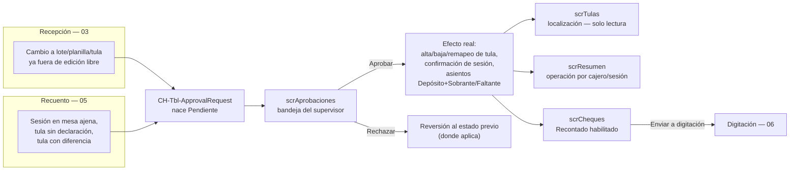
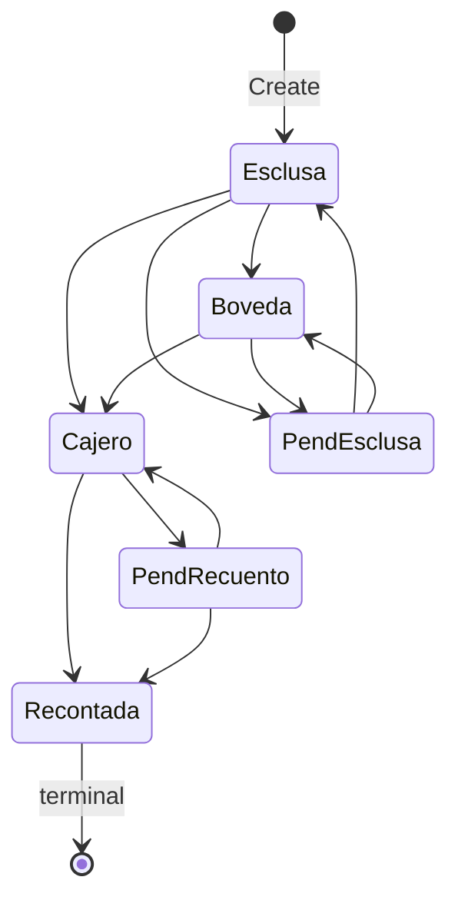

# Supervisión y aprobaciones

> Proceso transversal — no tiene ingesta propia. Vive de lo que Recepción (03) y
> Recuento (05) le mandan a firmar, y entrega el gatillo que habilita Digitación (06).

## 1. Qué es este proceso

Supervisión es el **control de cuatro ojos** de todo el circuito de tulas: cada vez
que Recepción o Recuento tocan algo que ya salió de la edición libre (una tula que
no cuadra, una sesión abierta en mesa ajena, un cambio a un lote cerrado), el
sistema genera una **solicitud de aprobación** y la manda a esta bandeja. El
supervisor es además el **único actor que postea faltantes y sobrantes**: ni
Recepción ni Recuento contabilizan la diferencia por sí solos — la transacción nace
cuando el supervisor **aprueba** la solicitud correspondiente. El proceso también
administra la **localización de tulas** (consulta), el **resumen de operaciones**
(consulta) y el **envío de cheques a digitación** (la acción que dispara el
handoff hacia 06).

Los 10 tipos de solicitud que puede recibir esta bandeja:

| Tipo (texto libre exacto) | Lo genera |
|---|---|
| Agregar tula | Recepción |
| Eliminar tula | Recepción |
| Remapear tula | Recepción |
| Editar tula | Recepción |
| Modificar numero de planilla | Recepción |
| Crear sesion de recuento | Recuento |
| Primera tula en planilla | Recuento |
| Tula sin declaracion | Recuento |
| Tula con diferencia | Recuento |
| Tula recontada sin declaracion | Recuento |

**Handoffs**:
- **Recibe de** [03 — Recepción de tulas en esclusa](03-recepcion-tulas-esclusa.md)
  y [05 — Recuento de tulas](05-recuento-tulas.md): ambos procesos crean filas en
  `CH-Tbl-ApprovalRequest` (`sanic_chtblapprovalrequest`) cuando su propia app
  detecta una excepción; ninguno resuelve su propia solicitud.
- **Entrega a** [06 — Digitación en core bancario](06-digitacion-core-bancario.md):
  el botón **Enviar** de `scrCheques` es la única puerta de entrada — un cheque
  nunca llega al digitador sin pasar por acá.

## 2. Estados y transiciones

### 2.1 Solicitud de aprobación (`CH-Tbl-ApprovalRequest` / `sanic_chtblapprovalrequest`)

`sanic_approvalstatus` (picklist) — **`Blank()` = Pendiente**, no es un valor del
option set:

| Etiqueta | Valor | Quién transiciona | Guard |
|---|---|---|---|
| *(pendiente — sin valor)* | `null` | Recepción/Recuento al crear | `GuardReceptionPlugin` bloquea que nazca ya resuelta (excepción abajo) |
| Aprobado | `159460000` | Supervisor, botón **Aprobar** | `ReceptionGuard.EvaluateApprovalUpdate` |
| Rechazado | `159460001` | Supervisor, botón **Rechazar** | ídem |

**Única excepción de nacimiento resuelto**: `Crear sesion de recuento` puede nacer
ya `Aprobado` cuando el cajero elige **su propia mesa** — es un atajo de negocio
deliberado, verificado server-side (la sesión referenciada en el JSON tiene que
existir y pertenecer al propio solicitante, resuelto por el plugin **como
sistema**, no por el texto del JSON). Cualquier otro `RequestType` que intente
nacer resuelto se bloquea; si la excepción de sesión propia no se puede probar
con certeza (JSON ilegible, sesión de otro, sesión inexistente) la solicitud **no
se bloquea**: se **degrada a pendiente** — el cajero no se queda sin poder pedir
su sesión por un JSON mal armado, y el cuatro ojos igual se preserva.

**Congelamiento**: una vez que `sanic_approvalstatus` tiene valor, el registro
queda **congelado** — ningún Update que toque la decisión pasa, salvo la
excepción de espejo (§6).

### 2.2 Tula (`CH-Tbl-Bags` / `sanic_chtblbags`, columna `sanic_bagstatus`)

| Etiqueta | Valor | Visible en `scrTulas` antes del rediseño |
|---|---|---|
| Recibida en esclusa | `159460000` | Sí |
| Almacenada en boveda | `159460001` | Sí |
| Asignada a cajero | `159460002` | **No** — invisible en la app vieja |
| Recontada | `159460003` | Sí (terminal) |
| Pendiente de revision por supervisor - recuento | `159460004` | **No** — invisible en la app vieja |
| Pendiente de revision por supervisor - esclusa | `159460005` | Sí |

Matriz de transiciones legales (`ReceptionGuard.EvaluateBagStatusTransition`,
impuesta server-side, no solo en el canvas):

`Recontada` es terminal: ningún camino sale de ahí. La identidad de la tula
(número, nombre, planilla) solo se edita con el lote de recepción abierto — o
sobre una tula `Pendiente de revision por supervisor - esclusa`, que es como el
circuito de aprobación materializa remapeos y ediciones con el lote ya en bóveda.

### 2.3 Cheque (`CH-Tbl-Checks` / `sanic_chtblchecks`, columna `sanic_checkstatus`)

Máquina impuesta por `CheckGuard` (guard del proceso 06, referenciado acá porque
`scrCheques` de Supervisión es la que dispara la única transición que le compete):

| Desde | Hacia | ¿Legal? | Quién la dispara |
|---|---|---|---|
| Recontado | Enviado a digitacion | ✅ | botón **Enviar** de `scrCheques` |
| No Recibido | Enviado a digitacion | ✅ | botón **Reenviar** de `scrCheques` |
| Enviado a digitacion | Enviado a digitacion | ❌ bloqueada | — (no hay no-op de reenvío) |
| Recibido | cualquiera | ❌ congelado, terminal | — |
| Digitado / Rebotado | cualquiera | ❌ reservados | proceso 06 |

Ver el detalle completo del ciclo de vida del cheque en
[06 — Digitación en core bancario](06-digitacion-core-bancario.md).

## 3. Roles y acceso

| Rol Dataverse | Grupo AAD asociado | Qué habilita en este proceso |
|---|---|---|
| `CH-SR-CountingSupervisor` | *(compartición de app — ver Limitaciones)* | Acceso a `CH-App-Supervisor`: las 4 pantallas |
| — (parámetro de firma) | Team **"CashHub - Banca de Empresas -Approver"** (`sanic_value` = `17b5e5c7-e7a0-4b61-98cd-ceff67211797` en `CH-Tbl-Parameter`, clave `Security.ApproverGroup.Supervisor`) | Único requisito real para **resolver** una solicitud — ver abajo |

**Lo que verifica la app (cosmético) vs. lo que impone el servidor (real)**:

- La app **no verifica ningún rol dentro del código**. Cualquier usuario al que
  se le comparta `CH-App-Supervisor` ve las 4 pantallas; el control de acceso a
  la app depende exclusivamente de la compartición manual (misma limitación
  documentada en `docs/guias/02-manual-supervisor.md`).
- Lo que **sí** es real y server-side es la resolución de una solicitud:
  `GuardReceptionPlugin`, step `CashHub.GuardReception: Update de
  sanic_chtblapprovalrequest` (síncrono, Pre-validation), exige — leyendo como
  sistema, no confiando en lo que mande el cliente:
  1. La solicitud sigue Pendiente (`sanic_approvalstatus` sin valor). Si ya
     tiene valor, el Update se **bloquea entero**: registro congelado.
  2. Quien resuelve (`InitiatingUserId`) **no es** quien creó (`createdby`) —
     separación de funciones. Comparación de GUID, nunca de nombre.
  3. Quien resuelve **pertenece al grupo AAD** configurado en `CH-Tbl-Parameter`
     (`Security.ApproverGroup.Supervisor`). Esta verificación es **FAIL-CLOSED**:
     si la fila del parámetro no existe, está inactiva, o su valor no es un GUID
     válido, **nadie puede aprobar ni rechazar** — no hay modo degradado que deje
     pasar por error de configuración.
- Este guard **jamás debe quedar en `Disabled` en producción**. El seeder de
  estrés `scripts/seed-supervisor-aprobaciones.py` lo apaga temporalmente para
  poder sembrar volumen (el service principal no es miembro del grupo aprobador)
  y lo reactiva con `finally` + verificación explícita — es la única excepción
  documentada, y es de un script de datos de prueba, no de operación real.
- **FLS `sanic_accountnumber`** (perfil **CashHub | FLS | Supervisor Cuentas**):
  la columna tiene `IsSecured=1` en `CH-Tbl-DepositsRecounting`,
  `CH-Tbl-DeclaredDeposits` y `CH-Tbl-Transactions`. Sin el perfil dando Read (y
  Update, para que los asientos se posteen con cuenta) al supervisor, la columna
  **no da error: devuelve `Blank()` en silencio** — el detalle de la solicitud
  mostraría "—" en Cuenta y los asientos se escribirían con `sanic_accountnumber`
  vacío. Verificar en vivo que el perfil está aplicado antes de operar con dinero
  real: no hay ningún archivo de Field Security Profile en el repo, así que su
  existencia en el entorno **no se puede confirmar desde el código** — es
  configuración pura de portal.
- `prvRead sanic_CHTblClient` (Global) — confirmado en
  `solutions/unpacked/core/Roles/CH-SR-CountingSupervisor.xml` tras la
  remediación de roles (commit `feat(gobierno): remediacion de roles del
  circuito supervisor…`). Sin este privilegio, `RemitentClient.Name` cae al
  `Coalesce` con `RemitentName` (texto plano) — degradación silenciosa, no error.
- El mismo archivo de rol confirma **C/R/W** sobre
  `CH-Tbl-RecountingSessionDetail` (antes en cero) y **prvDelete** sobre
  `CH-Tbl-Bags` (necesario para rechazar "Agregar tula").
- La contrapartida en `CH-SR-Counter` (rol del cajero) quedó recortada: sin
  `prvWrite` sobre `CH-Tbl-ApprovalRequests` (verificado — no hay línea para ese
  privilegio en el XML) y `prvRead` bajado a `Local`. Un cajero puede **crear**
  su propia solicitud (`prvCreate` `Local`) pero no puede tocarla después de
  creada ni ver las de otro cajero — cierra la auto/co-aprobación por Web API.

## 4. Aplicaciones

App **v2**: `CH-App-Supervisor`. Cuatro pantallas, todas construidas con
controles clásicos (sin PCF de terceros — ver
[docs/supervisor-rebuild/00-analisis-y-plan.md](../supervisor-rebuild/00-analisis-y-plan.md)
para el detalle de qué murió de la app anterior):

| Pantalla v2 | Reemplaza a | Para qué sirve |
|---|---|---|
| `scrResumen` | *Screen OperationSummary* | Resumen de recuentos por cajero/sesión — solo lectura |
| `scrAprobaciones` | *Screen Approvals* | Bandeja de solicitudes — pantalla principal de trabajo |
| `scrTulas` | *Screen BagLocation* | Localización de cada tula, cualquier estado — solo lectura |
| `scrCheques` | *Screen ChecksSummary* | Entrega física de cheques recontados a digitación |

Estado de entrega, según
[docs/supervisor-rebuild/09-entrega-fase2-qa.md](../supervisor-rebuild/09-entrega-fase2-qa.md):
**publicado en el entorno** (import `--publish-changes` confirmado), las 4
pantallas "vestidas" (con lógica completa, no solo maqueta). Los detalles de
árbol de controles, fórmulas Power Fx completas y las decisiones de layout
responsive de cada pantalla viven en las guías de rebuild
([01-app](../supervisor-rebuild/01-app.md),
[02](../supervisor-rebuild/02-pantalla-resumen.md),
[03](../supervisor-rebuild/03-pantalla-aprobaciones.md),
[04](../supervisor-rebuild/04-pantalla-tulas.md),
[05](../supervisor-rebuild/05-pantalla-cheques.md)) — este documento no las
repite, solo resume lo que hace falta para entender el proceso de negocio.

## 5. Flujos Power Automate

**No aplica**: este proceso no tiene flujos propios. La resolución de
solicitudes, la generación de asientos y el envío de cheques corren **dentro de
la app canvas** (Power Fx) contra Dataverse directo, sin intermediario de
Power Automate. El handoff hacia Digitación (06) tampoco pasa por un flujo: es
un `Patch` de estado sobre `CH-Tbl-Checks` que el digitador consulta.

## 6. Tablas

Modelo completo en [docs/referencia/modelo-de-datos.md](../referencia/modelo-de-datos.md)
— acá solo lo propio de este proceso.

**`CH-Tbl-ApprovalRequest`** (`sanic_chtblapprovalrequest`) — PK singular
`sanic_chtblapprovalrequestid`:

| Columna | Lógico | Notas |
|---|---|---|
| RequestType | `sanic_requesttype` | **Texto libre**, NO es picklist. Comparación server-side es **ordinal exacta** (el guard viejo comparaba ignorando mayúsculas — cerrado) |
| RequestResources | `sanic_requestresources` | JSON plano. Claves **no homogéneas** por tipo — ver la tabla de contrato en [03-pantalla-aprobaciones §0](../supervisor-rebuild/03-pantalla-aprobaciones.md) |
| RequestDetails | `sanic_requestdetails` | HTML heredado de la app vieja; la v2 ya no lo parsea (se arma el resumen desde `RequestResources` + lookups) |
| ApprovalStatus | `sanic_approvalstatus` | Picklist, `Blank()` = Pendiente — ver §2.1 |
| SolvedBy | `sanic_solvedby` | Lookup a `systemuser` — quien resolvió (o el plugin de auto-aprobación) |
| ResolutionDatetime | `sanic_resolutiondatetime` | — |
| StatusReason | `sanic_statusreason` | Motivo del rechazo (obligatorio en la UI) o de la aprobación |
| BagNumber | `sanic_bagnumber` | **Mantenido por plugin. No editar a mano.** Número de tula extraído del JSON al crear, para buscar por tula en la bandeja con delegación |
| *(solicitante)* | `createdby` | `CH-Tbl-ApprovalRequest` **no tiene columna propia de solicitante** — el cuatro ojos compara contra esta columna de sistema |

**`CH-Tbl-Bags`** (`sanic_chtblbags`) — columnas propias de este proceso:

| Columna | Lógico | Notas |
|---|---|---|
| BagStatus | `sanic_bagstatus` | Máquina de estados de §2.2 |
| BagID | `sanic_bagid` | Número de tula (texto) — **nunca confundir con el GUID** |
| ReceptionBatchId | `sanic_receptionbatchid` | **Mantenido por plugin. No editar a mano.** Espejo del lote de la planilla, para dup-check delegable de "Agregar tula"/"Editar tula" |
| ReceiptIdMirror | `sanic_receiptidmirror` | **Mantenido por plugin. No editar a mano.** Espejo del `ReceiptID` de la planilla, para búsqueda por recibo delegable en `scrTulas` |
| RecountingSession | `sanic_recountingsession` | Columna de **negocio** (la escribe Recuento), no espejo — es el origen del espejo del cheque |

**`CH-Tbl-Transactions`** (`sanic_chtbltransactions`) — los asientos que postea
esta pantalla:

| Columna | Lógico | Notas |
|---|---|---|
| TransactionType | `sanic_transactiontype` | `Deposito` 159460000 · `Faltante` 159460001 · `Sobrante` 159460002 · `Sin declaracion` 159460003 |
| CashAmount / BACLocalCheckAmount / OtherLocalCheckAmount | `sanic_cashamount` / `sanic_baclocalcheckamount` / `sanic_otherlocalcheckamount` | **Por componente** — el neto nunca se calcula ni se guarda |
| RelatedDepositRecounting | `sanic_relateddepositrecounting` | Ancla al depósito recontado. Vacío solo en el camino "declarado sin recontar" (Faltante + Depósito) |
| AccountNumber | `sanic_accountnumber` | `IsSecured=1` — ver FLS en §3 |
| Total | `sanic_total` | **Columna calculada**: Dataverse la rechaza en Create/Update API. **No se puede auditar** (limitación de plataforma: el flag se descarta en silencio sobre una calculada) |

**`CH-Tbl-DepositsRecounting`** (`sanic_chtbldepositsrecounting`) — ojo con la
ortografía real, verificada contra `Entity.xml`:

| Columna | Lógico |
|---|---|
| CashAmount | `sanic_cashamount` |
| BACLocalCheckAmount | `sanic_baclocalcheckamount` |
| OtherLoca~~l~~CheckAmount | **`sanic_otherlocacheckamount`** — falta la segunda "l" (typo de origen, no corregir: así está publicado) |
| RelatedDeclaredDeposit | `sanic_relateddeclareddeposit` | lado recontado → declarado |

**`CH-Tbl-DeclaredDeposits`** (`sanic_chtbldeclareddeposits`) — la misma columna,
bien escrita acá: `OtherLocalCheckAmount` = `sanic_otherlocalcheckamount`.
`RelatedRecountedDeposit` = `sanic_relatedrecounteddeposit` (lado declarado →
recontado, vacío = nadie lo recontó).

**`CH-Tbl-Checks`** (`sanic_chtblchecks`) — columnas del handshake hacia
Digitación:

| Columna | Lógico | Notas |
|---|---|---|
| CheckStatus | `sanic_checkstatus` | Máquina de §2.3 |
| SentToDigitizationOn / By | `sanic_senttodigitizationon` / `sanic_senttodigitizationby` | **Mantenido por plugin** (`CheckStatusStampPlugin`). El canvas nunca escribe fechas: solo las lee |
| NotReceivedOn / ReceivedOn / ReceivedBy | `sanic_notreceivedon` / `sanic_receivedon` / `sanic_receivedby` | ídem — sellos del proceso 06 |
| Bag | `sanic_bag` | **Mantenido por plugin.** Tula del cheque, derivada del depósito de recuento |
| RecountingSession | `sanic_recountingsession` | **Mantenido por plugin.** Espejo de `sanic_bag.sanic_recountingsession`, para que `scrResumen` cuente cheques por sesión con `CountRows` delegado en vez de materializar filas |

**`CH-Tbl-Parameter`** (`sanic_chtblparameter`) — la fila que hace posible el
cuatro ojos:

| Campo | Valor |
|---|---|
| `sanic_name` | `Security.ApproverGroup.Supervisor` |
| `sanic_value` | GUID del team AAD aprobador |
| `sanic_category` | `159460000` (Security) |
| `sanic_isactive` | `true` — una fila inactiva **cuenta como ausente** |

## 7. Custom APIs

**No aplica hoy — resolución client-side.** No hay ningún Custom API desplegado
para este proceso; `sanic_CHResolveApprovalRequest` está **diseñado y
documentado** (`docs/supervisor-rebuild/03-pantalla-aprobaciones.md §14`) como
la evolución que movería la resolución de una solicitud (revalidación, dup-checks
y generación de asientos) a una única transacción server-side, pero **no existe
en el código del repo** (verificado — sin resultados al buscar el nombre del
mensaje). Hasta que se implemente, todo el flujo de Aprobar/Rechazar corre en
Power Fx dentro de `scrAprobaciones`, con el orden fijo: **(1)** revalidar
estado con lookup fresco → **(2)** patchear la solicitud → **(3)** solo si (2)
tuvo éxito, ejecutar los efectos → **(4)** apagar el overlay siempre. Esto da
consistencia razonable pero **no atomicidad real**: si el paso de generar 5
asientos falla en el 4°, la solicitud ya quedó `Aprobado` con 3 asientos
creados — la app lo declara con un `Notify` de error explícito, no lo esconde.

## 8. Steps de plugins

Los guards de seguridad son síncronos, Pre-validation (stage 10) — la razón:
un control de seguridad tiene que abortar la operación **antes** de que nada
la tome. La excepción es `ApprovalRequestBagNumber` (fila marcada abajo): no
es seguridad sino infraestructura de búsqueda, y corre en **Pre-operation
(stage 20)** — verificado en `scripts/register-supervisor-mirrors.sh`, contra
el stage 10 hardcodeado para los guards en `scripts/register-reception-guard.sh`
y `scripts/register-transaction-guard.sh`.

| Step | Mensaje / entidad | Etapa | Qué regla de negocio defiende |
|---|---|---|---|
| `CashHub.GuardReception: Create de sanic_chtblapprovalrequest` | Create de `CH-Tbl-ApprovalRequest` | Pre-validation (10) | Una solicitud no puede nacer resuelta; la única excepción (sesión propia) se verifica leyendo la sesión **como sistema**, nunca confiando en el texto del JSON — y si no se puede probar, **degrada a pendiente** en vez de bloquear |
| `CashHub.GuardReception: Update de sanic_chtblapprovalrequest` | Update de `CH-Tbl-ApprovalRequest`, PreImage `sanic_approvalstatus,createdby` | Pre-validation (10) | Congelamiento post-decisión + separación creador/resolutor + pertenencia al grupo AAD aprobador (fail-closed) — es el cuatro ojos real, ver §3 |
| `CashHub.GuardReception: Update de sanic_chtblbags` | Update de `CH-Tbl-Bags`, filtrado en `sanic_bagstatus,sanic_bagid,sanic_name,sanic_receptionid`, PreImage `sanic_bagstatus,sanic_receptionid` | Pre-validation (10) | Matriz de transiciones de §2.2; identidad de tula congelada salvo lote abierto o tula `Pendiente de revision - esclusa` |
| `CashHub.GuardReception: Delete de sanic_chtblbags` | Delete de `CH-Tbl-Bags`, PreImage `sanic_bagstatus,sanic_receptionid` | Pre-validation (10) | Solo se borra con lote abierto o tula pendiente de supervisor (denegación de "Agregar tula" / aprobación de "Eliminar tula") |
| `CashHub.ApprovalRequestBagNumber: Create` | Create de `CH-Tbl-ApprovalRequest` | **Pre-operation (20)** | Estampa el espejo `sanic_bagnumber` desde el JSON — infraestructura de búsqueda, no seguridad; por eso no comparte etapa con los guards |
| `CashHub.GuardSupervisorAccounting` (B-5) | Create de `CH-Tbl-Transactions`, rank 2 (después de la máquina de estados de lote/transacción) | Pre-validation (10) | **Recalcula server-side** el asiento esperado (`AccountingGuard.EvaluateAccountingCreate`) por depósito × componente y bloquea cualquier monto que no coincida con el recuento aprobado, cualquier duplicado (idempotencia por `RelatedDepositRecounting` + `TransactionType`), y cualquier tipo/moneda inconsistente. **Estado de registro: verificar en vivo** — el runbook (`docs/supervisor-rebuild/08-runbook-backend.md §4`) exige no registrarlo hasta que `scrAprobaciones` v2 esté publicada y en uso (la app vieja emitía el caso "recontado sin declarar" sin ancla y sin cuenta, y este guard lo rechazaría), y a la fecha del último QA (`09-entrega-fase2-qa.md §4`) seguía listado como pendiente fuera de ciclo |

**Guards mencionados de otros procesos, referenciados sin duplicar**: `CheckGuard`
(máquina de §2.3, ver [06](06-digitacion-core-bancario.md)),
`ReceptionGuard.EvaluateBatchUpdate`/`EvaluateReceptionUpdate` (congelamiento de
lote/planilla, ver [03](03-recepcion-tulas-esclusa.md)).

## 9. Acciones

### Resolver una solicitud — Aprobar

| Campo | Contenido |
|---|---|
| **Quién** | Supervisor (usuario con `CH-App-Supervisor` compartida y miembro del grupo AAD `Security.ApproverGroup.Supervisor`) |
| **Cuándo** | Solicitud en la bandeja de **Pendientes**, seleccionada, con `cntDetStaleApr` apagado (el detalle cargado corresponde a la solicitud elegida) |
| **Por qué / para qué** | Aplica el efecto real de la solicitud: alta/baja/remapeo de tula, confirmación de sesión de recuento, o cierre del recuento con generación de asientos. Es el paso que hace que el trabajo de Recepción/Recuento se vuelva definitivo |
| **Cómo** | `scrAprobaciones` → seleccionar fila de `galBandejaApr` → revisar el detalle (incluida la caja de diferencias por componente si aplica) → botón **"✓ Aprobar y generar asientos"** → diálogo de confirmación → **"Sí, aprobar y contabilizar"** |
| **Qué valida el servidor** | `GuardReceptionPlugin` en el Update de `CH-Tbl-ApprovalRequest`: congelamiento, `createdby ≠ InitiatingUserId`, pertenencia al grupo aprobador. La app además revalida con un `LookUp` fresco justo antes de patchear (defensa contra doble aprobación concurrente — ver `SU-04`), pero **la defensa real es el guard**, no ese `LookUp` |
| **Qué pasa si falla / deshacer** | Si el guard rechaza el Update, `Notify` con el mensaje del guard, nada cambia. Si la solicitud se marca Aprobada pero los efectos fallan a mitad de camino (sin Custom API atómico — §7), la app lo declara: *"La solicitud quedó APROBADA pero los efectos fallaron… revisá la tula antes de reintentar."* **"Tula con diferencia" y "Tula recontada sin declaracion" NO tienen deshacer**: los asientos ya están posteados. Los demás tipos sí revierten al rechazar, pero aprobar nunca se deshace por sí solo |

### Resolver una solicitud — Rechazar

| Campo | Contenido |
|---|---|
| **Quién** | Igual que Aprobar |
| **Cuándo** | Igual que Aprobar |
| **Por qué / para qué** | Revierte la tula/sesión al estado previo donde aplica, y dejar constancia del motivo en `StatusReason` |
| **Cómo** | `scrAprobaciones` → seleccionar fila → **"✕ Rechazar"** → diálogo con **motivo obligatorio** (`inpMotivoApr`) → **"Sí, rechazar"** (deshabilitado hasta que haya texto) |
| **Qué valida el servidor** | Mismo guard que Aprobar. El motivo obligatorio es **solo de la app** — el guard no exige `StatusReason` |
| **Qué pasa si falla / deshacer** | Ninguna reversión de Rechazar tiene "deshacer" — es en sí misma la reversión. Casos especiales: "Tula sin declaracion" **no revierte nada** (el productor nunca patcheó la tula, es no-op deliberado); "Editar tula" y "Primera tula en planilla" restituyen a *Almacenada en boveda* con aviso de advertencia si el contrato no trae `BagPreviousState` (los dos productores dejan la tula pre-patcheada antes de pedir la aprobación — fix documentado de las tulas que quedaban atrapadas en la app anterior) |

### Aprobar "Tula con diferencia" — el caso que postea dinero

| Campo | Contenido |
|---|---|
| **Quién** | Supervisor |
| **Cuándo** | Solicitud `Tula con diferencia`, con la caja de diferencias (`cntDifApr`) revisada por componente × moneda |
| **Por qué / para qué** | Cierra el recuento: postea el asiento **Depósito** de cada depósito recontado, y **Sobrante**/**Faltante** por separado donde corresponda — **sin compensar** un componente contra otro. Deja la tula en `Recontada`, los cheques asociados en `Recontado`, y el detalle de sesión en *"Cerrado con diferencias"* |
| **Cómo** | Igual que "Aprobar" genérico — la caja de diferencias se calcula **por depósito × componente**, nunca por el neto: dos depósitos opuestos de +200.000/−200.000 en el mismo componente muestran `+200,000.00 / −200,000.00`, no "Cuadra" |
| **Qué valida el servidor** | Si `GuardSupervisorAccounting` (B-5) está registrado (§8): recalcula el monto esperado por componente contra el recuento y el declarado, leídos como sistema, y bloquea cualquier monto que no coincida o cualquier duplicado. **Si B-5 no está registrado** (verificar en vivo), la única defensa es el orden de ejecución client-side de §7 — nada impide que un Web API directo fabrique un asiento arbitrario |
| **Qué pasa si falla / deshacer** | **No tiene deshacer.** Una vez aprobada, las transacciones ya quedaron posteadas — es la advertencia explícita en el diálogo de confirmación y en el manual de usuario |

### Consultar localización de tulas

| Campo | Contenido |
|---|---|
| **Quién** | Supervisor |
| **Cuándo** | Cualquier momento — pantalla de solo lectura |
| **Por qué / para qué** | Saber dónde está una tula y en qué estado, incluidos los dos estados que la app anterior no mostraba nunca (*Asignada a cajero*, *Pendiente de revisión — recuento*) |
| **Cómo** | `scrTulas` → filtrar por fecha/búsqueda/creador → segmentado de 6 estados + "Todas" |
| **Qué valida el servidor** | No aplica — no hay escritura. La consulta es delegable con ventana temporal (30 días por defecto); con más de 2.000 filas (límite configurado) `lblTopeTula` avisa que los contadores son parciales |
| **Qué pasa si falla / deshacer** | No aplica (solo lectura) |

### Consultar resumen de operaciones

| Campo | Contenido |
|---|---|
| **Quién** | Supervisor |
| **Cuándo** | Cualquier momento — pantalla de solo lectura |
| **Por qué / para qué** | Ver el resumen de recuentos por cajero y por sesión del día elegido |
| **Cómo** | `scrResumen` → selector de fecha (abre en Hoy) |
| **Qué valida el servidor** | No aplica — no hay escritura |
| **Qué pasa si falla / deshacer** | No aplica (solo lectura) |

### Enviar cheques a digitación

| Campo | Contenido |
|---|---|
| **Quién** | Supervisor |
| **Cuándo** | Cheques en estado **Recontado** — es el único estado seleccionable en la grilla |
| **Por qué / para qué** | Es la entrega física del supervisor al digitador; habilita que el digitador los procese en `CH-App-Digitization` (proceso 06) |
| **Cómo** | `scrCheques` → multiseleccionar (icono `icoCheckChq`, o clic en la fila) solo cheques con la píldora "Recontado" → **"→ Enviar N a digitación"** |
| **Qué valida el servidor** | `CheckGuard` (proceso 06): solo `Recontado → Enviado a digitacion` es legal. La app filtra visualmente por las dudas, pero el guard es la defensa real — si otro supervisor envió el mismo cheque entre la carga y el clic, el `Patch` individual de ese cheque falla y se cuenta como rechazado, no se finge éxito |
| **Qué pasa si falla / deshacer** | Reporte real "N enviado(s) · M rechazado(s) por el servidor: `<mensaje>`" (cada `Patch` va envuelto en su propio `IfError`, no hay `ForAll` ciego). No hay "deshacer" del envío: para revertir hace falta que el digitador marque el cheque **No Recibido**, lo que vuelve a habilitar el **Reenviar** |

### Reenviar cheques no recibidos

| Campo | Contenido |
|---|---|
| **Quién** | Supervisor |
| **Cuándo** | Existen cheques en estado **No Recibido** dentro de la ventana cargada (el día elegido + arrastre de 30 días) |
| **Por qué / para qué** | Reintentar la entrega de cheques que el digitador marcó como no recibidos |
| **Cómo** | `scrCheques` → **"↩ Reenviar N no recibidos"** → diálogo modal de confirmación (nombra el alcance exacto: "los N cheques No recibido de la ventana cargada… estén o no visibles con el filtro actual") → **"Sí, reenviar"** |
| **Qué valida el servidor** | Mismo `CheckGuard`: solo `No Recibido → Enviado a digitacion` es legal |
| **Qué pasa si falla / deshacer** | Mismo patrón de reporte real que Enviar. **El alcance NO es la selección** — es todos los `No Recibido` de la ventana cargada, aunque el filtro de Estado los tenga ocultos en ese momento; por eso existe el diálogo de confirmación con el conteo explícito antes de escribir |

## 10. Supuestos y limitaciones

- **La app no impone ningún rol por código.** El único control de "quién entra a
  Supervisor" es la compartición manual de la app — documentado también en
  `docs/guias/02-manual-supervisor.md §Limitaciones`. Quien tenga la app
  compartida ve las 4 pantallas completas.
- **El comentario "Rechazar no hace nada" no siempre se cumple.** Para varios
  tipos (`Agregar tula`, `Eliminar tula`, `Primera tula en planilla`…), rechazar
  sí ejecuta una reversión real. Confirmar el estado en `scrTulas` si el
  resultado de un rechazo no es el esperado.
- **`Tula sin declaracion` es el único tipo que no revierte nada al rechazar** —
  es deliberado: el productor (Recuento) nunca patchea la tula al crear esta
  solicitud, así que no hay nada que restituir.
- **Ni `Editar tula` ni `Primera tula en planilla` traen `BagPreviousState`** en
  su contrato JSON. Los dos productores dejan la tula pre-patcheada antes de
  pedir la aprobación, así que rechazar cae a un estado terminal seguro
  (*Almacenada en boveda*) con aviso de advertencia en vez de perder el registro
  — mejor que la app anterior, que dejaba esas tulas atrapadas para siempre, pero
  no es la reconstrucción exacta del estado previo.
- **Sin el Custom API B-4, no hay atomicidad real en Aprobar/Rechazar** (§7): un
  fallo a mitad de la cadena de efectos deja la solicitud resuelta con efectos
  parciales. La app lo declara con un mensaje explícito; no lo esconde.
- **B-5 (`GuardSupervisorAccountingPlugin`) — estado de registro sin confirmar
  en este documento.** El código y los tests existen en el repo
  (`src/backend/CashHub.Plugins/GuardSupervisorAccountingPlugin.cs`,
  `AccountingGuardTests.cs`), pero el runbook de despliegue exige un orden
  estricto de co-despliegue con la app v2, y la última entrega de QA revisada
  lo listaba como pendiente. **Verificar en vivo** antes de asumir que la
  contabilidad tiene defensa server-side.
- **FLS de `sanic_accountnumber`** (B-8): sin el Field Security Profile aplicado
  en el entorno, la cuenta se lee `Blank()` sin error y los asientos se postean
  sin número de cuenta — falla muda. No hay artefacto de FSP en el repo para
  confirmar su existencia; **verificar en vivo**.
- **El contador `pilBandejaCountApr` de la bandeja puede mentir hacia abajo**
  con más de una página de pendientes (usa `AllItems`, que solo cuenta filas ya
  paginadas). El número que manda para "cuánto falta firmar" es el del
  segmento (`CountRows(Filter(...))`, delegado).
- **Divergencia declarada de diseño**: la tabla de diferencias del mockup
  original tenía 3 filas fijas en córdobas; la app real usa filas dinámicas por
  componente × moneda — necesario porque una tula puede traer depósitos en
  NIO/USD/EUR y el diseño anterior los perdía.

## 11. Pruebas

Casos cubiertos en
[docs/guias/09-plan-de-pruebas-integral.md](../guias/09-plan-de-pruebas-integral.md),
bloque **E Supervisor**: `SU-01` a `SU-08`.

| ID | Qué cubre |
|---|---|
| `SU-01` 🔴 | Bandeja completa — los 10 tipos de solicitud, aprobar aplica el efecto real, rechazar revierte donde aplica |
| `SU-02` 🔴 | Cuatro ojos — resolver una solicitud propia, y resolver siendo ajeno al grupo AAD aprobador; el guard rebota server-side, no solo por botones ocultos |
| `SU-03` 🔴 | Tula con diferencia — el caso sagrado: caja por componente × moneda, Sobrante/Faltante sin compensar, sin deshacer |
| `SU-04` 🔴 | Doble aprobación concurrente — la segunda revalida y no duplica el asiento |
| `SU-05` | Resumen de operaciones — KPIs consistentes con lo hecho en Recuento |
| `SU-06` 🔴 | Localización de tulas — los 6 estados visibles, fecha-hasta inclusiva |
| `SU-07` 🔴 | Envío de cheques — solo Recontado seleccionable, reporte real, habilita Digitación |
| `SU-08` | Reenvío — confirmación con conteo antes de escribir |
