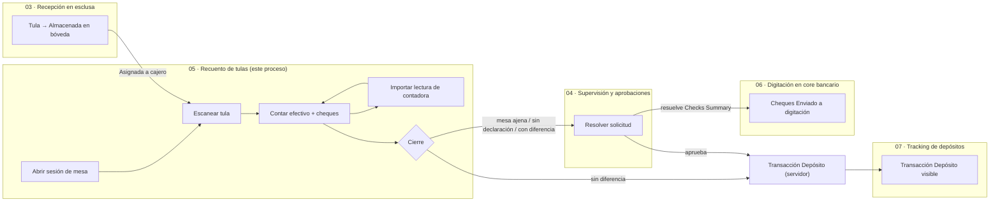
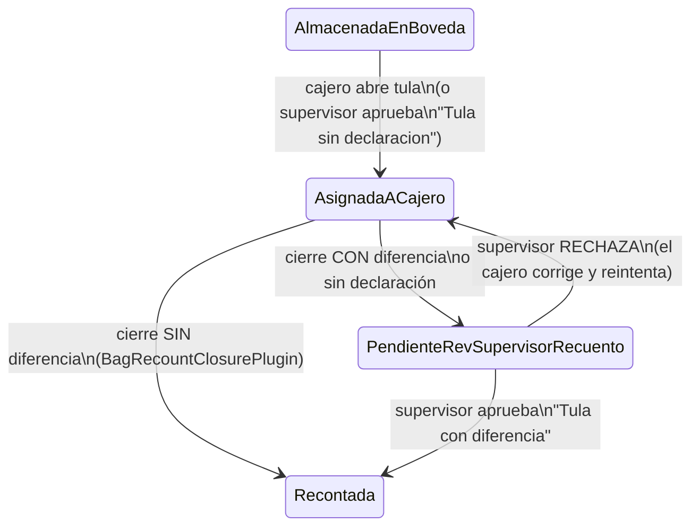

# 05 — Recuento de tulas

## 1. Qué es este proceso

El recuento es el punto del circuito donde el dinero físico que llegó dentro de
una tula sellada se convierte en un registro contable verificado. Un cajero de
recuento abre su sesión de trabajo del día en una mesa de conteo, escanea las
tulas que ya están en bóveda, y por cada depósito dentro de la tula carga el
efectivo — denominación por denominación — y los cheques, comparándolo en vivo
contra lo que el cliente declaró por correo. Puede además importar la lectura
de la máquina contadora de efectivo para no tipear a mano lo que la máquina ya
contó. Al cerrar la tula, el sistema calcula la diferencia entre lo recontado y
lo declarado, por moneda. Si no hay diferencia, el servidor postea la
transacción de depósito de inmediato — nadie más interviene. Si hay diferencia
(o la tula nunca tuvo declaración), la tula queda bloqueada esperando que un
supervisor resuelva el caso.

Este es el proceso donde CashHub decide, de forma verificable, **cuánta plata
entró**. Por eso es también el que más lógica movió del cliente (canvas app) al
servidor en el rediseño v2: la app v1 dejaba que el dispositivo del cajero
decidiera aprobaciones, totales y asientos contables — la v2 no confía en el
cliente para nada de eso.

**Handoffs:**

- **Recibe de** [03 — Recepción de tulas en esclusa](03-recepcion-tulas-esclusa.md):
  la tula ya movida a `Almacenada en boveda` (159460001), con o sin
  declaración enlazada. Sin ese estado, la tula no aparece como candidata al
  escanearla (§9).
- **Recibe de** [02 — Recepción e ingesta de emails](02-recepcion-ingesta-emails.md):
  la declaración materializada (`CH-Tbl-DeclaredBags`/`DeclaredDeposits`/
  `DeclaredChecks`) — es el contra-valor contra el que este proceso compara
  cada conteo; una tula sin declaración dispara la ruta `B3` (§9).
- **Entrega a** [04 — Supervisión y aprobaciones](04-supervision-aprobaciones.md):
  toda solicitud que este proceso genera (mesa ajena, tula sin declaración,
  tula con diferencia) queda pendiente hasta que el supervisor la resuelva
  desde su app.
- **Entrega a** [06 — Digitación en core bancario](06-digitacion-core-bancario.md):
  indirectamente — los cheques quedan en `Recontado` acá; es la app Supervisor
  (proceso 04) quien los pasa a `Enviado a digitacion` desde su pantalla
  *Checks Summary*.
- **Entrega a** [07 — Tracking sobre depósitos](07-tracking-depositos.md): la
  transacción `Deposito` que este proceso crea (directa o vía aprobación) es lo
  que el tracker termina mostrando como depósito procesado.

## 2. Estados y transiciones

### 2.1 `BagStatus` — estado de la tula (`sanic_bagstatus`, optionset local
`sanic_chtblbags_sanic_bagstatus`)

Este proceso solo opera sobre dos tramos de la máquina de estados completa de
la tula (la máquina entera vive en
[catálogo de choices §2](../referencia/catalogo-de-choices.md)):

| Valor | Etiqueta | Quién transiciona | Guard que lo defiende |
|---|---|---|---|
| `159460001` | Almacenada en boveda | (entra desde proceso 03) | — |
| `159460002` | Asignada a cajero | El cajero, al abrir la tula (`03` de las guías rebuild, §6.3) o el supervisor al aprobar `"Tula sin declaracion"` | `ReceptionGuard.EvaluateBagStatusTransition` — la transición `Almacenada en boveda → Asignada a cajero` ya estaba en su matriz legal antes del rediseño; **no se tocó** `ReceptionGuard` |
| `159460003` | Recontada | El **servidor** (`BagRecountClosurePlugin`), al cierre limpio o al aprobarse `"Tula con diferencia"` | `BagRecountClosurePlugin` recalcula totales y **pisa** lo que mande el cliente. Es **terminal**: no hay transición de salida documentada en este proceso |
| `159460004` | Pendiente de revision por supervisor - recuento | La app, al cerrar con diferencia o sin declaración | Igual — la app escribe el `Patch`, pero la creación de la `ApprovalRequest` que lo justifica pasa por `RecountingSessionAutoApprovePlugin`/`ReceptionGuard` |

> El rechazo del supervisor devuelve la tula a `Asignada a cajero` y el
> detalle a `En progreso` — decisión explícita del rediseño v2 (evita dejar la
> tula "muerta" en `Pendiente`, donde la pantalla es solo lectura). Es
> **CONTRATO** entre `04-pantalla-conteo.md` §D04-15 y la app Supervisor, que ya
> hace ese mismo `Patch`.

### 2.2 `RecountingSessionDetailStatus` — estado del detalle tula+sesión
(`sanic_recountingsessiondetailstatus` en `CH-Tbl-RecountingSessionDetail`,
optionset **global** `ch-recountingDetailsStatus` / `sanic_chrecountingdetailsstatus`)

| Valor | Etiqueta | Quién transiciona |
|---|---|---|
| `159460000` | En progreso | La app, al abrir la tula (las **4 rutas**: recibida+declarada, sin declaración, homónima desambiguada, tula ya abierta que se retoma) |
| `159460001` | Cerrado | La app, al cerrar sin diferencia |
| `159460002` | Cerrado con diferencias | La app Supervisor, al aprobar `"Tula con diferencia"` |

Es un registro **por bolsa + sesión** (`CH-Tbl-RecountingSessionDetails`, PK
`'CH-Tbl-RecountingSessionDetail'`), no por bolsa a secas: es la llave que la
máquina contadora usa (`ID_Sesion`) para saber a qué sesión pertenece su
lectura XML.

### 2.3 `CheckStatus` — ciclo del cheque físico (`sanic_checkstatus` en
`CH-Tbl-Checks`, optionset local `sanic_chtblchecks_sanic_checkstatus`)

| Valor | Etiqueta | Quién lo pone |
|---|---|---|
| `159460000` | Recontado | **Este proceso** — al cerrar la tula sin diferencia, en un `Update` que toca **únicamente** `sanic_checkstatus` (después del `Patch` de la bolsa) |
| `159460001` | Digitado | proceso 06 (fuera de alcance) |
| `159460002` | Rebotado | proceso 06 (fuera de alcance) |
| `159460003` | Enviado a digitacion | proceso 04 (Supervisor, *Checks Summary*) |

### 2.4 `ApprovalStatus` de las solicitudes que genera este proceso
(`sanic_approvalstatus`, optionset local `sanic_chtblapprovalrequest_sanic_approvalstatus`)

| Valor | Etiqueta |
|---|---|
| *(blanco)* | Pendiente |
| `159460000` | Aprobado |
| `159460001` | Rechazado |

**La app nunca escribe esta columna.** Solo la lee (polling cada 15 s, por PK).
El detalle completo de quién la escribe y con qué guard vive en
[04 — Supervisión y aprobaciones](04-supervision-aprobaciones.md); acá importa
la consecuencia: un valor en blanco bloquea al cajero en la pantalla de espera,
`Aprobado` lo deja seguir, y `Rechazado` — a diferencia de la v1, que fallaba
abierto tratándolo igual que "pendiente" — es un **estado de primera clase**:
la app lo distingue explícitamente y muestra el motivo (`sanic_statusreason`).

### 2.5 `RecountingSession.Confirmed` — no es un picklist, es el gate de la sesión

`sanic_confirmed` (Sí/No) en `CH-Tbl-RecountingSessions`. La app **nunca lo
escribe**: lo decide el servidor en el mismo `Create` de la `ApprovalRequest`
tipo `"Crear sesion de recuento"` (§8). Mesa propia ⇒ `true` sin intervención
humana; mesa ajena ⇒ queda `false`/blanco hasta que el supervisor apruebe.

## 3. Roles y acceso

| Rol físico | Rol de seguridad | App |
|---|---|---|
| Cajero de recuento | `CH-SR-Counter` | Recounting |

Fuente completa de privilegios: [roles-y-seguridad.md](../referencia/roles-y-seguridad.md).
`CH-SR-Counter` tiene **63 privilegios** sobre tablas custom
(`solutions/unpacked/core/Roles/CH-SR-Counter.xml`) y **NO todos son Global**:
solo el bloque de solo lectura/append — `Declaration`, `DeclaredBags`,
`DeclaredChecks`, `DeclaredDeposits`, `CountingDesk`, `Locations`,
`MoneyDenomination`, `ReceptionBatch`, `Receptions`, `TransportCompany` — es
Global. El bloque operativo es **Local** (Business Unit) o **Basic**
(usuario) — confirmado también en
[07 — Tracking sobre depósitos](07-tracking-depositos.md) §3, que contrasta
`CH-SR-DepositsTracker` (Global) "a diferencia de `CH-SR-Counter` (Business
Unit)" — y ninguna de las 7 tablas operativas tiene **CRUD completo**:
`Bags` es solo Read/Write (Local) — sin Create ni Delete; `Checks` y
`DepositsRecounting` sí tienen las cuatro (Create en `Basic`, el resto en
`Local`); `CountedMoneyDetails`, `RecountingSession` y `Transactions` **no
tienen Delete**; `ApprovalRequest` solo tiene Create/Read (`Local`) — ni
Append, ni Write, ni Delete.

**Qué verifica la app vs. qué impone el servidor — la distinción central de
este proceso:**

| | La app (canvas, v2) | El servidor (plugins) |
|---|---|---|
| Rol dentro de la app | **Nada.** `CH-App-Recounting` resuelve identidad con `LookUp(Users, 'Primary Email' = User().Email)` y **no comprueba** pertenencia a grupo ni rol antes de mostrar pantallas. Cualquiera con la app compartida y el Security Role opera como cajero | El Security Role Dataverse (`CH-SR-Counter`) es el único filtro real de qué tablas puede tocar el usuario |
| Aprobación de sesión en mesa propia | Solo **lee** el resultado (polling) | `RecountingSessionAutoApprovePlugin` decide comparando `CountingDesk.Cajero` contra `context.InitiatingUserId`, en el mismo `Create` de la `ApprovalRequest` |
| Totales de la tula | Los muestra (KPIs del rail) | `BagRecountClosurePlugin` los **recalcula y pisa** desde una query server-side, nunca desde lo que mande el cliente |
| Que un depósito/cheque/denominación se pueda cargar | Oculta botones si la tula "no parece" abierta (cosmético) | `GuardRecountingPlugin` rechaza por Web API cualquier escritura sobre `DepositsRecounting`/`Checks`/`CountedMoneyDetails` cuya tula ancestro no esté `Asignada a cajero` |
| Retirar una solicitud propia / abandonar sesión propia | Ofrece los botones *Cancelar solicitud* / *Elegir otra mesa* | `GuardRecountingPlugin` es quien de verdad permite el `Delete`: solo `ApprovalRequests` **propias sin resolver** y `RecountingSessions` **propias sin confirmar** — todo lo demás rebota |

FLS (field-level security) relevante a este proceso: `AccountNumber` en
`CH-Tbl-DeclaredDeposits`, `DepositReference` y `CheckNumber` en las tablas
declaradas. Detalle de columnas con FLS en
[modelo-de-datos.md](../referencia/modelo-de-datos.md).

## 4. Aplicaciones

**`CH-App-Recounting v2`** (Apps 1.32.0.0 → 1.32.0.1, publicada en DEV;
reemplaza a la v1 de una sola `Screen1` de 11.239 líneas). Tres pantallas:

| Pantalla | Sirve para | Controles |
|---|---|---|
| `scrSesion` | Apertura de la sesión diaria: elegir mesa, disparar la solicitud, esperar/ver rechazo | 44 |
| `scrTulas` | Hub de la sesión: escanear tula (barra scan-first), ver KPIs de sesión por moneda, lista de tulas abiertas hoy | 143 |
| `scrConteo` | El corazón: contar una tula — matrices Rec/Dec/Diff por moneda, depósitos declarados/recontados, billetes/monedas/cheques del depósito en curso, terminar/cerrar | 246 |

Componentes canvas compartidos entre pantallas: `cmpMatrizMoneda` (matriz
Recontado/Declarado/Diferencia por moneda), `cmpKpiSesion` (tarjeta de total
por moneda del rail), `cmpDialogo` (chrome de diálogo nativo: overlay + card +
título/subtítulo + acciones). 100 % controles nativos salvo `TabList` y
`Spinner`; cero PowerCAT (la v1 tenía 8 diálogos `Dialog` de esa librería).

Guías de construcción completas:
[`docs/recounting-rebuild/01-app.md`](../recounting-rebuild/01-app.md) (datos,
fórmulas globales, recetas, componentes),
[`02-pantalla-sesion.md`](../recounting-rebuild/02-pantalla-sesion.md),
[`03-pantalla-tulas.md`](../recounting-rebuild/03-pantalla-tulas.md),
[`04-pantalla-conteo.md`](../recounting-rebuild/04-pantalla-conteo.md).

## 5. Flujos Power Automate

| Flujo | Trigger | Qué toca | Estado | Owner de la conexión |
|---|---|---|---|---|
| `CH-Flow-ProcessXMLFiles` | Instantáneo `PowerAppV2` — invocado por `scrConteo` (botón *Obtener recuento de la máquina contadora*) con `.Run(gvarSesionDetalle.'CH-Tbl-RecountingSessionDetail', Serial_Maquina)` | Lee el XML de OneDrive de la máquina contadora, crea/actualiza `CH-Tbl-XMLReadings` / `CH-Tbl-XMLReadingDetails` | **verificar en vivo** — el export estático (`solutions/unpacked/flow/`, 1.6.5.0) lo muestra `Activado`, pero por el CAVEAT de flujos del contrato de este documento ese estado no refleja reactivaciones/desactivaciones posteriores. Corresponde a `RE-06` del plan de pruebas | verificar en vivo |

Conectores: OneDrive for Business (`runtimeSource: invoker`) y Dataverse. Sin
ramas de captura de error ni notificación ante fallo de conector (detalle en
[conexiones-y-flujos.md](../referencia/conexiones-y-flujos.md)). Es el **único**
conector que la app usa — cero Office365, cero Graph; la identidad sale de
`User()` + un `LookUp` contra `Users` en `App.OnStart`.

## 6. Tablas

Modelo completo del dominio en
[modelo-de-datos.md §3](../referencia/modelo-de-datos.md). Acá solo el detalle
propio de este proceso — las 13 tablas que `CH-App-Recounting` toca, con sus
columnas espejo marcadas.

| Tabla (display / lógico) | PK | Rol en el proceso |
|---|---|---|
| `CH-Tbl-RecountingSessions` / `sanic_chtblrecountingsession` | `sanic_chtblrecountingsessionid` | Sesión diaria del cajero en una mesa |
| `CH-Tbl-RecountingSessionDetails` / `sanic_chtblrecountingsessiondetail` | `sanic_chtblrecountingsessiondetailid` | Un registro por tula+sesión — llave de la contadora |
| `CH-Tbl-CountingDesks` / `sanic_chtblcountingdesk` | `sanic_chtblcountingdeskid` | Mesas de conteo + serial de la contadora — **solo lectura** |
| `CH-Tbl-Bags` / `sanic_chtblbags` | `sanic_chtblbagsid` | La tula: `BagStatus`, totales, enlace a sesión y declaración |
| `CH-Tbl-Receptions` / `sanic_chtblreceptions` | — | Planilla y cliente de la tula — **solo lectura** |
| `CH-Tbl-DeclaredBags` / `sanic_chtbldeclaredbags` | — | Declaración de la tula — **casi** solo lectura (la app escribe `BagID` al enlazar) |
| `CH-Tbl-DeclaredDeposits` / `sanic_chtbldeclareddeposits` | — | Depósitos declarados — la app escribe `RelatedRecountedDeposit` al enlazar/desenlazar |
| `CH-Tbl-DeclaredChecks` / `sanic_chtbldeclaredchecks` | — | Cheques declarados — la app escribe `MatchedCheck` (nunca `DeclaredDepositID`) |
| `CH-Tbl-DepositsRecountings` / `sanic_chtbldepositsrecounting` | `sanic_chtbldepositsrecountingid` | El depósito recontado: moneda, cuenta, efectivo, cheques por tipo |
| `CH-Tbl-CountedMoneyDetails` / `sanic_chtblcountedmoneydetails` | — | Desglose de denominaciones por depósito (`Quantity` mínimo 1) |
| `CH-Tbl-Checks` / `sanic_chtblchecks` | — | Cheques recontados (declarados enlazados o manuales) |
| `CH-Tbl-MoneyDenominations` / `sanic_chtblmoneydenomination` | — | Catálogo de denominaciones por moneda y tipo — **solo lectura** |
| `CH-Tbl-XMLReadingDetails` / `sanic_chtblxmlreadingdetail` | — | Lectura de la máquina contadora — **solo lectura** |
| `CH-Tbl-ApprovalRequests` / `sanic_chtblapprovalrequest` | `sanic_chtblapprovalrequestid` | Solicitudes al supervisor + polling |

### 6.1 Columnas espejo — **mantenidas por plugin, no editar a mano**

| Columna (lógico) | Tabla | Apunta a | Plugin |
|---|---|---|---|
| `sanic_recountingsessionmirror` | `sanic_chtbldepositsrecounting` | `sanic_chtblrecountingsession` | `DepositSessionMirrorPlugin` |
| `sanic_bag` | `sanic_chtblchecks` | `sanic_chtblbags` | `CheckMirrorStampPlugin` (ya existía antes del rediseño) |
| `sanic_declaredbagmirror` | `sanic_chtbldeclaredchecks` | `sanic_chtbldeclaredbags` | `DeclaredCheckBagMirrorPlugin` |
| `sanic_recountingsessiondetailmirror` | `sanic_chtblxmlreadingdetail` | `sanic_chtblrecountingsessiondetail` | `XmlReadingDetailMirrorPlugin` |
| `sanic_xmlreadingactiva` | `sanic_chtblxmlreadingdetail` | (bit, refleja `XMLReading.IsActive`) | `XmlReadingDetailMirrorPlugin` |

Las cinco existen para que las consultas críticas de la app **deleguen**
(evitan el bug D-1 de la v1: un `Filter` de 2 saltos o un `in` con subconsulta
que jamás delega y trunca en 500 filas sin avisar). Están descriptas en el
esquema como *"Mantenido por plugin. No editar a mano."*

### 6.2 Gotcha de nombres declarado en el modelo

`sanic_otherlocacheckamount` (`DepositsRecountings`, **sin** la `l`) y
`sanic_otherlocalcheckamount` (`DeclaredDeposits`, **con** la `l`) son dos
columnas distintas con nombre casi idéntico. Copiar el nombre de una tabla en
la otra no compila.

## 7. Custom APIs

**No aplica.** A diferencia de Digitización (que expone
`sanic_CHWorkloadByCashier`, `sanic_CHPreviewTransactionCut`, etc.), este
proceso no tiene superficie de Custom API: toda la lógica server-side corre
como plugins sobre los mensajes CRUD estándar (`Create`/`Update`/`Delete`) de
las tablas del dominio, en Pre-validation, Pre-operation y Post-operation. La
app llama a Dataverse directo con `Patch`/`Collect`/`Remove`; el único punto
donde invoca algo fuera de Dataverse es el flujo de §5.

## 8. Steps de plugins

| Plugin | Mensaje / etapa | Filtro | Regla de negocio que defiende |
|---|---|---|---|
| `DepositSessionMirrorPlugin` | Pre-op 20 `Create`/`Update` de `sanic_chtbldepositsrecounting`; Post-op 40 `Update` de `sanic_chtblbags` (filtro `sanic_recountingsession`, con PreImage) | filtrado en `sanic_bagid` (Update) / `sanic_recountingsession` (cascada) | Estampa E-1 en el depósito y **re-estampa en cascada** cuando se re-abre una tula en otra sesión — sin la cascada, los depósitos viejos quedan colgando de la sesión anterior y el rail de KPIs suma plata ajena |
| `DeclaredCheckBagMirrorPlugin` | Pre-op 20 `Create`/`Update` de `sanic_chtbldeclaredchecks` | filtrado en `sanic_declareddepositid` | Estampa E-3. **Sin cascada** — deliberado: la bolsa se fija en el `Create` del depósito declarado y nadie re-parenta después |
| `XmlReadingDetailMirrorPlugin` | Pre-op 20 `Create`/`Update` de `sanic_chtblxmlreadingdetail`; Post-op 40 `Update` de `sanic_chtblxmlreading` (filtro `sanic_recountingsessiondetailid,sanic_isactive`, con PreImage) | — | Estampa **las dos** columnas de E-4 juntas y **propaga en cascada** cuando la lectura padre cambia `IsActive` — sin la cascada, una lectura vieja apagada sigue sumando en la columna *Auto* que ve el cajero |
| `RecountingSessionAutoApprovePlugin` | Pre-op 20 `Create` de `sanic_chtblapprovalrequest`; Post-op 40 `Create` de la misma | tipo `"Crear sesion de recuento"` | **La auto-aprobación por mesa propia la decide el servidor, en el mismo Create** — comparando `CountingDesk.Cajero` contra `context.InitiatingUserId`. Mata la auto-aprobación client-side de la v1, que con `gvarUser` en blanco entregaba la primera mesa sin cajero a cualquiera |
| `BagRecountClosurePlugin` | Pre-op 20 `Update` de `sanic_chtblbags` (filtro `sanic_bagstatus`, con PreImage); Post-op 40 `Update` de la misma (mismo filtro, con PreImage) | — | **Recalcula y pisa** `TotalNIO/USD/EUR` desde una query server-side de los depósitos persistidos (no de lo que mande el cliente), y **crea** `CH-Tbl-Transactions` **idempotentes por (recuento, tipo)** — solo en el cierre limpio. Reintentar el mismo cierre no duplica asientos |
| `GuardRecountingPlugin` | Pre-validation 10 `Create`/`Update`/`Delete` de `sanic_chtbldepositsrecounting`, `sanic_chtblchecks`, `sanic_chtblcountedmoneydetails`; Pre-validation 10 `Delete` de `sanic_chtblapprovalrequest` y `sanic_chtblrecountingsession` | — | Rechaza cualquier escritura sobre las 3 tablas de evidencia si la tula ancestro **no** está `Asignada a cajero`, con bypass `touchesOnlyMirror`/`touchesOnlyCheckStatus` para las columnas de infraestructura. El `Delete` acotado habilita *Cancelar solicitud*/*Elegir otra mesa* **solo** sobre lo propio y sin resolver/confirmar |

Detalle completo (incluye la tabla de exenciones `touchesOnly…` y los tests que
fijan cada regla) en
[`docs/recounting-rebuild/05-backend-espejos.md`](../recounting-rebuild/05-backend-espejos.md).

## 9. Acciones

### Abrir sesión de recuento en mesa propia

| Campo | Contenido |
|---|---|
| **Quién** | Cajero de recuento (`CH-SR-Counter`) |
| **Cuándo** | No tiene sesión confirmada abierta hoy (`RecountingSessions` filtrado por `Cashier`, `'Created On'` de hoy, `SessionForciblyClosed = false`) |
| **Por qué / para qué** | Habilita el resto del proceso: sin sesión confirmada no se puede escanear ninguna tula |
| **Cómo** | `scrSesion` → menú desplegable de mesa → elegir la mesa asignada por defecto → botón *Solicitar* |
| **Qué valida el servidor** | `RecountingSessionAutoApprovePlugin`, en el `Create` de la `ApprovalRequest` tipo `"Crear sesion de recuento"`: si `CountingDesk.Cajero = context.InitiatingUserId`, aprueba y confirma la sesión en el mismo request. **No es la app quien decide** — solo lee el resultado por polling |
| **Qué pasa si falla / deshacer** | No hay "falla" en el sentido de rechazo — es auto-aprobación server-side. *Deshacer*: `Delete` de la `RecountingSession` propia **sin confirmar** está permitido por el guard; con la sesión ya `Confirmed`, no se puede retirar (el botón de la app no la ofrece) |

### Abrir sesión de recuento en mesa ajena

| Campo | Contenido |
|---|---|
| **Quién** | Cajero de recuento |
| **Cuándo** | Igual que la anterior, pero elige una mesa distinta a la asignada (típicamente cubriendo a un compañero) |
| **Por qué / para qué** | Permite operar en cualquier mesa habilitada, con control humano de por medio |
| **Cómo** | `scrSesion` → elegir mesa distinta → *Solicitar* → pantalla queda en modo espera (spinner + polling 15 s) |
| **Qué valida el servidor** | Mismo plugin: como `CountingDesk.Cajero ≠ InitiatingUserId`, la solicitud queda pendiente. La resuelve el supervisor desde [04](04-supervision-aprobaciones.md) — `ReceptionGuard.EvaluateApprovalUpdate` exige resolutor ≠ creador y pertenencia al grupo AAD aprobador |
| **Qué pasa si falla / deshacer** | **Rechazo**: la tarjeta cambia a modo "Rechazada" con el motivo (`StatusReason`) — estado de primera clase, no libera al cajero. *Deshacer*: *Cancelar solicitud*/*Elegir otra mesa* — `Remove` de la solicitud **y** de la sesión (las dos o ninguna), permitido por `GuardRecountingPlugin` solo mientras la solicitud sigue sin resolver |

### Escanear una tula

| Campo | Contenido |
|---|---|
| **Quién** | Cajero de recuento, sesión confirmada |
| **Cuándo** | Sesión del día `Confirmed = true` |
| **Por qué / para qué** | Localiza la tula candidata entre las que están en bóveda o ya asignadas al propio cajero, y decide la ruta de apertura |
| **Cómo** | `scrTulas` → barra scan-first (foco automático, Enter dispara) → tipear/escanear `BagID` |
| **Qué valida el servidor** | Ninguna escritura todavía en este paso — es solo lectura por `BagID` exacto. La validación real llega en el `Patch` siguiente (`GuardRecountingPlugin` sobre las tablas hijas si se sigue de largo) |
| **Qué pasa si falla / deshacer** | 0 candidatas: mensaje de "no encontrada" — no hay nada que deshacer, es una consulta |

### Desambiguar tulas homónimas

| Campo | Contenido |
|---|---|
| **Quién** | Cajero de recuento |
| **Cuándo** | El escaneo devuelve **más de una** tula con el mismo `BagID` (mismo número físico, distintas planillas) |
| **Por qué / para qué** | Evitar contar la tula equivocada — el arqueo entero se arruina si se elige mal |
| **Cómo** | Diálogo `B1`: tarjeta por candidata (planilla, cliente); **solo** la que está en `Almacenada en boveda` responde al clic — las que ya están en otro estado se muestran deshabilitadas |
| **Qué valida el servidor** | `ReceptionGuard.EvaluateBagStatusTransition` sobre la transición que sigue después de elegir |
| **Qué pasa si falla / deshacer** | No hay escritura en este paso — es selección. Ninguna tarjeta pre-seleccionada por diseño: elegir mal arruina el arqueo |

### Enlazar la declaración de la tula

| Campo | Contenido |
|---|---|
| **Quién** | Cajero de recuento |
| **Cuándo** | La tula elegida tiene al menos una `DeclaredBag` con `BagID` en blanco (enlazable) para ese `BagNumber` |
| **Por qué / para qué** | Fija contra qué declaración se van a comparar los depósitos recontados |
| **Cómo** | Diálogo `B2`: tarjeta por declaración candidata (cliente, fecha, monto por moneda, `TotalDeposits`) → elegir → `Patch` de `DeclaredBags.BagID` |
| **Qué valida el servidor** | Ninguna transición de estado en este paso puntual — la escritura es sobre `DeclaredBags.BagID`, un lookup sin guard propio registrado. La consecuencia (abrir la tula) sí pasa por `ReceptionGuard` |
| **Qué pasa si falla / deshacer** | Sin declaración disponible → diálogo `B3` (ver acción siguiente). No hay "deshacer" documentado de un enlace ya confirmado dentro de esta pantalla |

### Contar una tula sin declaración

| Campo | Contenido |
|---|---|
| **Quién** | Cajero de recuento |
| **Cuándo** | La tula no tiene ninguna `DeclaredBag` enlazable |
| **Por qué / para qué** | Permite seguir operando aunque la declaración nunca haya llegado o no se haya materializado — sin esto la tula queda trabada indefinidamente |
| **Cómo** | Diálogo `B3` ("confirmar sin declaración") → crea `ApprovalRequest` tipo `"Tula sin declaracion"` |
| **Qué valida el servidor** | `ReceptionGuard.EvaluateApprovalCreate`/`EvaluateApprovalUpdate` en [04](04-supervision-aprobaciones.md): la solicitud nace pendiente y **no puede** auto-resolverse. Tras la aprobación, el `Patch` `Almacenada en boveda → Asignada a cajero` que hace la app es **tolerado y validado** por `GuardRecountingPlugin` solo si existe esa `ApprovalRequest` aprobada para esa bolsa y ese cajero |
| **Qué pasa si falla / deshacer** | Pendiente: cajero bloqueado en esa tula hasta resolución. Rechazada: estado de primera clase, con motivo visible — no libera. Reintentar el escaneo de la misma tula **re-adopta** la solicitud previa (si sigue pendiente) o la **consume** (si ya fue aprobada), en vez de duplicarla |

### Contar efectivo por denominación

| Campo | Contenido |
|---|---|
| **Quién** | Cajero de recuento |
| **Cuándo** | Tula `Asignada a cajero`, depósito en curso seleccionado |
| **Por qué / para qué** | Registra el efectivo físico contado, denominación por denominación, para compararlo contra lo declarado |
| **Cómo** | `scrConteo` → panel del depósito en curso → pestaña *Billetes*/*Monedas* → grilla teclado-primero (cantidad manual + lo que trajo la contadora) → volcado a `Patch`/`Remove` explícitos contra `CH-Tbl-CountedMoneyDetails` |
| **Qué valida el servidor** | `GuardRecountingPlugin` rechaza el `Patch` si la tula ancestro **no** está `Asignada a cajero`. El modelo exige `Quantity` **mínimo 1** — una fila con cantidad 0 se **borra**, no se guarda con cero |
| **Qué pasa si falla / deshacer** | `Patch`/`Remove` rechazado por el guard → mensaje del servidor, la app no lo silencia. Sin deshacer explícito de una denominación ya guardada más allá de volver a poner la cantidad en 0 (lo que la remueve) |

### Marcar cheques declarados y agregar cheques manuales

| Campo | Contenido |
|---|---|
| **Quién** | Cajero de recuento |
| **Cuándo** | Depósito en curso, pestaña *Cheques* |
| **Por qué / para qué** | Registra qué cheques declarados llegaron físicamente y cuáles no; permite sumar cheques que no estaban declarados |
| **Cómo** | Casilla por cheque declarado (tildar/destildar) → `Patch` de `DeclaredChecks.MatchedCheck` (**nunca** `DeclaredDepositID` — ese era el bug D-6 de la v1, que dejaba el cheque huérfano para siempre); botón *Agregar cheque manual* → nace ya `Seleccionado: true` |
| **Qué valida el servidor** | `GuardRecountingPlugin` sobre el `Create`/`Update` de `CH-Tbl-Checks`; `CheckAmount` tiene **mínimo 1** en el modelo — un cheque manual en 0 bloquea el guardado con mensaje explícito, no lo resetea en silencio como la v1 |
| **Qué pasa si falla / deshacer** | Cheque manual borrado antes de guardar: papelera en la grilla, sin `Patch` todavía. Cheque declarado destildado: el enlace se limpia, el cheque **sigue existiendo** en `DeclaredChecks` (no se borra) |

### Importar la lectura de la máquina contadora

| Campo | Contenido |
|---|---|
| **Quién** | Cajero de recuento |
| **Cuándo** | Depósito en curso; la mesa tiene `MachineSerialNumber` configurado |
| **Por qué / para qué** | Evita tipear a mano las denominaciones que la máquina ya contó |
| **Cómo** | Botón *Obtener recuento de la máquina contadora* → `'CH-Flow-ProcessXMLFiles'.Run(RecountingSessionDetail, Serial)` → lectura vía `CH-Tbl-XMLReadingDetails` filtrada por **las dos** condiciones de espejo (`RecountingSessionDetailMirror` **y** `XMLReadingActiva = true`) |
| **Qué valida el servidor** | El flujo (§5, **verificar en vivo**) escribe `XMLReading`/`XMLReadingDetail`; `XmlReadingDetailMirrorPlugin` mantiene los espejos que hacen la lectura posterior delegable. La cantidad persistida en `CountedMoneyDetails` es **manual + auto** — la columna *Auto* se resetea por depósito, nunca se hereda al siguiente |
| **Qué pasa si falla / deshacer** | Si el flujo está apagado o el XML no llegó: el botón no trae datos (columna *Auto* en 0), el cajero puede seguir cargando manualmente. No hay reversión de una lectura ya importada más allá de corregir la cantidad a mano |

### Cerrar la tula sin diferencia

| Campo | Contenido |
|---|---|
| **Quién** | Cajero de recuento |
| **Cuándo** | Todos los depósitos de la tula cargados; el recuento cuadra exacto contra lo declarado, por cada moneda |
| **Por qué / para qué** | Cierra el ciclo de esa tula sin intervención humana adicional — el dinero queda contabilizado de inmediato |
| **Cómo** | `scrConteo` → *Terminar* → confirmar cierre → `Patch` de `Bags.BagStatus = Recontada` |
| **Qué valida el servidor** | `BagRecountClosurePlugin`: **recalcula y pisa** `TotalNIO/USD/EUR` desde los depósitos persistidos server-side, y crea `CH-Tbl-Transactions` tipo `Deposito` — **idempotente por (recuento, tipo)**: reintentar el mismo cierre no duplica asientos. Después de la bolsa, un `Update` que toca **solo** `sanic_checkstatus` pasa los cheques a `Recontado` (exención `touchesOnlyCheckStatus` del guard) |
| **Qué pasa si falla / deshacer** | El `Patch` de la bolsa puede rebotar (ej. si otra operación cambió el estado entretanto) — mensaje del guard, cheques **no** se marcan si la bolsa no cerró primero (orden deliberado). `Recontada` es **terminal**: no hay deshacer desde este proceso |

### Cerrar la tula con diferencia

| Campo | Contenido |
|---|---|
| **Quién** | Cajero de recuento |
| **Cuándo** | El recuento **no** cuadra contra lo declarado en al menos una moneda, o la tula nunca tuvo declaración |
| **Por qué / para qué** | Deja evidencia completa del hallazgo para que el supervisor decida si postea faltante o sobrante |
| **Cómo** | *Terminar* → diálogo `C5` con los hallazgos **por moneda** (recontado/declarado/diferencia, cheques declarados sin marcar, cheques manuales sobrantes) → confirmar → `Patch` `Bags.BagStatus = Pendiente de revision por supervisor - recuento`, detalle a `Cerrado con diferencias`, `ApprovalRequest` tipo `"Tula con diferencia"` con el HTML del hallazgo en `RequestDetails` |
| **Qué valida el servidor** | La creación de la `ApprovalRequest` pasa por `ReceptionGuard` de [04](04-supervision-aprobaciones.md); **no** se generan transacciones en este paso — las crea el supervisor al aprobar (`Deposito` + `Sobrante`/`Faltante` según corresponda) |
| **Qué pasa si falla / deshacer** | Cajero queda **bloqueado** en esa tula hasta que el supervisor resuelva. Rechazo del supervisor: la tula vuelve a `Asignada a cajero` y el detalle a `En progreso` — el cajero puede corregir y reintentar. **Sin deshacer** desde la app del cajero una vez enviado a revisión |

## 10. Supuestos y limitaciones

**Supuestos de diseño (v2, decididos y documentados):**

- **La apertura de sesión en mesa propia se auto-aprueba por diseño.** Lo
  único que siempre pasa por el supervisor es una **diferencia** de recuento
  (faltante, sobrante o tula sin declaración) o una **mesa ajena** — no la
  apertura de sesión en sí.
- **Abrir una tula CON declaración va directo a `scrConteo`**, sin solicitud
  ni espera de supervisor (decisión `L-6` del ledger de divergencias del
  rediseño). El tipo `"Primera tula en planilla"` sigue existiendo en el
  contrato de aprobaciones por compatibilidad con solicitudes v1 legadas, pero
  la v2 **no lo crea ni lo espera**.
- **La cantidad persistida por denominación es manual + automático** de la
  contadora, nunca solo la parte manual — así el desglose siempre cuadra con
  el monto.

**Limitaciones conocidas:**

- **No hay verificación de rol dentro de la app.** El control de acceso real
  es el Security Role de Dataverse (`CH-SR-Counter`) y a quién se comparte la
  app en Power Platform — ver §3.
- **Ningún Security Role del repo otorga privilegio `Delete` sobre
  `sanic_chtblapprovalrequest`** (confirmado con `rg
  "prvDeletesanic_CHTblApprovalRequest" solutions/unpacked/core/Roles/` —
  cero resultados en los 6 roles, incluido `CH-SR-Counter` y
  `CH-SR-CountingSupervisor`). El paso `Pre-validation` de
  `GuardRecountingPlugin` sobre ese `Delete` (§8, §9 *Cancelar solicitud*) es
  code muerto tal como está provisionado hoy: la plataforma rechaza el
  mensaje por falta de privilegio antes de que el guard pueda aprobarlo.
  `CH-SR-Counter` tampoco tiene `Delete` sobre `sanic_chtblrecountingsession`
  ni sobre `sanic_chtblcountedmoneydetails` (sí lo tiene
  `CH-SR-CountingSupervisor` sobre la primera). **Verificar en vivo** si hay
  un privilegio adicional fuera de este export o si *Cancelar solicitud* /
  *Elegir otra mesa* / borrar una denominación en 0 están rotos en DEV.
- **El espejo E-3 (`DeclaredBagMirror`) no tiene cascada.** Si algún día se
  re-parenta un depósito declarado a otra bolsa (hoy no ocurre: la
  declaración es inmutable), el espejo de sus cheques queda desactualizado
  hasta el próximo backfill manual.
- **`sanic_totaldeposits` de `CH-Tbl-DeclaredBags` es una columna entera
  simple materializada por `DeclarationMaterializer`, no un rollup nativo**
  (el rollup original nunca tuvo definición de agregación válida — corregido
  fuera de este proceso, documentado en `CHANGELOG.md`).
- **Estado del flujo de la contadora sin confirmar en vivo.** El export
  estático de `solutions/unpacked/flow/` (1.6.5.0) es la única fuente
  versionada y puede no reflejar cambios posteriores — ver §5.
- **Solicitudes legadas `"Primera tula en planilla"` pendientes son un riesgo
  latente**: si se aprueban tal cual, `CH-App-Supervisor` re-patchea la bolsa
  con la sesión y declaración **viejas**, potencialmente sobre una tula que la
  v2 ya recontó. El GC de `scripts/backfill-recounting-mirrors.py` las cierra
  (`Rechazado` + motivo, nunca `Delete`) cuando detecta ese riesgo — corre en
  modo lista por defecto, no automático.
- **Sin deshacer para el cierre.** `Recontada` es terminal desde este
  proceso; una tula cerrada con diferencia y ya aprobada por el supervisor
  tampoco tiene camino de reversión documentado.

## 11. Pruebas

No se duplican los casos acá — la guía
[09-plan-de-pruebas-integral](../guias/09-plan-de-pruebas-integral.md) trae el
detalle completo (dato de prueba, pasos, resultado esperado) de los casos que
cubren este proceso:

**RE-01** (sesión en mesa propia) · **RE-02** (sesión en mesa ajena, incluye la
rama Rechazado) · **RE-03** (homónimas) · **RE-04** (tula sin declaración) ·
**RE-05** (conteo limpio, idempotencia del asiento) · **RE-06** (máquina
contadora, depende del flujo de §5) · **RE-07** (multi-moneda con diferencias
y cheques) · **RE-08** (tula gorda — 612 cheques, delegación por espejo).

`RE-07` continúa en **SU-03** del mismo plan (el supervisor aprobando la
diferencia) — ese caso pertenece a
[04 — Supervisión y aprobaciones](04-supervision-aprobaciones.md), no a este
documento.

Escenarios QA humanos con datos reales sembrados en DEV (tulas, GUIDs y guion
paso a paso) en
[`docs/recounting-rebuild/06-escenarios-qa.md`](../recounting-rebuild/06-escenarios-qa.md).
