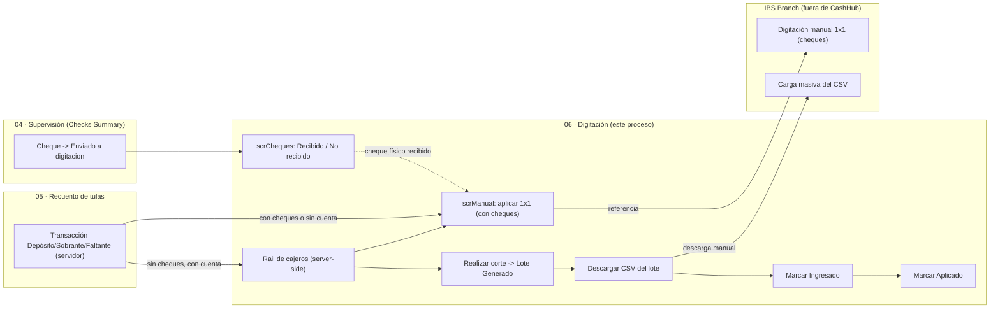
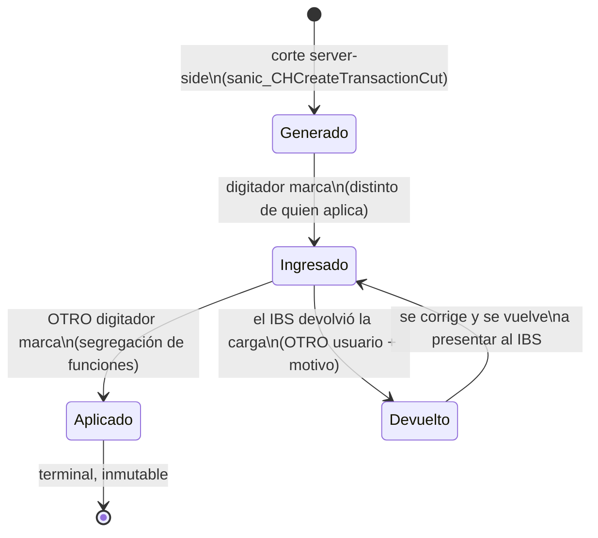
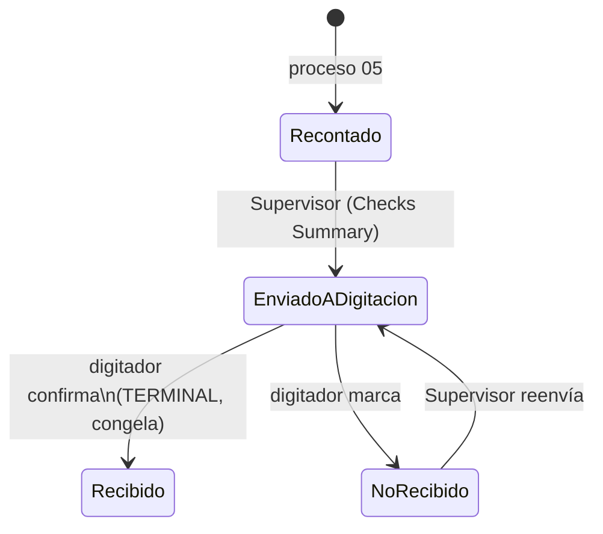

# 06 — Digitación en core bancario

## 1. Qué es este proceso

Digitación es el último tramo antes de que la plata quede acreditada en el
core bancario **IBS Branch**, y corre fuera de la vista del cliente: solo hay
transacciones que ya salieron limpias de recuento (o de la aprobación del
supervisor) y que hay que subir al core. El digitador agrupa en **lotes** las
transacciones de efectivo puro por cajero ("Realizar corte"), descarga el CSV
que ese lote arma para IBS Branch, lo sube manualmente al core (paso externo a
CashHub) y va marcando el ciclo de vida del lote — **Generado → Ingresado →
Aplicado** — a medida que confirma cada etapa en el core. Las transacciones
con cheques de otros bancos **no entran al corte automático**: se aplican una
por una en una pantalla teclado-first (`scrManual`), porque el core no las
acepta en carga masiva. En paralelo, el digitador recibe físicamente los
cheques que el supervisor le envía desde la esclusa y confirma el handshake de
recepción (`scrCheques`): **Recibido** o **No recibido**, con trazabilidad de
quién envió y quién recibió.

Es el proceso con más plata concentrada por operación (lotes de cientos de
transacciones) y donde CashHub tiene **cero integración real** con el destino:
todo lo que pasa después de subir el CSV — si lo aceptó, si lo rechazó, si ya
acreditó — es responsabilidad humana de marcar. El rediseño v2 movió al
servidor todo lo que la v1 dejaba mentir al cliente: el conteo por cajero, el
conteo del corte, el corte mismo y la desasignación de una transacción de su
lote.

**Handoffs:**

- **Recibe de** [05 — Recuento de tulas](05-recuento-tulas.md): las
  transacciones `Deposito`/`Sobrante`/`Faltante`/`'Sin declaracion'` que ese
  proceso (o la aprobación del supervisor) crea en `CH-Tbl-Transactions`.
  Ninguna transacción nace acá — este proceso solo la clasifica (Batch/Manual)
  y la mueve por su propio ciclo.
- **Recibe de** [04 — Supervisión y aprobaciones](04-supervision-aprobaciones.md):
  los cheques que la pantalla *Checks Summary* del Supervisor marca `'Enviado
  a digitacion'` — es el disparador de `scrCheques`.
- **Entrega a IBS Branch** (fuera de CashHub, sin integración): el archivo CSV
  de carga masiva por lote, y las transacciones con cheques digitadas 1×1
  desde `scrManual`. No hay confirmación automática de vuelta — ver §10.
- **Entrega a** [07 — Tracking sobre depósitos](07-tracking-depositos.md): el
  estado del lote y de la transacción individual es lo que el tracker
  eventualmente expone al consultar el estado de un depósito.

## 2. Estados y transiciones

### 2.1 `BatchStatus` — estado del lote (`sanic_batchstatus`,
`CH-Tbl-TransactionBatches` / `sanic_transactionbatches`, optionset local
`sanic_transactionbatches_sanic_batchstatus`)

Valores numéricos confirmados contra `TransactionRouting`/`TransactionGuard`
(el catálogo de referencia solo trae las etiquetas, sin los códigos —
`docs/referencia/catalogo-de-choices.md` §`sanic_transactionbatches_sanic_batchstatus`):

| Valor | Etiqueta | Quién transiciona | Guard que lo defiende |
|---|---|---|---|
| `159460000` | Generado | El **servidor**, en el `Create` atómico del corte (`sanic_CHCreateTransactionCut`) | `TransactionGuard.EvaluateBatchCreate` — un lote solo puede **nacer** Generado, explícito (los defaults de columna no aplican a este `Create`) |
| `159460001` | Ingresado | El digitador, desde `scrLotes` (botón *Marcar Ingresado*, solo visible en `Generado`) | `TransactionGuard.EvaluateBatchUpdate` — transición hacia adelante únicamente |
| `159460002` | Aprobado | — | **Dead-end prohibido**: no se entra ni se sale de este valor. Existe en el option set pero el dominio lo bloquea en cualquier dirección |
| `159460003` | Aplicado | El digitador, desde `scrLotes` (botón *Marcar Aplicado*, solo visible en `Ingresado`) | Mismo guard + **segregación de funciones**: quien marcó `Ingresado` (estampado en `sanic_ingresadopor`) **no puede** marcar el mismo lote `Aplicado` — tiene que confirmarlo otro usuario. Un lote legado sin esa estampa no se bloquea |
| `159460004` | Devuelto | Quien registra que **el aprobador devolvió la carga en el IBS Branch**, desde `scrLotes` (botón *Marcar Devuelto*, solo visible en `Ingresado`) | Mismo guard. **Segregación de funciones igual que `Aplicado`**: aplicar y devolver son las dos caras del mismo veredicto del aprobador, así que quien marcó `Ingresado` no puede registrar ninguna de las dos. Y exige **motivo** (`sanic_motivodevolucion`) en el **mismo request**: quien tenga que corregir necesita saber qué rechazó el Core |

El ciclo avanza `Generado → Ingresado → Aplicado`, con **un único retroceso
legal**: `Ingresado → Devuelto → Ingresado`. Existe porque el aprobador revisa
la carga en el IBS Branch y puede **devolverla**; sin ese estado el lote quedaba
atrapado en `Ingresado` —un valor que afirma *"ya entró al Core"*— cuando en
realidad no entró nada. La aplicación mentía sobre dónde estaba la plata.

`Devuelto` **no tiene atajo a `Aplicado`**: un lote devuelto vuelve a pasar por
el IBS o no se aplica. Saltos, el no-op, cualquier movimiento hacia/desde
`Aprobado`, o cualquier escritura de estado sobre un lote `Aplicado` los bloquea
`TransactionGuard.EvaluateBatchUpdate`. Un lote `Aplicado` sigue siendo
**inmutable**: ni su estado ni las transacciones que contiene (§2.2) admiten más
cambios.

`BatchTransitionStampPlugin` (Pre-operation 20, `Update` de
`sanic_transactionbatches`, filtrado en `sanic_batchstatus`, **después** del
guard) estampa server-side quién y cuándo hizo cada transición: `Ingresado` →
`sanic_ingresadopor` + `sanic_ingresadoon`; `Aplicado` → `sanic_aplicadopor` +
`sanic_aplicadoon`, con `context.InitiatingUserId` — insumo real de la
segregación de funciones de arriba.

> **Nota**: `docs/referencia/roles-y-seguridad.md` todavía lista Digitización
> como "sin rol mapeado" — desactualizado frente al código: `CH-SR-Digitizer.xml`
> ya existe y está acotado (§3).

### 2.2 `TransactionStatus` de la transacción individual (`sanic_transactionstatus`,
`CH-Tbl-Transactions` / `sanic_chtbltransactions`)

Un único valor definido en el option set: `Aplicada` (`159460000`). No hay
estado intermedio ni de rechazo a nivel de transacción; el resto del tiempo la
columna queda en blanco (pendiente).

| Valor | Etiqueta | Quién lo pone | Regla |
|---|---|---|---|
| *(blanco)* | Pendiente | — | Estado de nacimiento. Una transacción pendiente puede estar sin lote (Manual o esperando corte) o ya asignada a un lote |
| `159460000` | Aplicada | El digitador, en `scrManual` (marcar aplicada 1×1) | `TransactionGuard.EvaluateTransactionUpdate`: **terminal** — una vez Aplicada no admite más cambios de estado. Solo se marca así una transacción **sin lote** (circuito Manual); las de lote se "aplican" cerrando el lote entero, no marcando cada fila |

**Dinero congelado (regla H-04)**: `sanic_cashamount`,
`sanic_baclocalcheckamount`, `sanic_otherlocalcheckamount`, `sanic_accountnumber`
y `sanic_total` no admiten edición una vez que la transacción está `Aplicada`
**o** que su lote ya entró al core (`Ingresado`/`Aplicado`) — una corrección se
hace con asiento nuevo, nunca reescribiendo lo cargado. El paso de guard corre
**sin `filteringattributes`** a propósito: con filtro, un `Update` que solo
tocara montos no despertaba al guard.

### 2.3 `ProcessingType` — ruteo Batch/Manual (`sanic_transactionprocessingtype`,
`CH-Tbl-Transactions`)

No es una máquina de estados con transiciones manuales: la resuelve **siempre**
el servidor, en `Create`/`Update`, vía `TransactionRoutingPlugin` (Pre-operation
20) con la regla pura de `TransactionRouting.ResolveProcessingType`:

| Valor | Etiqueta | Cuándo lo resuelve el servidor |
|---|---|---|
| `159460000` | Manual | Si el request pide Manual explícito (el Supervisor lo fuerza en aprobaciones); o si la transacción trae cheques (BAC u otro banco, propios o del depósito de recuento relacionado); o si **no tiene cuenta destino** — regla que la v1 nunca aplicó y dejaba transacciones sin cuenta coladas en el corte, inaplicables |
| `159460001` | Batch | Solo si nada de lo anterior aplica: efectivo puro **con cuenta** |

Al **sacar una transacción de un lote** (§9), el tipo de proceso se resuelve
siempre a `Manual` (`TransactionRouting.ResolveOnUnassign`) — un rechazo del
core nunca vuelve solo a un corte automático, exige gestión humana.

### 2.4 `CheckStatus` — handshake de recepción de cheques (`sanic_checkstatus`,
`CH-Tbl-Checks` / `sanic_chtblchecks`, optionset local
`sanic_chtblchecks_sanic_checkstatus`)

`docs/referencia/catalogo-de-choices.md` lista solo 4 etiquetas
(`Recontado`/`Digitado`/`Rebotado`/`Enviado a digitacion`) — **desactualizado**:
el código (`CheckGuard.cs`) confirma 6 valores, con `Recibido` y `No Recibido`
agregados por el rediseño v2:

| Valor | Etiqueta | Quién lo pone |
|---|---|---|
| `159460000` | Recontado | Proceso 05 (Recuento), al cerrar la tula |
| `159460001` | Digitado | **Reservado** — etapa futura, ninguna transición lo usa hoy |
| `159460002` | Rebotado | **Reservado** — ídem |
| `159460003` | Enviado a digitacion | El Supervisor, desde *Checks Summary* (proceso 04) |
| `159460004` | Recibido | El digitador, desde `scrCheques` — **terminal, congela el registro** |
| `159460005` | No Recibido | El digitador, desde `scrCheques` — reenviable |

`CheckGuard.EvaluateCheckUpdate` impone el handshake de arriba y **congela**
cualquier edición sobre un cheque ya `Recibido` — toque o no el estado (bypass
explícito solo para las columnas espejo `sanic_bag`/`sanic_recountingsession`,
infraestructura del proceso 05). `Digitado`/`Rebotado` quedan bloqueados en
cualquier dirección: reservados para una digitación automática al core que hoy
no existe.

`CheckStatusStampPlugin` (Pre-operation 20, `Update` de `sanic_chtblchecks`,
filtrado en `sanic_checkstatus`, después del guard) estampa fecha **y actor**
en el `Target`: `Enviado a digitacion` → `sanic_senttodigitizationon` +
`sanic_senttodigitizationby` (Supervisor); `Recibido`/`No Recibido` →
`sanic_receivedon`/`sanic_notreceivedon` + `sanic_receivedby` (digitador,
misma columna de actor para ambos).

## 3. Roles y acceso

| Rol físico | Rol de seguridad | App |
|---|---|---|
| Digitador | `CH-SR-Digitizer` | Digitization |

Fuente: `solutions/unpacked/core/Roles/CH-SR-Digitizer.xml`. El rol nace y se
endurece en el mismo rediseño v2 (fix S3/V-6,
[docs/digitization-rebuild/06-backend.md](../digitization-rebuild/06-backend.md)):
los tres privilegios de escritura de dinero bajaron de **Global** a **Local**
(BU) — `prvWritesanic_CHTblChecks`, `prvWritesanic_CHTblTransactions`,
`prvWritesanic_TransactionBatches` — porque el corte reasigna la propiedad del
lote al cajero, así que Local alcanza; se **quitó** `prvReadTraceLog` (fuga de
datos operativos innecesaria). `prvCreatesanic_TransactionBatches` (Basic) es
además el `executeprivilegename` que gatea las tres Custom APIs nuevas (§7).
`prvWorkflowExecution` (Global) **no se tocó** — ejecuta los flujos del corte y
del export; `prvCreateWorkflow`/`prvWriteWorkflow` (Basic) quedaron sin
revisar.

**Qué verifica la app vs. qué impone el servidor:**

| | La app (canvas, v2) | El servidor |
|---|---|---|
| Rol dentro de la app | **Nada.** A diferencia de Reception/Recounting/Supervisor (que sí resuelven identidad con `LookUp(Users, 'Primary Email' = User().Email)`), `CH-App-Digitization` ni siquiera hace ese `LookUp`: las named formulas de `App.Formulas` (`UsuarioNombre`, `UsuarioIniciales`) usan `User().FullName`/`User().Email` directo, sin tocar la tabla `Users` — no comprueba grupo ni rol antes de mostrar pantallas | El Security Role Dataverse (`CH-SR-Digitizer`) y a quién se comparte la app son el único filtro real |
| Quién puede cortar/sacar del lote/ver el rail | Los botones están siempre visibles | `executeprivilegename: prvCreatesanic_TransactionBatches` en las **cuatro** Custom APIs (§7) — invocarlas por Web API sin ese privilegio rebota, no solo el botón de la UI |
| Que el corte no mienta el conteo | El diálogo de confirmación muestra un número | `sanic_CHPreviewTransactionCut` corre la **misma query** que el corte real server-side; el número que confirma el operador y el que ejecuta el corte salen de la misma fuente. **El preview cuenta lo elegible, no lo que se va a llevar**: el corte tiene tope (§7), así que el diálogo dice cuántas hay pendientes y avisa que puede hacer falta repetir el corte — el `AssignedCount` de la respuesta es el número real |
| Que un digitador corte "a nombre" de otro cajero | La app deja elegir cualquier cajero del rail | **Deliberado, no un bug**: el corte es por `CajeroId`, no por `InitiatingUserId` — el digitador corta a nombre del cajero que generó las transacciones. La autorización va por el privilegio de ejecución, no por igualdad de identidad |
| Que el CSV al core no se pueda corromper con un nombre | La app no valida el texto del depositante | El archivo va **separado por comas y sin entrecomillar**: un `PEREZ, JUAN` corre todas las columnas siguientes y el core postea mal **sin fallar**. `CoreExportSanitizer` aplica la lista blanca `Export.Core.AllowedCharacters` al generar. Es la **primera** de dos defensas: la validación de entrada usará la misma lista para rebotar en origen |
| Que el CSV salga con las cuentas en ceros | — | `sanic_accountnumber` tiene **field-level security**: si quien llama no la puede leer, Dataverse **no falla**, la enmascara y devuelve `null`. `CoreCsvExport` **frena** si alguna transacción del lote queda sin cuenta legible, en vez de exportar `000000000`. El digitador tiene lectura por el perfil `CashHub \| FLS \| Digitador Lectura Cuenta` (**solo lectura**: escribirla devuelve 403) |
| Captura de datos de cliente por el digitador | La app no ofrece campo de cuenta al digitador | **Field-level security** en `sanic_accountnumber`: solo `System Administrator` y `CashHub \| FLS \| Supervisor Cuentas` pueden escribirla — confirmado por el stress test, que falla al impersonar cajeros por esta FLS. Perfil **no exportado** en el repo — **verificar en vivo** su lista de miembros |

## 4. Aplicaciones

**`CH-App-Digitization v2`** (`sanic_chappdigitization`, Apps 1.32.0.2 →
1.32.0.5, publicada en DEV). Reemplaza la v1 (una pantalla, 3 pestañas) por
**4 pantallas** + **6 componentes canvas** compartidos (`cmpHeader`,
`cmpRailCajeros`, `cmpPildora`, `cmpKpi`, `cmpDialogo`, `cmpEmpty`), layout
**100 % manual** (`manualLayoutContainer` + fórmulas relativas a
`Parent.Width`/`Height`, cero `FillPortions`).

| Pantalla | Sirve para |
|---|---|
| `scrCorte` | Elegir cajero en el rail (server-side) y ver sus transacciones de efectivo pendientes de cortar; *Realizar corte* abre un diálogo con el conteo real y genera el lote |
| `scrManual` | Aplicar 1×1 las transacciones que no van por corte automático (con cheques o sin cuenta): segmentado Pendientes/Aplicadas, grilla ordenable por Motivo, panel keyboard-first (`SetFocus`/Tab/Enter) que muestra los cheques de la tx |
| `scrLotes` | Ciclo de vida completo del lote: lista filtrable por estado y fecha, detalle con KPIs por moneda, grid delegable de transacciones, timeline de historial, sacar del lote con motivo, descarga del CSV, marcar Ingresado/Aplicado |
| `scrCheques` | Recepción física de cheques: segmentado Enviados/Recibidos/No recibidos, acuse **Recibido**/**No recibido**, sin rail de cajeros (filtra por estado, no por cajero) |

El rail de cajeros (`cmpRailCajeros`) es el cambio de paradigma central del
rediseño: en v1 la app traía todas las transacciones y agrupaba client-side —
mentía en silencio al toparse en 500/2000 filas. En v2 lo resuelve
`sanic_CHWorkloadByCashier` (§7), medido en **0,40 s con 7.028 transacciones
pendientes** (stress test, CHANGELOG).

Guías completas: [`digitization-rebuild/01-app.md`](../digitization-rebuild/01-app.md)
(contrato, componentes, recetas de layout manual) y `02`..`05-pantalla-*.md`
(una por pantalla). Runbook de deploy en
[`08-integracion-y-deploy.md`](../digitization-rebuild/08-integracion-y-deploy.md)
(orden backend-antes-que-app, datasources a cablear, pulido pendiente en Studio).

## 5. Flujos Power Automate

| Flujo | Trigger | Qué toca | Estado | Owner de la conexión |
|---|---|---|---|---|
| `CH-Flow-DownloadData` | Instantáneo `PowerAppV2`, invocado desde `scrLotes` (botón *Descargar lote*) con `LoteId` + `NombreDelArchivo` | Lee las transacciones del lote, arma el CSV con el layout de 14 columnas que espera IBS Branch, lo sube como columna **Archivo** (`sanic_csvcore`) del propio `TransactionBatch` | **verificar en vivo** — ver nota abajo | verificar en vivo |

**Endurecido (fix S2/V-3, ✅ hecho):** `Validar_LoteId` rechaza con `Terminate`
si `text` no tiene pinta de GUID canónico (longitud 36 y, al pelar hex/guiones,
queda vacío) — corta la inyección OData/IDOR sobre el `$filter`. Sin OneDrive
ni `Create_share_link`: el flujo sube el CSV directo a la columna
`sanic_csvcore` del lote (`UpdateEntityFileImageFieldContent`) y la app lo
descarga con `Download(".../sanic_transactionbatcheses(<id>)/sanic_csvcore/$value")`
— **no** con un `data:` URI (el diseño original con
`Download("data:text/csv;base64,…")` no funciona: `Download()` rechaza los
`data:` URI y `Launch()` los acepta pero Chrome/Edge bloquean la navegación en
silencio; corregido en runtime, CHANGELOG `[Unreleased]`). Beneficio: el CSV
queda **archivado en el propio lote**.

> **Discrepancia código-vs-changelog (regla 6 del contrato)**: el CHANGELOG
> dice que la conexión Dataverse quedó en `runtimeSource: invoker` (corre con
> privilegios del usuario real). El **source versionado**
> (`solutions/unpacked/flow/Workflows/CH-Flow-DownloadData-*.json`) todavía
> declara ambas conexiones como `embedded` — el deploy fue **quirúrgico**
> (`scripts/deploy-downloaddata-flow.sh` hace `PATCH` de `clientdata` leyendo
> ese mismo archivo, sin re-exportar la solución), así que si se corrigió a
> mano en el diseñador web después, el repo no lo refleja. **Verificar en
> vivo** cuál de los dos es el estado real.

Conector: Dataverse únicamente, sin OneDrive. Detalle general de conexiones en
[conexiones-y-flujos.md](../referencia/conexiones-y-flujos.md) (no cubre este
flujo puntual — es más nuevo que ese doc).

## 6. Tablas

Modelo completo del dominio en
[modelo-de-datos.md §3](../referencia/modelo-de-datos.md). Acá el detalle
propio de este proceso.

| Tabla (display / lógico) | PK | Rol en el proceso |
|---|---|---|
| `CH-Tbl-Transactions` / `sanic_chtbltransactions` | `sanic_chtbltransactionsid` | La transacción individual: efectivo/cheques, cuenta, tipo de proceso, lote, estado |
| `CH-Tbl-TransactionBatches` / `sanic_transactionbatches` | `sanic_transactionbatchesid` | El lote: estado, cajero, generador, totales por moneda, CSV archivado |
| `CH-Tbl-Checks` / `sanic_chtblchecks` | `sanic_chtblchecksid` | El cheque físico: estado del handshake, autoría y fechas de cada transición |
| `CH-Tbl-DepositsRecounting` / `sanic_chtbldepositsrecounting` | `sanic_chtbldepositsrecountingid` | Origen de los montos de cheque cuando la transacción viene de un depósito recontado — **solo lectura** desde este proceso |
| `systemuser` (`Users`) | `systemuserid` | Identidad del cajero/digitador — resuelto por email, sin filtro de rol dentro de la app |
| `CH-Tbl-CountingDesk` / `sanic_chtblcountingdesk` | `sanic_chtblcountingdeskid` | Mesa del cajero, mostrada en el rail — **solo lectura** |

### 6.1 Columnas propias de este proceso (creadas en el rediseño v2)

`scripts/create-digitization-columns.sh` (idempotente, Web API v9.2 + header
`MSCRM.SolutionUniqueName: CashHubCore`):

| Columna (lógico) | Tabla | Tipo | Escrita por |
|---|---|---|---|
| `sanic_motivorechazocore` | `sanic_chtbltransactions` | Memo 2000 | El digitador, vía `sanic_CHRemoveFromCut` (dato de negocio, se persiste una sola vez) |
| `sanic_senttodigitizationby` | `sanic_chtblchecks` | Lookup → `systemuser` | `CheckStatusStampPlugin` — **mantenido por plugin, no editar a mano** |
| `sanic_receivedby` | `sanic_chtblchecks` | Lookup → `systemuser` | `CheckStatusStampPlugin` — **mantenido por plugin, no editar a mano** |

### 6.2 Columnas espejo/materializadas relevantes — **mantenidas por plugin**

| Columna (lógico) | Tabla | Plugin | Qué hace |
|---|---|---|---|
| `sanic_batchstatus` (espejo) | `sanic_chtbltransactions` | `TransactionBatchStatusMirrorPlugin` | Copia el estado del lote a cada transacción hija; se re-estampa al re-colgar la tx de otro lote (corte/desasignación) — evita el `Filter` de 2 saltos que no delegaba |
| `sanic_totalnio` / `sanic_totalusd` / `sanic_totaleur` | `sanic_transactionbatches` | `BatchTotalsCalculator` (invocado por `CreateTransactionCutPlugin` y `sanic_CHRemoveFromCut`) | Un `aggregate` FetchXML `sum(sanic_cashamount)` agrupado por moneda, filtrado por lote — nunca sumado client-side. Las monedas sin filas quedan en **0, no en null** (un total en blanco parecería dato faltante) |
| `sanic_ingresadopor` / `sanic_ingresadoon`, `sanic_aplicadopor` / `sanic_aplicadoon` | `sanic_transactionbatches` | `BatchTransitionStampPlugin` | Actor y fecha real de cada transición del lote — insumo de la segregación de funciones (§2.1) |
| `sanic_senttodigitizationon` / `sanic_receivedon` / `sanic_notreceivedon` | `sanic_chtblchecks` | `CheckStatusStampPlugin` | Fecha server-side de cada transición del handshake — no depende del reloj del cliente |
| `sanic_transactionprocessingtype` | `sanic_chtbltransactions` | `TransactionRoutingPlugin` | Re-resuelve Batch/Manual en cada `Create`/`Update` — la app puede sugerirlo, el servidor decide |

### 6.3 Gotcha de nombres ya documentado en el modelo

`sanic_otherlocalcheckamount` (`CH-Tbl-Transactions`, **con** la `l`) y
`sanic_otherlocacheckamount` (`CH-Tbl-DepositsRecounting`, **sin** la `l`) son
columnas distintas con nombre casi idéntico — mismo gotcha de
[05 — Recuento de tulas §6.2](05-recuento-tulas.md). `TransactionRoutingPlugin`
lee ambas para insumos distintos del ruteo; no son intercambiables.

## 7. Custom APIs

Cuatro Custom APIs, todas con `executeprivilegename:
prvCreatesanic_TransactionBatches` (Basic, lo tiene `CH-SR-Digitizer`). Las
tres primeras nacieron ya con el privilegio en el rediseño v2; el corte es
**anterior** y se corrigió después (fix S1/V-1 — antes cualquier usuario del
entorno lo invocaba por Web API sin ese gate).

| Custom API | Entrada | Salida | Quién la invoca | Qué hace |
|---|---|---|---|---|
| `sanic_CHCreateTransactionCut` | `CajeroId` (Guid, req.) | `BatchId`, `BatchName` (autonumber `TB-####`), `AssignedCount` | `scrCorte` → *Realizar corte* | Crea el lote `Generado` **a nombre del digitador que lo genera** (no se reasigna la propiedad: nadie lee lotes por dueño, y regalar Read a los cajeros sobre lotes ajenos era privilegio sin uso), pagina las tx elegibles hasta el instante del corte y las asigna con `Update` fila a fila (no `ExecuteMultiple`: dentro del pipeline los child requests fallan **en silencio**). **Corta como máximo `Digitization.MaxTransactionsPerCut`** (tabla de parámetros, 500; piso en código si falta o no es numérica): un corte de miles revienta el límite de 400 requests de la base y termina no cortando **nada** — con tope, un cajero con 2.851 pendientes hace seis cortes y los seis entran. Lo que sobra queda pendiente para el corte siguiente. Sin elegibles, borra el lote vacío (regla W6) |
| `sanic_CHGetBatchCsv` | `BatchId` (Guid, req.) | `Csv` (texto), `FileName`, `SizeBytes` | `scrLotes` → *Descargar CSV* | **Genera** el CSV del lote (layout IBS, 14 columnas), lo **archiva** en la columna File `sanic_csvcore` y lo devuelve como texto. Generar y archivar en la misma pasada es lo que garantiza que el archivo que baja el digitador y el que queda para auditoría sean el mismo. Corre en el contexto de quien llama: sin permiso de lectura sobre el lote, Dataverse lo frena |
| `sanic_CHPreviewTransactionCut` | `CajeroId` (Guid, req.) | `EligibleCount`, `TotalNIO`/`USD`/`EUR` | Diálogo de confirmación de `scrCorte`, antes de cortar | Dry-run con la **misma query exacta** que el corte real, sin crear nada — el número que confirma el operador y el que ejecuta el corte salen de la misma fuente |
| `sanic_CHRemoveFromCut` | `TransactionId` (Guid, req.), `Motivo` (String, opc.) | `BatchId`, `TotalNIO`/`USD`/`EUR` **nuevos** | `scrLotes` → *Sacar del lote* | Relee el estado real del lote, valida `TransactionGuard.CanRemoveFromCut`, desasigna (dispara el mirror → vuelve a Manual), estampa el motivo si vino, recalcula totales — atómico, sin releer |
| `sanic_CHWorkloadByCashier` | Ninguna | `Workload` (String, JSON: array de `{cajero, cajeroNombre, mesa, pendientesCorte, pendientesManual, lotesPorAplicar, totalNio/usd/eur}`) | `scrCorte`/`scrManual`/`scrLotes`, al entrar | Dos `FetchXML aggregate` (tx pendientes por cajero/tipo/moneda; lotes `Generado`/`Ingresado` por cajero) + nombre y mesa. Reemplaza el `GroupBy` client-side que no delegaba |

> 🧨 **Ninguna valida `CajeroId == InitiatingUserId`.** Es deliberado: el
> digitador corta/saca del lote a nombre de OTRO cajero — la autorización va
> por `executeprivilegename` (quién puede invocar), no por igualdad de
> identidad.

## 8. Steps de plugins

| Plugin | Mensaje / etapa | Filtro | Regla de negocio que defiende |
|---|---|---|---|
| `GuardTransactionPlugin` | Pre-validation **10**, `Create`/`Update` de `sanic_chtbltransactions` (rank 1) y de `sanic_transactionbatches`, `Delete` de `sanic_transactionbatches`, `Create`/`Update` de `sanic_chtblchecks` | `Update` de `sanic_chtbltransactions` **sin** filtro (deliberado, H-04: un filtro dejaba pasar ediciones de dinero sin despertar el guard); `Update` de `sanic_transactionbatches` filtrado en `sanic_batchstatus`; `Update` de `sanic_chtblchecks` **sin** filtro (Recibido congela todo el registro) | Despacha por entidad hacia `TransactionGuard`/`CheckGuard`: máquina de estados completa del lote, la transacción y el handshake de cheques — el único plugin type que la impone, con las reglas puras en `CashHub.Validation.Security` |
| `GuardSupervisorAccountingPlugin` | Pre-validation 10, `Create` de `sanic_chtbltransactions` (rank 2, después del guard de arriba) | — | `AccountingGuard`: recalcula server-side los montos esperados de `Deposito`/`Sobrante`/`Faltante`/`'Sin declaracion'` contra el depósito recontado y su declarado, e impone idempotencia (un asiento por recuento+tipo). No es un guard propio de este proceso — pertenece a la contabilidad del proceso 05 — pero corre sobre la misma tabla `Transactions` que digitación consume después |
| `TransactionRoutingPlugin` | Pre-operation **20**, `Create`/`Update` de `sanic_chtbltransactions` | `Create` sin filtro; `Update` filtrado en `sanic_accountnumber,sanic_baclocalcheckamount,sanic_otherlocalcheckamount,sanic_relateddepositrecounting,sanic_transactionprocessingtype` (`register-transaction-routing.sh`) — solo se re-resuelve el ruteo si cambia alguno de esos insumos | Re-resuelve `ProcessingType` (Batch/Manual) con `TransactionRouting.ResolveProcessingType` y lo estampa en el Target **solo si difiere** — la app puede sugerir un tipo, el servidor decide de verdad (§2.3) |
| `TransactionBatchStatusMirrorPlugin` | Pre-operation 20, `Create` de `sanic_chtbltransactions` (sin filtro) y `Update` (filtrado en `sanic_transactionbatch`); Post-operation **40**, `Update` de `sanic_transactionbatches` (filtrado en `sanic_batchstatus`) | — | Mantiene el espejo `sanic_batchstatus` en cada transacción hija, con cascada cuando el lote cambia de estado |
| `BatchTransitionStampPlugin` | Pre-operation 20, `Update` de `sanic_transactionbatches`, filtrado en `sanic_batchstatus`, **después** del guard | — | Estampa actor + fecha server-side de `Ingresado`/`Aplicado` — insumo de la segregación de funciones (§2.1) |
| `CheckStatusStampPlugin` | Pre-operation 20, `Update` de `sanic_chtblchecks`, filtrado en `sanic_checkstatus` | — | Estampa fecha + actor de cada transición del handshake de cheques (§2.4) |
| `CreateTransactionCutPlugin` (sin prefijo `CH`, a diferencia de los otros tres backing types — confirmado en `scripts/register-transaction-cut.sh`: `typename 'CashHub.Plugins.CreateTransactionCutPlugin'`) | Backing de `sanic_CHCreateTransactionCut` | — | El corte atómico por cajero (§7) |
| `CHPreviewTransactionCutPlugin` | Backing de `sanic_CHPreviewTransactionCut` | — | El dry-run del corte (§7) |
| `CHRemoveFromCutPlugin` | Backing de `sanic_CHRemoveFromCut` | — | Sacar del lote + recompute atómico (§7) |
| `CHWorkloadByCashierPlugin` | Backing de `sanic_CHWorkloadByCashier` | — | El agregado del rail (§7) |

Todos registrados por los scripts bash + Web API v9.2 del repo
(`scripts/register-*.sh`, no `pac plugin`/spkl); el assembly `CashHub.Plugins`
se identifica por **nombre**, no por bump de versión de DLL. Detalle de deploy
en [digitization-rebuild/06-backend.md](../digitization-rebuild/06-backend.md).

## 9. Acciones

### Realizar el corte del día

| Campo | Contenido |
|---|---|
| **Quién** | Digitador (`CH-SR-Digitizer`) |
| **Cuándo** | Rail de `scrCorte` con al menos un cajero con `pendientesCorte > 0` |
| **Por qué / para qué** | Agrupa en un lote nuevo todas las transacciones de efectivo puro de ese cajero, listas para el CSV de carga masiva |
| **Cómo** | `scrCorte` → elegir cajero en el rail → botón *Realizar corte* → diálogo de confirmación (conteo y totales del `PreviewTransactionCut`) → confirmar |
| **Qué valida el servidor** | `sanic_CHCreateTransactionCut`: crea el lote `Generado` explícito, asigna solo lo elegible (`TransactionRouting.IsEligibleForCut`: Batch, del cajero, sin lote, pendiente, creado hasta el instante del corte — `Aplicada` **nunca** entra, corrige la doble aplicación de la v1); sin elegibles, **borra** el lote vacío (regla W6) |
| **Qué pasa si falla / deshacer** | El diálogo previo usa la misma query que el corte real: sin sorpresas de conteo. *Deshacer*: no hay `Delete` de un lote con contenido desde la app — se corrige sacando sus transacciones una por una (acción siguiente) |

### Aplicar una transacción manual (con cheques o sin cuenta)

| Campo | Contenido |
|---|---|
| **Quién** | Digitador |
| **Cuándo** | `scrManual`, segmento *Pendientes*, transacción seleccionada (`IsBlank(BatchStatus)` — nunca está en Manual y en un lote a la vez) |
| **Por qué / para qué** | Estas transacciones no pueden ir por carga masiva (el core no acepta cheques ni cuentas en blanco en ese formato); se digitan a mano en IBS Branch y acá solo se registra que ya se hizo |
| **Cómo** | `scrManual` → panel de detalle keyboard-first (Tab/Enter entre campos) → botón *Aplicar* → el `Patch` marca `sanic_transactionstatus = Aplicada` → auto-avance a la siguiente pendiente |
| **Qué valida el servidor** | `TransactionGuard.EvaluateTransactionUpdate`: solo una transacción **sin lote** se marca Aplicada directamente; si en el medio otra sesión ya la aplicó (choque de concurrencia real, no "está en un lote"), el `Patch` rebota |
| **Qué pasa si falla / deshacer** | Rechazo del guard → banner de error (MA3) con el mensaje del servidor, sin auto-avance. `Aplicada` es **terminal**: no hay deshacer desde la app una vez confirmado |

### Sacar una transacción del lote (rechazo del core)

| Campo | Contenido |
|---|---|
| **Quién** | Digitador |
| **Cuándo** | `scrLotes`, lote en estado `Generado` **o** `Ingresado` (los rechazos del core ocurren durante la carga, con el lote ya subido) |
| **Por qué / para qué** | El core rechazó esa transacción puntual (cuenta inválida, etc.); hay que sacarla del lote sin tocar el resto y dejar registrado el motivo |
| **Cómo** | `scrLotes` → seleccionar la transacción en el grid del lote → *Sacar del lote* → diálogo con textarea de motivo → confirmar |
| **Qué valida el servidor** | `sanic_CHRemoveFromCut`: relee el estado real del lote, valida `TransactionGuard.CanRemoveFromCut` (**solo** `Generado`/`Devuelto` — en `Ingresado` el lote lo tiene el aprobador en el IBS), desasigna, estampa `sanic_motivorechazocore` si vino motivo, recalcula totales — atómico, cero carrera |
| **Qué pasa si falla / deshacer** | Sobre un lote `Aplicado`: el guard **rebota**, intocable. La transacción sacada vuelve siempre a **Manual** (`TransactionRouting.ResolveOnUnassign`, nunca a un corte automático) — "deshacer" es re-cortarla manualmente si corresponde |

### Descargar el CSV del lote

| Campo | Contenido |
|---|---|
| **Quién** | Digitador |
| **Cuándo** | Lote seleccionado en `scrLotes`, cualquier estado con contenido |
| **Por qué / para qué** | Genera el archivo con el layout de 14 columnas que IBS Branch espera para la carga masiva |
| **Cómo** | `scrLotes` → detalle del lote → botón *Descargar lote* → `CH-Flow-DownloadData.Run(LoteId, NombreDelArchivo)` → la app descarga desde `.../sanic_transactionbatcheses(<id>)/sanic_csvcore/$value` |
| **Qué valida el servidor** | `Validar_LoteId` corta la inyección OData si el parámetro no es un GUID canónico. El flujo sube el CSV a la columna `sanic_csvcore` del propio lote — queda **archivado ahí** para trazabilidad de qué se mandó al core |
| **Qué pasa si falla / deshacer** | Si el flujo está apagado o rebota, el botón no trae archivo — reintentar antes de reportarlo como error del lote en sí (limitación conocida, §10). No hay "deshacer" de una descarga: es de solo lectura sobre datos ya persistidos |

### Marcar el lote como Ingresado

| Campo | Contenido |
|---|---|
| **Quién** | Digitador |
| **Cuándo** | Lote en `Generado`, **después** de subir el CSV manualmente a IBS Branch (paso externo, sin verificación automática) |
| **Por qué / para qué** | Deja constancia de que el archivo ya se cargó al core y habilita el veredicto del aprobador: `Aplicado` o `Devuelto`. **Cierra** la edición del lote — mientras está `Ingresado` no se le sacan transacciones; para corregirlo hay que devolverlo primero |
| **Cómo** | `scrLotes` → botón *Marcar Ingresado* (visible solo si `BatchStatus = Generado`) |
| **Qué valida el servidor** | `TransactionGuard.EvaluateBatchUpdate`: transición hacia adelante únicamente. `BatchTransitionStampPlugin` estampa `sanic_ingresadopor` + `sanic_ingresadoon` — insumo de la segregación de funciones de la acción siguiente |
| **Qué pasa si falla / deshacer** | Sobre un lote que no está `Generado`, el `Patch` rebota. Sin deshacer: no hay transición `Ingresado → Generado` en el dominio |

### Marcar el lote como Aplicado

| Campo | Contenido |
|---|---|
| **Quién** | Digitador — **distinto** de quien marcó Ingresado |
| **Cuándo** | Lote en `Ingresado`, después de que el core confirme (fuera de CashHub) que el lote fue procesado |
| **Por qué / para qué** | Cierra el ciclo del lote; a partir de acá el lote y sus transacciones quedan inmutables |
| **Cómo** | `scrLotes` → botón *Marcar Aplicado* (visible solo si `BatchStatus = Ingresado`) |
| **Qué valida el servidor** | `TransactionGuard.EvaluateBatchUpdate` + **segregación de funciones**: si `sanic_ingresadopor == InitiatingUserId`, rebota — quien subió el lote no puede confirmarlo, tiene que ser otro usuario. Un lote legado sin esa estampa (`ingresadoPor` null) no se bloquea |
| **Qué pasa si falla / deshacer** | Rechazo del guard → mensaje explícito de segregación de funciones. `Aplicado` es **terminal e inmutable**: no hay deshacer desde ningún proceso de CashHub una vez confirmado |

### Confirmar el acuse de un cheque (Recibido / No recibido)

| Campo | Contenido |
|---|---|
| **Quién** | Digitador |
| **Cuándo** | `scrCheques`, segmento *Enviados* (`CheckStatus = Enviado a digitacion`) |
| **Por qué / para qué** | Cierra (o pospone) el handshake iniciado por el Supervisor en el proceso 04, con trazabilidad de quién lo recibió |
| **Cómo** | `scrCheques` → seleccionar el cheque en la grilla → botón *Recibido* (llegó físicamente) o *No recibido* (extravío/error de conteo) |
| **Qué valida el servidor** | `CheckGuard.EvaluateCheckUpdate`: desde `Enviado a digitacion` solo son legales `Recibido` y `No Recibido`. `CheckStatusStampPlugin` estampa `sanic_receivedon`/`sanic_notreceivedon` + `sanic_receivedby` (el digitador, misma columna de actor para ambos) en la misma operación |
| **Qué pasa si falla / deshacer** | `Recibido` es **terminal y congela el registro entero**: sin deshacer. `No Recibido` **no** es terminal — es **reenviable** (`No Recibido → Enviado a digitacion`, del lado del Supervisor): el cheque vuelve a *Enviados* para un nuevo intento, pero no hay "deshacer" un `No Recibido` desde esta pantalla misma |

## 10. Supuestos y limitaciones

**Supuestos de diseño (v2, decididos y documentados):**

- **El digitador corta y saca del lote "a nombre" de otro cajero, por
  diseño.** No es falla de autorización: la Custom API valida
  `executeprivilegename`, no igualdad de identidad.
- **La segregación de funciones solo aplica en `Ingresado → Aplicado`.** Un
  mismo digitador genera el lote y lo marca Ingresado sin restricción; el
  control cruzado se exige recién al confirmar contra el core.
- **Field-level security en `sanic_accountnumber` es intencional**: el
  digitador no necesita ni puede escribir el número de cuenta — coherente con
  que no captura datos de cliente en este proceso.

**Limitaciones conocidas:**

- **Sin confirmación automática de IBS Branch.** "Ingresado"/"Aplicado" son
  marcas 100 % manuales; si el digitador se olvida, CashHub sigue mostrando el
  lote como pendiente aunque ya esté acreditado.
- **Algunos campos del CSV son valores fijos por lote** (disponibilidad
  inmediata, manifiesto, tipo/número de identificación, nacionalidad — de
  `Compose('Identidad')`, leído de `CH-Tbl-Parameters` con `sanic_name =
  'Export.Core.Identidad'`), no calculados por depositante: sugiere carga bajo
  identidad genérica/de agencia — confirmar con negocio.
- **El export del CSV depende de un flujo que puede fallar**; si
  `CH-Flow-DownloadData` no responde, *Descargar lote* no trae archivo, no es
  necesariamente error del lote en sí.
- **`runtimeSource` real de la conexión del flujo sin confirmar en vivo**
  (§5): source versionado en `embedded`, CHANGELOG documenta `invoker` como
  resultado del deploy quirúrgico.
- **`sanic_batchstatus` es `RequiredLevel=none`** pese a ser crítico para el
  ciclo del lote (nota heredada de `catalogo-de-choices.md`, no corregida).
- **Sin verificación de rol dentro de la app**: cualquiera con la app
  compartida y el Security Role opera como digitador (§3).
- **Rol Digitizer sin perfil FLS exportado en el repo**: la existencia del
  perfil `CashHub | FLS | Supervisor Cuentas` está confirmada por evidencia de
  ejecución (el stress test falla al impersonar), pero no está en
  `solutions/unpacked/` — su lista de miembros es "verificar en vivo".
- **Sin deshacer para `Aplicado`** (lote), `Aplicada` (tx manual) ni
  `Recibido` (cheque): terminales por diseño.

## 11. Pruebas

No se duplican los casos acá — la guía
[09-plan-de-pruebas-integral](../guias/09-plan-de-pruebas-integral.md) trae el
detalle completo (dato de prueba, pasos, resultado esperado) de los casos que
cubren este proceso:

**DI-01** (rail server-side, conteo exacto con 7.000+ tx) · **DI-02** (preview
del corte coincide exacto con lo agrupado) · **DI-03** (corte: tx con cheques
NO entran) · **DI-04** (aplicar manuales, flujo de teclado, orden por motivo)
· **DI-05** (sacar del lote en Generado e Ingresado; rebote en Aplicado) ·
**DI-06** (descarga del CSV desde la columna Archivo, layout de 14 columnas)
· **DI-07** (ciclo de vida del lote, transiciones solo hacia adelante) ·
**DI-08** (cheques: Recibido/No recibido, trazabilidad de autoría) ·
**DI-09** (filtros de lotes por estado y fecha, con los 18 lotes del stress).

Datos de estrés sembrados en DEV con los 8 steps de guard **activos**
(`scripts/seed-digitization-stress.py`): 7.028 transacciones pendientes (un
cajero con 2.600 Batch + 2.600 Manual, muy por encima del tope 500/2000 de la
v1), 18 lotes (uno con 600 tx) y 2.201 cheques en *Enviado a digitación* —
detalle completo en `CHANGELOG.md [Unreleased]`.
