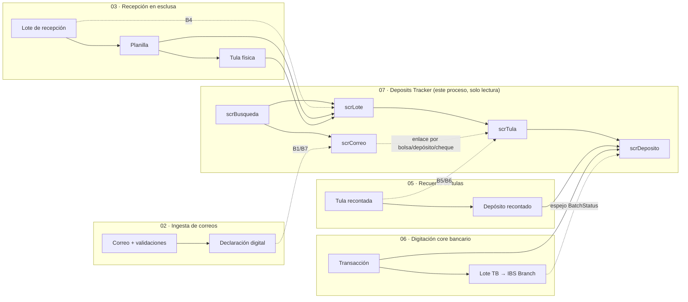

# 07 — Tracking sobre preguntas de clientes en depósitos

## 1. Qué es este proceso

Este es el proceso sin escritura de todo CashHub: cuando un cliente pregunta
"¿dónde está mi depósito?" o auditoría pide reconstruir un caso, alguien con
acceso al **Deposits Tracker** entra con lo que tenga a mano — el número de
tracking del correo, el lote de recepción, la planilla o la tula — y recorre
la cadena completa hacia adelante o hacia atrás: del correo del cliente y sus
validaciones automáticas, a la declaración digital que ese correo generó, al
lote físico que llegó a bóveda, a la tula que se abrió, al depósito que se
recontó, a la transacción que se generó, hasta si esa transacción ya fue
acreditada en el core bancario (IBS Branch). Es una app de **solo lectura**:
no corrige nada — si algo está mal, la corrección va en la app operativa que
sea dueña de ese dato (Reception, Recounting o Supervisor).

Lo que hace posible recorrer esa cadena sin que la app mienta por límite de
filas es el mismo patrón que el resto del proyecto usa para todo dato crítico:
nada de agregados ni filtros por columna de entidad relacionada client-side —
todo lo que el tracker necesita filtrar o sumar está **materializado por
plugin** en columnas espejo, igual que `sanic_batchstatus` en transacciones y
planillas. El paquete de espejos que hizo esto posible (B1–B9) se describe en
§6 y §8.

**Handoffs:**

- **Recibe de** [02 — Recepción e ingesta de emails](02-recepcion-ingesta-emails.md):
  el correo, sus corridas de validación y la declaración digital que generó
  (o no generó, si fue rechazado). `scrCorreo` es la raíz de esta lectura.
- **Recibe de** [03 — Recepción de tulas en esclusa](03-recepcion-tulas-esclusa.md):
  el lote, sus planillas y las tulas físicas asociadas. `scrLote` es el punto
  de entrada.
- **Recibe de** [05 — Recuento de tulas](05-recuento-tulas.md): la conciliación
  declarado-vs-recontado de la tula y sus depósitos, cheques y transacciones.
  `scrTula`/`scrDeposito` muestran ese resultado.
- **Recibe de** [06 — Digitación en core bancario](06-digitacion-core-bancario.md):
  si la transacción del depósito ya fue acreditada en IBS Branch — vía el
  espejo `sanic_batchstatus` de la transacción, sin consultar el core
  directamente.
- **No entrega nada a ningún proceso operativo**: es un sumidero de lectura.
  Su único "entregable" es la respuesta que la persona que consulta le da al
  cliente o a auditoría, fuera del sistema. Ver también
  [08 — Operación y soporte](08-operacion-y-soporte.md) para el uso de este
  proceso como herramienta de soporte/monitoreo.

## 2. Estados y transiciones

**Este proceso no transiciona ningún estado — solo los muestra.** Todos los
option sets que aparecen en las pantallas del tracker son propiedad de otro
proceso; acá se documentan porque el tracker es quien más superficie de
estados expone de punta a punta, pero el "quién transiciona" y el "guard que
lo defiende" viven en el proceso dueño (columna **Fuente**).

### 2.1 `BagStatus` (`sanic_bagstatus`, local `sanic_chtblbags_sanic_bagstatus`, en `CH-Tbl-Bags`)

| Valor | Etiqueta | Fuente |
|---|---|---|
| `159460000` | Recibida en esclusa | [03](03-recepcion-tulas-esclusa.md) |
| `159460001` | Almacenada en boveda | [03](03-recepcion-tulas-esclusa.md) |
| `159460002` | Asignada a cajero | [05](05-recuento-tulas.md) |
| `159460003` | Recontada | [05](05-recuento-tulas.md) |
| `159460004` | Pendiente de revision por supervisor - recuento | [04](04-supervision-aprobaciones.md) |
| `159460005` | Pendiente de revision por supervisor - esclusa | [04](04-supervision-aprobaciones.md) |

### 2.2 `ReceptionStatus` (`sanic_receptionstatus`, en `CH-Tbl-ReceptionBatch` / `sanic_chtblreceptionbatch`)

| Valor | Etiqueta | Fuente |
|---|---|---|
| `159460000` | En progreso | [03](03-recepcion-tulas-esclusa.md) |
| `159460001` | Recibido | [03](03-recepcion-tulas-esclusa.md) |
| `159460002` | Anulado | [03](03-recepcion-tulas-esclusa.md) |
| `159460003` | En boveda | [03](03-recepcion-tulas-esclusa.md) |

### 2.3 `CheckStatus` (`sanic_checkstatus`, en `CH-Tbl-Checks` / `sanic_chtblchecks`)

| Valor | Etiqueta | Fuente |
|---|---|---|
| `159460000` | Recontado | [05](05-recuento-tulas.md) |
| `159460001` | Digitado | [06](06-digitacion-core-bancario.md) |
| `159460002` | Rebotado | [06](06-digitacion-core-bancario.md) |
| `159460003` | Enviado a digitacion | [04](04-supervision-aprobaciones.md) |
| `159460004` | Recibido | [06](06-digitacion-core-bancario.md) |
| `159460005` | No Recibido | [06](06-digitacion-core-bancario.md) |

### 2.4 `TransactionType` / `BatchStatus` (`sanic_transactiontype` en `CH-Tbl-Transactions`; `sanic_batchstatus` en `CH-Tbl-TransactionBatches` / `sanic_transactionbatches`)

| Valor | Etiqueta | Tabla | Fuente |
|---|---|---|---|
| `159460000` | Deposito | `TransactionType` | [05](05-recuento-tulas.md) |
| `159460001` | Faltante | `TransactionType` | [04](04-supervision-aprobaciones.md) |
| `159460002` | Sobrante | `TransactionType` | [04](04-supervision-aprobaciones.md) |
| `159460003` | Sin declaracion | `TransactionType` | [04](04-supervision-aprobaciones.md) |
| `159460000` | Generado | `BatchStatus` (TB) | [06](06-digitacion-core-bancario.md) |
| `159460001` | Ingresado | `BatchStatus` (TB) | [06](06-digitacion-core-bancario.md) |
| `159460002` | Aprobado (dead-end) | `BatchStatus` (TB) | [06](06-digitacion-core-bancario.md) |
| `159460003` | Aplicado | `BatchStatus` (TB) | [06](06-digitacion-core-bancario.md) |

`sanic_transactionstatus` de `CH-Tbl-Transactions` tiene **un solo valor
posible** (`159460000` "Aplicada"); pendiente es simplemente el campo en
blanco. `scrDeposito` **no** usa esta columna para el pill "Acreditada" — usa
el espejo `sanic_batchstatus` de la transacción (§6.1), que copia
`BatchStatus` del lote TB. Compararlo contra `TransactionStatus` o contra el
lookup del lote sin pasar por el espejo es el bug que el tracker evita a
propósito (guía 05, nota de `pilXFilaCore`).

### 2.5 `EmailReviewStatus` / `EmailReplyStatus` (en `CH-Tbl-Received Emails` / `sanic_chtblreceivedemails`)

| Valor | Etiqueta | Columna | Fuente |
|---|---|---|---|
| `159460000` | Pendiente | `EmailReviewStatus` | [02](02-recepcion-ingesta-emails.md) |
| `159460001` | Aceptado | `EmailReviewStatus` | [02](02-recepcion-ingesta-emails.md) |
| `159460002` | Omitido | `EmailReviewStatus` | [02](02-recepcion-ingesta-emails.md) |
| `159460003` | Revision manual | `EmailReviewStatus` | [02](02-recepcion-ingesta-emails.md) |
| `159460004` | Error | `EmailReviewStatus` | [02](02-recepcion-ingesta-emails.md) |
| `159460005` | Denegado | `EmailReviewStatus` | [02](02-recepcion-ingesta-emails.md) |
| `159460000` | Pendiente | `EmailReplyStatus` | [02](02-recepcion-ingesta-emails.md) |
| `159460001` | Respondido | `EmailReplyStatus` | [02](02-recepcion-ingesta-emails.md) |
| `159460002` | Omitido | `EmailReplyStatus` | [02](02-recepcion-ingesta-emails.md) |

### 2.6 `ValidationResult` (`sanic_validationresult`, en `CH-Tbl-ValidationResults` / `sanic_chtblvalidationresults`)

| Valor | Etiqueta | Fuente |
|---|---|---|
| `159460000` | Pass | [02](02-recepcion-ingesta-emails.md) |
| `159460001` | Fail | [02](02-recepcion-ingesta-emails.md) |
| `159460002` | Omitida | **B2 de este proceso** (§6.1) — antes de B2, `PersistRun` descartaba los resultados Skipped con `continue` y esta etiqueta nunca se persistía |

Es la única fila de esta sección donde el tracker no solo lee: el backend de
este proceso (§6.1, §8) le agregó un valor al option set y cambió el
comportamiento de persistencia para que existiera algo que mostrar.

## 3. Roles y acceso

| Rol físico | Rol de seguridad | App |
|---|---|---|
| Auditoría / consulta / soporte | `CH-SR-DepositsTracker` | Deposits Tracker |

`CH-SR-DepositsTracker` (verificado contra
`solutions/unpacked/core/Roles/CH-SR-DepositsTracker.xml`): **22 privilegios
`prvRead`, todos con profundidad Global, cero privilegios de escritura**:
`CH-Tbl-AppCatalog`, `CH-Tbl-AppCatalogAccess`, `CH-Tbl-Bags`, `CH-Tbl-Checks`,
`CH-Tbl-Client`, `CH-Tbl-Declaration`, `CH-Tbl-DeclaredBags`,
`CH-Tbl-DeclaredChecks`, `CH-Tbl-DeclaredDeposits`,
`CH-Tbl-DepositsRecounting`, `CH-Tbl-EmailsAttachments`, `CH-Tbl-Locations`,
`CH-Tbl-ReceivedEmails`, `CH-Tbl-ReceptionBatch`, `CH-Tbl-Receptions`,
`CH-Tbl-RecountingSession`, `CH-Tbl-RecountingSessionDetail`,
`CH-Tbl-Transactions`, `CH-Tbl-TransactionBatches`,
`CH-Tbl-ValidationResults`, `CH-Tbl-ValidationRuns`, `CH-Tbl-ValidationRules`
(más los privilegios de plataforma sobre plugin assembly/SDK message/
SharePoint que trae cualquier rol custom). Profundidad **Global** — a
diferencia de `CH-SR-Counter` (Business Unit) — porque la trazabilidad es
transversal a toda la operación, no a una mesa ni a una sucursal.
`CH-Tbl-Parameter` **no** está en la lista: es organization-owned y no genera
privilegios (ningún rol del proyecto la referencia).

**Decisión del usuario (2026-08-12), documentada en
`scripts/provision-tracker-role.sh`**: `CH-SR-AnalyticsRead` **no** era el rol
para esta app y quedó intacto — se creó `CH-SR-DepositsTracker` desde cero,
rol nuevo dedicado.

**Qué verifica la app vs. qué impone el servidor:**

| | La app (canvas) | El servidor |
|---|---|---|
| Qué se puede leer | Nada — la app no filtra por rol, confía en que Dataverse solo le devuelva lo que el usuario puede ver | El Security Role `CH-SR-DepositsTracker` es la única frontera real: `prvRead` Global sobre las 22 tablas listadas, cero sobre cualquier otra |
| Qué se puede escribir | **Nada.** No hay un solo `Patch`/`Collect`/`Remove`/`Update` contra un datasource en ninguna de las 5 pantallas (ver §9) | Aunque alguien intentara escribir vía Web API con esta identidad, el rol no otorga `prvCreate`/`prvWrite`/`prvDelete` sobre ninguna tabla de negocio — rebota por permisos antes de llegar a cualquier guard de las otras apps |
| Visibilidad en el Hub | El catálogo (`CH-Tbl-AppCatalog`) filtra por grupo AAD (proceso [00](00-acceso-y-plataforma.md)) — cosmético, no seguridad | Igual que en todo el proyecto: el filtro del Hub decide qué tarjeta se ve, el Security Role decide qué se puede leer una vez adentro |

**Grupo AAD y sharing — estado PENDIENTE (verificar en vivo)**: el script
soporta crear el team "CashHub - Tracker" (teamtype 2) y registrar el GUID en
`CH-Tbl-Parameter` (clave `aad-group-tracker`) vía `AAD_GROUP_ID=<guid>`, pero
al momento de escribir este documento esa variable no se había corrido — el
rol y sus 22 privilegios están provisionados en DEV, el team y el compartir de
la app quedan como tarea pendiente declarada en el propio script y en el
CHANGELOG.

## 4. Aplicaciones

**`CH-App-DepositsTracker v2`** — 5 pantallas, todas de solo lectura:

| Pantalla | Sirve para | Contrato de entrada |
|---|---|---|
| `scrBusqueda` | Punto de entrada: buscar por Tracking (correo), Lote, Planilla o Tula; lista de lotes recientes | — (raíz) |
| `scrLote` | Ficha del lote + montos declarados (B4) + planillas (master) + tulas de la planilla seleccionada (detail) | `gvarLote` siempre; `gvarPlanilla` opcional |
| `scrTula` | Ficha de la tula + 4 pestañas: Conciliación (declarado vs. recontado por moneda), Por depósito, Cheques, Cronología | `gvarTula`, `gvarPlanilla`, `gvarLote` |
| `scrDeposito` | Ficha de un depósito recontado: diferencia, transacciones generadas (con estado de acreditación en core), cheques del depósito | `gvarDep` + `gvarTula`/`gvarPlanilla`/`gvarLote` + `colChequesTula` cargada por `scrTula` |
| `scrCorreo` | Raíz de la trazabilidad: el correo, sus 28 validaciones (Pasó/Falló/Omitida), la declaración generada (bolsas/depósitos/cheques declarados) y la respuesta HTML enviada al cliente | `gvarCorreo` |

Guías de construcción completas: `docs/tracker-rebuild/01-app.md` (app, datos,
fórmulas globales, convenciones), `02-pantalla-busqueda.md`,
`03-pantalla-lote.md`, `04-pantalla-tula.md`, `05-pantalla-deposito.md`,
`06-pantalla-correo.md`. Paleta rojo BAC (`#C8102E`), 100 % controles nativos
clásicos, cero PowerCAT.

**Divergencias deliberadas vs. `docs/guias/07-manual-trazabilidad.md`** (ese
manual describe una versión previa de la app, con pantallas "Vista de
Recepción/Vista de Tula/Vista de Cheques" que **ya no existen** — manda el
rebuild, regla del CAVEAT de manuales del contrato de esta carpeta):

- La reconstrucción **agregó `scrCorreo`** completa (correo, cuadro de
  validaciones, declaración, respuesta al cliente) — el manual viejo no cubre
  ese nivel en absoluto.
- Conteos de tulas se perdieron en toda la app (decisión consciente: no hay
  contador materializado y `CountRows` sobre relaciones no delega).
- La app **no** hace verificación de rol/grupo en su propio arranque — igual
  que el resto de las apps del proyecto, la frontera real es el Security Role.

## 5. Flujos Power Automate

**No aplica.** Verificado con `rg` sobre `solutions/unpacked/flow/` y sobre las
6 guías de pantalla: ninguna fórmula de `CH-App-DepositsTracker` invoca un
flujo. Toda la lectura es conector Dataverse directo (`Filter`/`LookUp`/
`Sort`), sin Office365, sin Graph, sin flujo intermedio.

## 6. Tablas

Modelo completo del dominio en
[modelo-de-datos.md](../referencia/modelo-de-datos.md). Acá el detalle propio
de este proceso: las 20 tablas que la app agrega como datasource (más `Users`,
solo para navegar `'Full Name'`).

| Tabla (display / lógico) | Rol en el proceso |
|---|---|
| `CH-Tbl-Received Emails` / `sanic_chtblreceivedemails` | Correo del cliente, tracking `Email-{N}`, estado de revisión/respuesta |
| `CH-Tbl-EmailsAttachments` / `sanic_chtblemailsattachments` | Adjuntos del correo |
| `CH-Tbl-ValidationRuns` / `sanic_chtblvalidationruns` | Corrida de validación de un correo |
| `CH-Tbl-ValidationResults` / `sanic_chtblvalidationresults` | Resultado por regla (Pasó/Falló/Omitida) |
| `CH-Tbl-ValidationRules` / `sanic_validationrules` | Catálogo de las 28 reglas VR-01..VR-28 |
| `CH-Tbl-Declarations` / `sanic_chtbldeclaration` | Declaración digital `Decla-{N}`, atribuida al cliente |
| `CH-Tbl-DeclaredBags` / `sanic_chtbldeclaredbags` | Bolsa declarada, totales por moneda |
| `CH-Tbl-DeclaredDeposits` / `sanic_chtbldeclareddeposits` | Depósito declarado |
| `CH-Tbl-DeclaredChecks` / `sanic_chtbldeclaredchecks` | Cheque declarado |
| `CH-Tbl-ReceptionBatches` / `sanic_chtblreceptionbatch` | Lote de recepción `RB-{N}` |
| `CH-Tbl-Receptions` / `sanic_chtblreceptions` | Planilla `ReceiptID` |
| `CH-Tbl-Bags` / `sanic_chtblbags` | Tula física `BagID` |
| `CH-Tbl-RecountingSessions` / `sanic_chtblrecountingsession` | Sesión de recuento, cajero |
| `CH-Tbl-RecountingSessionDetails` / `sanic_chtblrecountingsessiondetail` | Detalle tula+sesión |
| `CH-Tbl-DepositsRecountings` / `sanic_chtbldepositsrecounting` | Depósito recontado (PK singular `'CH-Tbl-DepositsRecounting'`) |
| `CH-Tbl-Checks` / `sanic_chtblchecks` | Cheque físico |
| `CH-Tbl-Transactions` / `sanic_chtbltransactions` | Transacción de depósito/faltante/sobrante/sin declaración |
| `CH-Tbl-TransactionBatches` / `sanic_transactionbatches` | Lote de digitación TB → IBS Branch |
| `CH-Tbl-Clients` / `sanic_chtblclient` | Cliente atribuido a la declaración/planilla |
| `CH-Tbl-Locations` / `sanic_chtbllocations` | Ubicación del lote (ficha `scrLote`) |

### 6.1 Columnas espejo — **mantenidas por plugin, no editar a mano**

El paquete completo se llama **B1–B9** (plan en
`docs/tracker-rebuild/00-analisis-y-plan.md`, desplegado en DEV, 33 tests de
dominio nuevos, suite 378/378):

| # | Columna (lógico) | Tabla | Apunta a / calcula | Plugin |
|---|---|---|---|---|
| B1 | `sanic_receivedemail` (display `ReceivedEmail`) | `sanic_chtbldeclaration` | `sanic_chtblreceivedemails` | `DeclarationMaterializer` (lo estampa en el `Create` de la declaración) |
| B2 | Valor `159460002` "Omitida" en `sanic_validationresult` | `sanic_chtblvalidationresults` | — (option set) | Cambio en `PersistRun` (`ReceivedEmailValidationService.cs`): ya no hace `continue` sobre los resultados Skipped |
| B3 | `sanic_matchedcheck` (display `MatchedCheck`) | `sanic_chtbldeclaredchecks` | `sanic_chtblchecks` | `CheckMirrorStampPlugin` — inverso de `sanic_relateddeclaredcheck` del cheque físico |
| B4 | `sanic_decniocash/decniocheck/decniototal/decusdcash/decusdcheck/decusdtotal` (displays `DecNIOCash`/`DecNIOCheck`/`DecNIOTotal`/`DecUSDCash`/`DecUSDCheck`/`DecUSDTotal`) | `sanic_chtblreceptionbatch` | Aggregate de `sanic_chtblreceptions` del lote | `ReceptionBatchTotalsPlugin` |
| B5 | `sanic_decltotalnio/decltotalusd/decltotaleur` + `sanic_hasdifference` (displays `DeclTotalNIO`/`DeclTotalUSD`/`DeclTotalEUR`/`HasDifference`) | `sanic_chtblbags` | Copia de `CH-Tbl-DeclaredBags` + comparación contra `sanic_totalnio/usd/eur` recontados | `BagReconciliationMirrorPlugin` |
| B6 | `sanic_bag` (display `Bag`) | `sanic_chtblchecks` | `sanic_chtblbags` | `CheckMirrorStampPlugin` — derivada de `sanic_relatedrecounterdepositid.sanic_bagid` |
| B7 | `sanic_declaration` (display `Declaration`) | `sanic_chtbldeclareddeposits` y `sanic_chtbldeclaredchecks` | `sanic_chtbldeclaration` | `DeclarationMaterializer` (denormalización directa al crear cada fila) |
| B9 | `sanic_recountingsession` en el cheque físico | `sanic_chtblchecks` | `sanic_chtblrecountingsession` de la tula | `CheckMirrorStampPlugin` — no lo consume ninguna pantalla del tracker directamente, pero comparte plugin y cascada con B6 |

Todas nacen o se re-escriben con la descripción **"Mantenido por plugin. No
editar a mano."** — mismo patrón que `sanic_batchstatus` en `CH-Tbl-Receptions`
(espejo del `ReceptionStatus` del lote) y en `CH-Tbl-Transactions` (espejo del
`BatchStatus` del lote TB), que el tracker también lee sin tocar.

### 6.2 Gotchas de nombres verificados en esta sesión

- **`sanic_otherlocacheckamount`** (`DepositsRecountings`, **sin** la `l`) vs.
  **`sanic_otherlocalcheckamount`** (`DeclaredDeposits`, **con** la `l`): dos
  columnas casi idénticas, distinto typo real de esquema.
- La PK de `CH-Tbl-DepositsRecountings` es **singular**:
  `'CH-Tbl-DepositsRecounting'`.
- El lookup al lote TB en `CH-Tbl-Transactions` se llama **`'Transaction
  Batch'`** (`sanic_transactionbatch`, con espacio en el display). Los campos
  en español **no viven en `CH-Tbl-Transactions`, sino en el lote TB destino
  del lookup** (`CH-Tbl-TransactionBatches` / `sanic_transactionbatches`,
  verificado en `Entity.xml`): `'Generado por'` (`sanic_generadopor`),
  `'Aplicado el'` (`sanic_aplicadoon`), `'Aplicado por'` (`sanic_aplicadopor`).
- El cliente atribuido en `CH-Tbl-Declaration` se llama **`'Cliente
  atribuido'`** (`sanic_client`) — mismo display en `CH-Tbl-Received Emails`.
- `NIOCash`/`NIOCheck`/`USDCash`/`USDCheck` (montos declarados de
  `CH-Tbl-Receptions`) llevan la moneda en **mayúsculas** — casing real del
  esquema, no convención libre.
- `RunStart` (`sanic_runstart`, en `CH-Tbl-ValidationRuns`) es una sola
  palabra. En `CH-Tbl-ValidationResults` los **display name** están en
  español (`Detalle`/`Hoja`/`Celda`/`Fila`) pero el **logical name no sigue
  el español** — verificado carácter a carácter contra `Entity.xml` en esta
  sesión: `Detalle` → `sanic_detail`, `Hoja` → `sanic_sheet`, `Celda` →
  `sanic_cellref`, `Fila` → `sanic_rownumber`. Ojo con este patrón: acá el
  display en español NO predice el logical name (a diferencia de
  `sanic_generadopor`/`sanic_aplicadoon`/`sanic_aplicadopor`, donde sí
  coincide).
- `sanic_totaldeposits` de `CH-Tbl-DeclaredBags` es una **columna entera
  simple** escrita por `DeclarationMaterializer`, no un rollup nativo — el
  rollup original nunca tuvo definición de agregación válida (corregido fuera
  de este proceso, documentado en el CHANGELOG).

## 7. Custom APIs

**No aplica.** Verificado con `rg` sobre `src/backend/CashHub.Plugins/*.cs`:
ninguna de las columnas o lecturas de este proceso pasa por un Custom API — el
paquete B1–B9 corre íntegro como plugins síncronos sobre mensajes CRUD
estándar (`Create`/`Update`/`Delete`) de las tablas de origen (`CH-Tbl-Receptions`,
`CH-Tbl-Bags`, `CH-Tbl-Checks`), y la app lee todo con el conector Dataverse
directo. La única lógica de negocio invocada explícitamente en la cadena
(`sanic_CHValidateReceivedEmail`) pertenece al proceso
[02](02-recepcion-ingesta-emails.md), no a este.

## 8. Steps de plugins

| Plugin | Mensaje / etapa | Filtro | Regla de negocio que defiende |
|---|---|---|---|
| `ReceptionBatchTotalsPlugin` | Post-operation (40) síncrono en `Create`/`Update`/`Delete` de `sanic_chtblreceptions` | Update filtrado en los 4 montos declarados (`NIOCash/NIOCheck/USDCash/USDCheck`) + `sanic_receptionbatch`, con PreImage de ese lookup (mover una planilla de lote recalcula **ambos** lotes) | Mantiene B4: los montos declarados del lote son un aggregate FetchXML server-side, nunca una suma client-side que tope en el límite de filas y mienta en silencio |
| `BagReconciliationMirrorPlugin` | Pre-operation (20) síncrono en `Create` y `Update` de `sanic_chtblbags` | Update filtrado en `sanic_bagdeclarationid` + `sanic_totalnio/usd/eur` + `sanic_bagstatus`, con PreImage de esas mismas columnas | Mantiene B5: escribe **en el Target** (sin update extra) la copia de los totales declarados y recalcula `hasdifference` — el join Bag→DeclaredBag no delega en Power Fx, así que la comparación se materializa acá |
| `CheckMirrorStampPlugin` | 4 pasos síncronos: Pre-op (20) `Create` de `sanic_chtblchecks` (B6+B9 en el Target); Post-op (40) `Create` de la misma (B3, ya con la fila creada); Pre-op (20) `Update` de `sanic_chtblchecks` filtrado en `sanic_relatedrecounterdepositid`+`sanic_relateddeclaredcheck`, con PreImage (re-estampa B6+B9+B3); Post-op (40) `Update` de `sanic_chtblbags` filtrado en `sanic_recountingsession`, con PreImage (cascada de sesión a TODOS los cheques de la tula, paginada de a 500) — **este 4° paso lo registra `scripts/register-supervisor-mirrors.sh` (proceso [04](04-supervision-aprobaciones.md)), no `register-tracker-mirrors.sh`: mismo plugin, cascada compartida** | Mantiene B3, B6 y B9. El `Create` está partido en dos pasos por integridad referencial: B3 escribe en el cheque DECLARADO un lookup al cheque físico, y en Pre-operation esa fila todavía no existe (Dataverse responde `0x80040265` y tumba el `Create` entero — bug reproducido con 783 cheques en el stress de recuento) |
| `DeclarationMaterializer` | No es un plugin registrado por sí mismo — es la clase invocada por el motor de validación de [02](02-recepcion-ingesta-emails.md) cuando la validación cierra en verde | — | Mantiene B1 y B7: al crear `Declaration`, `DeclaredDeposits` y `DeclaredChecks`, estampa `sanic_receivedemail` y `sanic_declaration` en el mismo `Create` — cero espejo diferido, cero backfill necesario para datos nuevos |

Scripts idempotentes de despliegue: `scripts/create-tracker-columns.sh` (crea
las columnas B1–B7), `scripts/register-tracker-mirrors.sh` (registra 3 de los
4 pasos síncronos de los tres plugins — el 4° paso de `CheckMirrorStampPlugin`,
la cascada B9 sobre `sanic_chtblbags`, lo registra
`scripts/register-supervisor-mirrors.sh` del proceso
[04](04-supervision-aprobaciones.md), ver nota en la tabla de arriba),
`scripts/backfill-tracker.py` (backfill de datos existentes — corrido en DEV;
pipeline verificado en vivo: espejo de cheque limpiado y re-estampado por el
plugin en un caso real).

## 9. Acciones

Todas las acciones de este proceso son de **lectura**. Ninguna tiene
"deshacer" en el sentido de una escritura revertida — no hay escritura que
revertir.

### Buscar por tracking del correo

| Campo | Contenido |
|---|---|
| **Quién** | Cualquier usuario con `CH-SR-DepositsTracker` |
| **Cuándo** | Tiene el identificador `Email-{N}` a mano (de un ticket, un reclamo, un correo reenviado) |
| **Por qué / para qué** | Entrar directo a la raíz de la trazabilidad de ese correo: validaciones, declaración, respuesta enviada |
| **Cómo** | `scrBusqueda` → menú desplegable "Tracking (correo)" → tipear/pegar el identificador → *Buscar* |
| **Qué valida el servidor** | Nada escribe; el `LookUp('CH-Tbl-Received Emails', Name = _q)` delega por igualdad simple sobre columna autonumber. El Security Role decide si la fila existe **para este usuario** — si no tiene `prvRead` Global sobre `CH-Tbl-ReceivedEmails`, la fila vuelve vacía aunque exista |
| **Qué pasa si falla / deshacer** | Identificador inexistente: mensaje inline `"Tracking "…" no encontrado..."`, sin navegar. No hay deshacer: es una consulta |

### Buscar por lote de recepción, planilla o tula

| Campo | Contenido |
|---|---|
| **Quién** | Cualquier usuario con `CH-SR-DepositsTracker` |
| **Cuándo** | Tiene el identificador `RB-{N}`, el `ReceiptID` de la planilla, o el `BagID` impreso en la tula |
| **Por qué / para qué** | Entrar directo al nivel de la cadena física que corresponde, sin pasar por el correo |
| **Cómo** | `scrBusqueda` → elegir tipo → identificador → *Buscar*. Planilla y Tula derivan también `gvarLote`/`gvarPlanilla` para dejar las migas completas desde el primer clic |
| **Qué valida el servidor** | Los tres `LookUp` (`ReceiptID`, `BagID`, `Name` del lote) delegan igual que el de tracking. La planilla huérfana (sin `ReceptionBatch`) tiene guard **de la app**, no del servidor: mensaje explícito en vez de navegar a un lote en blanco |
| **Qué pasa si falla / deshacer** | Identificador inexistente por tipo: mensaje inline específico, nunca navega. Campo vacío: `"Escribí un identificador para buscar."` |

### Navegar de una bolsa/depósito/cheque declarado a su tula recontada

| Campo | Contenido |
|---|---|
| **Quién** | Cualquier usuario con `CH-SR-DepositsTracker`, desde `scrCorreo` |
| **Cuándo** | La declaración tiene al menos una bolsa/depósito/cheque ya enlazado a su contraparte física (`BagID` en `DeclaredBags`, `RelatedRecountedDeposit` en `DeclaredDeposits`, `MatchedCheck` en `DeclaredChecks` — este último requiere B3+B6) |
| **Por qué / para qué** | Confirmar si lo declarado por el cliente ya se materializó en algo físico contado, sin salir de la pantalla del correo |
| **Cómo** | `scrCorreo` → pestaña Declaración o Cheques declarados → clic en el link ("Sin tula vinculada todavía" cuando no aplica, texto plano sin link) |
| **Qué valida el servidor** | El link solo aparece activo cuando el lookup no está en blanco — validación de la app, no un guard. La lectura de la tula destino pasa por el mismo `CH-SR-DepositsTracker` |
| **Qué pasa si falla / deshacer** | Sin enlace: el texto queda en gris, sin subrayado, sin `OnSelect`. No es un error — es el estado normal de un correo cuya tula todavía no se recontó |

### Ver la conciliación declarado vs. recontado de una tula

| Campo | Contenido |
|---|---|
| **Quién** | Cualquier usuario con `CH-SR-DepositsTracker` |
| **Cuándo** | Llegó a `scrTula` por cualquiera de las tres búsquedas o por un link desde el correo |
| **Por qué / para qué** | Responder "¿cuadró lo que declaró el cliente contra lo que se contó?" por moneda, sin recalcular nada a mano |
| **Cómo** | `scrTula` → pestaña Conciliación (pestaña por defecto) → tabla por moneda: Declarado / Recontado / Diferencia |
| **Qué valida el servidor** | El pill "Con diferencia"/"Sin diferencia" de la ficha y de la grilla de `scrLote` lee directo `sanic_hasdifference` (B5) — recalculado por `BagReconciliationMirrorPlugin`, nunca por la app |
| **Qué pasa si falla / deshacer** | Tula sin depósitos recontados: mensaje `"Sin depósitos recontados todavía."`. No hay falla en el sentido de rechazo — es una lectura |

### Ver transacciones y estado de acreditación en core de un depósito

| Campo | Contenido |
|---|---|
| **Quién** | Cualquier usuario con `CH-SR-DepositsTracker` |
| **Cuándo** | Desde `scrTula`, pestaña Por depósito, con un depósito seleccionado |
| **Por qué / para qué** | Es la pregunta más frecuente del cliente: "¿ya se aplicó mi depósito en el banco?" |
| **Cómo** | `scrTula` → pestaña Por depósito → seleccionar fila → *Ver transacciones y cheques del depósito* → `scrDeposito` |
| **Qué valida el servidor** | El pill "Acreditada · fecha"/"Pendiente" compara `ThisItem.BatchStatus = 159460003` (espejo, no el estado real del lote vía lookup, que no delegaría) |
| **Qué pasa si falla / deshacer** | Depósito sin transacciones generadas todavía: `"Todavía no se han generado transacciones para este depósito."`. **Limitación declarada**: no hay un estado "rechazado" a nivel de depósito visible en esta app — si el core rechazó algo, hay que consultar la app Digitization o IBS Branch directamente (ver §10) |

### Consultar el cuadro de validaciones y la respuesta enviada al cliente

| Campo | Contenido |
|---|---|
| **Quién** | Cualquier usuario con `CH-SR-DepositsTracker` |
| **Cuándo** | En `scrCorreo`, pestañas Validaciones y Respuesta al cliente |
| **Por qué / para qué** | Explicarle a un cliente por qué su declaración fue rechazada (regla exacta, hoja, celda) o confirmar qué se le contestó y cuándo |
| **Cómo** | `scrCorreo` → pestaña Validaciones (default) → fila por regla con resultado Pasó/Falló/Omitida (B2) y detalle hoja!celda; pestaña Respuesta al cliente → HTML renderizado (`sanic_replybodyhtml`) |
| **Qué valida el servidor** | Nada escribe. `EmailReviewStatus`/`EmailReplyStatus` reflejan lo que [02](02-recepcion-ingesta-emails.md) decidió; este proceso solo los muestra |
| **Qué pasa si falla / deshacer** | Correo sin corridas (`Pendiente`/`Error` temprano): `"Este correo aún no tiene corridas de validación."`. Correo rechazado: la pestaña Declaración muestra `"Este correo no generó declaración..."` en vez de grillas vacías |

## 10. Supuestos y limitaciones

**Supuestos de diseño:**

- **Solo lectura por diseño, no por omisión.** El rol no tiene un solo
  privilegio de escritura sobre ninguna de las 22 tablas; no es que la app
  "todavía no" tenga botones de edición — la decisión es que **nunca** los
  tenga. Cualquier corrección va en Reception, Recounting o Supervisor.
- **Cero agregados client-side.** Todo total o comparación que la app muestra
  viene materializado por un plugin (B1–B9) o ya existía (espejos previos como
  `sanic_batchstatus`). Es el mismo racional que el resto del proyecto, no una
  invención de este proceso.
- **El filtro del Hub sobre esta app es UX, no seguridad** — igual que en
  [00](00-acceso-y-plataforma.md): la frontera real es `CH-SR-DepositsTracker`.

**Limitaciones conocidas:**

- **Conteos de tulas se perdieron en toda la app** (lista de recientes, grilla
  de planillas, ficha del lote): `CountRows` sobre relaciones no delega y no
  existe un contador materializado — decisión consciente documentada en
  `docs/tracker-rebuild/00-analisis-y-plan.md §2.5`. Si el negocio lo pide, se
  agregaría como un B4-bis (contador por plugin, mismo patrón que B4).
- **Sin estado de "rechazado en core" a nivel de depósito.** El único estado
  de acreditación que la app conoce es el espejo `BatchStatus` del lote TB
  (`159460003` Aplicado = acreditada; cualquier otro valor = pendiente). Si el
  core rechazó una transacción puntual, este proceso no lo distingue —
  documentado también en `docs/guias/07-manual-trazabilidad.md`.
- **PENDIENTE en vivo**: grupo AAD "CashHub - Tracker" sin crear en Entra al
  momento de este documento; el rol y sus 22 privilegios ya están
  provisionados en DEV, pero el team y el compartir de la app son el paso que
  falta (§3). No asumir que cualquier usuario ya puede lanzar la app desde el
  Hub sin verificarlo en vivo.
- **`docs/guias/07-manual-trazabilidad.md` describe una versión anterior de la
  UI** (pantallas "Vista de Recepción/Tula/Cheques", sin `scrCorreo`) —
  desactualizado frente al rebuild; ver §4. Sus advertencias sobre "el Hub no
  filtra realmente" y "es exclusivamente de consulta" siguen vigentes; su
  inventario de pantallas, no.
- **`RunStart`/`Detalle`/`Hoja`/`Celda`/`Fila`** de `ValidationResults`: los
  logical names exactos de `Detalle`/`Hoja`/`Celda`/`Fila` no se verificaron
  carácter a carácter contra el `Entity.xml` en esta sesión (se tomaron de las
  guías de rebuild, ya auditadas por dos agentes antagonistas) — si Studio
  ofrece otro nombre en IntelliSense, ese manda.
- **Estado de los flujos de otros procesos que alimentan esta cadena**
  (`CH-Flow-ProcessEmail`, `CH-Flow-ProcessXMLFiles`, etc.) no se verifica
  acá — ver el CAVEAT de flujos del contrato de esta carpeta y los procesos
  02/05 correspondientes.

## 11. Pruebas

No se duplican casos acá — la guía dedicada
[`docs/tracker-rebuild/07-guia-de-pruebas.md`](../tracker-rebuild/07-guia-de-pruebas.md)
trae las tres partes completas (delegación con protocolo de límite-en-1,
funcionalidad, performance) contra el universo de estrés sembrado en DEV
(~30.000 registros marcados `STRESS`, centinelas con valores calculados contra
el Web API). Del plan de pruebas integral
([09-plan-de-pruebas-integral.md](../guias/09-plan-de-pruebas-integral.md)),
bloque **G Tracker**:

**07:P1–P3** (las tres partes de la guía dedicada, referenciadas como bloque
único en el plan integral) · **TR-01** 🔴 (integración): buscar los registros
creados por el resto del plan integral (el lote de `RC-01`, la tula de
`RE-07`, el correo del hilo de oro) y verificar que la cronología de `scrTula`
cuente la historia completa hasta "acreditada en core (lote TB-…)".

`TR-01` también es el último tramo de **§9 — El hilo de oro** del plan
integral: un depósito nuevo, sin datos pre-armados, atravesando alta de
cliente → declaración por correo → recepción → recuento → digitación → y
cerrando acá, en el tracker, confirmando que la cadena completa es
consultable de punta a punta.
