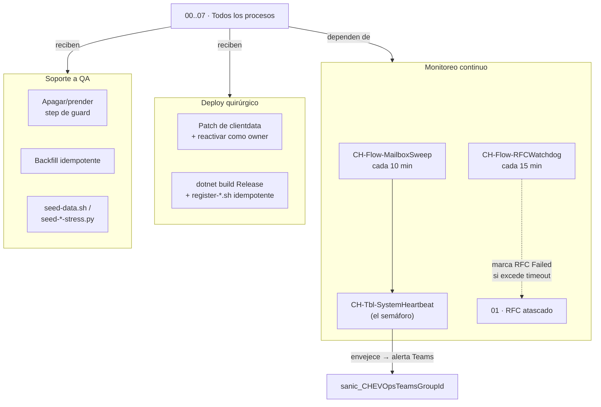

# 08 — Operación y soporte

## 1. Qué es este proceso

Los siete procesos anteriores describen lo que un usuario de negocio hace todos
los días. Este describe lo que hay que hacer para que ese "todos los días"
siga funcionando: nadie construye CashHub una vez y lo deja andar solo. Un
correo se queda sin `ValidationRun`, un flujo se importa y queda en Draft, un
step de guard hay que apagarlo un rato para una ronda de QA, una tabla nueva
nace vacía en un ambiente fresco y necesita sus datos de configuración, un
espejo recién registrado no cubre el histórico. Operación y soporte es la capa
transversal que atiende eso: **monitoreo** (heartbeat, barridos periódicos,
watchdog), **deploys quirúrgicos** (parchear un flujo o registrar un plugin
sin pasar por un import de solución completo, para no pisar cambios hechos a
mano en el diseñador web), **backfills** (poner al día registros existentes
con lo que un plugin nuevo va a mantener de acá en adelante) y **seeds de QA**
(poblar un ambiente con datos de prueba trazables). Nada de esto lo ve el
usuario de negocio — es la maquinaria detrás del telón, operada por quien
desarrolla y despliega CashHub.

**Handoffs:** este proceso es transversal — no recibe ni entrega un artefacto
de negocio como los demás, entrega **disponibilidad**. Sin él:

- [00 — Acceso y plataforma](00-acceso-y-plataforma.md) tendría el Hub apuntando
  a apps o grupos AAD mal configurados (variables de entorno sin pisar).
- [01 — Administración de datos de clientes](01-administracion-datos-clientes.md)
  tendría RFCs `Approved` eternos si `CH-Flow-RFCWatchdog` no corriera.
- [02 — Recepción e ingesta de emails](02-recepcion-ingesta-emails.md) tendría
  correos sin `ValidationRun` para siempre si `CH-Flow-MailboxSweep` no
  re-validara.
- [05 — Recuento de tulas](05-recuento-tulas.md) es, hoy, el proceso con más
  procedimiento de soporte documentado: el toggle del step cuatro-ojos para QA
  (§8-9 de este documento) nace ahí.
- [06 — Digitación en core bancario](06-digitacion-core-bancario.md) existe en
  el ambiente **porque** sus Custom APIs y columnas se desplegaron
  quirúrgicamente, sin import de solución.

## 2. Estados y transiciones

Este proceso no tiene una entidad de negocio con máquina de estados propia.
Opera sobre los **interruptores del sistema**: el estado ON/OFF de un step de
plugin, el estado ON/OFF de un flujo, y de forma indirecta, el estado de un
RFC atascado.

### 2.1 `sdkmessageprocessingstep.statecode/statuscode` — el interruptor de un guard

Tabla estándar de Dataverse (no `sanic_`), sin optionset de negocio propio.

| `statecode` | `statuscode` | Etiqueta | Quién transiciona |
|---|---|---|---|
| `0` | `1` | **Active** | Un `register-*.sh` (alta/upsert) o una reactivación manual explícita |
| `1` | `2` | **Disabled** | Un operador/desarrollador, de forma **deliberada** (nunca automático) |

No hay guard que defienda esta transición — el único control es el privilegio
de Dataverse (System Administrator/Customizer) de quien tiene el token. Por
eso la regla operativa reemplaza al guard técnico: apagar un step **es** una
operación acotada, con re-activación **verificada** (`statecode = 0`) **en el
mismo turno de trabajo** — nunca se deja para "mañana". Ejemplo documentado
con auditoría completa (antes/después, quién, por qué) en
[`docs/recounting-rebuild/06-escenarios-qa.md` §6-7](../recounting-rebuild/06-escenarios-qa.md):
el step `CashHub.GuardReception: Update de sanic_chtblapprovalrequest`
(`sdkmessageprocessingstepid` `ee7c4081-0495-f111-b8db-6045bd099905`) se apagó
para que `scripts/qa-approve-pending.py` pudiera aprobar/rechazar solicitudes
saltando el cuatro-ojos, y se re-activó y verificó al cierre de la ronda.

### 2.2 `workflow.statecode/statuscode` — el interruptor de un flujo

| `statecode` | `statuscode` | Etiqueta |
|---|---|---|
| `0` | `1` | **Draft / Off** |
| `1` | `2` | **Activado** |

Quien transiciona depende de la vía: un import de solución activa los flujos
que vienen `StateCode=1` en el paquete (con la excepción documentada de
`CH-Flow-IngestEmails`, que exporta en Draft — ver
[04-deploy-y-alm.md §4](../desarrollo/04-deploy-y-alm.md)); un deploy
quirúrgico (§9) lo hace por API, con el gotcha central de este proceso: **el
Service Principal puede poner `statecode=1` pero el trigger no queda
registrado si el `PATCH` de reactivación corre con la identidad del SP** — hay
que reactivar **impersonando al owner** del flujo (header `MSCRMCallerID`).

### 2.3 `sanic_changestatus` del RFC — la única transición que este proceso dispara

La máquina de estados completa del RFC (`Draft → Submitted → Approved →
Applied/Failed/Rejected/Canceled`) es propiedad de
[01 — Administración de datos de clientes](01-administracion-datos-clientes.md).
Este proceso solo posee **una** arista: `CH-Flow-RFCWatchdog` (cada 15 min)
detecta RFCs en `Approved` (`159460002`) más allá de
`sanic_CHEVRfcApplyTimeoutMinutes` (default 30) y los marca `Failed`
(`159460005`) con nota de auditoría — nunca queda un RFC `Approved` eterno
esperando un flujo aplicador que murió o quedó apagado. La notificación de
cierre sale sola vía `NotifywhenRFCimplementationfinish`. Caso de prueba
**CA-12** (§11).

### 2.4 `sanic_lastrunon` de `CH-Tbl-SystemHeartbeat` — no es un picklist, es el gate de frescura

Igual que `RecountingSession.Confirmed` en [05 §2.5](05-recuento-tulas.md), no
hay optionset acá: `sanic_lastrunon` (datetime) se pisa en cada corrida de un
barrido. La app/Console que lo consuma no pregunta "¿está sano?" sino "¿hace
cuánto que no late?" — un latido viejo delata un barrido muerto sin que otro
proceso tenga que vigilarlo. El vigilante del vigilante es la ausencia de
latido, no una alarma activa.

## 3. Roles y acceso

| Rol físico | Perfil / rol de seguridad | Qué opera |
|---|---|---|
| Desarrollador/Operador CashHub | **System Administrator** o **System Customizer** en Dataverse (según si necesita administrar seguridad) | Corre los scripts de este documento a mano, con `pp_secrets.env` local |
| Application User (Service Principal) | Mismo rol, concedido explícitamente en *Usuarios de la aplicación* del ambiente destino | Automatiza `pac solution import/export` en pipeline — **no** puede reactivar un flujo de forma que el trigger quede registrado (§2.2) |
| Grupo Teams de operaciones | Miembro del grupo mapeado a `sanic_CHEVOpsTeamsGroupId` (config en `CH-Tbl-Parameter`, no hardcodeado) | Recibe las alertas de `CH-Flow-MailboxSweep` — rol **pasivo**, no opera Dataverse |

**Qué verifica el script vs. qué impone el servidor:**

| | El script (`register-*.sh`, `backfill-*.py`, `seed-*.py`) | El servidor (Dataverse) |
|---|---|---|
| Que no se duplique un `pluginassembly`/`plugintype`/`customapi`/`step` al re-correr | Upsert por filtro (`name eq` / `uniquename eq`) — **no hay lock**: dos corridas simultáneas contra la misma entidad pueden crear duplicados | Ninguna — Dataverse no impone un `unique key` sobre `name`/`uniquename` de estas tablas de metadatos por defecto |
| Quién puede **invocar** un Custom API ya registrado | Nada — el script termina en el registro | `executeprivilegename` (ej. `prvCreatesanic_TransactionBatches` en los tres Custom API de digitación, §7) — el único control real |
| Que el assembly a registrar sea el correcto | El script exige el `.dll` compilado en Release y falla si no existe | Nada — Dataverse acepta cualquier assembly firmado con una `.snk` válida; la disciplina de "compilar antes de registrar" es humana |
| Que `qa-approve-pending.py` no se use en producción | Nada en el script — su docstring lo dice, pero no lo verifica | El propio guard cuatro-ojos, si está `Active`, rechaza la auto-resolución — el script **solo funciona** con el guard apagado (§9) |

`pp_secrets.env` (credenciales del Service Principal) y `CashHub.snk` (firma
del assembly) son prerrequisitos de entorno **no versionados** — confirmado en
`.gitignore`. Sin ambos, ningún script de este documento corre.

## 4. Aplicaciones

**No aplica una canvas app propia de este proceso.** Operación y soporte se
ejecuta desde tres superficies, ninguna de ellas una app de CashHub:

| Superficie | Para qué |
|---|---|
| Terminal + scripts de `scripts/` | Deploys quirúrgicos, registro de plugins/Custom APIs, backfills, seeds |
| Power Apps Studio | Edición de canvas apps — ver la regla de oro de §9 (bajar la última versión antes de construir) |
| Web API directa (`curl`/Python) | Toggle de steps de guard, verificación de `statecode`, aprobación QA sin cuatro-ojos |

La única superficie visual relacionada con este proceso pertenece a otro:
la **Email Validation Console** (proceso 02) muestra el semáforo del heartbeat
("última revisión hace X min") y ofrece "Reprocesar" — es el consumidor
humano del trabajo que este proceso mantiene vivo, no una app operada por
soporte. Estado de la fase E de la Console (recableada al semáforo):
**verificar en vivo** — el diseño está escrito en
[`08-motor-validacion.md`](../desarrollo/08-motor-validacion.md) pero ese
documento no confirma despliegue.

## 5. Flujos Power Automate

| Flujo | Trigger | Qué toca | Estado | Owner de la conexión |
|---|---|---|---|---|
| `CH-Flow-MailboxSweep` | Programado, **cada 10 minutos** | (a) re-valida `ReceivedEmails` en `Pendiente` sin `ValidationRun` (auto-reparación, reinvoca `sanic_CHValidateReceivedEmail`); (b) detecta correos en el buzón >5 min sin fila registrada y los rescata (ruta distinta al webhook del trigger — sobrevive a la muerte del trigger); (c) alerta por Teams al grupo de `sanic_CHEVOpsTeamsGroupId` (opcional); (d) escribe `CH-Tbl-SystemHeartbeat` | **verificar en vivo** — confirmado operando en la sesión de trabajo de este documento, pero por el CAVEAT de flujos del contrato (`solutions/unpacked/flow` a 1.12.0.0) el export estático no certifica el estado actual | verificar en vivo |
| `CH-Flow-RFCWatchdog` | Programado, **cada 15 minutos** | RFCs en `Approved` (`159460002`) más allá de `sanic_CHEVRfcApplyTimeoutMinutes` → `Failed` (`159460005`) con nota; dispara `NotifywhenRFCimplementationfinish` | verificar en vivo (mismo caveat) | verificar en vivo |

`CH-Flow-RFCWatchdog` solo usa el conector de Dataverse. `CH-Flow-MailboxSweep`
suma Teams (alerta opcional) **y Office 365 Outlook** (`GetEmailsV3` sobre el
buzón compartido, para el rescate de huérfanos de (b)) — no hay OneDrive ni
Excel en este proceso. Detalle completo de connection references y su
reconexión por ambiente en
[04-deploy-y-alm.md §3](../desarrollo/04-deploy-y-alm.md).

## 6. Tablas

| Tabla (display / lógico) | PK | Rol en el proceso |
|---|---|---|
| `CH-Tbl-SystemHeartbeat` / `sanic_chtblsystemheartbeat` | `sanic_chtblsystemheartbeatid` | El semáforo de salud — una fila por proceso monitoreado |
| `CH-Tbl-Parameter` / `sanic_chtblparameter` | `sanic_chtblparameterid` | Configuración key/value de CashHub — reemplaza multiplicar variables de entorno |

### 6.1 `CH-Tbl-SystemHeartbeat`

| Columna (lógico) | Tipo | Contenido |
|---|---|---|
| `sanic_name` | texto (nombre primario) | Identificador del proceso monitoreado (p. ej. `ingesta-correos`) |
| `sanic_lastrunon` | datetime, requerido | Marca de tiempo de la última corrida — §2.4 |
| `sanic_details` | texto largo (2000) | Detalle libre de la corrida (contadores, errores) |

**Escrita por flujos programados, no por un plugin** — no lleva el rótulo de
"columna espejo" del resto de los procesos, pero la misma regla aplica en la
práctica: no se edita a mano, el próximo barrido la pisa igual.

### 6.2 `CH-Tbl-Parameter`

| Columna (lógico) | Tipo | Contenido |
|---|---|---|
| `sanic_name` | texto | Clave del parámetro (p. ej. `Security.ApproverGroup.Supervisor`) |
| `sanic_value` | texto | Valor — GUID de grupo AAD, umbral, lista |
| `sanic_datatype` | texto | Tipo del valor almacenado |
| `sanic_category` | texto | Agrupación (p. ej. `Security`) |
| `sanic_description` | texto | Para qué sirve — documentación in-place |
| `sanic_isactive` | bit | Apaga el parámetro sin borrarlo |

Claves que el código lee hoy, además del grupo AAD aprobador:

| Clave | Quién la lee | Si falta / no es válida |
|---|---|---|
| `Security.ApproverGroup.Supervisor` | `GuardReceptionPlugin` (cuatro-ojos) | El guard no puede resolver el grupo aprobador |
| `Validation.MaxUncompressedMB` | `XlsxParser` | Usa su default; el techo absoluto lo pone el parser |
| `Digitization.MaxTransactionsPerCut` | `CreateTransactionCutPlugin` | Piso de 500 en código |
| `Export.Core.Identidad` | `CoreCsvExport` (CSV al core) | El CSV no se genera; error explícito |
| `Export.Core.AllowedCharacters` | `CoreCsvExport` + (futuro) validación de entrada | El CSV no se genera; **vacía = no pasa nada** (default-deny) |

El parámetro lo lee el **plugin en el contexto de quien llama**, no el service
principal: el rol del consumidor necesita Read sobre `sanic_chtblparameter` o el
valor de la tabla no tiene ningún efecto y la fila queda de adorno (verificado
para `CH-SR-Digitizer`).

Provista por `scripts/provision-parameters-table.py` (idempotente, scope
exclusivo CashHub — no toca variables de entorno existentes). Uso real
verificado en código: `GuardReceptionPlugin` resuelve el grupo AAD aprobador
del cuatro-ojos leyendo `CH-Tbl-Parameter` con clave
`Security.ApproverGroup.Supervisor`, **no** una variable de entorno — la
decisión de diseño (tabla de parámetros en vez de multiplicar env vars, ver
[04-deploy-y-alm.md §2](../desarrollo/04-deploy-y-alm.md) para el inventario de
las 19 variables que sí existen) tiene aplicación concreta en este mismo
proceso.

Las tablas estándar de Dataverse `sdkmessageprocessingstep` (steps de plugin,
§2.1/§8) y `workflow` (flujos, §2.2/§5) son la superficie real que este
proceso conmuta — no llevan prefijo `sanic_` por ser tablas de plataforma, y
su modelo completo no se documenta acá.

## 7. Custom APIs

Este proceso **no es dueño** del contrato de negocio de ningún Custom API —
esa responsabilidad vive en el proceso que lo consume. Lo que sí posee es el
**mecanismo de registro**: todos los Custom APIs de CashHub se dan de alta por
script idempotente (Web API `upsert`), nunca dentro de un import de solución,
para no pisar cambios hechos en el diseñador web sobre otras piezas del
paquete.

| Custom API (`uniquename`) | Plugin type que lo respalda | Script de registro | `executeprivilegename` | Proceso dueño del contrato |
|---|---|---|---|---|
| `sanic_CHValidateReceivedEmail` | `CashHub.Plugins.ValidateReceivedEmailPlugin` | `register-validation-plugin.sh` | ninguno registrado — abierto a cualquiera con acceso de escritura a la tabla | 02 — Recepción e ingesta de emails |
| `sanic_CHWorkloadByCashier` | `CashHub.Plugins.CHWorkloadByCashierPlugin` | `register-workload.sh` | `prvCreatesanic_TransactionBatches` | 06 — Digitación en core bancario |
| `sanic_CHPreviewTransactionCut` | `CashHub.Plugins.CHPreviewTransactionCutPlugin` | `register-preview-cut.sh` | `prvCreatesanic_TransactionBatches` | 06 — Digitación en core bancario |
| `sanic_CHRemoveFromCut` | `CashHub.Plugins.CHRemoveFromCutPlugin` | `register-remove-from-cut.sh` | `prvCreatesanic_TransactionBatches` | 06 — Digitación en core bancario |

Los tres de digitación comparten el mismo `executeprivilegename` a propósito:
restringe la invocación a quien tenga el privilegio de creación sobre
`TransactionBatches` (los digitadores), no a cualquier usuario autenticado —
es el único filtro real, la app no impone nada por su cuenta (mismo patrón que
`GuardRecountingPlugin` en [05 §3](05-recuento-tulas.md)). El contrato
entrada/salida completo de cada uno (parámetros, tipos, respuestas) vive en el
proceso dueño listado arriba — acá no se duplica.

## 8. Steps de plugins

Los steps que este proceso opera directamente no defienden una regla de
negocio de dominio — defienden **el propio mecanismo de soporte**:

| Step | Mensaje / etapa | Filtro / imagen | Qué opera |
|---|---|---|---|
| `CashHub.ValidateReceivedEmail: Create de correo recibido` | Async, `Create` de `sanic_chtblreceivedemails` | — | **Retirado en la fase D** del motor de validación: existía como puerta automática y se reemplazó por invocación explícita desde `CH-Flow-ProcessEmail` (orden garantizado correo→adjuntos→archivo→motor). `register-validation-plugin.sh` lo **borra si sobrevive** de una versión anterior — auto-limpieza en cada corrida, para que nunca dispare el motor dos veces sobre el mismo correo |
| `CashHub.GuardReception: Update de sanic_chtblapprovalrequest` | **Pre-validation, stage 10**, síncrono, `Update` de `sanic_chtblapprovalrequest`; sin filtro de atributos, PreImage `sanic_approvalstatus,createdby` | — | El cuatro-ojos: resolutor ≠ creador **y** pertenencia al grupo AAD aprobador (`ReceptionGuard.EvaluateApprovalUpdate`, resolviendo el grupo desde `CH-Tbl-Parameter`, §6.2). **Es el step que este proceso apaga y re-activa** para habilitar `qa-approve-pending.py` — nunca se lo toca por otro motivo |

En DEV, al cierre de la última ronda de QA auditada, había **74 steps
`CashHub.*` registrados**, todos `Active` salvo el de la tabla de arriba
mientras estuvo apagado — inventario completo y verificación por diferencia
de conjuntos en
[`06-escenarios-qa.md` §6](../recounting-rebuild/06-escenarios-qa.md). El
resto de los ~70 steps (guards y espejos de los demás procesos: reception,
recounting, supervisor, digitización, tracker) se registra con el mismo patrón
de script idempotente descrito en §7, pero su regla de negocio la documenta el
proceso dueño — no se repite acá.

## 9. Acciones

### Leer el semáforo de salud

| Campo | Contenido |
|---|---|
| **Quién** | Desarrollador/Operador CashHub |
| **Cuándo** | Rutina, o ante sospecha de que algo dejó de correr |
| **Por qué / para qué** | Confirmar que los barridos siguen vivos sin tener que revisar cada flujo uno por uno |
| **Cómo** | Consultar `CH-Tbl-SystemHeartbeat` por `sanic_name` (Web API o, cuando esté recableada, la Email Validation Console) → comparar `sanic_lastrunon` contra "ahora" |
| **Qué valida el servidor** | Nada — es lectura pura. La "validación" es de negocio: un latido viejo (mucho más que el intervalo del flujo) es la señal, no un guard |
| **Qué pasa si falla / deshacer** | No hay falla posible en una lectura; si el latido está viejo, el paso siguiente es diagnosticar por qué el flujo dejó de correr (¿se desactivó? ¿el trigger no está registrado por el gotcha de §2.2?) |

### Rescate automático de correo huérfano (MailboxSweep)

| Campo | Contenido |
|---|---|
| **Quién** | El sistema — `CH-Flow-MailboxSweep`, sin intervención humana |
| **Cuándo** | Cada 10 minutos; encuentra un correo en el buzón sin fila en `ReceivedEmails` con más de 5 minutos de antigüedad, o una fila `Pendiente` sin `ValidationRun` |
| **Por qué / para qué** | El buzón es la cola real — nada se pierde, solo se atrasa. Cubre la muerte del trigger de ingesta con una vía de consulta activa independiente |
| **Cómo** | El flujo, en su corrida programada: re-registra el correo huérfano o reinvoca `sanic_CHValidateReceivedEmail` sobre el pendiente sin run, y escribe el heartbeat |
| **Qué valida el servidor** | El propio motor de validación (28 reglas, ver [`04-backend.md`](../soluciones/04-backend.md)) — el barrido solo dispara, no valida nada por su cuenta |
| **Qué pasa si falla / deshacer** | Si el propio barrido muere, no hay red de seguridad automática — el heartbeat envejece y **eso** es la alerta (§2.4). No hay deshacer: es reintento, no transacción |

### Cierre automático de RFC atascado (RFCWatchdog)

| Campo | Contenido |
|---|---|
| **Quién** | El sistema — `CH-Flow-RFCWatchdog`, sin intervención humana |
| **Cuándo** | Cada 15 minutos; un RFC lleva más de `sanic_CHEVRfcApplyTimeoutMinutes` (default 30) en `Approved` sin pasar a `Applied`/`Failed` |
| **Por qué / para qué** | Ningún RFC debe quedar `Approved` eterno esperando un flujo aplicador apagado o caído — visibilidad y cierre garantizado |
| **Cómo** | El flujo compara `createdon`/fecha de aprobación contra el timeout y hace `Patch` de `sanic_changestatus = Failed` (`159460005`) con nota de auditoría |
| **Qué valida el servidor** | Nada adicional — es el propio flujo quien decide y escribe; no hay guard que lo defienda porque nace del sistema, no de un usuario |
| **Qué pasa si falla / deshacer** | Sin deshacer documentado: un RFC marcado `Failed` por watchdog se resuelve creando uno nuevo, no reabriendo el viejo. Caso de prueba **CA-12** |

### Deploy quirúrgico de un flujo

| Campo | Contenido |
|---|---|
| **Quién** | Desarrollador/Operador CashHub, vía Application User o cuenta propia con permiso |
| **Cuándo** | Un flujo necesita un cambio puntual (ej. endurecer una validación) y no se quiere pasar por un import de solución completo que arriesgue pisar cambios hechos en el diseñador web sobre otras piezas del paquete |
| **Por qué / para qué** | Desplegar rápido y acotado, con rollback simple (el `clientdata` viejo queda en el export estático del repo) |
| **Cómo** | (1) Leer `_ownerid_value` actual del `workflow`; (2) `PATCH statecode=0/statuscode=1` (desactivar); (3) `PATCH clientdata` con la definición nueva; (4) `PATCH statecode=1/statuscode=2` **con header `MSCRMCallerID` = el owner** (reactivar) |
| **Qué valida el servidor** | Nada de negocio — Dataverse acepta el `clientdata` tal cual, sin parsear su contenido. La única "validación" real es operativa: si el paso 4 se corre sin impersonar al owner, el flujo queda `Activado` pero **el trigger no se registra** — bug silencioso, no error |
| **Qué pasa si falla / deshacer** | Si el script corta a mitad de camino, el flujo puede quedar **desactivado** — hay que reactivarlo manualmente en el portal. Deshacer: repetir el procedimiento con el `clientdata` anterior (versionado en `solutions/unpacked/flow/`) |

### Compilar y registrar el plugin de validación

| Campo | Contenido |
|---|---|
| **Quién** | Desarrollador CashHub |
| **Cuándo** | Cambió el código de `CashHub.Plugins`/`CashHub.Validation` (una regla, el motor, el parser) |
| **Por qué / para qué** | Publicar el cambio del backend C# sin tocar el resto de la solución |
| **Cómo** | `dotnet build src/backend/CashHub.Plugins -c Release` (requiere `CashHub.snk` presente, no versionado) → `scripts/register-validation-plugin.sh` (requiere `pp_secrets.env`) |
| **Qué valida el servidor** | El script exige el `.dll` compilado; Dataverse exige que el assembly esté firmado con una clave fuerte válida para registrarlo en modo sandbox (`isolationmode=2`) |
| **Qué pasa si falla / deshacer** | Sin el `.dll` en `bin/Release/net462/`, el script corta con mensaje explícito antes de llamar a la API. El primer `POST` al Custom API justo después de re-registrar el assembly puede devolver **500 transitorio** — el sandbox está reciclando el proceso que hostea el nuevo assembly; no es un fallo real, se reintenta |

### Registrar o actualizar un Custom API con su plugin (patrón general)

| Campo | Contenido |
|---|---|
| **Quién** | Desarrollador CashHub |
| **Cuándo** | Un proceso de dominio necesita lógica server-side nueva expuesta como Custom API (ejemplo real: los tres de digitación, §7) |
| **Por qué / para qué** | Publicar backend nuevo sin import de solución — mismo motivo que el deploy de flujos |
| **Cómo** | `dotnet build -c Release` → `register-<nombre>.sh`: upsert de `pluginassembly` → `plugintype` → `customapi` (+ parámetros/respuestas, + `executeprivilegename`) → steps si aplica |
| **Qué valida el servidor** | `executeprivilegename` es lo único real (§3); el resto del registro es metadata sin validación de negocio |
| **Qué pasa si falla / deshacer** | Cada `upsert` es independiente — si el script corta a mitad, lo ya creado queda creado (no hay transacción). Re-correr el script completo es seguro: es idempotente, no duplica lo que ya existe |

### Apagar y re-activar un step de guard para una ventana de QA

| Campo | Contenido |
|---|---|
| **Quién** | Desarrollador/QA CashHub |
| **Cuándo** | Se necesita simular resoluciones sin cuatro-ojos (ej. `qa-approve-pending.py` en un ambiente DEV sin usuarios de sobra para separar creador/resolutor) |
| **Por qué / para qué** | Permitir pruebas ágiles en DEV sin comprometer el control real — **jamás** se hace en un ambiente con datos de producción |
| **Cómo** | `PATCH` del `sdkmessageprocessingstep` a `statecode=1/statuscode=2` (Disabled) → operar la ventana de QA → `PATCH` de vuelta a `statecode=0/statuscode=1` (Active) → **verificar** la respuesta antes de cerrar el turno (procedimiento completo con dos opciones, HTTP directo y helper del seeder, en [`06-escenarios-qa.md` §7](../recounting-rebuild/06-escenarios-qa.md)) |
| **Qué valida el servidor** | Nada mientras está apagado — **es exactamente ese el punto**: el cuatro-ojos deja de aplicarse. Por eso la disciplina de re-activar en el mismo turno es la única defensa que queda |
| **Qué pasa si falla / deshacer** | Dejarlo apagado "hasta mañana" es la falla operativa real de este proceso — no hay alarma automática que lo detecte (a diferencia del heartbeat de §2.4, este interruptor no tiene semáforo propio). Deshacer = re-activar y verificar `statecode = 0` |

### Aprobar/rechazar solicitudes pendientes saltando el cuatro-ojos

| Campo | Contenido |
|---|---|
| **Quién** | QA/Desarrollador CashHub |
| **Cuándo** | El step de §"Apagar y re-activar" está `Disabled`; hay `ApprovalRequests` con `sanic_approvalstatus` en blanco |
| **Por qué / para qué** | Resolver solicitudes de prueba sin necesitar una segunda identidad real |
| **Cómo** | `python3 scripts/qa-approve-pending.py` (lista) → `--approve [N]` o `--reject "motivo" [N]` sobre la solicitud elegida |
| **Qué valida el servidor** | Nada — el script hace el mismo `PATCH` que haría un supervisor real, pero con la identidad de quien creó la solicitud. Solo funciona porque el guard está apagado (§3) |
| **Qué pasa si falla / deshacer** | Con el guard `Active`, el `PATCH` es rechazado por `ReceptionGuard.EvaluateApprovalUpdate` — el script no tiene forma de bypasear eso, y no lo intenta. Sin deshacer: es el mismo `PATCH` irreversible que haría un supervisor humano |

### Correr un backfill idempotente

| Campo | Contenido |
|---|---|
| **Quién** | Desarrollador CashHub |
| **Cuándo** | Se acaba de registrar un plugin/columna espejo nueva y hay **registros existentes** que ese plugin no va a tocar retroactivamente (solo estampa lo que nace/cambia de ahí en más) |
| **Por qué / para qué** | Que las consultas delegables de la app no mientan por omisión sobre todo el histórico — exactamente el bug que los espejos existen para matar |
| **Cómo** | `python3 scripts/backfill-<dominio>-*.py` (tracker, recounting-mirrors, supervisor-mirrors, clientbranch-mirror) — cada uno **solo** patchea lo que difiere del valor esperado |
| **Qué valida el servidor** | Nada especial — son `Update`s normales; si hay un guard activo sobre esa tabla, se aplica igual (los backfills están escritos para respetarlos, no para saltarlos) |
| **Qué pasa si falla / deshacer** | Re-ejecutable sin riesgo: correrlo N veces da el mismo resultado (comparación contra el valor esperado, no un ciego "pisar todo"). `backfill-clientbranch-mirror.py` es además la cobertura permanente de un rename de cliente (el plugin no cascadea a propósito) |

### Sembrar datos de configuración o de estrés para QA

| Campo | Contenido |
|---|---|
| **Quién** | Desarrollador/Operador CashHub |
| **Cuándo** | Ambiente recién importado (todas las tablas de configuración vacías) o se necesita volumen realista para probar delegación/rendimiento |
| **Por qué / para qué** | Las soluciones empaquetan esquema, no datos — sin esto nada funciona en un ambiente fresco |
| **Cómo** | `scripts/seed-data.sh [--dry-run]` para configuración (`data/seed/*.json`, upsert por clave natural); `scripts/seed-<proceso>-stress.py` para volumen de prueba con marcadores rastreables (`SRC-QA*`, `STRESS-*`) |
| **Qué valida el servidor** | Los guards de cada dominio activos durante la siembra — los seeders de estrés están escritos para respetarlos (`--dry-writes` para verificar antes de escribir de verdad) |
| **Qué pasa si falla / deshacer** | Valores `"PENDIENTE*"` en el seed de configuración se **omiten con advertencia**, nunca fallan el script entero. Los seeders de estrés traen `--clean` acotado a lo que ellos mismos crearon (por marcador), nunca un `Delete` general |

### Bajar la última versión de la solución antes de construir o desplegar

| Campo | Contenido |
|---|---|
| **Quién** | Desarrollador CashHub |
| **Cuándo** | Antes de **cualquier** `pac canvas pack`, `pac solution export` o edición en Studio |
| **Por qué / para qué** | Regla de oro del proyecto: el usuario edita canvas apps directamente en Studio; construir sobre una copia local vieja del `.msapp` pisa esos cambios sin aviso |
| **Cómo** | Exportar/descargar la versión publicada actual del ambiente **antes** de tocar nada localmente |
| **Qué valida el servidor** | Nada — es disciplina humana, sin enforcement de herramienta. Y **agrava** el riesgo: `pac canvas pack` y `pac solution export` **fallan en silencio** si el destino ya existe (no hay error, el resultado simplemente no se actualiza) — verificar siempre el contenido/tamaño del `.msapp` resultante antes de importar |
| **Qué pasa si falla / deshacer** | Si se salta la regla y se importa una versión vieja, el cambio del usuario en Studio se pierde sin mensaje de error visible — el único "deshacer" es el historial de versiones de la app en Power Apps (restaurar manualmente) |

## 10. Supuestos y limitaciones

**Supuestos de diseño:**

- **El deploy quirúrgico es la vía preferida sobre el import de solución** para
  cambios acotados de backend (flujos, plugins, Custom APIs) — decisión
  explícita para no arriesgar pisar trabajo hecho en el diseñador web sobre
  otras piezas del mismo paquete.
- **Apagar un step de guard es una operación de QA en DEV, nunca de
  producción** — no hay ambiente-check automático en los scripts que lo
  impida; depende de disciplina.
- **La tabla `CH-Tbl-Parameter` reemplaza progresivamente a las variables de
  entorno** para configuración de negocio (grupos AAD de aprobadores, etc.) —
  las 19 variables de entorno documentadas en
  [04-deploy-y-alm.md](../desarrollo/04-deploy-y-alm.md) siguen existiendo,
  pero código nuevo (como `GuardReceptionPlugin`) ya lee de la tabla.

**Limitaciones conocidas:**

- **Sin lock entre corridas de `register-*.sh`.** El patrón upsert-por-filtro
  asume una sola corrida a la vez; no hay `unique key` declarado en Dataverse
  sobre `name`/`uniquename` de `pluginassembly`/`plugintype`/`customapi` que
  lo impida a nivel de plataforma.
- **`CashHub.snk` no versionado.** El build Release del plugin no es
  reproducible desde un clone limpio del repo — deuda documentada en
  [`04-backend.md`](../soluciones/04-backend.md).
- **Drift fuente↔ambiente por diseño.** Todo lo registrado quirúrgicamente
  (Custom APIs de digitación, steps de guard nuevos, flujos parcheados) **no
  aparece** en `solutions/unpacked/` hasta el próximo `pac solution export` —
  es la contracara del punto fuerte del mecanismo (no pisar el diseñador web):
  el repo puede quedar desactualizado respecto del ambiente vivo por un tiempo
  indeterminado.
- **`qa-approve-pending.py` es de un solo uso por ventana.** Solo funciona
  mientras el step cuatro-ojos está `Disabled`; no tiene ni necesita bypass
  propio — si el guard está `Active`, simplemente falla, no hay riesgo de
  aprobación silenciosa fuera de la ventana de QA.
- **El primer `POST` tras re-registrar un assembly puede devolver 500
  transitorio** (el sandbox recicla el proceso que hostea el plugin nuevo) —
  no está tratado como caso especial en los scripts; hay que reintentar a
  mano si ocurre.
- **Estado ON/OFF real de `MailboxSweep`/`RFCWatchdog` en el ambiente vivo: sin
  confirmar en este documento** — CAVEAT de flujos del contrato: el export
  estático de `solutions/unpacked/flow/` (1.12.0.0) no refleja reactivaciones
  posteriores.

## 11. Pruebas

No se duplican casos acá. La guía
[09-plan-de-pruebas-integral](../guias/09-plan-de-pruebas-integral.md) trae
una sección completa dedicada a este proceso:

**§0 — Pre-vuelo del entorno** (antes de probar cualquier otro módulo):
0.1 (flujos activados, incluido `CH-Flow-MailboxSweep` y `CH-Flow-RFCWatchdog`),
0.2 (backend y guards: **cero** steps `CashHub.*` en `Disabled` salvo la
ventana deliberada de §9 de este documento, suite `dotnet test src/backend`
en verde — 618+ tests, Custom APIs registradas), 0.3 (datos y configuración
sembrados), 0.4 (seguridad y acceso), 0.5 (higiene de apps en Studio).

**CA-12** (RFCWatchdog: RFC en `Approved` con flujo aplicador apagado → marcado
`Failed` a los ~30 min, nunca eterno) — [01 — Administración de datos de
clientes](01-administracion-datos-clientes.md).

Escenarios QA humanos con el toggle del guard cuatro-ojos, auditoría completa
de antes/después y procedimiento de re-activación verificada en
[`docs/recounting-rebuild/06-escenarios-qa.md` §6-7](../recounting-rebuild/06-escenarios-qa.md).
