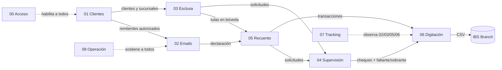

# CashHub por proceso

Documentación del sistema agrupada por **proceso de negocio** (no por app ni
por solución): cada documento cuenta un proceso completo — qué es, sus estados,
quién puede qué, qué apps/flujos/tablas/APIs/plugins lo componen, el catálogo
de acciones (quién/cuándo/por qué/cómo/qué valida el servidor/qué pasa si
falla), sus supuestos y sus pruebas.

Todos los documentos obedecen el mismo contrato de formato:
**[CONTRATO.md](CONTRATO.md)** (las 11 secciones, el formato de acciones y las
reglas de verificación). Escritos contra el código vivo del repo y verificados
por revisión adversarial (autor → antagonista → coordinación).

## Los 9 procesos

| # | Proceso | En una frase |
|---|---------|--------------|
| [00](00-acceso-y-plataforma.md) | **Acceso y plataforma** | El Hub, el catálogo de apps, los grupos AAD y los roles: cómo un usuario llega a su aplicación. |
| [01](01-administracion-datos-clientes.md) | **Administración de datos de clientes** | Altas, modificaciones, activaciones y bajas de clientes/sucursales/correos/cuentas vía RFC con aprobación cuatro-ojos. |
| [02](02-recepcion-ingesta-emails.md) | **Recepción e ingesta de emails** | Del buzón compartido a la declaración digital: motor de 28 reglas, triage de remitentes, cuarentena, respuesta automática y consola de contingencia. |
| [03](03-recepcion-tulas-esclusa.md) | **Recepción de tulas en esclusa** | El registro físico de la entrega: lote, planillas de conducción, tulas, y la custodia esclusa → bóveda. |
| [04](04-supervision-aprobaciones.md) | **Supervisión y aprobaciones** | El control **transversal** a 03 y 05: los 10 tipos de solicitud, el posteo de faltantes/sobrantes y el envío de cheques a digitación. |
| [05](05-recuento-tulas.md) | **Recuento de tulas** | El cajero cuenta el contenido contra lo declarado: sesión de mesa, escaneo, conteo por denominación, cheques, cierre con o sin diferencias. |
| [06](06-digitacion-core-bancario.md) | **Digitación en core bancario** | El último paso: corte a lotes, transacciones manuales con cheques, CSV para IBS Branch y ciclo Generado → Ingresado → Aplicado. |
| [07](07-tracking-depositos.md) | **Tracking sobre depósitos** | Consulta de solo lectura para responder preguntas de clientes: del correo a la tula, del depósito a la transacción acreditada. |
| [08](08-operacion-y-soporte.md) | **Operación y soporte** | Cómo se mantiene vivo el sistema: monitoreo, deploys quirúrgicos, backfills, seeds y las reglas de oro operativas. |

## El flujo entre procesos

## Relación con el resto de la documentación

- **Contratos globales** (modelo de datos, roles, choices, convenciones):
  [`../referencia/`](../referencia/00-indice.md) — los procesos los linkean, no
  los duplican.
- **Manuales por rol** (paso a paso operativo): [`../guias/`](../guias/00-indice.md).
- **Plan de pruebas integral** (certificación pre-producción):
  [`../guias/09-plan-de-pruebas-integral.md`](../guias/09-plan-de-pruebas-integral.md)
  — la §11 de cada proceso linkea sus casos.
- **Detalle por solución** (Core/Flows/Apps/Backend): [`../soluciones/`](../soluciones/00-vision-general.md).
- **Guías de reconstrucción de las apps v2**: `../[app]-rebuild/`.
