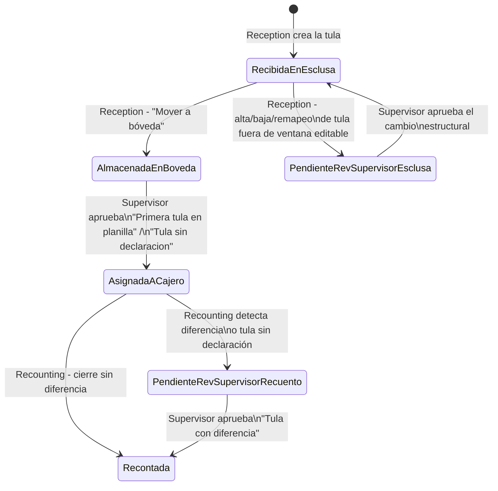

# Catálogo de choices — CashHubCore

Fuente: `solutions/unpacked/core/OptionSets/*.xml` (3 globales) y los option sets
locales declarados dentro de cada `Entity.xml`. Los 3 globales fueron leídos completos
y se transcriben tal cual (valores confirmados, prefijo de valor `159460xxx` derivado
de `CustomizationOptionValuePrefix=15946` en `Other/Solution.xml`).

## 1. Option sets globales

### `sanic_chchcurrency` (CH-Ch-Currency)

| Valor | Label |
|---|---|
| `159460000` | NIO |
| `159460001` | USD |
| `159460002` | EUR |

Usado en: `DeclaredChecks`, `DeclaredDeposits`, `Checks`, `MoneyDenomination`,
`DepositsRecounting`, `Transactions`.

### `sanic_chchrecordstatus` (CH-Ch-RecordStatus)

| Valor | Label |
|---|---|
| `159460000` | Active |
| `159460001` | Inactive |
| `159460002` | PendingApproval |
| `159460003` | PendingDeactivation |

Usado en: `Client`, `ClientBranch`, `ClientEmail`, `ClientDepositHistory` — siempre
bajo el campo `sanic_recordstatus` (y en 2 de 4 casos, también `sanic_clientstatus`
calculado). Es el optionset que `Activaterow`/`Deactivaterow` manipulan: `Activaterow`
setea `159460000` (Active), `Deactivaterow` setea `159460001` (Inactive).

### `sanic_chrecountingdetailsstatus` (ch-recountingDetailsStatus)

| Valor | Label |
|---|---|
| `159460000` | En progreso |
| `159460001` | Cerrado |
| `159460002` | Cerrado con diferencias |

Usado solo en `RecountingSessionDetail.sanic_recountingsessiondetailstatus`. La app
Supervisor lo setea a `Cerrado con diferencias` al aprobar una `"Tula con
diferencia"`.

## 2. Option sets locales relevantes (por máquina de estado)

### `sanic_chtblbags_sanic_bagstatus` — estado de la tula (el más citado del sistema)

| Valor | Label |
|---|---|
| `159460000` | Recibida en esclusa |
| `159460001` | Almacenada en boveda |
| `159460002` | Asignada a cajero |
| `159460003` | Recontada |
| `159460004` | Pendiente rev. supervisor-recuento |
| `159460005` | Pendiente rev. supervisor-esclusa |

**Máquina de estados real** (reconstruida cruzando las 3 apps operativas —
`solutions/unpacked/apps/CanvasApps/src/sanic_chappreception_9ff29`,
`sanic_chapprecounting_54962`, `sanic_chappsupervisor_75678`):

**Nota de verificación (corrige al análisis previo)**: el label vigente en el
`Entity.xml` de este export es `'Recibida en esclusa'` (con "s") — es la app
Recounting la que coincide con el esquema vivo; son las apps Reception, Supervisor,
Deposits Tracker y Email Validation Console las que tienen cacheada la grafía
`'Recibida en exclusa'` (con "x"), desincronizada respecto al esquema actual. El
análisis anterior había reportado la relación inversa. Ver el detalle completo de la
verificación en [typos-conocidos.md](typos-conocidos.md) §6.

### `sanic_chtblreceptionbatch_sanic_receptionstatus` — estado del lote de recepción

| Valor | Label |
|---|---|
| `159460000` | En progreso |
| `159460001` | Recibido |
| `159460002` | Anulado |
| `159460003` | En boveda |

Transición confirmada en la app Reception: `En progreso` → `Recibido` (al terminar de
guardar todas las planillas del lote) → `En boveda` (al mover custodia física).

### `sanic_transactionbatches_sanic_batchstatus` — estado del lote de acreditación IBS Branch

| Label (orden declarado) |
|---|
| Generado |
| Ingresado |
| Aprobado |
| Aplicado |

Confirmado en la app Digitization: el botón "Realizar corte" crea el lote en
`Generado`; "Marcar como Ingresado" visible solo si `BatchStatus=Generado`; "Marcar
como Aplicado" visible solo si `BatchStatus=Ingresado`. El campo es
`RequiredLevel=none` en el esquema pese a ser crítico para el ciclo de vida del lote.

### `sanic_chtbltransactions_sanic_transactiontype` — clasificación de la transacción final

| Label |
|---|
| Deposito |
| Faltante |
| Sobrante |
| Sin declaracion |

Es el **único lugar del modelo donde se registra el resultado del faltante/sobrante**,
y solo como etiqueta categórica — no existe un campo numérico de "monto de la
diferencia" en ninguna tabla (ver [modelo-de-datos.md](modelo-de-datos.md) §7). Los
valores `Sobrante`/`Faltante` se generan exclusivamente cuando el Supervisor aprueba
una solicitud `"Tula con diferencia"` (`Diferencia = recontado - declarado`; `> 0` →
Sobrante, `< 0` → Faltante); `Deposito` se postea siempre, tanto en el cierre sin
diferencia (por Recounting) como junto a cada Sobrante/Faltante (por Supervisor).

### `sanic_chtbltransactions_sanic_transactionstatus` — estado de la transacción

Confirmado: **un único valor posible**, `Aplicada`. No hay estado intermedio ni de
rechazo a nivel de transacción individual.

### `sanic_chtblchecks_sanic_checkstatus` — ciclo del cheque físico

| Label |
|---|
| Recontado |
| Digitado |
| Rebotado |
| Enviado a digitacion |

Transición confirmada: `Recontado` (Recounting) → `Enviado a digitacion` (Supervisor,
pantalla Checks Summary) → `Digitado`/`Rebotado` (fuera del alcance de las apps
analizadas, en Digitization/IBS Branch).

### `sanic_chtblapprovalrequest_sanic_approvalstatus` — resolución de una solicitud de aprobación

| Valor | Label |
|---|---|
| `159460000` | Aprobado |
| `159460001` | Rechazado |

Labels en español (única excepción de idioma junto con `TransactionBatches.sanic_comentarios`
y `sanic_machineserialnumber`). Se fija junto con `ResolutionDatetime` y
`SolvedBy = gvarUser` desde la app Supervisor.

### `cr140_changestatus` — estado del RFC de cambio de datos de cliente (cabecera)

| Valor aprox. | Label |
|---|---|
| rango `796490xxx` | Draft / Submited (sic) / Approved / Rejected / Applied / Failed |
| `159460001` (rango distinto, suelto) | Canceled |

Ver la explicación del prefijo `cr140_` (de otro publisher) en
[convenciones-nomenclatura.md](convenciones-nomenclatura.md). Mapeo de valores usado
por los triggers webhook de los 6 flujos del subsistema RFC, inferido del nombre del
flujo que consume cada filtro OData (no hay un optionset propio exportado para este
campo en los 3 archivos de `OptionSets/`):

| `cr140_changestatus` | Estado | Flujo disparado |
|---|---|---|
| `796490001` | Submitted | `Notifyreviewers` |
| `796490002` | Approved | `Activaterow` / `Deactivaterow` / `Createclientdata` / `Applyclientdatachanges` |
| `796490003`, `796490004`, `796490005` | Rejected / Failed / Applied (orden exacto no confirmable solo con el JSON) | `NotifywhenRFCimplementationfinish` |

### `sanic_chtblclientdatachangerequestline_sanic_changestatus` — estado de la línea del RFC

`Draft` → `Submitted` → `Approved` | `Denied` → `Applied` | `Failed` | `Canceled`.
**Vocabulario distinto al de la cabecera** (usa "Denied" donde la cabecera usa
"Rejected") — inconsistencia de nombrado entre cabecera y línea del mismo proceso.

### `sanic_chtblclientdatachangerequest_sanic_type` / `ClientDataChangeRequestLine` — tipo de RFC

| Valor | Tipo |
|---|---|
| `159460000` | Update |
| `159460001` | Deactivate |
| `159460002` | Create |
| `159460003` | Activate |

## 3. Otros option sets locales de una sola tabla (referencia rápida)

| Tabla.Campo | Valores |
|---|---|
| `Client.sanic_iseditable` | 1=Yes / 0=No |
| `ClientBranch`/`ClientEmail`.doble status | usan el global `sanic_chchrecordstatus` |
| `CountingDesk.sanic_enable` | 1=Yes / 0=No |
| `ClientEmail.sanic_alwaysnotify` | 1=Yes / 0=No |
| `DeclaredBags.sanic_isrelatedtobag` | 1=Yes / 0=No |
| `DeclaredChecks.sanic_checktype` | 159460000=BAC Local / 159460001=Otros Local |
| `Checks.sanic_checktypes` (plural) | BAC Local / Otros Local — optionset LOCAL **distinto** al de `DeclaredChecks`, mismos labels |
| `MoneyDenomination.sanic_enabled` | 1=Yes / 0=No |
| `MoneyDenomination.sanic_type` | 159460000=Billete / 159460001=Moneda |
| `RecountingSession.sanic_confirmed` / `sanic_sessionforciblyclosed` | Yes / No |
| `ReceivedEmails.sanic_emailreplystatus` | Pendiente / Respondido / Omitido |
| `ReceivedEmails.sanic_emailreviewmethod` | Manual / Auto |
| `ReceivedEmails.sanic_emailreviewstatus` | Pendiente / Aceptado / Omitido / Revision manual / Error / Denegado |
| `ReceivedEmails.sanic_validationstatus` | Pendiente / Valido / Invalido |
| `ValidationRuns.sanic_runresult` | Pass (`#08a623`) / Fail (`#db0000`) — con color UI |
| `ValidationResults.sanic_validationresult` | Pass / Fail |
| `ValidationRules.sanic_validationdatatype` | numeric / text / datetime / boolean |
| `ValidationRules.sanic_validationoperation` | equal / less than / less than or equal / greater than / greater than or equal / contains / empty / begins with / ends with |
| `ClientDataChangePermission.sanic_type` | Contributor / Approver (default Contributor) |
| `ClientDataChangesAuditTrail.sanic_opeationtype` | Create / Update / Deactivate / Activate |
| `ClientDataChangesAuditTrail.sanic_result` | 1=Success / 0=Fail |
| `ClientTableLogicalFieldName.sanic_datatype` | Text / Number / Date / Money / Lookup / OptionSet / TwoOptions |
| `AppCatalog.sanic_enabled` | Yes / No |

Ver también: [modelo-de-datos.md](modelo-de-datos.md) para el esquema completo de
cada tabla citada, [typos-conocidos.md](typos-conocidos.md) para el impacto del typo
esclusa/exclusa en `BagStatus`.
