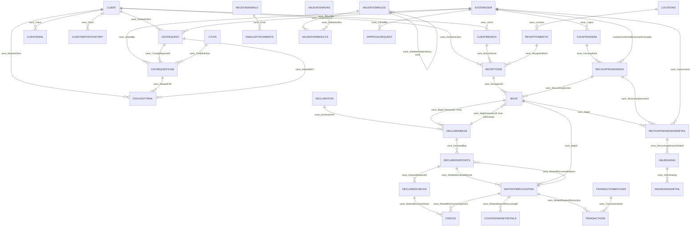

# Modelo de datos — CashHubCore

38 entidades Dataverse (publisher `sanic_`, prefijo de tabla `sanic_CHTbl*` salvo dos
excepciones — ver [`convenciones-nomenclatura.md`](convenciones-nomenclatura.md)).
Fuente: `solutions/unpacked/core/Entities/<NombreEntidad>/Entity.xml`. Relaciones
verificadas contra los lookups declarados en cada `Entity.xml` y contra el diagrama
del análisis original ([`01-core-data-model.md`](../analysis/01-core-data-model.md)).

Contexto físico: un **Cliente** (banco corresponsal) envía tulas con efectivo/cheques
+ minutas vía una **transportadora**, y en paralelo un Excel declarativo por correo.
Un **oficial de bóveda** las recibe en la esclusa, un **supervisor** las asigna a
**cajeros** que las recuentan contra lo declarado; las diferencias (faltante/sobrante)
terminan en una **transacción** que se acredita en **IBS Branch**.

## 1. Maestro / Cliente / Organización física (8 tablas)

Ruta base: `solutions/unpacked/core/Entities/`.

| Tabla | Propósito | Campos clave | Relaciones |
|---|---|---|---|
| `Account` | Estándar de Dataverse, **sin customización** (`unmodified="1"`). Incluida solo por dependencia declarada en `Other/Solution.xml`. | — | — |
| `SystemUser` | Estándar, **sin customización**. Representa cajeros/supervisores/oficiales, pero el rol físico no está modelado en campos propios — vive en Security Roles y en lookups de otras tablas. | — | — |
| `sanic_CHTblClient` | Maestro de Clientes (banco/entidad corresponsal). | `sanic_name` (req.), `sanic_cifbco`/`sanic_cifcom` (claves alternas, ver typo `AlternetKey` en [typos-conocidos.md](typos-conocidos.md)), `sanic_iseditable` (calculado), `sanic_recordstatus` | Origen de `ClientBranch`, `ClientEmail`, `ClientDepositHistory`, `ClientDataChangeRequest`, `ClientDataChangesAuditTrail`, `Receptions` |
| `sanic_CHTblClientBranch` | Sucursal/agencia de un Cliente. | `sanic_name` (req.), `sanic_client` (lookup, req.), `sanic_clientstatus` (calculado), `sanic_recordstatus` | → `Client` |
| `sanic_CHTblTransportCompany` | Catálogo de empresas de valores/transportadoras. | `sanic_name` (único campo de negocio) | Sin relaciones custom |
| `sanic_CHTblLocations` | Catálogo de ubicaciones físicas (bóvedas/sedes). | `sanic_name` (único campo de negocio) | → usada por `ReceptionBatch` |
| `sanic_CHTblCountingDesk` | Mesa de recuento con máquina contadora, asignada a un cajero. | `sanic_name` (req.), `sanic_cajero` (lookup, req.), `sanic_enable`, `sanic_machineserialnumber` (única entidad del grupo con `<Description>` de negocio real) | → `SystemUser` |
| `sanic_CHTblClientEmail` | Correos autorizados de un Cliente para notificaciones. | `emailaddress` (estándar, req.), `sanic_name` (autonum. `CE-{SEQNUM:1}`, no es el email), `sanic_client` (lookup, req.), `sanic_alwaysnotify` | → `Client` |

## 2. Declaración del cliente / Bolsas / Cheques / Denominaciones (7 tablas)

Patrón central: cada concepto tiene una versión **Declarada** (lo que dice el Excel)
y, en algunos casos, una versión **Real** (lo verificado tras el recuento).

| Tabla | Propósito | Campos clave | Relaciones |
|---|---|---|---|
| `sanic_CHTblDeclaration` | Cabecera de la declaración del cliente (el Excel). | `sanic_name` (autonum.), `sanic_sourceentity`/`sanic_sourcerecordid` (texto libre — polimorfismo manual sin integridad referencial) | Origen de `DeclaredBags` |
| `sanic_CHTblDeclaredBags` | Bolsa/tula tal como la declara el cliente. | `sanic_bagid` (lookup a la bolsa real), `sanic_bagnumber`, `sanic_declarationid` (lookup, req.), `sanic_totaldeposits` (rollup), `sanic_totaleur/nio/usd` | ↔ `Bags` (bidireccional, ver §6); → `Declaration`; origen de `DeclaredDeposits` |
| `sanic_CHTblDeclaredDeposits` | Minuta de depósito declarada (efectivo + cheques por cuenta) dentro de una bolsa declarada. | `sanic_accountnumber` (**int**, `IsSecured=1`), `sanic_currency`, `sanic_cashamount`, `sanic_baclocalcheckamount`, `sanic_otherlocalcheckamount` (bien escrito acá — comparar con typo en `DepositsRecounting`), `sanic_declaredbag` (lookup, req.) | ↔ `DepositsRecounting` (bidireccional); → `DeclaredBags`; origen de `DeclaredChecks` |
| `sanic_CHTblDeclaredChecks` | Cheque declarado dentro de un depósito declarado. | `sanic_checkamount` (req.), `sanic_checkcurrency`, `sanic_checknumber` (req., `IsSecured=1`), `sanic_checktype`, `sanic_declareddepositid` (lookup, req.) | → `DeclaredDeposits`; → `Checks` (solo en un sentido, no bidireccional) |
| `sanic_CHTblBags` | La bolsa física/real recibida. Modela el ciclo de vida operativo vía `sanic_bagstatus` (ver máquina de estados en [catalogo-de-choices.md](catalogo-de-choices.md)). | `sanic_bagid` (**texto libre**, no lookup), `sanic_bagdeclarationid` (lookup), `sanic_bagstatus`, `sanic_receptionid` (lookup, req.), `sanic_recountingsession` (lookup) | ↔ `DeclaredBags`; → `Receptions`; → `RecountingSession` |
| `sanic_CHTblChecks` | El cheque físico/real recontado. | `sanic_checkamount`, `sanic_checkcurrency`, `sanic_checknumber` (req., **sin `IsSecured`**, a diferencia de `DeclaredChecks.checknumber`), `sanic_checkstatus`, `sanic_checktypes` (plural, optionset local distinto al de `DeclaredChecks`), `sanic_relateddeclaredcheck` (lookup) | → `DeclaredChecks`; → `DepositsRecounting` |
| `sanic_CHTblMoneyDenomination` | Catálogo de denominaciones (billetes/monedas) por moneda. | `sanic_currency` (req.), `sanic_enabled`, `sanic_type` (Billete/Moneda), `sanic_value` (decimal, max 10000) | Sin lookups — única tabla del grupo sin relaciones |

## 3. Recepción física / Bóveda / Recuento (8 tablas)

| Tabla | Propósito | Campos clave | Relaciones |
|---|---|---|---|
| `sanic_CHTblReceptionBatch` | Lote/viaje de la transportadora (esclusa → bóveda). Único lugar donde se modela ese paso. | `sanic_name` (autonum. `RB-{SEQNUM:5}`), `sanic_transportadora` (texto, req.), `sanic_location` (lookup), `sanic_receptionstatus` | → `Locations`; origen de `Receptions` |
| `sanic_CHTblReceptions` | Planilla individual (una fila = una planilla/minuta) con montos declarados en NIO/USD, cash/cheque. Sin estado propio ni fecha/hora del evento físico. | `sanic_receiptid` (req.), `sanic_branchname` (lookup), `sanic_receptionbatch` (lookup), `sanic_remitentclient` (lookup, req.), `sanic_niocash/niocheck/usdcash/usdcheck` | → `ClientBranch`, `ReceptionBatch`, `Client`; origen de `Bags` |
| `sanic_CHTblRecountingSession` | Sesión de conteo: asignación cajero + mesa. Sin lookup hacia `ReceptionBatch`/`Reception`, sin fechas propias de inicio/fin. | `sanic_cashier` (lookup, req.), `sanic_countingdesk` (lookup, req.), `sanic_confirmed`/`sanic_confirmedby`, `sanic_sessionforciblyclosed`/`sanic_forcedclosureby`, `sanic_reasonforforcedflosure` (typo, ver [typos-conocidos.md](typos-conocidos.md)) | → `SystemUser`, `CountingDesk`; origen de `Bags`, `RecountingSessionDetail` |
| `sanic_CHTblRecountingSessionDetail` | Qué bolsa se cuenta dentro de una sesión, con supervisor y estado propio. | `sanic_bagid` (lookup, req.), `sanic_recountingsessionid` (lookup, req.), `sanic_supervisorid` (lookup), `sanic_recountingsessiondetailstatus` (global `sanic_chrecountingdetailsstatus`) | → `Bags`, `RecountingSession`, `SystemUser`; origen de `XMLReading` |
| `sanic_CHTblDepositsRecounting` | Resultado del conteo real de una bolsa/depósito. Sin campo de diferencia/faltante-sobrante propio — el faltante/sobrante se calcula en la app Recounting/Supervisor y solo se persiste como etiqueta en `Transactions`. | `sanic_bagid` (lookup, req.), `sanic_relateddeclareddeposit` (lookup), `sanic_accountnumber` (**int**, `IsSecured=1`), `sanic_otherlocacheckamount` (typo, falta "l") | ↔ `DeclaredDeposits`; → `Bags`; origen de `Checks`, `CountedMoneyDetails`, `Transactions` |
| `sanic_CHTblCountedMoneyDetails` | Detalle de conteo por denominación dentro de un `DepositsRecounting`. | `sanic_relateddepositrecountingid` (lookup, req.), `sanic_denomination` (decimal), `sanic_denominationtype` (**texto libre**, no picklist), `sanic_quantity`, `sanic_totalamount` (calculado) | → `DepositsRecounting` |
| `sanic_CHTblTransactions` | La transacción final generada del conteo — Depósito/Faltante/Sobrante/Sin declaración. Paso de acreditación en IBS Branch. | `sanic_transactionreference` (max 31, interop con core), `sanic_accountnumber` (**decimal**, `IsSecured=1` — inconsistente con `int` en `DepositsRecounting`), `sanic_transactionbatch` (lookup), `sanic_relateddepositrecounting` (lookup), `sanic_transactionstatus` (**solo 1 valor posible**: Aplicada), `sanic_transactiontype` | → `TransactionBatches`, `DepositsRecounting` |
| `sanic_TransactionBatches` | Lote de transacciones enviado al core, con ciclo de estado completo. | `sanic_batchstatus` (Generado→Ingresado→Aprobado→Aplicado, `RequiredLevel=none` pese a ser crítico), `sanic_comentarios` (único campo en español del grupo) | Origen de `Transactions` |

## 4. Correo entrante / Lectura XML / Validación (8 tablas)

| Tabla | Propósito | Campos clave | Relaciones |
|---|---|---|---|
| `sanic_CHTblReceivedEmails` | El correo crudo recibido del cliente, con estado de revisión/respuesta y veredicto de validación global. | `sanic_attachment` (file, `IsSecured=1`), `sanic_emailreviewstatus`, `sanic_receivedemailinternetmessageid`/`outlookuniqueid` (req.), `sanic_sourceemailaddress` (req., `IsSecured=1`), `sanic_validationstatus` | Origen de `EmailsAttachments` |
| `sanic_CHTblEmailsAttachments` | El adjunto/Excel extraído del correo, normalizado, más su JSON parseado. | `sanic_filename` (req.), `sanic_fileextention` (typo), `sanic_tamanoenbytes` (en español), `sanic_filecontent` (file), `sanic_jsondata` (**file**, no texto), `sanic_email` (lookup, req.) | → `ReceivedEmails` |
| `sanic_CHTblXMLReading` | Cabecera de una lectura/parseo del XML de la máquina contadora, vinculada a la sesión de recuento físico. | `sanic_filename` (req.), `sanic_isactive`, `sanic_recountingsessiondetailid` (lookup, req.) | → `RecountingSessionDetail` (puente digital↔físico); origen de `XMLReadingDetail` |
| `sanic_CHTblXMLReadingDetail` | Línea por línea del parseo (moneda/denominación/cantidad/subtotal). | `sanic_currency` (**texto libre**, no lookup/optionset), `sanic_denomination`, `sanic_quantity`, `sanic_subtotal` (calculado) | → `XMLReading` |
| `sanic_CHTblValidationResults` | Resultado de aplicar una regla de validación dentro de una corrida — unidad atómica de auditoría. | `sanic_durationms`, `sanic_sourcetype` (único valor "Shared Mailbox"), `sanic_validationresult` (Pass/Fail), `sanic_validationrule` (lookup, req.), `sanic_validationrun` (lookup, req.) | → `ValidationRules`, `ValidationRuns` |
| `sanic_CHTblValidationRuns` | La corrida completa de validación contra un registro origen, con ventana de tiempo y veredicto global. | `sanic_runstart` (req.), `sanic_runend`, `sanic_runresult` (Pass verde `#08a623` / Fail rojo `#db0000`), `sanic_sourceentity`/`sanic_sourcerecordid` (polimorfismo manual por texto) | Sin lookup real hacia el origen |
| `sanic_ValidationRules` | Motor de reglas de validación configurable: tipo de dato, operador, valor de referencia, orden, mensaje de error, activo/inactivo, dependencia entre reglas. | `sanic_validationname` (req.), `sanic_isactive` (default Yes), `sanic_validationorder`, `sanic_validationdatatype`, `sanic_validationoperation`, `sanic_validationvalue` (req.), `sanic_validationfailmessage` (req.), `sanic_validationdependency` (self-lookup) | Auto-referencia; origen de `ValidationResults` |
| `sanic_CHTblClientDepositHistory` | Histórico acumulado de depósitos por cliente (detección de anomalías). Sin monto, fecha ni moneda propios. | `sanic_client` (lookup, req.), `sanic_chchrecordstatus` (global) | → `Client` |

## 5. Administración: catálogo de apps, aprobaciones y cambios de datos del cliente (7 tablas)

| Tabla | Propósito | Campos clave | Relaciones |
|---|---|---|---|
| `sanic_CHTblAppCatalog` | Catálogo data-driven de apps del Hub, filtrado por grupo AAD. | `sanic_aadgroupid`, `sanic_appkey` (req., clave única), `sanic_appurl`, `sanic_displayname` (req.), `sanic_enabled`, `sanic_order` (req.) | Sin relaciones custom |
| `sanic_CHTblApprovalRequest` | Solicitud de aprobación genérica (no ligada a un módulo específico — `TargetTable`/`TargetRecordID` texto libre). | `sanic_approvalstatus` (labels en español: Aprobado/Rechazado), `sanic_requestdetails`, `sanic_requestresources` (JSON con el estado previo para poder revertir), `sanic_requesttype` (req.), `sanic_solvedby` (lookup) | → `SystemUser` |
| `sanic_CHTblClientDataChangePermission` | Quién (grupo AAD/Teams) puede participar en el flujo de cambio de datos del cliente, y con qué rol. | `sanic_aadgroupid` (req.), `sanic_teamsgroupid`, `sanic_type` (Contributor/Approver, default Contributor) | Sin relaciones custom |
| `sanic_CHTblClientDataChangeRequest` | Cabecera de la solicitud de cambio de dato del cliente (RFC). `IsQuickCreateEnabled=1` (única del grupo). | **`cr140_changestatus`** (prefijo de otro publisher — ver [convenciones-nomenclatura.md](convenciones-nomenclatura.md)), `sanic_reason` (req.), `sanic_relatedclient` (lookup), `sanic_solvedby` (lookup), `sanic_targetrecordid`/`sanic_targettable` (texto libre), `sanic_type` | → `Client`, `SystemUser`; origen de `ClientDataChangeRequestLine`, `ClientDataChangesAuditTrail` |
| `sanic_CHTblClientDataChangeRequestLine` | Línea de detalle: campo específico a cambiar, valor viejo/nuevo, sub-estado propio de aprobación. | `sanic_changerequestid` (lookup, req.), `sanic_changestatus` (default Draft — vocabulario distinto a la cabecera: usa "Denied" en vez de "Rejected"), `sanic_fielddefinition` (lookup, req.), `sanic_newvalue` (req.), `sanic_oldvalue` | → `ClientDataChangeRequest`, `ClientTableLogicalFieldName`, `SystemUser` |
| `sanic_CHTblClientDataChangesAuditTrail` | Rastro de auditoría de cambios ya aplicados (create/update/activate/deactivate), con resultado success/fail. | `sanic_message`, `sanic_opeationtype` (typo), `sanic_relatedclient`/`sanic_relatedcrl`/`sanic_relatedrfc` (lookups), `sanic_result` (default Fail) | → `Client`, `ClientDataChangeRequestLine`, `ClientDataChangeRequest` |
| `sanic_CHTblClientTableLogicalFieldName` | Diccionario de metadata: nombre lógico de campo + tabla + tipo de dato + si está permitido, para el flujo genérico de cambio de datos. | `sanic_datatype` (Text/Number/Date/Money/Lookup/OptionSet/TwoOptions, req.), `sanic_isallowed` (default Yes), `sanic_logicalname`, `sanic_lookuptargettable` (**texto libre**, no lookup real), `sanic_table` (texto libre) | Describe metadata de otras tablas por texto, no por relaciones nativas |

## 6. Diagrama ER (relaciones custom)

Adaptado de [`01-core-data-model.md`](../analysis/01-core-data-model.md) §6, verificado
contra los lookups de `solutions/unpacked/core/Entities/*/Entity.xml`.

Tablas catálogo sin relación custom (no aparecen en el diagrama): `TransportCompany`,
`MoneyDenomination`, `AppCatalog`, `ClientDataChangePermission`, `Account`.

**Bidireccionalidad inconsistente**: `Bags`↔`DeclaredBags` y
`DeclaredDeposits`↔`DepositsRecounting` tienen lookups cruzados en ambos sentidos;
`Checks`↔`DeclaredChecks` solo en un sentido (`Checks.sanic_RelatedDeclaredCheck →
DeclaredChecks`, sin el inverso).

## 7. Notas transversales de integridad de datos

- **El faltante/sobrante no se persiste como monto**: solo existe como etiqueta
  categórica en `Transactions.sanic_transactiontype` (Deposito/Faltante/Sobrante/Sin
  declaracion). El cálculo de la diferencia vive en la app (Recounting/Supervisor),
  no en una columna de Dataverse.
- **Estado del proceso fragmentado** en al menos 5 option sets desconectados entre sí:
  `ReceptionBatch.sanic_receptionstatus`, `RecountingSessionDetail` (global
  `sanic_chrecountingdetailsstatus`), `Bags.sanic_bagstatus`,
  `Transactions.sanic_transactiontype`/`sanic_transactionstatus`,
  `TransactionBatches.sanic_batchstatus` — no hay un estado maestro de "expediente de
  depósito" de punta a punta.
- **Inconsistencia de tipos entre tablas relacionadas**: `AccountNumber` es `int` en
  `DepositsRecounting` pero `decimal` en `Transactions`; `sanic_bagid` es lookup en
  `DeclaredBags` pero texto libre (`nvarchar`) en `Bags`.
- **Políticas de archivado** (`solutions/unpacked/core/metadataforarchivals/`)
  configuradas solo para `ReceivedEmails`, `ValidationResults`, `ValidationRuns` —
  ninguna tabla transaccional de mayor volumen (`Bags`, `Receptions`, `Transactions`,
  `DepositsRecounting`) tiene retención definida.

Ver también: [roles-y-seguridad.md](roles-y-seguridad.md) para privilegios por tabla,
[catalogo-de-choices.md](catalogo-de-choices.md) para el detalle de cada option set y
sus máquinas de estado, [typos-conocidos.md](typos-conocidos.md) para el detalle de
cada `LogicalName` con error de tipeo.
