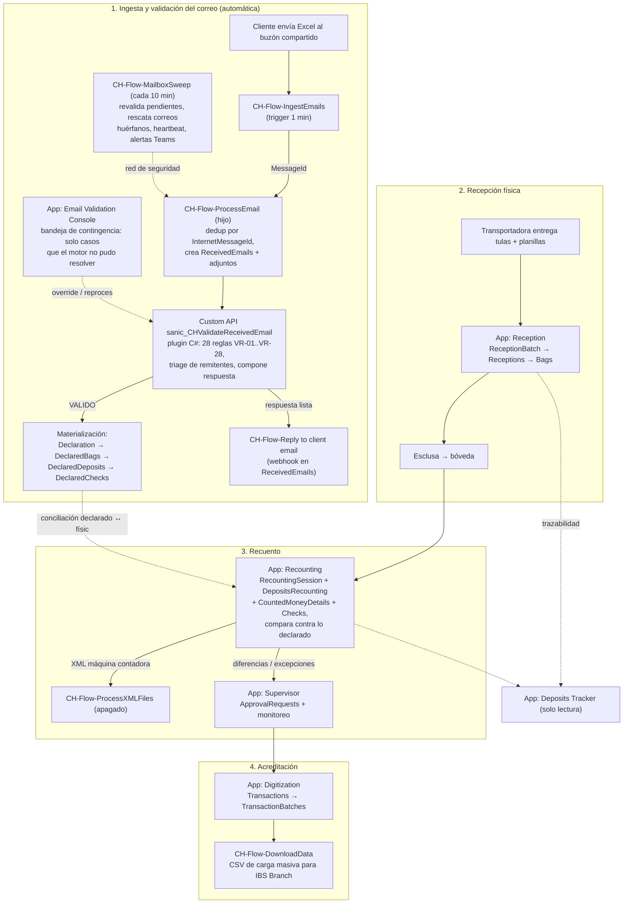

# CashHub — Visión general de las soluciones

> Referencia actual del sistema, escrita leyendo la fuente desempaquetada bajo
> `solutions/unpacked/` y el backend en `src/backend/` (agosto 2026). El detalle
> por solución está en:
> [01-core.md](01-core.md) · [02-flujos.md](02-flujos.md) · [03-apps.md](03-apps.md) · [04-backend.md](04-backend.md)

## Qué es CashHub

Digitalización del procesamiento bancario de depósitos en efectivo enviados en
bolsas de seguridad (tulas) vía transportadora de valores. Reemplaza la minuta
física y la digitación manual por: plantilla Excel enviada por correo →
validación automática (motor de 28 reglas en un plugin C#) → trazabilidad de la
recepción física (esclusa → bóveda → recuento) → carga masiva al core bancario
**IBS Branch**.

## Las piezas y para qué sirve cada una

| Pieza | Versión | Qué contiene | Para qué sirve |
|---|---|---|---|
| **CashHubCore** (`solutions/unpacked/core`) | 1.6.0.0 | 40 tablas `sanic_*`, 11 roles `CH-SR-*`, 3 option sets globales, 21 variables de entorno `sanic_CHEV*`, 4 connection references | El **modelo de datos y la seguridad**. Todo lo demás depende de esta solución; se importa primero. |
| **CashHubFlows** (`solutions/unpacked/flow`) | 1.6.5.0 | 16 flujos Power Automate `CH-Flow-*` (5 apagados), 13 connection references, réplica de los 3 option sets | La **automatización**: pipeline de ingesta de correos, aplicación de RFCs de datos de cliente, utilidades invocables desde las apps, notificaciones Teams y mantenimiento. |
| **CashHubApps** (`solutions/unpacked/apps`) | 1.15.3.0 | 8 canvas apps `CH-App-*` + 2 component libraries. Sin model-driven apps. | La **interfaz por rol**: recepción, recuento, supervisión, digitación, trazabilidad, administración de clientes, consola de correos y el Hub lanzadera. |
| **Backend C#** (`src/backend/`) | — (no es solución; se registra por script) | `CashHub.Plugins` (plugin + Custom API), `CashHub.Validation` (motor de 28 reglas, parser XLSX, triage, plantillas), `CashHub.Validation.Tests` (xUnit, ~91 casos) | El **motor de validación de correos**: una sola DLL firmada detrás del Custom API `sanic_CHValidateReceivedEmail`. |

Publisher común: `Sistemas_Abiertos_Nicaragua`, prefijo `sanic`, option value
prefix `15946` (por eso todos los choices valen `159460000+`).

### Por qué tres soluciones

Segmentación clásica de ALM: el esquema (Core) cambia poco y se importa primero;
la automatización (Flows) y la UI (Apps) iteran rápido y se despliegan aparte.
Las apps declaran las tablas y los flujos como `MissingDependencies` — el orden
de importación es **Core → Flows → Apps**. El plugin no viaja en ninguna
solución: se registra imperativamente con
`scripts/register-validation-plugin.sh` (assembly + plugin type + Custom API).

## El flujo de punta a punta (estado actual)

Módulo paralelo: **administración de datos maestros del cliente** (RFC =
Request For Change). App Client Administration → `ClientDataChangeRequest(Line)`
→ aprobación por grupos AAD (permisos en `ClientDataChangePermission`) →
webhooks Dataverse disparan los flujos aplicadores (`Create client data`,
`Apply client data changes`, `Activate row`, `Deactivate row`) → notificaciones
Teams (`Notify reviewers`, `Notify when RFC implementation finish`) →
`RFCWatchdog` marca Failed los RFC atascados. **Ojo:** hoy 4 de los 7 flujos de
este dominio están apagados (ver [02-flujos.md](02-flujos.md#flujos-apagados)).

## El cambio arquitectónico central (vs. el análisis inicial)

El análisis de `docs/analysis/` (histórico) documentó que la validación vivía en
la canvas app Email Validation Console con 23 reglas Power Fx. **Eso ya no es
así**: la validación completa vive en el plugin C# detrás del Custom API, con
28 reglas paramétricas cargadas desde la tabla `sanic_ValidationRules` (seed en
`data/seed/50-validationrules.json`). La Console quedó reducida a consola de
contingencia: en un día sano su bandeja está vacía.

## Dónde buscar qué

| Pregunta | Documento |
|---|---|
| ¿Qué hace la tabla X, quién la usa? | [01-core.md](01-core.md) |
| ¿Qué dispara el flujo Y y qué toca? | [02-flujos.md](02-flujos.md) |
| ¿Qué pantallas y datasources tiene la app Z? | [03-apps.md](03-apps.md) |
| ¿Cómo funciona el motor de 28 reglas / el plugin? | [04-backend.md](04-backend.md) |
| Manuales de operación por rol | [../guias/](../guias/00-indice.md) |
| Build, deploy, ALM | [../desarrollo/](../desarrollo/00-indice.md) |
